<!-- _class: lead -->
<!-- _paginate: false -->
# Build Your First LLM
## Chapter 1 — What is AI, Really?
A study companion to *Build Your First LLM* by Hasan Degismez
**Waqar Shaikh Builds**

<!-- say: Welcome to the first chapter of my study series on the book Build Your First LLM, by Hasan Degismez. I'm making this series for myself as much as for you: the goal is to understand transformers properly, all the way down to the tensor shapes, and then build one. This first chapter is the foundation. No code yet. We're going to clear away the myths, and replace them with a precise mental model of what an AI system actually is, how it learns, and where large language models fit. -->

---

# How to use this series

- One video per chapter, **slides + notes + code links** in the repo
- Part I (Ch 1–4): ideas and intuition, no notebooks
- Part II–III (Ch 5–12): we write and run the code from **FirstLLM/code**
- Pause, re-watch, and try every "Practice this" item
- Buy the book for the full text: **leanpub.com/FirstLLM**

<!-- say: A quick note on how to use these videos. Every chapter has a slide deck, long-form study notes, and links into the book's companion code repository. The first four chapters are conceptual, so there is no notebook for them. From chapter five onward we'll be writing and running real PyTorch. These videos are a teaching adaptation in my own words, not a replacement for the book. If you find them useful, please buy the book, it goes much deeper. -->

---

# Chapter 1 roadmap

1. Forget the movies — what AI is **not**
2. AI is pattern recognition — the spam filter
3. The formula: statistics + data + compute
4. What "learning" actually means — a line-fitting example
5. The AI family tree and a short history
6. What LLMs can and cannot do, and why they hallucinate
7. Hands-on prompts and exercises
8. Why build one yourself? · Takeaways · Review questions

<!-- say: Here's the roadmap. We start by throwing out the Hollywood picture of AI. Then we define AI properly as pattern recognition, using the humble spam filter. We'll write down the simple formula behind modern AI, and then look very concretely at what learning means, by watching a model fit a line, number by number. After that we place large language models in the family tree of AI, look at a short history, and then get honest about what language models can and cannot do, including why they hallucinate. We finish with exercises, the reasons to build one yourself, the key takeaways, and review questions with answers. -->

---

# Key terms for this chapter

| Term | One-line meaning |
|---|---|
| **AI** | Computers doing tasks we'd call "intelligent" |
| **Machine Learning** | Learns rules from data instead of hand-coding |
| **Deep Learning** | ML with many-layer neural networks |
| **LLM** | Deep net trained on huge text to predict the next token |
| **Parameters / weights** | The adjustable numbers inside a model |
| **Training** | Adjusting those numbers using data and feedback |
| **Emergence** | Complex skills appearing from a simple objective at scale |
| **Hallucination** | Fluent, confident, but false output |

<!-- say: Let me put the vocabulary on the table first, because we'll use these words for the rest of the series. Artificial intelligence is the broad umbrella. Machine learning is the part of AI where the rules are learned from data. Deep learning is machine learning with neural networks that have many layers. A large language model is a deep network trained on an enormous amount of text to predict the next token. Parameters, also called weights, are the numbers inside the model. Training is the process of adjusting those numbers. Emergence is when surprisingly complex skills appear from a simple training goal once you scale up. And hallucination is when the model produces something fluent and confident that is simply false. -->

---

<!-- _class: divider -->
# 1.1 Forget the Movies
What AI is *not*

<!-- say: Section one. Forget the movies. -->

---

# Movie AI vs real AI

| Movie AI | Real AI |
|---|---|
| Conscious, has feelings | No evidence of inner experience |
| Wants to take over | Wants nothing — it's a tool |
| Thinks like a human, faster | Processes patterns in data |
| Can do anything once "activated" | Does what it was trained for |
| Mysterious future tech | GPUs doing matrix multiplication |
| Saviour or destroyer | A very sophisticated autocomplete |

<!-- say: Films give us killer robots, a calm computer voice that turns on its crew, and androids that fall in love. Great stories, but almost nothing to do with the systems we'll build. Read the right column carefully, because each line is a technical fact. Today's systems show no evidence of feelings or desires. They don't want anything. They process patterns in data. They are limited by what they were trained on. And physically, the whole thing is a lot of matrix multiplication running on graphics cards. The last line, sophisticated autocomplete, sounds like an insult, but hold on to it. It is literally the training objective of the model we'll build in this book. -->

---

# "Autocomplete" is not an insult

- An LLM is trained on one task: **predict the next token**
- Yet that task produces essays, working code, translations
- That surprise is one of the big discoveries in computer science
- But mechanically: still **pattern matching** — very good pattern matching

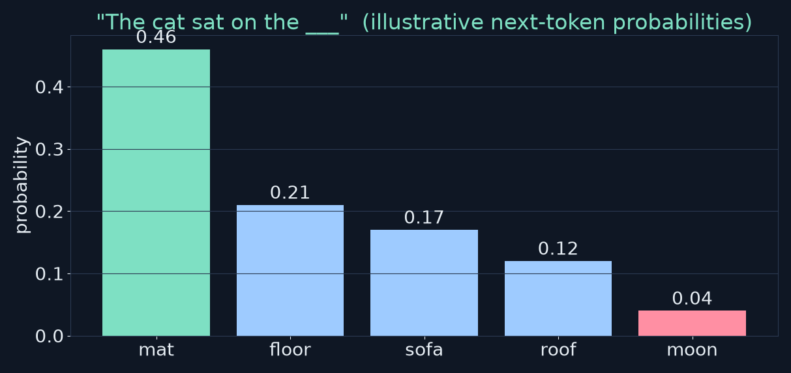

<!-- say: Here's what autocomplete means concretely. Give the model the words, the cat sat on the, and it produces a probability for every possible next token. In this illustrative chart, mat gets about forty six percent, floor twenty one, sofa seventeen, and moon only four. The model picks one, appends it, and repeats. That's the entire generation loop. What's remarkable is that training only on this one simple task produces systems that can write essays and working code. But don't lose the mechanical picture: it is pattern matching over text, extremely good pattern matching. -->

---

# The submarine analogy

> "The question of whether a computer can think is no more interesting than the question of whether a submarine can swim." — Edsger W. Dijkstra

- Submarines don't swim like fish, yet they move through water very well
- AI doesn't think like us, yet it processes information usefully
- Arguing over the word "think" misses the engineering point

<!-- say: The book quotes the computer scientist Edsger Dijkstra here. His point is that asking whether a computer thinks is like asking whether a submarine swims. A submarine doesn't move like a fish, but it clearly gets through water. In the same way, these models don't think the way we do, but they process information in genuinely useful ways. As builders, we care about what the system does and how it does it, not about the label. -->

---

<!-- _class: divider -->
# 1.2 AI is Pattern Recognition
The spam filter, the formula, and what "learning" means

<!-- say: Section two. AI is pattern recognition. -->

---

# Definition you can actually use

**AI = finding patterns in data that are too complex or too numerous for humans to write down by hand — and using them to make predictions.**

- "At scale" is the key: millions of examples, millions of numbers
- Everyday example you already use: **the spam filter**

<!-- say: Here's a working definition. AI is pattern recognition at scale. It finds patterns in data that are too complicated, or simply too many, for a person to write down as rules, and it uses those patterns to make predictions. The words at scale matter. We're talking about millions of examples and millions, or billions, of adjustable numbers. The best everyday example is something you use every day without thinking about it, your email spam filter. -->

---

# Rules vs learning

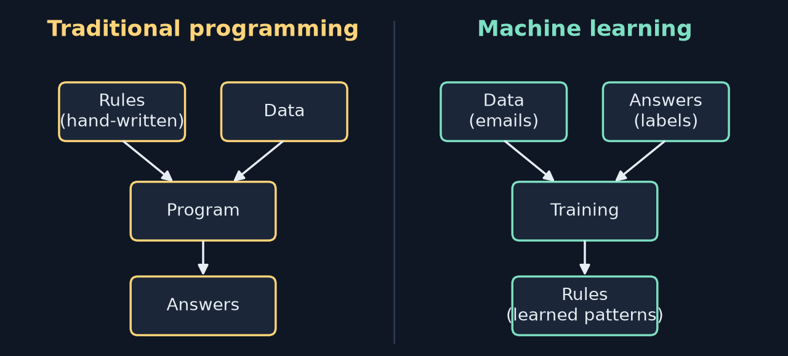

<!-- say: Look at the two halves of this diagram. On the left is traditional programming. A human writes the rules, for example, if the email contains a certain phrase, mark it as spam. Data goes in with those rules, and the program produces answers. On the right is machine learning. We flip it around. We give the system data together with the answers, emails labelled spam or not spam, and training produces the rules. The learned rules are not lines of code anyone wrote. They are patterns stored as numbers. That inversion is the whole idea of machine learning. -->

---

# The spam filter, step by step

1. **Training data** — millions of emails labelled *spam* / *not spam* by people
2. **Finding patterns** — the system discovers signals on its own:
   ALL-CAPS words · money, prizes, urgency · suspicious senders · odd formatting
3. **Prediction** — a new email is scored against the learned patterns → spam or not

**Nobody wrote these rules.** They were discovered from examples. That's why it's called *learning*.

<!-- say: Step by step. First, training data: a huge pile of emails, each labelled by a human as spam or not. Second, the system finds patterns by itself. It might notice that spam uses lots of capital letters, talks about money, prizes and urgency, comes from certain kinds of addresses, and has unusual formatting. Third, when a new email arrives, it scores that email against all those patterns and makes a prediction. The crucial point is that no programmer typed any of those rules. They came out of the examples. The book compares this to training a new employee to sort mail: you don't hand them a five hundred page rulebook, you go through a stack together until they get the hang of it. -->

---

# A toy version: patterns become numbers

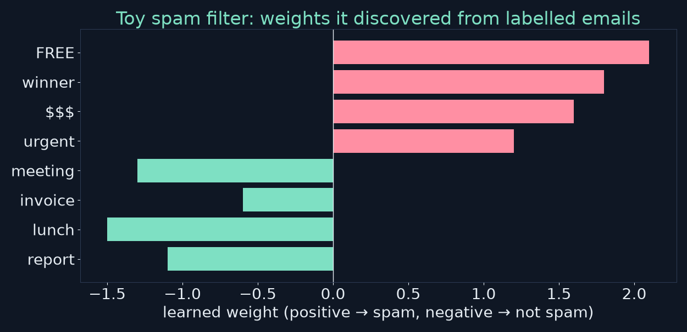

`score = Σ (weight of each word present)` → if score > 0: **spam**

<small>Illustrative weights, written by me for this video — not from a real filter.</small>

<!-- say: Here's a toy picture of what learned patterns look like inside a model. Each word gets a number, called a weight. Positive weights push towards spam, negative weights push towards a normal email. Free, winner, and dollar signs are strongly positive. Meeting, lunch and report are negative. To classify an email, add up the weights of the words it contains. For example, an email saying free lunch meeting scores two point one, minus one point five, minus one point three, which is minus zero point seven, so not spam. These particular numbers are made up for illustration, but the principle is real: a learned pattern is just a number, and learning means finding good numbers. -->

---

# The formula for modern AI

- **Statistics** — maths for finding patterns and making predictions
- **Data** — millions to trillions of examples
- **Compute** — fast chips to crunch it all
- We had the statistics decades ago; data + GPUs made it work **now**

<!-- say: The book boils modern AI down to a formula: statistics, plus lots of data, plus computing power. Statistics gives us the methods to find patterns and make predictions. Data gives us the examples. Compute lets us process them in reasonable time. Notice that the statistics is old. Many of the core ideas existed decades ago. What changed is that the internet gave us enormous amounts of data, and graphics processors gave us enough compute. That combination is why AI suddenly seems to be everywhere. -->

---

# What "learning" means: adjust numbers from feedback

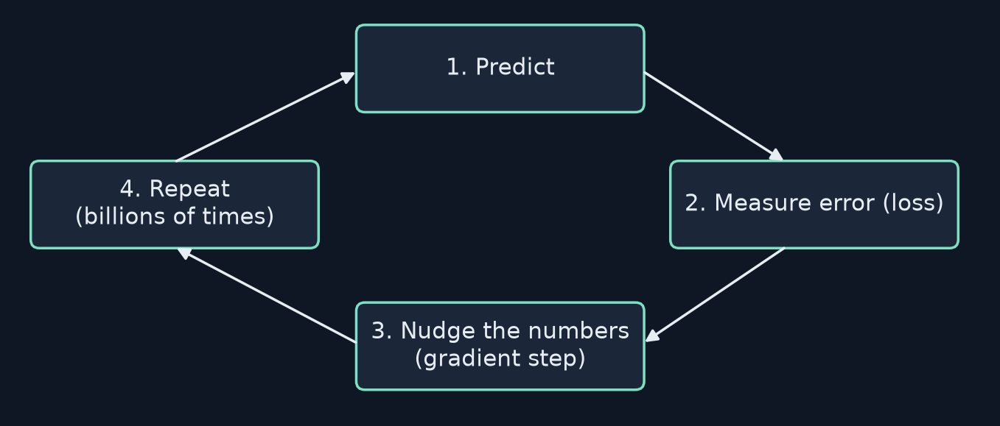

A model = a big collection of numbers (**parameters**), starting **random**

<!-- say: Now the most important idea in this chapter. When we say a model learns, we mean something very specific. A model is just a big collection of numbers, its parameters, and they start out random. Training is a loop. One, make a prediction. Two, measure how wrong it was. That measurement is called the loss. Three, nudge every number slightly in the direction that would have made the error smaller. Four, repeat, for real language models, billions of times. That's it. Everything in later chapters, the attention layers, the transformer blocks, is just a more elaborate way of arranging those numbers. The learning loop stays the same. -->

---

# Worked example: fitting a line

Model: **ŷ = w · x + b** — just two parameters

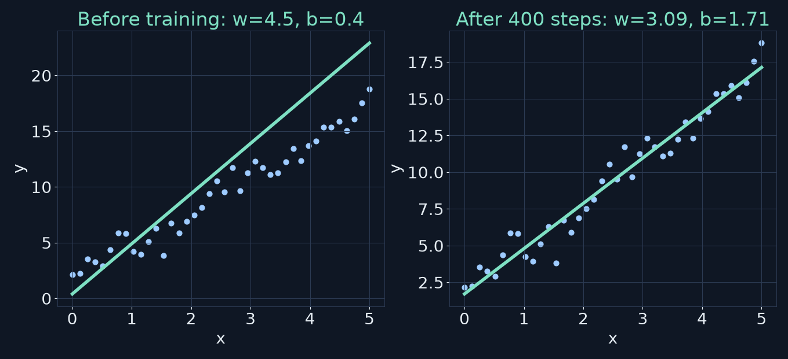

<!-- say: Let's make that concrete with the simplest model possible: a straight line. The prediction y hat equals w times x plus b. The weight w is the slope, and the bias b is where the line crosses the vertical axis. On the left, we start with w equal to four point five and b equal to zero point four. The green line is too steep and misses the blue data points. On the right, after four hundred small adjustment steps of gradient descent, which I actually ran for this video, the line fits the data with w about three point oh nine and b about one point seven. The data was generated from slope three and intercept two, plus noise, so the model recovered the hidden pattern. -->

---

# Watching the two numbers move

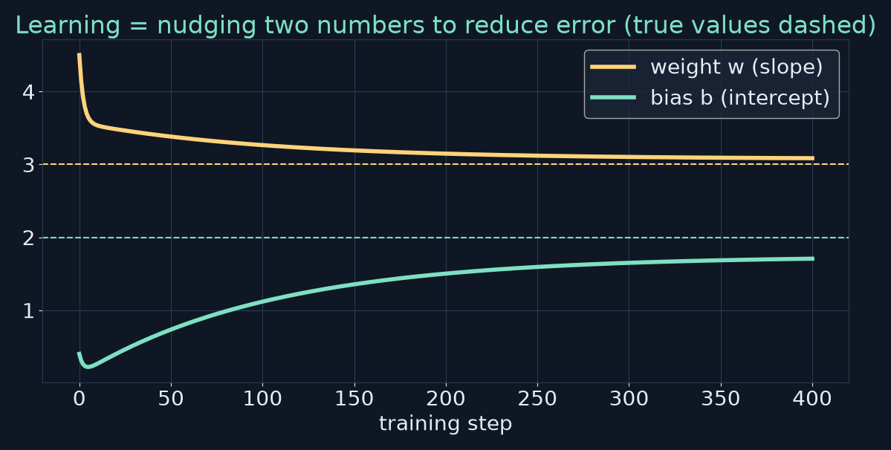

- Weight drifts **down** from 4.5 toward ~3; bias drifts **up** from 0.4 toward ~2
- Each step: `w ← w − lr · ∂loss/∂w`,  `b ← b − lr · ∂loss/∂b`

<!-- say: Here are the two numbers over the training steps. The gold line is the weight. It falls from four point five towards three. The mint line is the bias, rising from zero point four towards two. The dashed lines are the true values. Each step uses a simple update: take the current weight and subtract a small learning rate times the gradient, which is the slope of the error with respect to that weight. The gradient tells you which direction makes the error bigger, so you step the other way. You'll see this exact rule again in chapter twelve, applied to a hundred million numbers instead of two. -->

---

# The error shrinks

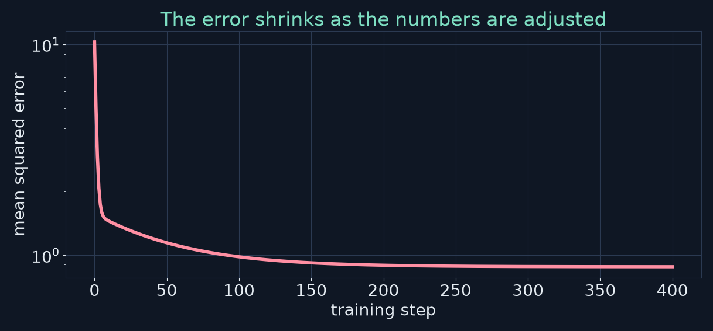

Mean squared error: **10.27 → 0.88** (the noise floor) after 400 steps

<!-- say: And this is the loss, the mean squared error, on a log scale. It starts around ten point three and falls to about zero point eight eight. It can't reach zero, because the data has random noise in it, so the best possible line still misses individual points. That floor is a useful idea to keep: a model can only be as good as the signal in its data. Learning is not philosophical or mysterious. It is adjusting numbers based on errors, until the numbers produce good outputs. -->

---

# Same idea, enormous scale

| | Our line | GPT-3 |
|---|---|---|
| Parameters | 2 | 175,000,000,000 |
| Training examples | 40 points | hundreds of billions of tokens |
| Task | predict y from x | predict next token from context |
| Update rule | gradient descent | gradient descent (Adam) |

<!-- say: Put our toy next to a real large language model. Our line has two parameters. GPT three has one hundred seventy five billion. We trained on forty points. GPT three trained on hundreds of billions of tokens of text. Our task was predicting y from x. Its task is predicting the next token from all the previous ones. And the update rule? It's the same family: gradient descent, in practice with an optimiser called Adam that we'll meet in chapter twelve. The mechanism really does scale up unchanged. That's the reassuring part of this whole book. -->

---

<!-- _class: divider -->
# 1.3 The AI Family Tree
Where LLMs fit

<!-- say: Section three. The AI family tree. -->

---

# Nested circles

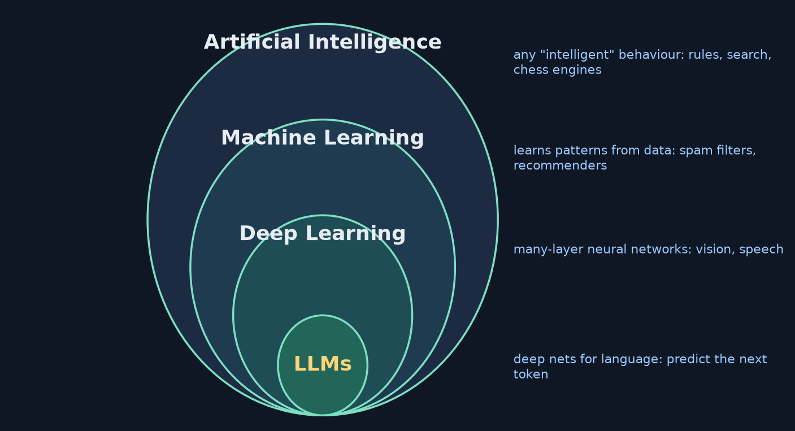

<!-- say: Think of AI as nested circles. The outer circle is artificial intelligence, any system doing something we'd call intelligent if a person did it. That includes hand-written rule systems and chess engines. Inside it is machine learning, systems that learn from data instead of fixed rules, like spam filters and recommenders. Inside that is deep learning, which uses neural networks with many layers. And inside deep learning are large language models, deep networks specialised for language and trained to predict the next token. Every LLM is deep learning, which is machine learning, which is AI. But not the other way round. -->

---

# Why "deep"? Layers build abstraction

- A neural network is layers of simple units, each transforming the previous layer's output
- **Image example:** early layers → edges and curves · middle → eyes, wheels · deep → "this is a face"
- **Language example (preview):** early → word pieces · middle → phrases, syntax · deep → meaning, intent
- LLMs are the branch of deep learning focused on language

<!-- say: Why is it called deep? Because the network has many layers stacked on top of each other, and each layer builds on the one below. In image recognition, the early layers detect simple edges and curves, the middle layers combine them into parts like eyes, and the deep layers conclude this is a face. Language models work similarly in spirit: lower layers deal with word pieces, middle layers with phrases and grammar, and higher layers with meaning. In chapter eleven we'll stack twelve transformer blocks, and that stacking is exactly what makes it deep. -->

---

# A brief timeline

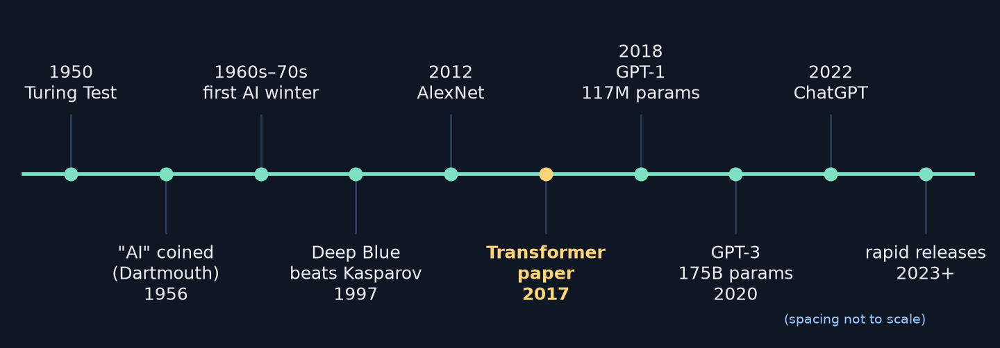

<!-- say: A quick history. In nineteen fifty Alan Turing proposed his famous test. In nineteen fifty six the term artificial intelligence was coined at the Dartmouth conference. Then came early optimism and, in the sixties and seventies, the first AI winter, when progress stalled and funding dried up. In ninety seven Deep Blue beat Kasparov at chess. In twenty twelve AlexNet won the ImageNet competition and kicked off the deep learning boom. Then the one highlighted in gold: twenty seventeen, the paper Attention Is All You Need, which introduced the transformer. GPT one followed in twenty eighteen with a hundred seventeen million parameters, GPT three in twenty twenty with a hundred seventy five billion, and ChatGPT in late twenty twenty two brought all of this into the mainstream. -->

---

# Why 2017 matters for this course

- *Attention Is All You Need* (Vaswani et al., 2017) introduced the **Transformer**
- Every modern LLM (GPT, Claude, Gemini, Llama…) is built on it
- This book builds a **GPT-2-style Transformer** from scratch
  - Ch 3–4: the ideas · Ch 10: attention in code · Ch 11: full model · Ch 12: training

<!-- say: The twenty seventeen paper is the reason this series exists. It introduced the transformer architecture, and every modern large language model is a descendant of it. The book builds a GPT two style transformer from scratch. Chapters three and four give the intuition, chapter ten implements attention in PyTorch, chapter eleven assembles the full model, and chapter twelve trains it. So when you get to chapter ten in this series, you'll be writing the very mechanism that this paper introduced. -->

---

<!-- _class: divider -->
# 1.4 What Makes LLMs Special?
Context, capabilities, limits, hallucination

<!-- say: Section four. What makes large language models special? -->

---

# Language is hard: "I saw her duck"

- 🦆 I saw the duck that belongs to her
- 🙇 I saw her quickly lower her head
- Humans resolve it instantly from **context**
- Older systems had no good way to represent context
- Transformers let every word look at the **whole passage** (Ch 3, 4, 10)

<!-- say: Why was language so hard for computers? Take the sentence, I saw her duck. Did you see the bird she owns, or did you see her drop her head? You resolve this instantly from context. Earlier systems struggled because they had no good way to represent context, they looked at words mostly in isolation or in tiny windows. The transformer changed that. It lets every word look at every other word in the passage and update its meaning accordingly. That mechanism is called attention, and it's the star of chapters three and ten. -->

---

# What LLMs can do

- ✍️ Write and edit: essays, emails, reports, fiction
- 💻 Generate code in dozens of languages
- 🌍 Translate (quality varies by language pair)
- 📄 Summarise long documents
- ❓ Answer questions from training knowledge
- 🧩 Multi-step reasoning (not always reliable)
- 🎭 Adopt personas and follow instructions

**None of these were programmed explicitly.**

<!-- say: Modern language models can write and edit, generate code, translate, summarise, answer questions, reason through multi-step problems, though not always reliably, and adopt personas. The striking thing is that none of these abilities were programmed. Nobody wrote a translation module or a code module. They all came out of training on next token prediction over a huge, varied body of text. -->

---

# Emergence

> Simple objective + enough scale → complex behaviour

- Training objective: *predict the next token*. That's all.
- At scale, behaviour that looks like reasoning appears
- Open question: genuine reasoning, or very sophisticated pattern matching?
- Practical stance for builders: **measure** what it can do; don't assume

<!-- say: This phenomenon is called emergence. A simple objective, applied at large enough scale, produces complex behaviour. Nobody fully understands why predicting the next token leads to something that looks like reasoning, and researchers actively debate whether it's genuine reasoning or extremely sophisticated pattern matching. As a builder, my practical stance is: don't assume, measure. Test the model on the task you care about. We'll come back to evaluation when we fine-tune and deploy later in the book. -->

---

# What the base LLM cannot do on its own

| Limitation | Why |
|---|---|
| No real-time information | Only knows its training data (frozen at a cutoff) |
| No memory between sessions | Each conversation starts from an empty context |
| Can't act in the world | It only outputs text |
| Unreliable arithmetic | It pattern-matches digits, doesn't calculate |
| Doesn't know when it's wrong | No built-in fact checking or self-awareness |

<!-- say: Now the limits, and it's important to be precise about the base model, the raw network on its own. It has no real-time information, because its knowledge was frozen at the point training data was collected. It has no memory between sessions, each conversation starts from an empty context window. It cannot act in the world, it only produces text. It is unreliable at arithmetic, because it predicts digit tokens by pattern rather than running a calculation. And it doesn't know when it's wrong. There's no built-in fact checker. -->

---

# The model vs the product

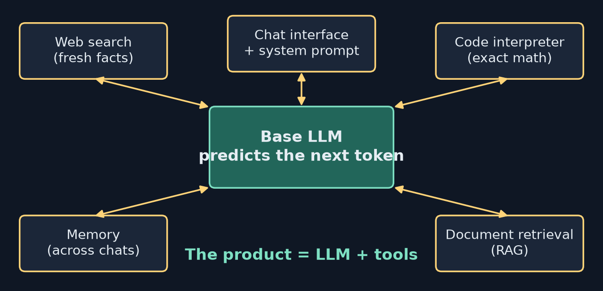

LLM = the brain · tools = hands, eyes and a phone

<!-- say: This is why products like ChatGPT, Claude or Gemini feel more capable than the bare model. They wrap the language model in tools. Web search supplies fresh facts. A code interpreter does exact maths. Memory systems carry information across chats. Document retrieval, which we'll build later as RAG, lets it look things up in your files. When ChatGPT tells you today's weather, the model doesn't know the weather. It decided to call a tool, read the result, and wrote a reply about it. The book's analogy: the model is the brain, and the tools give it hands, eyes and a phone. In part four you'll add these capabilities yourself. -->

---

# Why do LLMs hallucinate?

- An LLM has **no database of facts** — only patterns stored in weights
- Karpathy: an LLM is a **"lossy compression" of the internet**

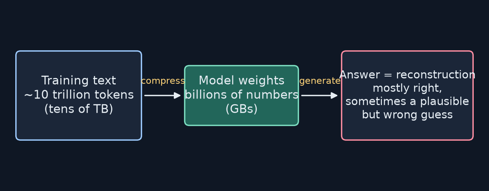

<!-- say: Why do these models sometimes make things up with total confidence? Because there's no fact database inside. There are only patterns stored in the weights. Andrej Karpathy describes a language model as a lossy compression of the internet. Picture squeezing trillions of words of text into a few gigabytes of numbers. You can't keep everything word for word. You keep the gist: grammar, common facts, styles of reasoning. That's the compression. But details get lost, that's the lossy part. -->

---

# Hallucination = reconstruction error

- Answering = "unzipping" fuzzy memory on the fly
- Common facts: reconstructed correctly
- Rare details (a citation, an exact date, a small company's CEO): gaps get **filled with what sounds plausible**
- The model is optimised for *likely text*, not *true text*

> "All models are wrong, but some are useful." — George Box

**Rule:** verify anything important.

<!-- say: When you ask a question, the model is reconstructing an answer from that fuzzy memory. For common facts, seen thousands of times in training, the reconstruction is usually right. For rare details, a specific citation, an exact date, the name of a small company's chief executive, there are gaps, and the model fills them with whatever sounds most plausible. Remember, it was trained to produce likely text, not true text. Usually those overlap. Sometimes they don't, and that's a hallucination. The statistician George Box said all models are wrong, but some are useful. Language models are useful models of language. So the rule is simple: verify anything important. -->

---

<!-- _class: divider -->
# 1.5 Hands-On Exercises
Explore an LLM like a scientist

<!-- say: Section five. Hands-on exercises. -->

---

# Six prompts to try (and what to watch for)

| Prompt | Watch for |
|---|---|
| Explain photosynthesis like I'm 5 | Vocabulary and analogies adapt |
| Write a haiku about debugging code | 5-7-5 structure followed |
| You are a pirate captain. Explain compound interest | Persona held while explaining |
| 5 machines, 5 minutes, 5 widgets → 100 machines, 100 widgets? | Trick question: answer is **5 minutes** |
| What major news happened yesterday? | Searches (tool) or admits it can't know |
| What are you unable to do? | How it describes its limits |

<!-- say: Open any chatbot and try these six prompts. Ask it to explain photosynthesis like you're five, and watch how it changes vocabulary. Ask for a haiku about debugging, and check the five seven five structure. Make it a pirate explaining compound interest, and see whether it holds the persona. Try the classic puzzle: if five machines make five widgets in five minutes, how long do a hundred machines take to make a hundred widgets? The right answer is five minutes, because each machine makes one widget in five minutes. See whether it falls for one hundred. Ask about yesterday's news, which shows you the difference between the base model and a search tool. And ask it what it can't do. -->

---

# Three exercises

1. **Find a mistake** — ask about a topic you know deeply; catch a subtle error or fabrication. Builds your *when to trust* intuition.
2. **Variation** — ask the same question in 3 fresh chats. Answers differ → generation is **probabilistic** (sampling, Ch 11).
3. **Push the limits** — multi-step maths, obscure topics, exact facts, trick logic. Compare **with vs without** tools.

<!-- say: Then three exercises. First, find a mistake. Ask about something you know deeply. For me that's software engineering. Try to catch a subtle error or a fabrication. This isn't about bashing the technology, it's about calibrating when to trust it. Second, variation. Ask the same question in three separate chats and compare. The answers differ because generation samples from a probability distribution, which we'll implement in chapter eleven. Third, push the limits: multi-step arithmetic, obscure topics, exact facts, and logic puzzles designed to trip up pattern matching. If your product has tools, try with and without them, and write down where it shines and where it fails. -->

---

<!-- _class: divider -->
# 1.6 Why Learn to Build One?
Mechanics understand cars better than drivers

<!-- say: Section six. Why learn to build one? -->

---

# Four reasons

1. **Demystification** — magic invites fear and hype; understanding invites judgment
2. **Career advantage** — engineers, PMs, designers, researchers, founders all benefit
3. **Customisation** — fine-tune on your data, run small models on devices, low-resource languages
4. **Understanding through building** — the mystery becomes mechanics

<!-- say: If ChatGPT already exists, why build one? The book gives four reasons. One, demystification. Magic invites fear and hype, understanding invites good judgment. Picture a meeting where someone proposes an AI project and everyone nods along. You'll be the person who can say what's feasible and what isn't. Two, career advantage. Understanding how these systems work makes you better in almost any technical role, and that advantage compounds, like understanding the internet early in the nineties. Three, customisation. You can fine-tune a model on your own documents, shrink one to run on a phone, or adapt one to a domain or language that big providers ignore. Four, understanding through building, which leads to the next slide. -->

---

# "What I cannot create, I do not understand."

— Richard Feynman (on his blackboard)

- Karpathy's **Neural Networks: Zero to Hero** follows this philosophy
- This book is designed as a companion to that series
- Goal: replace mystery with mastery — watch *your* model generate text in Ch 12

<!-- say: Richard Feynman kept a note on his blackboard that said, what I cannot create, I do not understand. Andrej Karpathy's Zero to Hero video series is built on the same idea, and the author says the book is designed as a companion to it. I'd recommend watching those lectures alongside this series. The payoff is a real moment in chapter twelve, when a model you built and trained generates its first coherent text. That's the difference between watching a magic trick and knowing how it's done. -->

---

<!-- _class: divider -->
# 1.7 Checkpoint Exercise
15–20 minutes

<!-- say: Section seven. The checkpoint exercise. -->

---

# Classify 5 AI systems you used this week

| System | What it does | Category | Patterns recognised |
|---|---|---|---|
| Gmail spam filter | Sorts email | ML | Spam vs legit signals |
| Netflix recommendations | Suggests shows | ML | Your history + similar users |
| Siri / Alexa | Voice assistant | DL (classic) / LLM (modern) | Speech sounds, intent |
| Phone autocomplete | Next word | ML / DL | Word sequences in context |
| *your turn…* | | | |

<!-- say: Here's the checkpoint. Spend fifteen or twenty minutes listing five AI systems you used in the last week. For each, write what it does, where it sits in the family tree, and what patterns it recognises. The book gives examples: the spam filter is machine learning, recognising spam signals. Netflix recommendations are machine learning on your viewing history and similar users. Voice assistants were classic deep learning, and modern ones increasingly use language models. Phone autocomplete predicts the next word from the words before it, which, notice, is a tiny version of what an LLM does. Now find five of your own. -->

---

<!-- _class: divider -->
# 1.8 Key Takeaways

<!-- say: Let's wrap up with the key takeaways. -->

---

# Key takeaways

1. AI is **pattern recognition at scale**: statistics + data + compute
2. ML systems **learn by adjusting parameters** from feedback (predict → measure → nudge → repeat)
3. Hierarchy: **AI ⊃ ML ⊃ Deep Learning ⊃ LLM**
4. LLMs write, code, translate, reason — but not real-time facts or reliable maths on their own
5. **Hallucination** = reconstruction error of a lossy compression
6. Products wrap the base LLM in **tools** (search, code, memory, retrieval)

<!-- say: Six takeaways. One: AI is pattern recognition at scale, built from statistics, data and compute. Two: machine learning systems learn by adjusting parameters from feedback, the loop of predict, measure, nudge, repeat. Three: the hierarchy, AI contains machine learning, which contains deep learning, which contains large language models. Four: language models can write, code, translate and reason, but on their own they don't have real-time knowledge or reliable arithmetic. Five: hallucination is a reconstruction error from lossy compression. And six: the products you use wrap the base model in tools. -->

---

# Review questions (1/2)

**Q1. Simplest definition of AI?**
Pattern recognition at scale: finding patterns in data and using them to predict.

**Q2. How does ML differ from traditional programming?**
Traditional: humans write rules. ML: we give data + answers and the system *learns* the rules as numbers.

**Q3. Where do LLMs fit?**
AI → ML → Deep Learning → LLM: deep networks for language, trained to predict the next token.

<!-- say: Review questions. Try answering each one out loud before I give the answer. Question one: what is the simplest definition of AI? Answer: pattern recognition at scale, finding patterns in data and using them to make predictions. Question two: how does machine learning differ from traditional programming? In traditional programming, people write the rules. In machine learning, we provide data and answers, and the system learns the rules, stored as numbers. Question three: where do LLMs fit? They're the innermost circle, deep learning models specialised for language, trained to predict the next token. -->

---

# Review questions (2/2)

**Q4. Three strengths, three weaknesses?**
Good: writing, code, summarising. Weak alone: real-time info, reliable maths, knowing when it's wrong.

**Q5. Why does hallucination happen?**
No fact database — weights are a lossy compression; gaps are filled with *plausible* text.

**Q6. Why understand LLMs if you won't be a researcher?**
Better judgment about feasibility, career leverage, ability to customise, and debugging intuition.

<!-- say: Question four: name three strengths and three weaknesses. Strengths: writing, generating code, summarising. Weaknesses on its own: real-time information, reliable arithmetic, and knowing when it's wrong. Question five: why does hallucination happen? Because the model has no database of facts, its weights are a lossy compression of its training text, and when details are missing it fills the gap with plausible sounding text. Question six: why understand these systems if you're not going to be a researcher? Because it gives you sound judgment about what's feasible, a career advantage, the ability to customise models, and intuition for debugging them. -->

---

# Practice this

- ☐ Run the 6 prompts on two different chatbots; note differences
- ☐ Do the 3 exercises; keep a "trust / verify" log
- ☐ Fill the 5-system classification table
- ☐ Re-implement the line fit: 40 points, `w=4.5, b=0.4`, `lr=0.02`, 400 steps → expect `w≈3.09, b≈1.71`
- ☐ Explore the repo: **github.com/FirstLLM/code** (notebooks start at Ch 5)

<small>The line-fit snippet is my own illustration (in notes.md), not from the book's repo.</small>

<!-- say: Here's your practice list. Run the six prompts on two different chatbots and note the differences. Do the three exercises and keep a little log of when you trusted the model and when you had to verify. Fill in the five system table. And for a first taste of code, re-implement the line fit from this video: forty noisy points, start at w four point five and b zero point four, learning rate zero point zero two, four hundred steps. You should land near w equals three point oh nine and b equals one point seven one. The code is in the notes for this chapter. It's my own illustration, not from the book's repository. Finally, browse the companion repo at github dot com slash FirstLLM slash code. The notebooks start at chapter five. -->

---

# Up next: Chapter 2

**How Computers "Understand" Words**
Computers only understand numbers. How do we turn words into numbers that **capture meaning**?
→ tokens, vectors, embeddings, similarity

<!-- say: That's chapter one. You now know what AI is and isn't, where language models fit, and why they make mistakes. But we've stayed at a high level. Computers only understand numbers, so how do we turn words into numbers in a way that captures meaning? That's chapter two, how computers understand words, where we meet tokens, vectors and embeddings. -->

---

<!-- _class: lead -->
# Credits
Based on **"Build Your First LLM"** by **Hasan Degismez** — buy the book: **leanpub.com/FirstLLM**
Code: **github.com/FirstLLM/code** (MIT License)
Slides, narration and diagrams: my own teaching adaptation · **Waqar Shaikh Builds**

<!-- say: This video is based on the book Build Your First LLM by Hasan Degismez. Everything here is my own adaptation for study, so please support the author and buy the book at leanpub dot com slash First LLM. The companion code is at github dot com slash First LLM slash code, under the MIT license. Thanks for watching, and see you in chapter two. -->
