<!-- _class: lead -->
<!-- _paginate: false -->
# Build Your First LLM
## Chapter 2 — How Computers “Understand” Words
A study companion to *Build Your First LLM* by Hasan Degismez
**Waqar Shaikh Builds**

<!-- say: Welcome back to my study series on Build Your First LLM by Hasan Degismez. In chapter one we learned that a language model predicts the next word. But a computer only understands numbers. So in this chapter we answer a deceptively simple question: how do you turn a word into numbers in a way that actually captures what the word means? The answer is embeddings, and it is one of the most elegant ideas in all of AI. I've also run real experiments with real word vectors for this video, so you'll see the ideas working, and occasionally failing, on actual data. -->

---

# Where we are

- **Ch 1:** an LLM is a pile of numbers that predicts the next token
- **Ch 2 (today):** how *words* become *numbers with meaning*
- **Ch 3:** attention — letting words look at each other
- **Ch 4:** the full Transformer, end to end
- Part I is conceptual — no book notebook yet (notebooks start at Ch 5)

<!-- say: A quick orientation. Chapter one gave us the big picture: a model is a big pile of numbers trained to predict the next token. Today we zoom in on the very first step of that machine, turning words into numbers. Chapter three adds attention, and chapter four puts the whole transformer together. These four chapters are conceptual, so the book has no notebook for them. The small code snippets you'll see today are my own illustrations, clearly labelled, run with the open source GloVe word vectors. -->

---

# Chapter 2 roadmap

1. The computer's dilemma: ASCII and word IDs
2. Words as locations: word space and distance
3. Embeddings and why we need hundreds of dimensions
4. The famous equation: king − man + woman ≈ queen
5. How embeddings are learned: context and self-supervision
6. Static vs contextual embeddings
7. From words to sentences — why averaging fails
8. Exercises, checkpoint, takeaways, review questions

<!-- say: Here's the plan. We start with two naive ways of turning words into numbers, and see exactly why they fail. Then we introduce the key idea: give each word a position in a space, so distance means difference in meaning. We'll see why that space needs hundreds of dimensions, and then look at the famous king minus man plus woman equals queen result, with real numbers. After that, we'll see where embeddings come from: context, learned without any human labels. We'll separate static from contextual embeddings, see why simply averaging word vectors loses meaning, and finish with exercises, the checkpoint, takeaways and review questions. -->

---

# Key terms for this chapter

| Term | One-line meaning |
|---|---|
| **Vector** | A list of numbers = a position in space |
| **Dimension** | One axis of that space |
| **Embedding** | A word's vector, arranged so position reflects meaning |
| **Word space** | The space embeddings live in |
| **Distributional hypothesis** | Similar contexts ⇒ similar meanings |
| **Cosine similarity** | Angle-based similarity, from −1 to 1 |
| **Word2Vec** | 2013 method for learning embeddings from text |
| **Self-supervised learning** | The labels come from the data itself |

<!-- say: Let's set up the vocabulary. A vector is just a list of numbers, which you can think of as a position in space. A dimension is one axis of that space. An embedding is a word's vector, arranged so that its position reflects its meaning. The space where all those vectors live is the word space. The distributional hypothesis says that words used in similar contexts have similar meanings. Cosine similarity measures how similar two vectors are by their angle, from minus one to one. Word2Vec is the 2013 system that made learned embeddings famous. And self-supervised learning means the training signal comes from the data itself, not from human labels. -->

---

<!-- _class: divider -->
# Part 1
## The computer's dilemma

<!-- say: Part one. The computer's dilemma. -->

---

# Teaching someone who only speaks numbers

- A computer can't read "cat", "democracy" or "beautiful"
- It stores and processes **numbers** — ultimately bits
- So we need a **mapping**: word → numbers
- The question isn't *whether* we can map words to numbers…
- …it's whether the numbers **mean anything**

<!-- say: Imagine explaining the idea of a cat to a friend who only understands numbers. That is exactly the position we're in with a computer. It can't read the word cat. It can only store and manipulate numbers. So we need some mapping from words to numbers. Making a mapping is easy. The hard part is making one where the numbers themselves carry meaning, so that the model can compute with meaning. Let's try the obvious approaches first. -->

---

# Attempt 1: ASCII codes

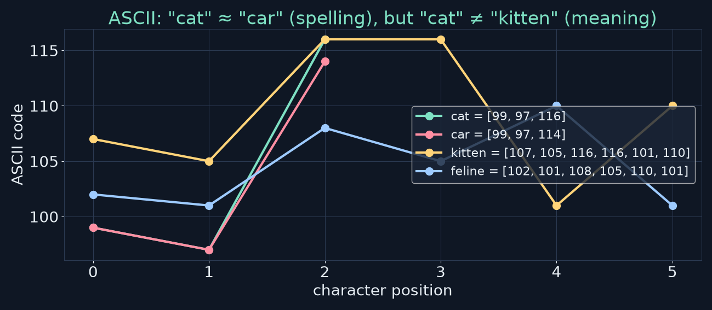

- `cat = [99, 97, 116]` · `car = [99, 97, 114]` — differ by 2 in one place
- `kitten`, `feline` — completely different numbers, same animal

<!-- say: The first instinct is to use the codes computers already use for text. In ASCII, c is ninety nine, a is ninety seven and t is one hundred and sixteen, so cat is ninety nine, ninety seven, one sixteen. Car is ninety nine, ninety seven, one fourteen. Those are almost identical, but a cat and a car have nothing in common. Meanwhile kitten and feline, which mean essentially the same creature, get completely different numbers, even different lengths. In the chart you can see cat and car almost on top of each other, while kitten and feline wander off. -->

---

# Why ASCII fails

- ASCII encodes **spelling**, not **meaning**
- Spelling is (mostly) **arbitrary** — nothing about c-a-t is cat-like
- Similar spellings ≠ similar meanings (cat / car / cart / cut)
- Different spellings can share meaning (cat / feline / kitty)

> **The numbers must reflect what words *mean*, not how they're written.**

<!-- say: The core problem is that ASCII captures spelling, and spelling is mostly an accident of history. There's nothing cat-like about the letters c, a, t. Words that look alike, like cat, car, cart and cut, have unrelated meanings, and words that mean the same thing can look nothing alike. So whatever numbers we pick, they have to reflect meaning, not spelling. -->

---

# Attempt 2: one ID per word

| word | ID |
|---|---|
| cat | 1 |
| dog | 2 |
| fish | 3 |
| feline | 4 |
| kitten | 5 |
| automobile | 6 |

<!-- say: Second attempt. Forget letters, and give every word its own ID number. Cat is one, dog is two, fish is three, feline four, kitten five, automobile six. Now cat and car are definitely different. Problem solved? -->

---

# Why word IDs fail

- IDs are **labels**, not measurements — the gaps mean nothing
- |cat − kitten| = 4, |cat − automobile| = 5 → "almost equally unrelated"
- Arithmetic is nonsense: **cat + dog = 3 = fish** 🐟
- The ordering is whatever order we happened to add words

> We need: similar words → similar numbers · unrelated → different · **relationships preserved**

<!-- say: Not really. IDs are just labels. The gap between two IDs means nothing. Cat is one and kitten is five, while automobile is six, so by these numbers a kitten is almost as unrelated to a cat as a car is. And arithmetic is nonsense: cat plus dog equals three, which is fish. So we can write down our wish list. Similar words should get similar numbers. Unrelated words should get different numbers. And relationships between words should be preserved. It turns out we can have all three, but only if we stop using a single number per word. -->

---

<!-- _class: divider -->
# Part 2
## Words as locations

<!-- say: Part two. Words as locations. -->

---

# The key insight: a position, not a number

- On a **map**, every place has coordinates (x, y)
- Two nearby cafés have **similar coordinates**
- A café and a park across town have **very different** coordinates
- Idea: give every **word** coordinates, so **nearby = similar meaning**

<!-- say: Here's the key insight. Instead of giving each word one number, give it a position. Think of a city map. Every place has coordinates. Two cafés next to each other have similar coordinates, and a café and a park on opposite sides of town have very different ones. What if words had coordinates too, arranged so that nearby words have similar meanings? -->

---

# A toy word space (my redraw)

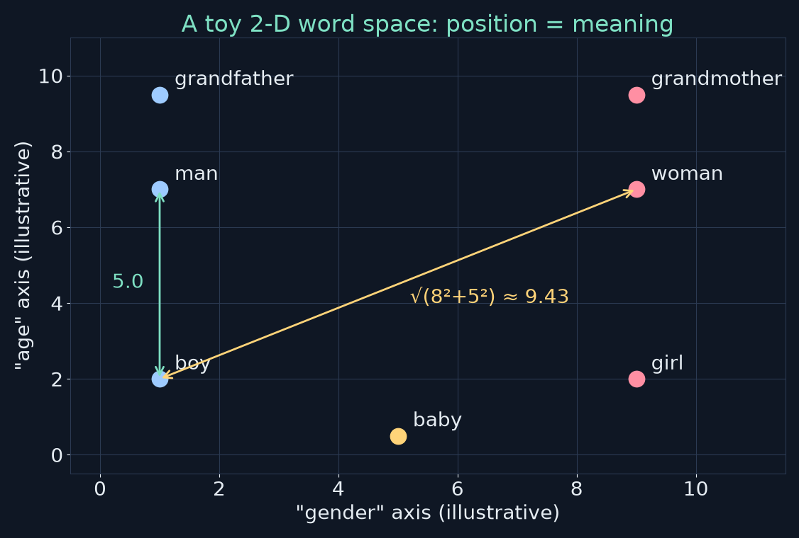

<!-- say: Here's a toy two dimensional word space that I've drawn. The horizontal axis is a made up gender axis, masculine on the left and feminine on the right. The vertical axis is age, young at the bottom and old at the top. Boy sits at one comma two, man at one comma seven, woman at nine comma seven. Boy and girl share a height because they're the same age, and differ left to right. Man and woman show the same pattern. Notice the distances: boy to man is exactly five, boy to woman is the square root of eight squared plus five squared, about nine point four three. So boy is closer to man than to woman, which matches our intuition. -->

---

# Vectors and distance

- A **vector** is a list of numbers: `boy = [1.0, 2.0]`, `man = [1.0, 7.0]`, `woman = [9.0, 7.0]`
- Euclidean distance: $d(a,b)=\sqrt{\sum_i (a_i-b_i)^2}$
- d(boy, man) = √(0² + 5²) = **5.0**
- d(boy, woman) = √(8² + 5²) = √89 ≈ **9.43**
- ⚠️ These axes are **illustrative**. Real dimensions are learned and rarely nameable.

<!-- say: In this picture each word is a vector, a list of two numbers. The straight line distance between two vectors is the square root of the sum of squared differences in each coordinate. Boy to man differs only in age, by five, so the distance is five. Boy to woman differs by eight in gender and five in age, giving the square root of eighty nine, about nine point four three. One important warning that the book also makes: these neat named axes are just for teaching. In real embeddings the dimensions are learned automatically, and they almost never line up with tidy human concepts like gender or age. -->

---

# Cosine similarity: compare directions

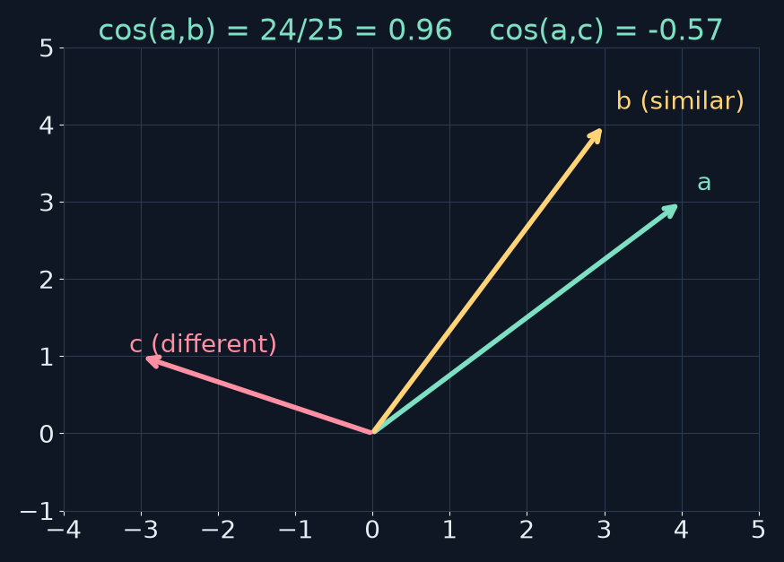

$\cos(a,b)=\dfrac{a\cdot b}{\lVert a\rVert\,\lVert b\rVert}$ · 1 = same direction · 0 = unrelated · −1 = opposite

<!-- say: In high dimensional embeddings the standard measure is not distance but cosine similarity, which looks at the angle between two vectors. You take the dot product, multiply matching coordinates and add them up, and divide by both lengths. In my example, a is four comma three and b is three comma four. Their dot product is twelve plus twelve, twenty four, and each has length five, so the cosine is twenty four over twenty five, zero point nine six. Very similar directions. Vector c points elsewhere, and its cosine with a is about minus zero point five seven. Cosine runs from one, same direction, through zero, unrelated, to minus one, opposite. Because it ignores length, it compares what a vector points at, not how long it is. -->

---

# Two dimensions aren't enough

- king ≈ queen → **royalty**
- king ≈ man → **gender**
- king ≈ president → **leadership**
- One word, many *kinds* of similarity → need **more axes**

<!-- say: Two dimensions quickly run out of room. A king is similar to a queen because both are royalty. A king is similar to a man because both are male. And a king is similar to a president because both are leaders. Each of those is a different kind of similarity, and to represent all of them at once we need more axes. -->

---

# Add a third axis: royalty (my redraw)

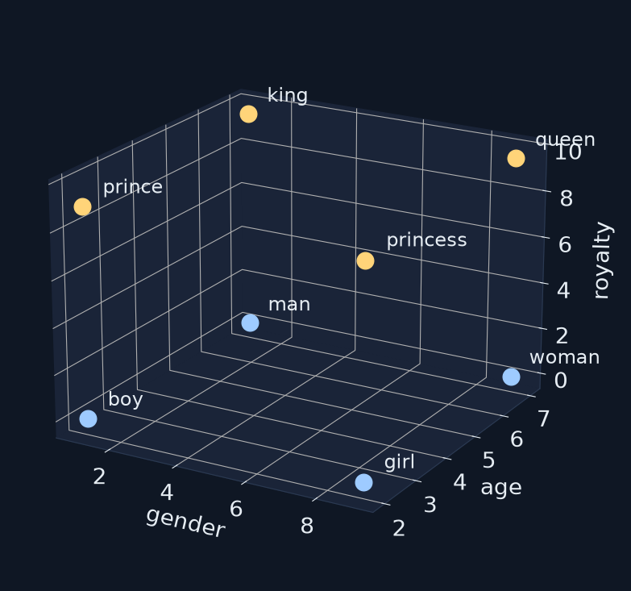

<!-- say: Here's the same idea in three dimensions, again with illustrative axes: gender, age, and now royalty. The commoners, boy, girl, man and woman, sit on the floor of the cube in blue. The royals, prince, princess, king and queen, float above them in gold. Prince is now closer to king than to boy, and princess is closer to queen than to girl. And that's with just three dimensions. We can't draw seven hundred and sixty eight, but the maths works exactly the same way. -->

---

<!-- _class: divider -->
# Part 3
## The magic of embeddings

<!-- say: Part three. The magic of embeddings. -->

---

# What an embedding is

- An **embedding** = a word's vector in a space of hundreds or thousands of dimensions
- Illustrative (book-style) numbers:
```text
"king"   = [ 0.82, 0.31, 0.91, -0.24, ...]   768 numbers
"queen"  = [ 0.79, 0.33, 0.88, -0.19, ...]   similar!
"banana" = [-0.51, 0.89, 0.11,  0.63, ...]   very different
```
- Real numbers from GloVe-100 below →

<!-- say: This list of numbers that places a word in a high dimensional space is called an embedding. The book shows a stylised example: king and queen have similar numbers in each position, and banana has very different ones. Those numbers are illustrative. On the next slides I'll show you the real thing, using GloVe, a set of one hundred dimensional word vectors trained on Wikipedia and newswire text that anyone can download. -->

---

# Real vectors: GloVe-100 (my experiment)

```python
import gensim.downloader as api            # my own snippet
m = api.load("glove-wiki-gigaword-100")    # 400k words x 100 dims
print(m["king"][:6])                        # first 6 of 100 numbers
print(m.similarity("cat", "dog"))           # cosine similarity
print(m.most_similar(positive=["king", "woman"], negative=["man"], topn=3))
```

- Not from the book's repo — Part I has no notebook

<!-- say: Here's the tiny program I used. It loads the GloVe vectors through the gensim library, about four hundred thousand words, each with one hundred numbers. Then it prints part of a vector, computes a cosine similarity, and asks for the nearest words to king minus man plus woman. This is my own snippet, not from the book's repository. -->

---

# Cosine similarity on real vectors

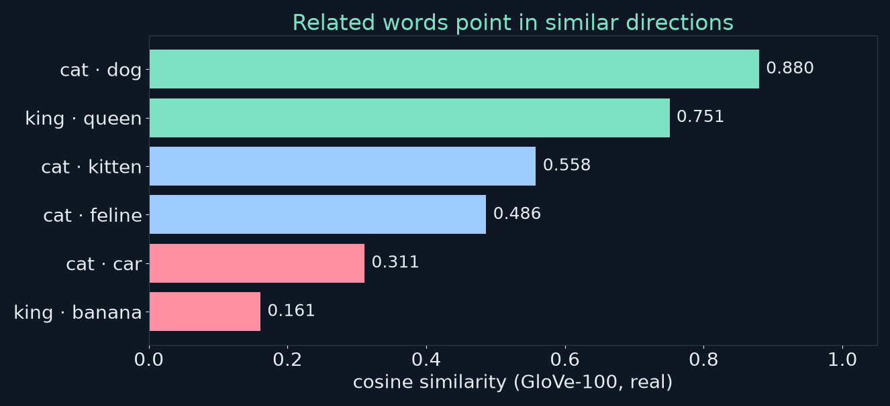

<!-- say: And here are the real cosine similarities. Cat and dog: zero point eight eight. King and queen: zero point seven five. Cat and kitten: zero point five six, and cat and feline: zero point four nine, lower than you might expect, because feline appears in more formal, scientific contexts than cat. Cat and car, despite the near identical spelling: only zero point three one. And king and banana: zero point one six. The ordering is broadly what we wanted. Notice that these vectors capture how words are used, which is not always the same as dictionary meaning. -->

---

# Why more dimensions help

| dims | describing a person | describing words |
|---|---|---|
| 1 | tall vs short | — |
| 2 | + heavy vs thin | animals vs objects |
| ~100 | subtle differences | mammals vs reptiles, pets vs wild |
| 768+ | — | nuance: *stroll* vs *march* |

- GPT-2 small & BERT-base: **768** · large models: **12,288+**
- No single dimension has a clean meaning — meaning is **distributed**

<!-- say: Why so many dimensions? Think about describing a person. With just height you can tell tall from short. Add weight and you can tell tall and thin from tall and heavy. Add age, hair and eye colour, and descriptions get much more specific. Words are the same. Two dimensions give crude groupings, around a hundred can separate mammals from reptiles and pets from wild animals, and seven hundred and sixty eight can capture the difference between a leisurely stroll and a deliberate march. Seven sixty eight is common because GPT-2 small and BERT base used it, and very large models go to twelve thousand two hundred and eighty eight or more. Importantly, no single dimension means something nameable. Meaning is spread across all of them. -->

---

# Why is it called an "embedding"?

- Maths: an embedding maps objects into another space **preserving structure**
- We take **discrete symbols** (cat, car — no relation) …
- … and embed them into a **continuous space** where position = meaning
- Once embedded we can **measure distance, find neighbours, do arithmetic**

<!-- say: Why the name embedding? In mathematics, an embedding maps objects from one space into another while keeping important structure. Here we take discrete symbols, where cat and car have no inherent relationship, and place them into a continuous space where position encodes meaning. Once they're in that space, we can do all the things computers are good at: measure distances, find neighbours, and do arithmetic. That's what makes language processing mathematical. -->

---

# Did you know? Across languages

- In **multilingual** models, "dog" and German "Hund" end up near each other
- Why: they appear in similar **contexts** (barking, chasing cats, four legs)
- My check: in **English-only** GloVe, cos(dog, hund) = **−0.006**
- Lesson: alignment comes from **multilingual training data**, not from embeddings themselves

<!-- say: Here's a nice fact from the book. In models trained on many languages, the English word dog and the German word Hund end up as neighbours, because they appear in similar contexts. Nobody tells the model they're translations. I tested this with GloVe, which is trained on English only, and the cosine between dog and hund is basically zero, minus zero point zero zero six. That's not a contradiction of the book. It's a useful lesson: the cross language alignment comes from multilingual training data. An embedding only knows what its training text showed it. -->

---

<!-- _class: divider -->
# Part 4
## The famous equation

<!-- say: Part four. The famous equation. -->

---

# king − man + woman = ?

```text
nearest_word( E("king") − E("man") + E("woman") )  →  "queen"
```

- The result is a **point**, not exactly any word
- We look up the **nearest** vocabulary word (excluding the inputs)
- Discovered with Word2Vec at Google in **2013**

<!-- say: In 2013, researchers at Google found that you could do arithmetic with word vectors. Take the vector for king, subtract the vector for man, and add the vector for woman. The result is a point in space that doesn't exactly match any word. But when you look for the nearest word in the vocabulary, leaving out the three input words, you get queen. -->

---

# Real GloVe result (my experiment)

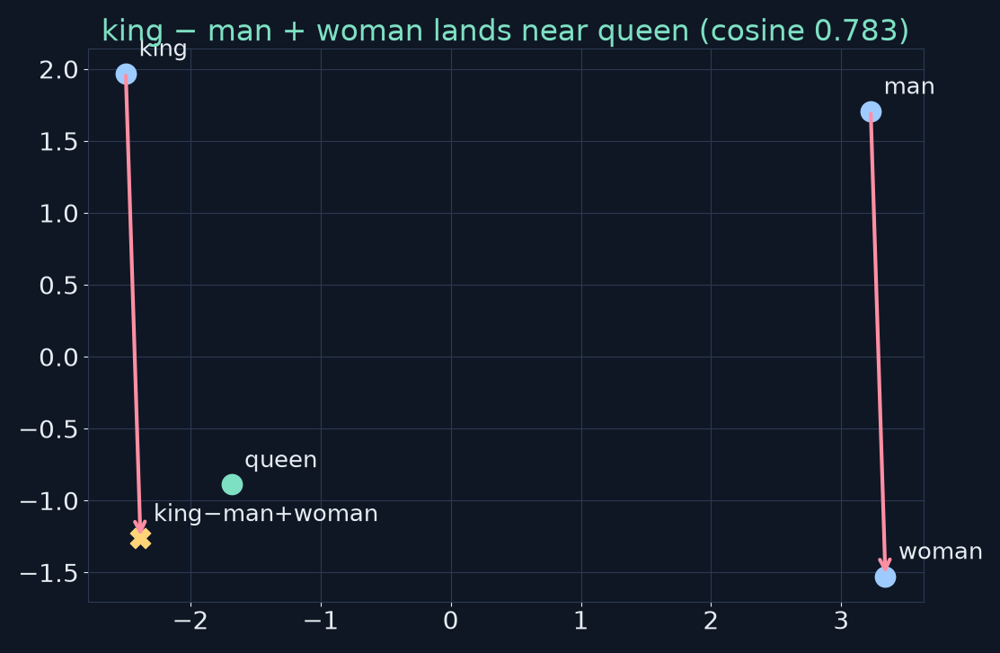

<!-- say: Here's what that looks like with real GloVe vectors, projected down to two dimensions so we can see it. The arrow from man to woman, and the arrow from king to the computed point, are the same vector. The computed point, the gold cross, lands right next to queen. Its cosine similarity with queen is about zero point seven eight. The top three results from gensim are queen at zero point seven seven, then monarch and throne. Remember that a two dimensional projection is a squashed view of a hundred dimensions, so distances in this picture are only approximate. -->

---

# Parallel relationships (my redraw)

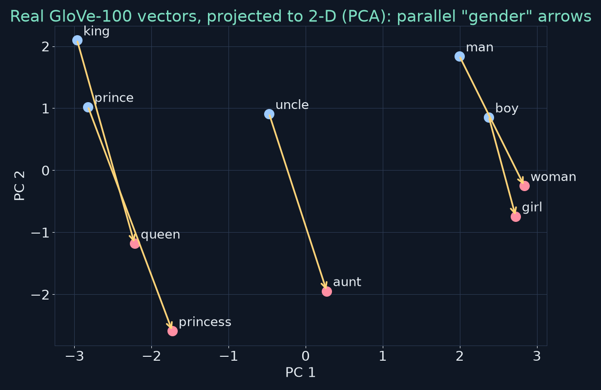

<!-- say: This chart shows why the trick works. I took ten real GloVe vectors and projected them to two dimensions. The gold arrows go from man to woman, king to queen, boy to girl, uncle to aunt, and prince to princess. They're roughly parallel and of similar length. The embedding has learned something like a consistent gender direction, without anybody defining gender. -->

---

# What this reveals

- Embeddings don't just cluster similar words…
- …they make **relationships consistent**: same offset, same relation
- **gender** direction: man→woman ≈ king→queen ≈ uncle→aunt
- **capital-of** direction: France→Paris ≈ Italy→Rome
- Nobody programmed these — they **emerged** from text

<!-- say: So embeddings do more than put similar words near each other. They organise words so relationships are consistent: the same offset means the same relation. There's a gender direction, man to woman, king to queen, uncle to aunt. There's a capital of direction, from France to Paris and Italy to Rome. Nobody programmed any of this. It emerged purely from patterns in text. -->

---

# The book's examples, tested on GloVe-100

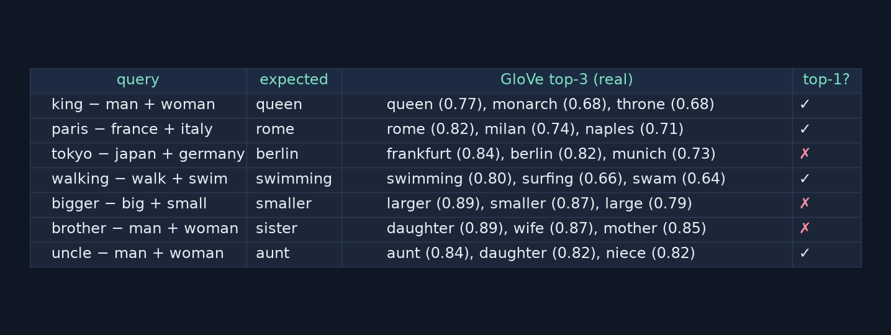

<!-- say: The book lists several analogy examples, and it's honest that these only work around forty to seventy percent of the time. So I ran them. Paris minus France plus Italy gives Rome. Walking minus walk plus swim gives swimming. Uncle minus man plus woman gives aunt. But three missed at the top spot. Tokyo minus Japan plus Germany gives Frankfurt first, with Berlin a close second. Bigger minus big plus small gives larger, just ahead of smaller. And brother minus man plus woman gives daughter, then wife and mother. Sister isn't in the top three. Four out of seven, which fits the book's forty to seventy percent nicely. -->

---

# Why analogies miss

- The answer word is often **near the input** (bigger → *larger*)
- Frequent words in similar **contexts** compete (Frankfurt is a huge German news word)
- Different corpora/models → different results
- **Bias**: training text's stereotypes show up in the directions
- Arithmetic is **approximate** — but that it works at all shows real structure

<!-- say: Why do they miss? Often the right offset lands near the starting word's own neighbourhood, so bigger plus a little nudge lands on larger. Words that are frequent in similar contexts compete: in newswire text, Frankfurt shows up constantly as Germany's financial centre. Different training data produces different answers. And training data carries biases, which show up as directions in the space too, which is a real concern. The arithmetic is approximate. But the fact that it works at all shows embeddings capture genuine structure. They are a map of meaning, a fuzzy one. -->

---

# Connection: lossy compression (Ch 1)

- Embeddings are the **first layer** of compression
- Infinite variety of language → **fixed-size vectors**
- Later layers keep compressing (attention, feed-forward)
- Upside: generalise to unseen combinations
- Downside: **plausible but wrong** fills → hallucination

<!-- say: This connects to chapter one's lossy compression idea. Embeddings are the first stage of compressing the endless variety of language into fixed size vectors, and the rest of the model keeps compressing. That's why a model can reason about combinations it's never seen exactly, and it's also why it sometimes fills gaps with plausible but wrong details. -->

---

<!-- _class: divider -->
# Part 5
## How embeddings are learned

<!-- say: Part five. How are embeddings learned? -->

---

# "You shall know a word by the company it keeps"

— J. R. Firth, linguist (as quoted in the book)

- "The ___ sat on the mat." · "The ___ chased the mouse." → *cat, dog, kitten, puppy*
- "I deposited money at the ___." · "The ___ approved my loan." → *bank*
- **Distributional hypothesis:** similar contexts ⇒ similar meanings

<!-- say: Where do these numbers come from? The answer is beautifully simple: context. The linguist J. R. Firth said you shall know a word by the company it keeps. Fill in the blank: the blank sat on the mat, the blank chased the mouse. Cat, dog, kitten or puppy all fit. These words share contexts, so they must be related. Now: I deposited money at the blank, the blank approved my loan. That's bank, the financial kind. Different contexts, different cluster. This is the distributional hypothesis. -->

---

# Learning from prediction (Word2Vec idea)

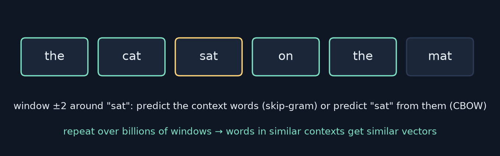

1. Take **billions** of words of text
2. Make a **prediction task** from it: predict a word from its neighbours (or vice versa)
3. Nudge vectors so words in **similar contexts** move **closer**

<!-- say: Here's how Word2Vec style systems learn. Take a huge amount of text. Slide a small window across it. For each position, either predict the middle word from the words around it, which is called continuous bag of words, or predict the surrounding words from the middle one, which is called skip gram. Every time the prediction is wrong, nudge the vectors a little so the prediction improves. After billions of these tiny updates, words that keep showing up in similar contexts end up with similar vectors. -->

---

# What the system ends up learning

- cat & dog share contexts → **similar** vectors (cos 0.88 in GloVe)
- king appears with royalty, rulers, male words → its vector **encodes all of it**
- "bank" appears near *river* **and** *money* → a **compromise** vector
- My GloVe check — nearest to **bank**: banks, banking, credit, investment, financial…

<!-- say: What comes out? Cat and dog share so many contexts that GloVe puts them at a cosine of zero point eight eight. King appears near royalty, rulers and male words, so its vector encodes all of that at once. And bank appears both near river and near money, so it gets a single compromise vector. In GloVe, which is trained largely on news text, bank's nearest neighbours are banks, banking, credit, investment and financial. The money sense completely dominates, and the river sense is buried. -->

---

# The beauty of self-supervision

- **No human labels**: nobody told it cat ≈ kitten
- The "label" is just **the next/missing word** — already in the text
- So we can train on **billions** of words (hand labelling is impossible)
- Same principle trains LLMs: predict the next token

<!-- say: What's remarkable is that none of this needed human labels. Nobody marked cat and kitten as related. The thing to predict is simply a word that's already in the text. That's self-supervised learning, and it's why we can train on billions of words. Labelling that much by hand would be impossible. And it's exactly the same principle that trains large language models: predict the next token. -->

---

# Static vs contextual embeddings

| | **Static** (Word2Vec, GloVe) | **Contextual** (Transformers) |
|---|---|---|
| vectors per word | one, fixed | one **per occurrence** |
| "river bank" vs "bank account" | same vector | **different** vectors |
| how | lookup table | lookup + **attention** layers |
| role today | stepping stone, intuition | how LLMs work |

<!-- say: Now an important distinction. Word2Vec and GloVe give static embeddings: one fixed vector per word, whatever the context. So bank gets the same vector in river bank and in bank account. Modern language models produce contextual embeddings. They start from a lookup table too, but then the attention layers modify each vector based on the surrounding words, so bank in river bank ends up somewhere very different from bank in bank account. Static embeddings are the stepping stone. Contextual ones are what LLMs actually use, and attention, our next chapter, is how they get there. -->

---

# Static embeddings and "apple"

- GloVe nearest to **apple**: microsoft, ibm, intel, software, dell, pc, macintosh, iphone
- The **company** sense dominates in news text; the fruit is missing from the top 8
- One vector per word → the **dominant** usage wins
- A contextual model can tell "apple pie" from "Apple shares"

<!-- say: Here's a striking example from my GloVe run. The nearest neighbours of apple are Microsoft, IBM, Intel, software, Dell, PC, Macintosh and iPhone. Not a single fruit in the top eight. In news text, the company is mentioned far more than the fruit, and a single static vector can only lean one way. A contextual model would treat apple pie and Apple shares completely differently. -->

---

<!-- _class: divider -->
# Part 6
## From words to sentences

<!-- say: Part six. From words to sentences. -->

---

# The naive approach: average the vectors

```text
"The cat sat"  →  ( E(the) + E(cat) + E(sat) ) / 3
```

- One fixed-size vector for any sentence
- Surprisingly decent for **finding similar documents**
- But it has a fatal flaw →

<!-- say: We can now represent single words. But language comes in sentences and documents. The simplest idea is to average the vectors of all the words in a sentence. That gives one fixed size vector for any sentence, and for some tasks, like finding similar documents, it works surprisingly well. But there's a fatal flaw. -->

---

# Order matters!

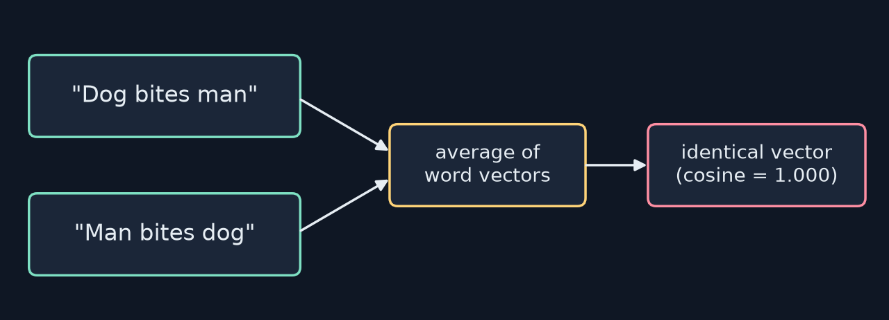

- Same words, same average → **identical** vector (checked: exactly equal)
- "The movie was not good" vs "The movie was good, not bad" — similar bags, **opposite** sentiment

<!-- say: Dog bites man, and man bites dog. Same three words, so exactly the same average. I checked with the real vectors, and the two averages are identical, cosine one. But one is a boring Tuesday, and the other is front page news. Or take the movie was not good, versus the movie was good, not bad. Very similar bags of words, opposite meanings. Averaging just can't see the difference. -->

---

# What averaging throws away

- **Word order:** dog bites man ≠ man bites dog
- **Long-range links:** "The cat that sat on the mat **was**…" — was what?
- **Modifiers:** "not" flips "good"
- **Disambiguation:** bank near *river* vs near *money*

<!-- say: Let's list what averaging throws away. Word order. Long range relationships, like linking was back to cat across a whole clause. Modifiers, like not flipping the meaning of good. And disambiguation, like which bank we mean. All of that depends on how words relate to each other, and averaging erases it. -->

---

# What we need → attention (Ch 3)

1. Process words **in sequence**, keeping order
2. Let words **influence each other's** meanings
3. Handle relationships over **long distances**
4. Give the **same word different vectors** in different contexts

> Static embeddings are **necessary but not sufficient**.

<!-- say: So here's what we need. Process words in sequence and keep track of order. Let words influence each other's meaning. Handle relationships across long distances. And give the same word different representations in different contexts. That is exactly what the attention mechanism does, and it's chapter three. Static embeddings are necessary, they give us a mathematical starting point, but they aren't sufficient. -->

---

<!-- _class: divider -->
# Part 7
## Hands-on

<!-- say: Part seven. Let's get hands on. -->

---

# Online tools to explore

- **projector.tensorflow.org** — embeddings in 3-D; search a word, see neighbours, rotate
- **Word-arithmetic demos** — search "word2vec online demo"
- Or run my 5-line gensim snippet (in notes.md) locally or in Colab

<!-- say: You can explore embeddings yourself. The TensorFlow Embedding Projector at projector dot tensorflow dot org shows word vectors in three dimensions. Search for a word, see its neighbours, and rotate the cloud. There are also many word arithmetic demos online. Or run my five line gensim snippet from the notes, on your own machine or in Colab. -->

---

# Exercise 1: find clusters (my GloVe answers)

| word | nearest neighbours in GloVe-100 |
|---|---|
| happy | 'm, feel, 're, i, 'll, really, glad, good |
| doctor | physician, nurse, dr., doctors, patient, medical, surgeon, hospital |
| red | yellow, blue, green, black, white, purple, pink, orange |

<!-- say: Exercise one asks you to look at the neighbours of happy, doctor and red. Here's what GloVe gave me. Red is perfect: the other colours. Doctor: physician, nurse, doctors, surgeon, hospital, the medical world. But happy is interesting. Its neighbours are fragments like I'm, feel, you're and really. That's because happy appears in phrases like I'm really happy, so this model learned the grammatical company it keeps more than other emotions. That's the distributional hypothesis in action, warts and all. -->

---

# Exercise 2: word arithmetic (my GloVe answers)

| query | GloVe top-3 |
|---|---|
| France − Paris + London | britain (0.89), england, australia |
| good − better + worse | bad (0.85), terrible, thing |
| dog − puppy + kitten | cat (0.69), dogs, monkey |

- All three "work" — but with low margins on the last one

<!-- say: Exercise two has three analogies. France minus Paris plus London gives Britain, with England second. Good minus better plus worse gives bad. And dog minus puppy plus kitten gives cat, though at a cosine of only zero point six nine, with dogs and monkey not far behind. Try them yourself, and when they miss, ask why: is the answer a rare word, an ambiguous word, or a word used in different contexts in the training text? -->

---

# Exercise 3: the "apple" puzzle

- Expectation: two clusters, **fruits** and **tech**
- In GloVe: tech dominates (microsoft, ibm, intel…)
- Try it in the projector with a different dataset — does the fruit show up?
- Lesson: a static vector sits wherever the **training text** pulls it

<!-- say: Exercise three is the apple puzzle. You might expect two clusters around apple, fruits and technology. In GloVe, technology completely dominates. Try it in the embedding projector, which uses a different dataset, and see whether the fruit sense appears. Either way, the lesson is that a static vector ends up wherever the training text pulls it. -->

---

<!-- _class: divider -->
# Part 8
## Checkpoint exercise

<!-- say: Part eight. The checkpoint exercise. -->

---

# Build a 3-D animal embedding (20–30 min)

1. Pick 3 properties — e.g. **size, domestic, dangerous**
2. Rate 10 animals from −1 to +1 on each
3. Compare them: which are **closest**?
4. Do **cat & lion** cluster (felines)? Or **cat & hamster** (small pets)?
5. Reflect: did your **choice of dimensions** decide the answer?

<!-- say: The checkpoint asks you to build your own three dimensional embedding for ten animals, on paper or in a spreadsheet. Choose three properties, for example size, how domestic, and how dangerous. Rate each animal from minus one to plus one. Then compare them. Which animals are closest? Do cat and lion cluster because they're both felines, or do cat and hamster cluster because they're small pets? And what does that tell you about your choice of dimensions? -->

---

# The book's example table, computed (my analysis)

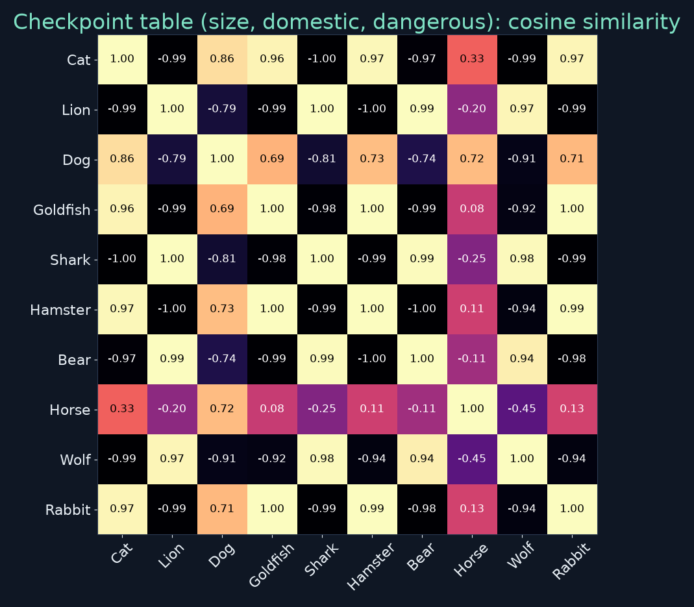

<!-- say: I took the example ratings from the book and computed every pairwise cosine similarity. The answer is dramatic. Cat and lion have a cosine of minus zero point nine nine: they're almost opposite. Cat and hamster are at zero point nine seven, and cat and rabbit at zero point nine seven. Lion and shark are nearly identical at zero point nine nine eight. With these three dimensions, the space sorts animals into small, safe pets versus large, dangerous wild animals. Biology doesn't come into it at all. -->

---

# What the checkpoint teaches

- **Dimensions decide similarity:** size/domestic/dangerous → "pets vs predators"
- Add **"feline"**, **"water-dwelling"**, **"legs"** → new groupings appear
- Goldfish ≈ hamster here — despite fish vs mammal!
- Real models **learn** hundreds of dimensions → many groupings at once

<!-- say: That's the lesson. The dimensions you choose decide which similarities exist. With size, domestic and dangerous, a goldfish is almost the same as a hamster, even though one is a fish and one is a mammal. Add a feline dimension, or water dwelling, or number of legs, and new groupings appear. Real models don't hand pick dimensions. They learn hundreds of them from data, so many kinds of grouping can coexist in one space. -->

---

<!-- _class: divider -->
# Part 9
## Wrap-up

<!-- say: Part nine. Wrapping up. -->

---

# The embedding pipeline

```text
word: "king"
   │  embedding lookup (a row of a big table)
   ▼
vector: [0.82, 0.31, 0.91, -0.24, ...]   (768 numbers)
   │  geometry of semantic space
   ▼
near "queen", far from "banana"
```

<!-- say: Here's the whole pipeline in one picture. A word, like king, is looked up in a big table, so its embedding is just one row of that table. The result is a vector, maybe seven hundred and sixty eight numbers. And its position in the semantic space puts it near queen and far from banana. In chapter five you'll build exactly this lookup table in PyTorch, with nn dot Embedding. -->

---

# Key takeaways

1. ASCII captures **spelling**, not meaning (cat ≈ car)
2. Embeddings = **positions** in a high-dimensional semantic space
3. Similar words **cluster**; unrelated words are far apart
4. Word arithmetic works (approximately): king − man + woman ≈ queen
5. **Context** teaches meaning — self-supervised, no labels
6. Static embeddings lose **order**: dog bites man = man bites dog (on average)

<!-- say: The key takeaways. One: ASCII captures spelling, not meaning. Two: embeddings represent words as positions in a high dimensional space. Three: similar words cluster together, and unrelated words are far apart. Four: word arithmetic works, approximately, like king minus man plus woman landing near queen. Five: context teaches meaning, without any human labels. And six: static embeddings, especially when averaged, lose word order, so we need something more. That something is attention. -->

---

# Notes on the book (checked)

- Examples checked on real GloVe-100 vectors; the book's **40–70 %** analogy caveat holds (4 / 7 top-1)
- Tokyo − Japan + Germany → *Frankfurt* first, Berlin 2nd · brother − man + woman → *daughter*
- Book's embedding numbers (king = [0.82, 0.31…]) are **illustrative**, not real model values
- No factual errors found in this chapter

<!-- say: A quick note on accuracy, since I'm checking the book as I go. I tested the chapter's examples against real vectors, and everything behaves as the book says, including its warning that analogies only work some of the time. A few of its listed examples don't come out first in GloVe, but the book presents them as typical relationships, not guaranteed outputs. The embedding numbers for king, queen and banana are illustrative, which the book itself signals by calling them simplified. I found no factual errors in this chapter. -->

---

# Review questions 1

**Q1. Why can't we just use ASCII codes?**
They encode spelling, which is arbitrary: cat ≈ car numerically, cat ≠ kitten.

**Q2. What is an embedding, and why the name?**
A word's vector in a learned space where position reflects meaning; "embedding" = mapping discrete symbols into a continuous space while preserving structure.

**Q3. Why hundreds of dimensions?**
Words are similar in many different ways at once (royalty, gender, leadership…); more axes hold more kinds of relationship.

<!-- say: Review questions, with my answers. Question one: why not ASCII codes? Because they encode spelling, which is arbitrary, so cat and car look almost identical while cat and kitten look unrelated. Question two: what is an embedding, and why that name? It's a word's vector in a learned space where position reflects meaning. The name comes from maths: mapping discrete symbols into a continuous space while preserving structure. Question three: why hundreds of dimensions? Because words are similar in many different ways at the same time, royalty, gender, leadership and so on, and each kind of relationship needs room. -->

---

# Review questions 2

**Q4. Explain king − man + woman ≈ queen.**
Removing "man" and adding "woman" moves along a consistent gender direction; the nearest word to the result is queen → relationships are encoded as consistent **offsets**.

**Q5. "You shall know a word by the company it keeps"?**
Meaning comes from context; embedding systems predict words from their neighbours, so words with similar contexts get similar vectors.

**Q6. Why isn't averaging enough?**
It discards order and interactions: "dog bites man" and "man bites dog" average to the same vector.

<!-- say: Question four: explain king minus man plus woman. Subtracting man and adding woman moves the king vector along a consistent gender direction, and the nearest word to where you land is queen. It shows that embeddings encode relationships as consistent offsets. Question five: what does you shall know a word by the company it keeps mean? That meaning comes from context. Embedding systems learn by predicting words from their neighbours, so words used in similar contexts end up with similar vectors. Question six: why isn't averaging enough? Because it throws away order and interactions. Dog bites man and man bites dog average to exactly the same vector. -->

---

# Practice this

- ☐ Compute d(boy, man) and d(boy, woman) by hand; then the cosine of [4,3] and [3,4]
- ☐ Run the gensim snippet (notes.md): try 10 analogies, record hit rate
- ☐ Explore **projector.tensorflow.org** — find a word with two senses
- ☐ Do the animal checkpoint; add a 4th dimension and see what changes
- ☐ Peek ahead: **github.com/FirstLLM/code** — Ch 5 builds `nn.Embedding`

<small>Code on these slides is my own illustration (Ch 1–4 have no book notebook).</small>

<!-- say: Here's your practice list. Compute the boy, man and woman distances by hand, and the cosine of four three and three four. Run the gensim snippet from the notes, try ten analogies of your own, and record your hit rate. Explore the embedding projector and find a word with two senses. Do the animal checkpoint, then add a fourth dimension and watch the groupings change. And peek ahead at the book's companion repository on GitHub, where chapter five builds the embedding table in PyTorch. The code in this video is my own illustration, since Part One has no book notebook. -->

---

# Up next: Chapter 3

**The Attention Mechanism**
"The cat sat on the mat because **it** was tired." — what does *it* refer to?
→ letting every word **look at** every other word

<!-- say: That's chapter two. We can turn words into vectors that capture meaning. But meaning lives in relationships. In the sentence the cat sat on the mat because it was tired, how does a computer know that it means the cat? It has to look at the whole sentence and work out what relates to what. That's the problem attention solves, and it's chapter three. -->

---

<!-- _class: lead -->
# Credits
Based on **"Build Your First LLM"** by **Hasan Degismez** — buy the book: **leanpub.com/FirstLLM**
Code: **github.com/FirstLLM/code** (MIT License) · GloVe vectors: Stanford NLP (Pennington et al., 2014)
Slides, narration and diagrams: my own teaching adaptation · **Waqar Shaikh Builds**

<!-- say: This video is based on the book Build Your First LLM by Hasan Degismez. Everything here is my own adaptation for study, so please support the author and buy the book at leanpub dot com slash First LLM. The companion code is at github dot com slash First LLM slash code, under the MIT license. The word vectors I used are GloVe, from the Stanford NLP group. Thanks for watching, and see you in chapter three. -->
