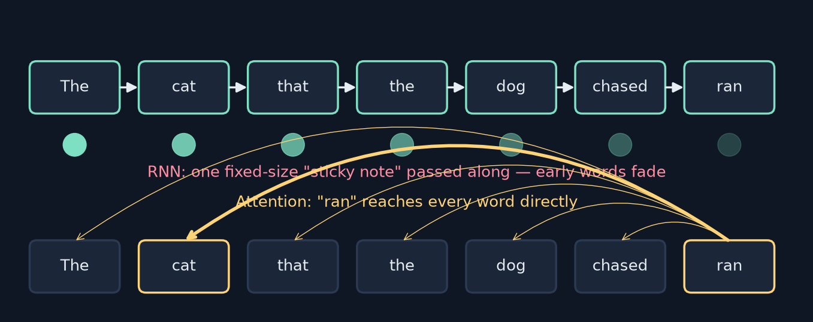
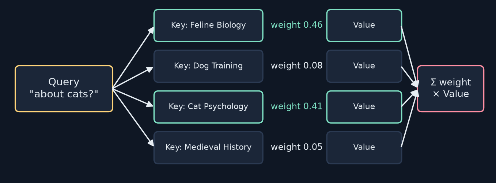
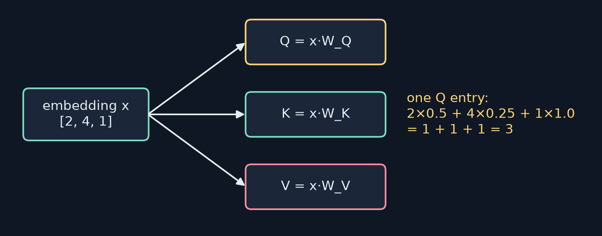
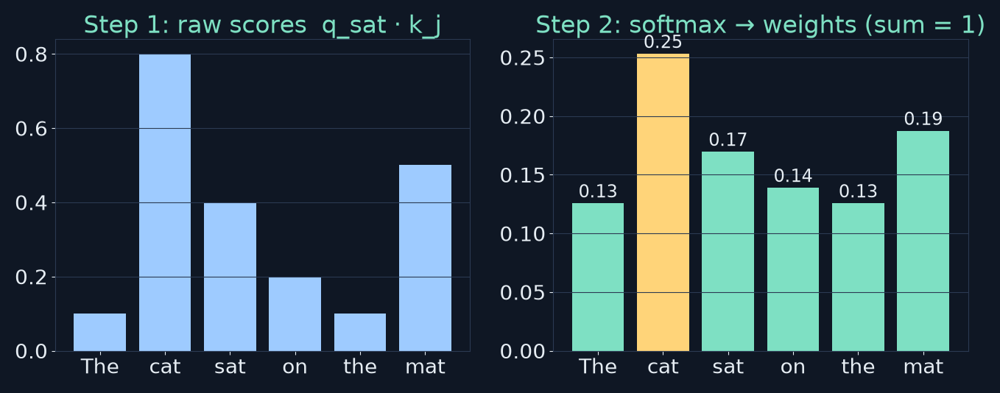
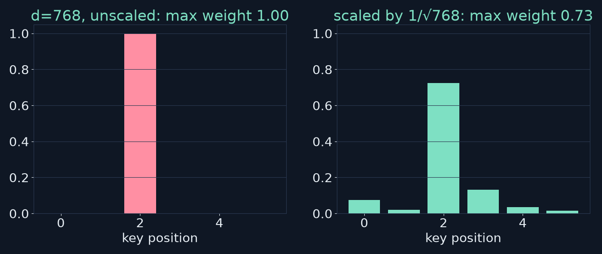
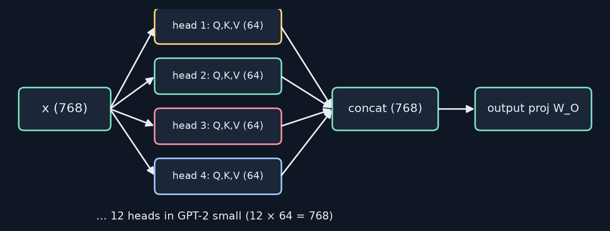
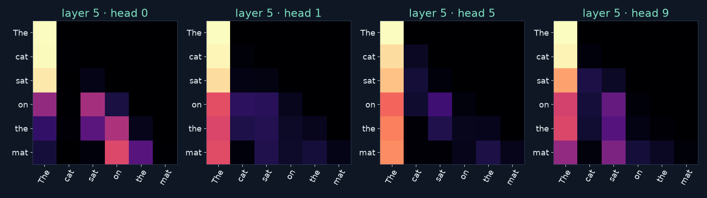
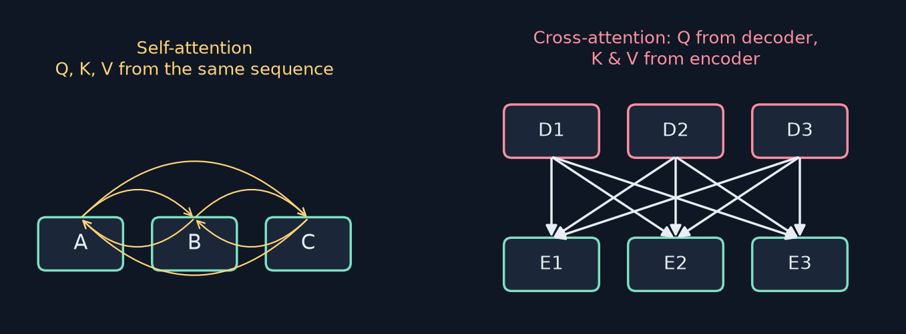
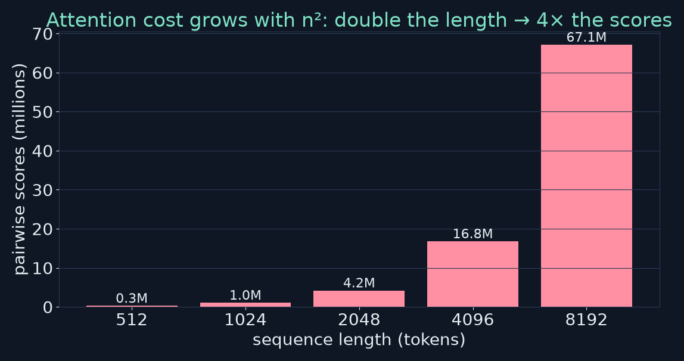
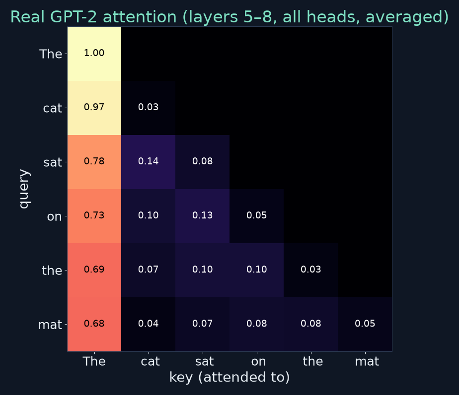

<!-- _class: lead -->
<!-- _paginate: false -->
# Build Your First LLM
## Chapter 3 — The Attention Mechanism
A study companion to *Build Your First LLM* by Hasan Degismez
**Waqar Shaikh Builds**

<!-- say: Welcome to chapter three of my study series on Build Your First LLM by Hasan Degismez. Last time we turned words into vectors, and found that averaging them loses order and context. Today we meet the fix, the single most important idea in modern AI: attention. We'll build the intuition with analogies, then do the actual arithmetic by hand, and then look inside a real GPT-2 model to see what attention really does, including a couple of surprises the analogies don't prepare you for. -->

---

# Where we are

- **Ch 2:** words → embeddings; averaging loses order and context
- **Ch 3 (today):** attention lets words **look at each other**
- **Ch 4:** the full Transformer (positions, FFN, norms, residuals)
- **Ch 10:** we implement attention in PyTorch, line by line
- Part I has no book notebook; snippets here are **my own**

<!-- say: Where are we? Chapter two gave us embeddings, but static ones that can't tell dog bites man from man bites dog. Today, attention lets each word look at every other word and update its meaning. Chapter four assembles the full transformer around it. And in chapter ten we'll implement attention in PyTorch line by line. As this is part one, there's no book notebook, so the code and the GPT-2 experiments you'll see today are my own. -->

---

# Chapter 3 roadmap

1. The problem with old AI: RNNs and the sequential bottleneck
2. What attention is: cocktail party, spotlights, search engine
3. Query, Key, Value — the library analogy
4. The calculation: scores → softmax → weighted sum, and why √d
5. Multi-head attention
6. Self- vs cross-attention, and the n² cost
7. The 2017 revolution
8. Real GPT-2 attention · exercises · checkpoint · review

<!-- say: Here's the plan. First the problem attention solved: recurrent networks and their sequential bottleneck. Then what attention is, through three analogies. Then the core trio, query, key and value. Then the calculation itself, step by step, including why we divide by the square root of the dimension. Then multi-head attention, self versus cross attention, and the quadratic cost. Then the 2017 paper that started it all. And finally real attention maps from GPT-2, the exercises, the checkpoint and review questions. -->

---

# Key terms for this chapter

| Term | One-line meaning |
|---|---|
| **Attention** | Each word weighs every other word by relevance and blends them |
| **Self- / cross-attention** | Attend within one sequence / to another sequence |
| **Query · Key · Value** | What I seek · what I offer · what I hand over |
| **Softmax** | Scores → positive weights that sum to 1 |
| **Scaled dot-product** | Scores = Q·Kᵀ / √d |
| **Multi-head** | Several attentions in parallel, each with its own weights |
| **Weights / transformation** | Learned numbers; multiplying by them makes Q, K, V |
| **Transformer** | The 2017 attention-only architecture |

<!-- say: The vocabulary. Attention lets each word weigh every other word by relevance and blend information from them. Self attention works within one sequence, and cross attention lets one sequence attend to another. Query, key and value: what a word is looking for, what it offers, and what it hands over. Softmax turns scores into positive weights that sum to one. Scaled dot product attention computes scores as Q times K transpose, divided by the square root of the dimension. Multi head attention runs several attentions in parallel. Weights are the learned numbers, and multiplying an embedding by them is the transformation that makes Q, K and V. And the transformer is the attention only architecture from 2017. -->

---

<!-- _class: divider -->
# Part 1
## The problem with old AI

<!-- say: Part one. The problem with old AI. -->

---

# RNNs: reading through a sticky note



<!-- say: Before 2017, language models were mostly recurrent neural networks, RNNs. An RNN reads one word at a time, and carries a fixed size summary forward, like keeping notes on a single sticky note. After each word you update the note, but it never gets bigger. By the end of a long sentence, the early words have been squeezed out. In the top row you can see the note fading as it travels. In the bottom row, attention gives the word ran a direct line to every earlier word, so it can reach cat no matter how far back it is. -->

---

# Where the sticky note fails

```text
"The cat that the dog that the man owned chased ran away"
 ...                       → notes: "cat… dog…"
 word 10: "ran"            → notes: "something… ran?"
 word 11: "away"           → "ran away… wait, what ran?"
```

- Nested clauses push the subject far from its verb
- Also: training is **sequential** — word 10 waits for words 1–9 (slow on GPUs)

<!-- say: Here's the book's example: the cat that the dog that the man owned chased ran away. By the time the RNN reaches ran, it has overwritten its notes with dog and man, and it's lost track of what is doing the running. It was the cat. There's also a speed problem. An RNN can't process word ten until it has processed words one to nine, so training can't take full advantage of parallel hardware like GPUs. -->

---

# ⚠️ A precision note: "vanishing gradients"

- The book links the forgetting to the **vanishing gradient problem**
- More precisely, two related issues:
  - **Forward:** a fixed-size hidden state must compress everything → information bottleneck
  - **Training:** the error signal shrinks as it flows *backward* through many steps → long-range patterns are hard to **learn** (vanishing gradients)
- LSTMs/GRUs eased the second; neither removes the first

<!-- say: A small precision note. The book describes this forgetting as the vanishing gradient problem, information degrading as it travels along a chain. That's close, but it mixes two related issues. Going forward, a fixed size hidden state has to compress the whole past, which is an information bottleneck. During training, the error signal shrinks as it's passed backward through many time steps, so long range patterns are hard to learn. That second one is what vanishing gradients strictly means. Gated networks like LSTMs and GRUs eased it a lot, but they still pass everything through one fixed size state. -->

---

# What long text requires

"The trophy didn't fit in the suitcase because **it** was too big."

1. Keep **both** candidates (trophy, suitcase) available at "it"
2. Use the meaning of "too big" to choose
3. Connect words that are **far apart**

→ We need to look back at **any word, any time** — that's attention

<!-- say: Consider the trophy didn't fit in the suitcase because it was too big. What is it? The trophy, because only a too big trophy explains not fitting. To work that out you need three things: keep both candidates available when you reach it, use the meaning of too big to choose between them, and connect words that are far apart. The old approach struggled with all three. We need the ability to look back at any word, at any time. That's attention. -->

---

<!-- _class: divider -->
# Part 2
## What is attention?

<!-- say: Part two. What is attention? -->

---

# Three ways to picture it

| Analogy | What it captures |
|---|---|
| 🍸 **Cocktail party** | Selective focus: hear your name across the room; the rest is dimmed, not deleted |
| 🔦 **Many spotlights** | Any word can light up any other word instantly — no single moving beam |
| 🔎 **Search engine** | Each word runs a query, ranks every word by relevance, blends the top results |

<!-- say: The book gives three pictures. First, the cocktail party. In a noisy room you can focus on one conversation, yet you still notice when someone across the room says your name. That's selective focus, and the other voices are dimmed, not deleted. Second, spotlights on a stage. An RNN is a single spotlight that has to move from actor to actor. Attention is many spotlights that can light anyone, instantly. Third, a search engine. Each word runs its own search over the sentence, ranks every word by relevance, and blends together what it finds. -->

---

# From sequential to parallel

- RNN: word *t* depends on word *t−1* → a **chain**
- Attention: every pair of words connects **directly**
- First and last word can communicate in **one step**
- All positions are computed **at once** → GPUs love it

<!-- say: The key shift is from a chain to a web. In an RNN, each step depends on the one before. With attention, every pair of words is connected directly, so the first and last words can communicate in a single step. And because no position has to wait for another, all positions can be computed at once, which is exactly what GPUs are built for. -->

---

<!-- _class: divider -->
# Part 3
## Query, Key, Value

<!-- say: Part three. Query, key and value. -->

---

# The library analogy (my redraw)



- **Query:** what you're looking for · **Key:** the spine label · **Value:** the content
- Matching is **soft**: every book gets a weight; mismatches get tiny weights

<!-- say: Imagine walking into a library looking for books about cats. Your question is the query. Each book's spine label is its key: Feline Biology, Dog Training, Cat Psychology, Medieval History. And the content inside each book is its value. You compare your query to every spine, find that Feline Biology and Cat Psychology match, and combine their contents. The weights in my picture are illustrative. The important detail is that attention's matching is soft. Every book gets some weight, and the mismatches just get very small weights. -->

---

# Every word is both visitor and book

| word | Query — "what I need" | Key — "what I offer" | Value |
|---|---|---|---|
| The | what am I pointing to? | I can point to things | The's info |
| cat | what am I doing? | I'm something that can act | cat's info |
| sat | who's doing this? | I'm an action | sat's info |

- "sat" queries every key → "cat" matches best → "sat" absorbs cat's **value**
- Output ≈ "sat — and the cat is doing it"

<!-- say: In self attention, every word plays all three roles at once. It's a visitor with a query, and it's also a book on the shelf with a key and a value. Take the cat sat. The word sat asks, who's doing this? The word cat advertises, I'm something that can do actions. So when sat compares its query to every key, cat scores highest, and sat pulls in a large share of cat's value. The new representation of sat means something like sat, and by the way, the cat is doing it. And at the same moment, cat is running its own search, and finds sat. -->

---

# Where Q, K, V come from (my redraw)



- **Not** three stored vectors — three **learned views** of one embedding
- Q = x·W_Q, K = x·W_K, V = x·W_V (weights learned in training)

<!-- say: Where do queries, keys and values come from? They aren't stored separately. They're computed on the fly from the same embedding, by multiplying it with three different learned weight matrices, three lenses on the same photo. Here's the book's tiny example. If cat's embedding is two, four, one, and one column of the query weights is a half, a quarter and one, then that query entry is two times a half, plus four times a quarter, plus one times one: one plus one plus one, three. A real query has many such entries, each with its own weights, and keys and values have their own matrices. None of these weights are designed by hand. They're learned. -->

---

# "Open weights", decoded

- Weights = the **learned numbers** (W_Q, W_K, W_V, and all the rest)
- "Open-weights model" (e.g. Llama, Mistral) = those numbers are **published**
- With them you can run the model **locally** and **fine-tune** it
- Code without weights = a recipe with no ingredients

<!-- say: This also decodes a phrase you see in the news: open weights. Weights are all those learned numbers, including the query, key and value matrices. When a company releases an open weights model, like Llama or Mistral, it publishes those numbers. Then anyone can run the model on their own machine, offline, and fine tune it. Model code without the weights is like a recipe without the ingredients. -->

---

<!-- _class: divider -->
# Part 4
## The attention calculation

<!-- say: Part four. The attention calculation itself. -->

---

# Step 1 & 2: scores → softmax



- Book's illustrative scores for query "sat": `[0.1, 0.8, 0.4, 0.2, 0.1, 0.5]`
- Softmax → `[0.13, 0.25, 0.17, 0.14, 0.13, 0.19]` ✓ (I re-computed it)

<!-- say: Let's walk the book's example. The sentence is the cat sat on the mat, and we're computing attention for sat. Step one: compare sat's query with every key using a dot product. The book's illustrative scores are point one for the, point eight for cat, point four for sat itself, point two for on, point one for the second the, and point five for mat. Step two: softmax. Exponentiate each score and divide by the total, so they become positive and add up to one. I recomputed it and the book's numbers are right: point one three, point two five, point one seven, point one four, point one three, point one nine. Cat gets a quarter of the attention. -->

---

# Softmax, by hand

$$\text{softmax}(s)_i = \frac{e^{s_i}}{\sum_j e^{s_j}}$$

- e^0.8 ≈ 2.23, e^0.1 ≈ 1.11 … sum of all six ≈ 8.82
- weight(cat) = 2.23 / 8.82 ≈ **0.25**
- Exponentials **amplify** differences; dividing makes them **sum to 1**

<!-- say: Here's softmax by hand. For each score you take e to that score. e to the point eight is about two point two three, and e to the point one is about one point one one. Add up all six exponentials and you get about eight point eight two. So cat's weight is two point two three divided by eight point eight two, about point two five. The exponential amplifies differences between scores, and the division makes the weights add up to one. -->

---

# Step 3: weighted sum of values

```text
out(sat) = 0.13·V(The) + 0.25·V(cat) + 0.17·V(sat)
         + 0.14·V(on)  + 0.13·V(the) + 0.19·V(mat)
```

- A **new vector** for "sat" that carries context from the whole sentence
- Most from "cat" (subject), then "mat" (location)
- Same shape as the input — so we can **stack** layers

<!-- say: Step three. Multiply each word's value vector by its weight and add them up. The output is a brand new vector for sat, carrying context from the whole sentence, mostly from cat, then mat. And because the output has the same shape as the input, we can stack many attention layers on top of each other. -->

---

# The whole thing in three lines

```python
scores  = Q @ K.T                  # how well each query matches each key
weights = softmax(scores / sqrt(d)) # normalise each row to sum to 1
output  = weights @ V               # blend the values
```

- Compare · normalise · combine
- Q, K, V for **all** words at once → matrix multiplies (fast)

<!-- say: And that's the whole formula. Scores are Q times K transpose: every query compared with every key. Weights are the softmax of the scores divided by the square root of d. And the output is weights times V, blending the values. Compare, normalise, combine. Because we do it for all the words at once using matrix multiplication, it's extremely fast on modern hardware. We'll implement exactly this in chapter ten. -->

---

# Why divide by √d? (my experiment)



- Random q, k: std of q·k = **2.0 / 7.9 / 28.0** for d = 4 / 64 / 768 (≈ √d)
- After ÷√d: **≈ 1.0** for every d → softmax stays soft

<!-- say: Why divide by the square root of d? I ran a quick experiment. For random query and key vectors, the dot product's typical size grows like the square root of the dimension: a standard deviation of about two for d of four, about eight for d of sixty four, and twenty eight for d of seven sixty eight. Feed scores that big into softmax and it becomes all or nothing. On the left, one key gets a weight of one point zero and everything else gets zero. That kills learning, because the gradients vanish. Divide by the square root of d, and the spread is back to about one at any size, so softmax stays soft, like turning down a microphone before it distorts. -->

---

<!-- _class: divider -->
# Part 5
## Multi-head attention

<!-- say: Part five. Multi head attention. -->

---

# One head isn't enough

"The tall lawyer who argued the case **won** the trial."

- Who won? → **lawyer** (subject)
- Won what? → **trial** (object)
- What kind of lawyer? → **tall** (modifier)
- What happened before? → **argued** (previous action)

One softmax distribution can't put all its weight on all four

<!-- say: Why more than one head? Look at the word won in the tall lawyer who argued the case won the trial. To understand it, won needs its subject, lawyer, its object, trial, the modifier on the subject, tall, and the earlier action, argued. A single attention distribution has to share out one unit of weight, so it can't focus sharply on all four relationships at once. -->

---

# Many heads in parallel (my redraw)



1. Each head projects x with **its own** W_Q, W_K, W_V
2. Run attention per head · 3. **Concatenate** · 4. Final projection W_O

<!-- say: So we run several attentions in parallel. Each head has its own query, key and value weights, so it can learn a different kind of relationship. In GPT-2 small, the seven sixty eight dimensional input is projected into twelve heads of sixty four dimensions each. Each head runs attention separately, the outputs are concatenated back to seven sixty eight, and a final learned projection mixes them together. Think of it as a committee of experts: one for grammar, one for meaning, one for position, and so on. -->

---

# Heads really do differ (real GPT-2)



<!-- say: Do the heads really specialise? Here are four heads from layer five of the real GPT-2 model, all on the cat sat on the mat. They're visibly different. Some put nearly everything on the very first token, some look at the previous token, and others spread their attention out. Nobody designed these patterns. They emerged from training on next word prediction. The upper triangle is empty because GPT-2 can't look at future words. More on that in a moment. -->

---

# How many heads?

| Model | Heads per layer | d_model |
|---|---|---|
| Transformer base (2017) | 8 | 512 |
| GPT-2 small (124M) | 12 | 768 |
| GPT-3 (175B) | 96 | 12,288 |
| Llama 3.1 405B | 128 query heads | 16,384 |

- Bigger models → more heads (more relationship types, more compute)
- Modern models share K/V across query heads (**grouped-query attention**)

<!-- say: How many heads do real models use? The original 2017 transformer base had eight heads of width five twelve. GPT-2 small has twelve, GPT-3 has ninety six with a model width of twelve thousand two hundred and eighty eight, and Llama three point one four oh five B has a hundred and twenty eight query heads. These are from the published papers and model cards, not the book's table. Larger models tend to have more heads. Many modern models also let several query heads share keys and values, which is called grouped query attention and saves memory. -->

---

<!-- _class: divider -->
# Part 6
## Self- vs cross-attention

<!-- say: Part six. Self attention versus cross attention. -->

---

# Two flavours (my redraw)



<!-- say: In self attention, the queries, keys and values all come from the same sequence. Each word asks what in my own sentence is relevant to me. That's what GPT style models use. In cross attention, the queries come from one sequence and the keys and values from another. In translation, for example, each word being generated in the target language asks what in the source sentence is relevant to me. -->

---

# Masking in GPT-style models

- GPT predicts the **next** word → it must not peek at future words
- A **causal mask** blocks attention to positions to the right
- Row *i* of the attention matrix only has entries for columns ≤ *i*
- That's the empty upper triangle you saw in GPT-2's heatmaps

<!-- say: One important detail. GPT models are trained to predict the next word, so they can't be allowed to look at the words after the one they're predicting, or they'd cheat. A causal mask blocks attention to any position to the right. So row i of the attention matrix only has entries for columns up to i. That's the empty upper triangle you saw in the GPT-2 heatmaps. We'll implement this mask in chapter ten. -->

---

# Where each is used

| Self-attention | Cross-attention |
|---|---|
| GPT-style language models | Machine translation (target → source) |
| Encoding one document | Image captioning (words → image regions) |
| BERT-style understanding | Question answering (answer → context) |
| | Text-to-image (image → prompt) |

- **Encoder–decoder** models use both: self inside each, cross between them

<!-- say: Where is each used? Self attention powers GPT style language models, encoding a single document, and BERT style understanding. Cross attention appears whenever two sequences meet: translation, image captioning where words attend to image regions, question answering, and text to image generation where the image attends to the prompt. The classic encoder decoder transformer uses both: self attention inside the encoder and the decoder, and cross attention connecting the two. This book focuses on self attention, since that's what GPT uses. -->

---

# The cost: n² comparisons



- 1,000 tokens → 1,000,000 scores · double the length → **4×** the work
- Why LLMs have **context limits**; why efficient-attention research exists

<!-- say: Attention has a price. Every word compares itself with every other word, so a thousand tokens means a million scores. Double the length, and you get four times the work and memory. That quadratic growth is why language models have context limits, and why there's so much research into more efficient attention. -->

---

<!-- _class: divider -->
# Part 7
## The 2017 revolution

<!-- say: Part seven. The 2017 revolution. -->

---

# "Attention Is All You Need" (June 2017)

- 8 Google authors: Vaswani, Shazeer, Parmar, Uszkoreit, Jones, Gomez, Kaiser, Polosukhin
- Radical claim: drop recurrence **entirely** → the **Transformer**
- Before: attention was a **helper** bolted onto RNNs
- After: attention, stacked in layers (6 encoder + 6 decoder), is the whole model

<!-- say: In June 2017, eight researchers at Google, Ashish Vaswani, Noam Shazeer, Niki Parmar, Jakob Uszkoreit, Llion Jones, Aidan Gomez, Lukasz Kaiser and Illia Polosukhin, published Attention Is All You Need. Attention already existed, as a helper that improved RNNs. Their radical step was to throw the recurrence away entirely and build the model from attention alone, stacked in layers, six in the encoder and six in the decoder. They called it the transformer. -->

---

# Why it won

- **Faster training:** no sequential dependency → full GPU parallelism
- **Better quality:** 28.4 BLEU on WMT'14 English→German, > 2 BLEU over the best previous results
- **Longer reach:** direct connections, no bottleneck
- Ingredients: attention + **positional encodings** + **layer stacking**

<!-- say: Why did it win? It trained much faster, because nothing had to wait for anything else. It was better, scoring twenty eight point four BLEU on the standard English to German translation benchmark, more than two points above the previous best, which is a big margin in that field. And it connected distant words directly. Two more ingredients made it work: positional encodings, to tell the model about word order now that there's no sequence, and stacking many layers. Both are coming in chapter four. -->

---

# ⚠️ Book check: "12 hours instead of days"

- Book: two-BLEU gain, and "training took 12 hours instead of days"
- Paper (Vaswani et al., 2017, §5.2): **base** model = 12 h on 8 P100 GPUs; **big** model = **3.5 days**
- The **28.4 BLEU** result is from the **big** model
- Fair summary: far cheaper than prior state of the art, but the record took ~3.5 days

<!-- say: One correction. The book says the two BLEU gain came with training that took twelve hours instead of days. In the paper, twelve hours is for the base model on eight P100 GPUs. The twenty eight point four BLEU record came from the big model, which trained for three and a half days. The fair summary is that the transformer reached a new record at a fraction of the training cost of earlier models, but the record itself took about three and a half days, not twelve hours. I've put this in the errata file. -->

---

# What followed

| Year | Milestone |
|---|---|
| 2017 | Transformer paper |
| 2018 | GPT-1 (generation) · BERT (understanding) |
| 2019 | GPT-2 — the model we'll load in this course |
| 2020 | GPT-3: 175B parameters, few-shot learning |
| 2022 | ChatGPT goes mainstream |
| 2023+ | GPT-4, Claude, Gemini, Llama … rapid scaling |

"All you need" is tongue-in-cheek: you also need embeddings, norms, FFNs (Ch 4)

<!-- say: And then the floodgates opened. GPT-1 and BERT in 2018. GPT-2 in 2019, the model we'll load and study in this course. GPT-3 with a hundred and seventy five billion parameters in 2020. ChatGPT in 2022. And rapid scaling since. All built on the transformer. The title is a little tongue in cheek, of course. You also need embeddings, layer normalisation, feed forward layers and more, which is chapter four. But attention is the star. -->

---

<!-- _class: divider -->
# Part 8
## Inside a real model

<!-- say: Part eight. Let's look inside a real model. -->

---

# Real GPT-2: "The cat sat on the mat" (my experiment)



<!-- say: This is real attention from GPT-2 small, averaged over all twelve heads in layers five to eight. Look at the row for sat. It doesn't look like the book's tidy illustration. Seventy eight percent of sat's attention goes to the very first token, the, fourteen percent goes to cat and eight percent to itself. And it can't see on, the or mat at all, because they come after it. Of what remains after that first token, cat does get most of it. So the subject verb pattern is there, just alongside something else. -->

---

# Two surprises the analogies hide

1. **Causal masking:** "sat" can't attend to "mat" in GPT — it hasn't happened yet. The book's sat→mat weight (0.19) fits a **bidirectional** model (e.g. BERT)
2. **Attention sinks:** many heads park most weight on the **first token** — a learned "no-op" when nothing is relevant
- The book's numbers are explicitly **illustrative** — fine for intuition, not what GPT-2 shows

<!-- say: Two lessons the analogies hide. First, causal masking. In the book's example, sat gives nineteen percent of its attention to mat, but in a GPT style model, mat hasn't happened yet when we process sat. That pattern fits a bidirectional model like BERT, which sees both directions. The book's numbers are illustrative, so this isn't an error. Just keep the distinction in mind. Second, attention sinks. Many heads put most of their weight on the first token. Researchers think the model uses it as a kind of parking spot when nothing in particular is relevant, since softmax forces the weights to add up to one. -->

---

# Exercise 1 in a GPT model (my experiment)

"I put the cake in the freezer because **it** was warm / cold."

- In GPT-2, attention **from "it"** is *identical* in both sentences:
  cake 0.040 · freezer 0.054 (all heads, all layers)
- Why: "warm"/"cold" come **after** "it" → invisible under the causal mask
- To see the flip, use a **bidirectional** model (BERT in BertViz), or look from "warm"/"cold" back

<!-- say: I tried the book's pronoun exercise on GPT-2. The cake in the freezer because it was warm, versus because it was cold. The attention from it was exactly identical in both sentences: about point zero four on cake and point zero five four on freezer, averaged over every head and layer. That's not a bug. Warm and cold come after it, so under the causal mask they're invisible when it is processed. To see the attention flip the way the book describes, use a bidirectional model like BERT in a tool such as BertViz, or look at attention from the later words back toward cake and freezer. This is a great example of why it helps to know which kind of model you're inspecting. -->

---

<!-- _class: divider -->
# Part 9
## Hands-on

<!-- say: Part nine. Hands on. -->

---

# Exercise 0: draw your own attention

"The chef who prepared the meal **forgot** the salt."

- Arrows from **forgot** → chef (who?) · salt (what?) — thick
- Arrows from **prepared** → chef (who?) · meal (what?)
- Same subject, **different** objects → different patterns per word

<!-- say: Exercise zero needs no computer. Take the chef who prepared the meal forgot the salt. Draw arrows from forgot to the words it should attend to: thick arrows to chef, who forgot, and to salt, forgot what. Then do the same for prepared: chef, who prepared, and meal, prepared what. They share a subject but have different objects, so each word needs its own attention pattern. That's exactly what per word queries allow. -->

---

# Exercises 2 & 3 + what to look for

- **Heads:** "The lawyer who argued the case won" → won→lawyer · argued→case · who→lawyer
- **Long range:** "The cat, which had been sitting… while the dog barked outside, finally **stood** up" → stood→cat?
- Look for: syntax heads, previous-token heads, long-range heads, early vs late layers
- Tools: **BertViz** (search "jessevig bertviz"), Hugging Face Spaces

<!-- say: Exercise two compares heads on the lawyer who argued the case won. Look for one head linking won to lawyer, another linking argued to case, and another linking who to lawyer. Exercise three tests long range links: the cat, which had been sitting on the mat for hours while the dog barked outside, finally stood up. Does stood reach back to cat? While you explore, look for heads that track grammar, heads that just look at the previous word, heads that reach far back, and how patterns change from early to late layers. BertViz is the classic tool, and there are many demos on Hugging Face Spaces. -->

---

# A 12-line attention you can run (my own)

```python
import torch
torch.manual_seed(0)
x  = torch.randn(6, 8)                    # 6 words, 8-dim embeddings
Wq, Wk, Wv = (torch.randn(8, 8) / 8**0.5 for _ in range(3))
Q, K, V = x @ Wq, x @ Wk, x @ Wv
scores  = Q @ K.T / 8**0.5               # (6, 6)
mask    = torch.triu(torch.ones(6, 6), 1).bool()
scores  = scores.masked_fill(mask, float("-inf"))   # causal
weights = torch.softmax(scores, dim=-1)  # rows sum to 1
out     = weights @ V                     # (6, 8)
print(weights.sum(-1), out.shape)
```

<!-- say: Here's a complete attention calculation in about a dozen lines of PyTorch. This is my own snippet, not from the book's repo. Six words with eight dimensional embeddings. Three random weight matrices make Q, K and V. The scores are Q times K transpose over the square root of eight. A causal mask sets every future position to minus infinity, so softmax gives it zero weight. Softmax normalises each row, and weights times V gives the output: six new eight dimensional vectors. Every row of weights sums to one. -->

---

<!-- _class: divider -->
# Part 10
## Checkpoint exercise

<!-- say: Part ten. The checkpoint exercise. -->

---

# Checkpoint: pronouns, heads, reflection

- **Part 1:** "The cat chased the mouse because **it** was hungry / scared" — what is *it*? Draw "it"'s arrows
- **Part 2:** "The quick brown fox jumped over the lazy dog" — design 3 heads: jumped→? · quick→? · dog→?
- **Part 3:** Why attention beats left-to-right for pronouns? Why many heads? What if weights were **uniform**?

<!-- say: The checkpoint has three parts. Part one: the cat chased the mouse because it was hungry. What does it refer to? Then change hungry to scared. Draw the arrows from it, and notice that your human answer depends on a word that comes after it. Part two: design three heads for the quick brown fox jumped over the lazy dog. What should jumped, quick and dog each attend to? Part three: reflect. Why is attention better than strictly left to right reading for pronouns? Why use many heads? And what happens if every weight is uniform? -->

---

# My answers

- **Part 1:** hungry → cat (the chaser); scared → mouse (the chased). Strong arrows it→cat/mouse + it→hungry/scared (bidirectional view)
- **Part 2:** jumped→fox (subject) · quick→fox (adjective→noun) · dog→lazy (modifier) or over (preposition)
- **Part 3:** direct access to any word · many relation types at once · **uniform** weights = plain **averaging** → back to Ch 2's problem

<!-- say: My answers. Part one: with hungry, it is the cat, the one chasing. With scared, it is the mouse. In a bidirectional view, it should attend strongly to both candidates and to the deciding adjective. In GPT-2 I measured it attending to cat at point zero three seven and mouse at point zero five six, before the adjective has even appeared. Part two: jumped looks to fox, its subject. Quick looks to fox, the noun it modifies. Dog looks to lazy, its modifier, or to over. Part three: attention gives direct access to any word, many heads capture many relationship types at once, and uniform weights would just be averaging, the exact problem from chapter two. -->

---

<!-- _class: divider -->
# Part 11
## Wrap-up

<!-- say: Part eleven. Wrapping up. -->

---

# Key takeaways

1. RNNs: a fixed-size state passed along a chain → long-range info fades
2. Attention: every word looks at every word **directly**
3. Q / K / V: what I seek / what I offer / what I hand over
4. scores = QKᵀ/√d → softmax → weighted sum of V
5. Multi-head: many relationship types in parallel
6. Self- vs cross-attention; causal mask in GPT; cost grows as n²
7. 2017: the Transformer removed recurrence entirely

<!-- say: The key takeaways. One: RNNs pass a fixed size state along a chain, so long range information fades. Two: attention lets every word look at every other word directly. Three: query, key and value mean what I'm looking for, what I offer, and what I hand over. Four: scores are Q K transpose over root d, then softmax, then a weighted sum of values. Five: multi head attention captures many relationships in parallel. Six: self attention works within a sequence and cross attention between sequences, GPT adds a causal mask, and the cost grows with the square of the length. Seven: in 2017 the transformer removed recurrence altogether. -->

---

# Notes on the book (checked)

- ✅ Softmax example `[0.13, 0.25, 0.17, 0.14, 0.13, 0.19]` — correct
- ✅ Q-entry example 2×0.5 + 4×0.25 + 1×1 = 3 — correct
- ⚠️ "12 hours instead of days": 12 h = **base** model; the 28.4-BLEU **big** model took **3.5 days**
- ⚠️ RNN forgetting ≠ strictly "vanishing gradients" (fixed-state bottleneck + backward signal decay)
- ℹ️ Illustrative sat→mat weight and the pronoun exercise assume a **bidirectional** view; GPT is causal

<!-- say: My notes on the book for this chapter. The softmax example and the query entry example are both correct. Two items go in the errata. The twelve hours figure refers to the base model, while the record setting big model took three and a half days. And RNN forgetting isn't strictly the vanishing gradient problem, as I explained earlier. Finally, a clarification rather than an error: the illustrative sat to mat weight and the pronoun exercise assume a model that can see both directions, while GPT is causal. -->

---

# Review questions 1

**Q1. RNN problem?** Fixed-size state passed step by step — like a sticky note that keeps being overwritten; early words fade, and training can't parallelise.
**Q2. Cocktail party?** Focus on what's relevant while others are dimmed, not removed — soft, relevance-based weighting.
**Q3. Q, K, V?** Search question / spine label / book contents.
**Q4. Three steps?** Dot-product scores Q·Kᵀ → softmax(scores/√d) → weighted sum of V.

<!-- say: Review questions with my answers. One: what problem did RNNs have? They pass a fixed size state step by step, like a sticky note that keeps getting overwritten, so early words fade, and they can't be trained in parallel. Two: the cocktail party analogy captures soft, relevance based focus. You tune in to what matters, and the rest is dimmed, not removed. Three: query, key and value are the search question, the spine label and the book's contents. Four: the three steps are dot product scores, softmax of the scaled scores, and a weighted sum of the values. -->

---

# Review questions 2

**Q5. Why ÷√d?** q·k grows like √d; huge scores make softmax one-hot and gradients vanish. Scaling keeps variance ≈ 1.
**Q6. Why many heads?** Each head learns its own relation (subject, object, modifier, position, long-range); one softmax can't do all.
**Q7. Self vs cross?** Self: Q, K, V from one sequence (GPT). Cross: Q from one, K/V from another (translation, captioning).
**Q8. Why was 2017 revolutionary?** Removed recurrence → parallel training, better quality, direct long-range links — the base of every modern LLM.

<!-- say: Five: why divide by root d? Because dot products grow like the square root of the dimension, and huge scores make softmax one hot, which kills the gradients. Scaling keeps the variance around one. Six: why many heads? Each head learns its own relationship, subject, object, modifier, position or long range, and a single softmax can't focus on all of them at once. Seven: self attention takes Q, K and V from one sequence, as in GPT. Cross attention takes queries from one sequence and keys and values from another, as in translation or captioning. Eight: the 2017 paper removed recurrence, which brought parallel training, better quality and direct long range links. It's the foundation of every modern LLM. -->

---

# Practice this

- ☐ Re-compute the book's softmax by hand (e^x, sum, divide)
- ☐ Run my 12-line attention; remove the mask and compare rows
- ☐ Try BertViz with BERT on the cake/freezer pair — does "it" flip?
- ☐ Do the checkpoint (pronouns, 3 heads, reflection)
- ☐ Peek ahead: **github.com/FirstLLM/code** — Ch 10 notebook implements this

<small>Code on these slides is my own illustration (Ch 1–4 have no book notebook).</small>

<!-- say: Your practice list. Recompute the book's softmax by hand. Run my twelve line attention, then remove the mask and compare the rows. Try BertViz with a BERT model on the cake and freezer sentences, and see whether it flips between cake and freezer. Do the checkpoint. And peek ahead at the book's repository, where the chapter ten notebook implements all of this properly. The code in this video is my own, since part one has no book notebook. -->

---

# Up next: Chapter 4

**The Transformer Architecture**
If everything runs in parallel, how does the model know **word order**?
→ positional encodings · feed-forward layers · layer norm · residual connections

<!-- say: That's chapter three. We now have the key innovation, attention. But attention alone isn't a model. If every word is processed in parallel, how does the model know the order of the words? And what happens after attention? Chapter four, the transformer architecture, adds positional encodings, feed forward layers, layer normalisation and residual connections, and puts it all together. -->

---

<!-- _class: lead -->
# Credits
Based on **"Build Your First LLM"** by **Hasan Degismez** — buy the book: **leanpub.com/FirstLLM**
Code: **github.com/FirstLLM/code** (MIT License) · GPT-2 weights: OpenAI via Hugging Face
Slides, narration and diagrams: my own teaching adaptation · **Waqar Shaikh Builds**

<!-- say: This video is based on the book Build Your First LLM by Hasan Degismez. Everything here is my own adaptation for study, so please support the author and buy the book at leanpub dot com slash First LLM. The companion code is at github dot com slash First LLM slash code, under the MIT license. The GPT-2 experiments used OpenAI's released weights via Hugging Face. Thanks for watching, and see you in chapter four. -->
