<!-- _class: lead -->
<!-- _paginate: false -->
# Build Your First LLM
## Chapter 4 — The Transformer Architecture
A study companion to *Build Your First LLM* by Hasan Degismez
**Waqar Shaikh Builds**

<!-- say: Welcome to chapter four of my study series on Build Your First LLM by Hasan Degismez. Attention is the star, but a star needs a stage. Today we assemble the complete transformer: positional encodings, feed forward networks, residual connections and layer normalisation, stacked into the architecture behind GPT, BERT and every modern language model. And as usual, I'll check everything against a real model, GPT-2 small, by counting its parameters, looking at its position vectors, and asking it a question. -->

---

# Where we are

- **Ch 2:** words → embeddings · **Ch 3:** attention mixes context
- **Ch 4 (today):** the full Transformer layer, and stacking it
- End of **Part I** — from Ch 5 we write code with the book's notebooks
- Snippets and GPT-2 experiments here are **my own**

<!-- say: We have embeddings from chapter two and attention from chapter three. Today we build the whole transformer layer around them and stack it. This is the end of part one, the conceptual part. From chapter five, we start writing real code with the book's notebooks. As before, the snippets and GPT-2 experiments in this video are my own. -->

---

# Chapter 4 roadmap

1. The missing piece: **position**
2. **Feed-forward** networks and **activation** functions
3. **Residual** connections: the highway
4. **Layer normalisation**: the thermostat
5. Putting it together: **one layer**, then a stack
6. **Encoder vs decoder**, GPT vs BERT
7. Training & inference · scale (real GPT-2 numbers)
8. Exercises · checkpoint · review

<!-- say: Here's the plan. First, the missing piece: position. Then feed forward networks and why they need an activation function. Then residual connections, the highway system, and layer normalisation, the thermostat. Then we assemble one complete layer and stack it. Then encoders versus decoders, and GPT versus BERT. Then training and inference, with real numbers from GPT-2. And we finish with exercises, the checkpoint and review questions. -->

---

# Key terms for this chapter

| Term | One-line meaning |
|---|---|
| **Position encoding** | Numbers added to an embedding to say *where* the token is |
| **Feed-forward network (FFN)** | Per-position MLP: expand ×4, activate, contract |
| **Activation function** | A nonlinearity (GELU, ReLU) that makes depth useful |
| **Residual connection** | output = x + f(x) — a skip path |
| **LayerNorm / RMSNorm** | Re-centre and re-scale each vector to a stable range |
| **Encoder / decoder** | Full visibility / causal (no peeking ahead) |
| **Causal masking** | Block attention to future positions |

<!-- say: The vocabulary. A position encoding is a set of numbers added to an embedding to say where the token sits. A feed forward network is a small neural network applied to each position separately: expand by four, apply an activation, contract back. An activation function is the nonlinearity, like GELU or ReLU, that makes depth worthwhile. A residual connection adds a layer's input to its output. LayerNorm and RMSNorm keep each vector in a stable range. An encoder lets every position see every other one, a decoder only lets positions look backward, and causal masking is how we enforce that. -->

---

<!-- _class: divider -->
# Part 1
## The missing piece: position

<!-- say: Part one. The missing piece, position. -->

---

# Attention is blind to order

- "The dog chased the cat" vs "The cat chased the dog" — same words
- Attention compares **every pair** — no notion of first/last
- My check: shuffle the input rows → attention outputs shuffle **identically** (`permutation-equivariant: True`)
- RNNs knew order implicitly (they read word 1, then 2…) — we gave that up for parallelism

<!-- say: Here's the problem we skipped in chapter three. Attention compares every word with every word, all at once. There's no first word and no last word. So the dog chased the cat and the cat chased the dog look the same to it. I checked this in code: if you shuffle the input vectors, the attention outputs come out shuffled in exactly the same way, and nothing else changes. Mathematicians call that permutation equivariant. RNNs got order for free, because they read word one, then word two. We gave that up to gain parallelism, so we need another way to tell the model about order. -->

---

# The fix: add a position vector

```text
final(cat @ pos 1) = E(cat) + P(1)
final(cat @ pos 5) = E(cat) + P(5)     → different vectors
```

- The word embedding says **what**; the position vector says **where**
- Added **once at the input** — then carried through every layer
- 🛰️ GPS analogy: coordinates don't change the message, they say where it came from

<!-- say: The fix is simple. Give every position its own vector, and add it to the word's embedding. Cat at position one becomes the embedding of cat plus position vector one. Cat at position five gets position vector five instead, so the two end up different. The embedding says what, the position says where. It's added once, at the input, and then carried through every layer. The book compares it to GPS coordinates on a message from a search party: the coordinates don't change what the message says, they tell you where it came from. -->

---

# Sinusoidal encodings (2017)

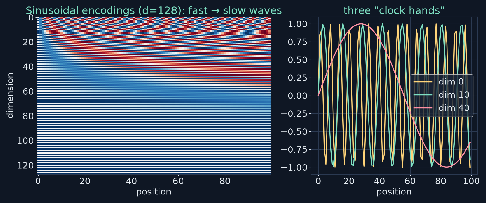

- Each dimension pair is a sine/cosine at a different **frequency** — like clock hands
- Unique per position · smooth for neighbours · defined for **any** position

<!-- say: The original transformer used sinusoidal encodings. Each pair of dimensions is a sine and cosine wave at a different frequency. On the left you can see the fast waves in the low dimensions and slow waves in the high ones. The book uses a clock analogy: the hour and minute hands turn at different rates, and together they give every time a unique reading, while times a minute apart look similar. Sinusoidal encodings work the same way with many hands, and because they come from a formula, they're defined for any position, even ones never seen in training. -->

---

# Learned positions — real GPT-2 (my experiment)

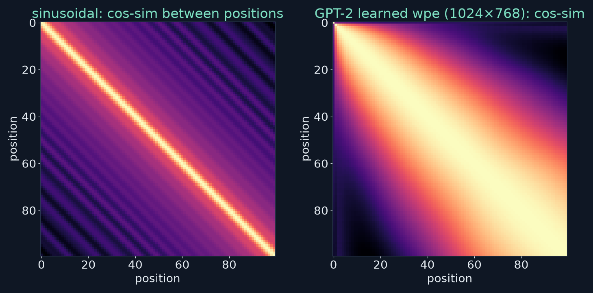

- GPT-2 learns a table `wpe` of shape **1024 × 768** — max 1,024 positions
- cos(pos 10, pos 11) = **0.998** · cos(pos 10, pos 90) = **0.27** → it learned smoothness

<!-- say: Many models, including GPT-2, simply learn a position table instead. In GPT-2 that table is called wpe, and it's one thousand and twenty four rows by seven sixty eight. So GPT-2 can't handle position one thousand and twenty five, because there's no row for it. That's the trade-off the book describes. I compared the similarity of positions in both schemes. On the left, sinusoidal. On the right, GPT-2's learned table. GPT-2 discovered the same smoothness on its own: position ten and position eleven have a cosine of point nine nine eight, while position ten and position ninety are only at point two seven. -->

---

# Rotary embeddings (RoPE)

- Instead of **adding** a vector, **rotate** Q and K by a position-dependent angle
- Dot products then depend on **relative** distance (cat is 3 tokens from sat)
- Fixed formula, no learned table → better behaviour on long contexts
- Used by **Llama, Mistral**, and most recent open models
- ⚠️ Book also lists **GPT-4** — its architecture is **not published**

<!-- say: Most recent models use rotary position embeddings, RoPE. Instead of adding a position vector, RoPE rotates the query and key vectors by an angle that depends on position. When you take the dot product of two rotated vectors, what's left depends on how far apart they are, so the model naturally sees relative distance. It's a fixed formula with no learned table, and it behaves better on long contexts. Llama, Mistral and most recent open models use it. One small correction: the book lists GPT-4 as using RoPE too, but OpenAI hasn't published GPT-4's architecture, so we can't know that. -->

---

<!-- _class: divider -->
# Part 2
## Feed-forward networks

<!-- say: Part two. Feed forward networks. -->

---

# Attention mixes; the FFN transforms

- Attention = **weighted averages** — it *gathers ingredients*
- FFN = per-position **processing** — it *cooks the meal*
- The rhythm of every layer: **attend → process**
- 🏭 Mail room (sorts letters) vs processing station (reads each letter)

<!-- say: Why do we need anything after attention? Because attention is fundamentally a mixing operation. It takes weighted averages of value vectors, so it gathers the ingredients but doesn't cook the meal. The feed forward network does the cooking, transforming each position's vector. Every transformer layer follows this rhythm: attend, then process. The book compares it to a factory: attention is the mail room that sorts related letters together, and the feed forward network is the station that actually reads each letter. -->

---

# Expand → activate → contract (my redraw)

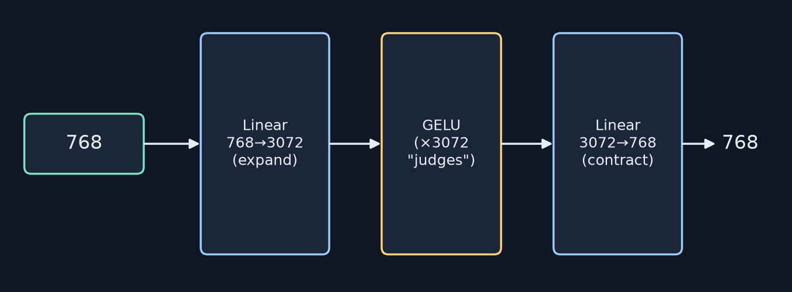

- Real GPT-2: `c_fc` **768 × 3072**, `c_proj` **3072 × 768** (I printed them)
- Applied to **each position independently** — no mixing here

<!-- say: The feed forward network has three steps. Expand the seven sixty eight numbers to three thousand and seventy two, four times as many. Apply a nonlinear activation to each one. Then contract back to seven sixty eight, so the output fits the next layer. I printed the shapes from real GPT-2: the expansion matrix is seven sixty eight by three oh seven two, and the contraction is the reverse. Crucially, every position goes through this independently. Cat, sat and the don't interact here. That was attention's job. -->

---

# Why expand?

- More room for **intermediate computation** — scratch space
- 23 × 47 → 23 × 40 = 920 · 23 × 7 = 161 · 920 + 161 = **1081**
- The steps (920, 161) vanish from the answer, but were needed to get it
- FFNs hold **~2/3** of GPT-2's non-embedding parameters (see later)

<!-- say: Why expand then contract? Expansion gives the model scratch space. The book's analogy is long multiplication. Twenty three times forty seven: twenty three times forty is nine twenty, twenty three times seven is one sixty one, add them to get one thousand and eighty one. The intermediate numbers don't appear in the answer, but you needed them. The wide hidden layer gives the model room for intermediate features like that. And as we'll see, the feed forward layers hold about two thirds of GPT-2's non embedding parameters. -->

---

# Why we need a nonlinearity

- Matrix multiplications and additions are **linear**
- Stack 100 linear maps → still **one** linear map (B·(A·v) = (BA)·v — checked)
- 📠 Photocopies of photocopies never become a colour photo
- Language is full of thresholds and reversals ("Great job!" sincere vs sarcastic)

<!-- say: Why do we need the activation function in the middle? Because without it, everything is linear: multiply and add. And a stack of linear operations collapses into a single linear operation. I checked it: B times A times v equals the matrix B A times v. So a hundred linear layers are no more expressive than one. The book's image is photocopying a photocopy: you'll never get a colour photograph out of it. Language is full of thresholds and reversals. Great job can be sincere or sarcastic depending on context. Capturing that needs a nonlinearity. -->

---

# GELU vs ReLU (my plot)

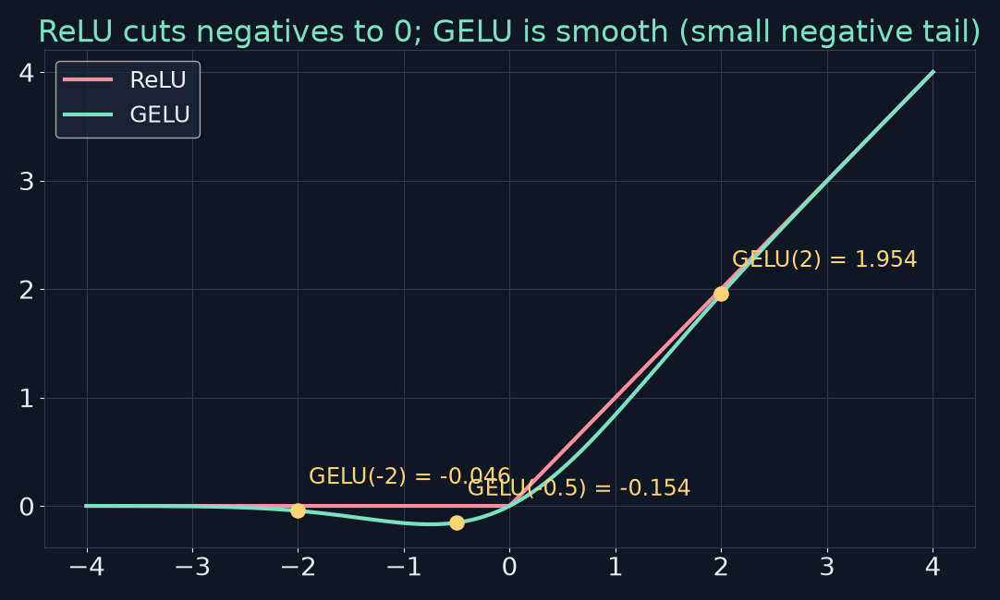

- ReLU: negatives → 0 (gradient 0 → "dead" units)
- GELU: smooth; GELU(2) = 1.954 · GELU(−2) = −0.046 · GELU(−0.5) = −0.154 ✓

<!-- say: Here are the two most common activations. ReLU passes positive values unchanged and zeroes the negatives. Its gradient there is zero, so units stuck in the negative region can stop learning. GELU is a smooth curve. It's close to the identity for large positive inputs and close to zero for large negatives, with a gentle dip in between. I computed the book's examples: GELU of two is one point nine five four, GELU of minus two is minus point zero four six, and GELU of minus a half is minus point one five four. They match the book. Think of thirty seventy two little judges, each deciding how much of its signal to let through. -->

---

# ⚠️ Book check: "GPT, Claude, LLaMA use GELU"

- GPT-2 / GPT-3: **GELU** ✓
- **LLaMA** (1, 2, 3): **SwiGLU** — a gated FFN using SiLU (Swish), not GELU
- **Claude**: architecture not published
- The principle still holds: **smooth** nonlinearities; modern FFNs are often **gated**

<!-- say: One correction. The book says most modern LLMs, naming GPT, Claude and Llama, use GELU or close variants. GPT-2 and GPT-3 do use GELU. But Llama uses SwiGLU, a gated feed forward block built on the SiLU activation, and Claude's architecture isn't published. The book's broader point stands: modern models use smooth nonlinear activations, and many now use gated variants of the feed forward block. -->

---

<!-- _class: divider -->
# Part 3
## Residual connections

<!-- say: Part three. Residual connections. -->

---

# The degradation problem

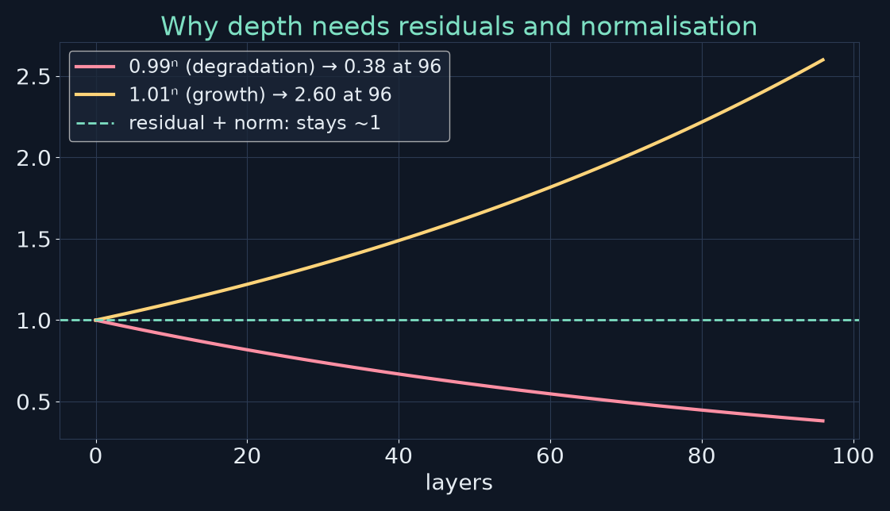

- 0.99⁹⁶ = **0.381** — "99 % accurate" per layer leaves 38 % after 96 layers ✓
- Gradients also vanish or explode through deep stacks

<!-- say: Stacking many layers creates a problem. Imagine a game of telephone through ninety six layers. Even if each layer keeps ninety nine percent of the signal, point nine nine to the power ninety six is point three eight one, so only thirty eight percent survives. The book's number is correct. The same thing happens to gradients flowing backward during training: they can vanish or explode, so the early layers barely learn. -->

---

# The fix: add the input back (my redraw)

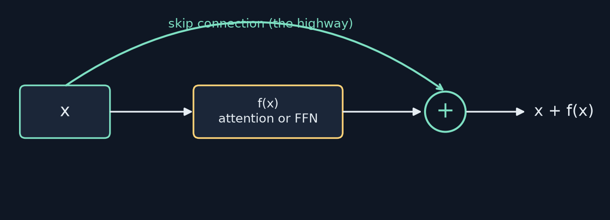

- Output = **x + f(x)** → f only learns the **residual** (what to change)
- Worst case f ≈ 0 → the layer passes x through unchanged
- 🛣️ A highway with optional exits: skip towns that don't help

<!-- say: The fix is beautifully simple. Add the input back to the output: x plus f of x. Now the layer only has to learn the residual, the change to make, rather than rebuilding everything from scratch. If a layer has nothing useful to add, it can learn f close to zero and just pass x through. The book calls it a highway with optional exits. Information can cruise straight from early layers to late ones, and take an exit only where a layer adds value. And during training, gradients get the same highway back down. -->

---

# Residuals in the Transformer

- **Two** skip connections per layer: around attention, around the FFN
- The vector that flows through is called the **residual stream**
- Each sublayer **reads** from it and **writes** an update into it
- Shapes must match → every sublayer outputs **768** (in GPT-2 small)

<!-- say: In a transformer layer there are two skip connections, one around the attention block and one around the feed forward block. People call the vector that flows along this highway the residual stream. Each sublayer reads from the stream, computes something, and adds its update back in. That's also why every sublayer has to output exactly the same size as its input, seven sixty eight in GPT-2 small. -->

---

<!-- _class: divider -->
# Part 4
## Layer normalisation

<!-- say: Part four. Layer normalisation. -->

---

# The stability problem

- 1.01⁹⁶ = **2.60** — a tiny per-layer gain compounds ✓
- Values drift up (overflow) or down (vanishing)
- **LayerNorm** per vector: subtract mean → divide by std → learned scale γ and shift β
- 🌡️ A thermostat: whatever comes in, the next layer gets a stable range

<!-- say: Deep networks have a second problem: values can drift. If each layer amplifies its input by just one percent, after ninety six layers it's grown by two point six times, which again matches the book, and it can get much worse during training. LayerNorm resets the scale at every layer. For each vector, compute its mean and standard deviation across the dimensions, subtract the mean, divide by the standard deviation, and then apply a learned scale and shift so the network can undo it if it wants. The book calls it a thermostat. -->

---

# ⚠️ Book check: the LayerNorm example

| | values |
|---|---|
| input | [102.5, 98.3, 105.7, 95.2] |
| **book's** output | [0.52, −0.31, 1.12, −0.78] — sums to **0.55**, not 0 |
| **actual** (`F.layer_norm`, γ=1, β=0) | **[0.52, −0.53, 1.32, −1.31]** |

- Mean = 100.425, std = 3.98 → (98.3 − 100.425)/3.98 = −0.53
- Rule of thumb: normalised values must **sum to 0** and have **variance 1**

<!-- say: Let's check the book's LayerNorm example. The input is one oh two point five, ninety eight point three, one oh five point seven and ninety five point two. The book gives the output as point five two, minus point three one, one point one two, minus point seven eight. But those add up to point five five, and a normalised vector has to sum to zero. I ran PyTorch's layer norm with no scale or shift, and the correct output is point five two, minus point five three, one point three two, minus one point three one. The mean is one hundred point four two five and the standard deviation is about three point nine eight. The first value happens to match. A quick sanity check for any normalised vector: it should sum to zero and have a variance of one. This one is in the errata. -->

---

# Pre-Norm vs Post-Norm (my redraw)

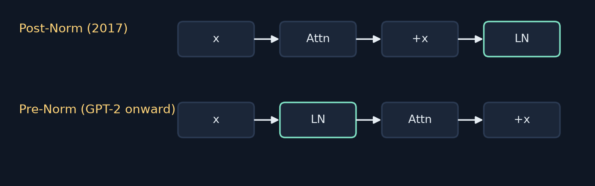

- 2017 paper: **Post-Norm** (normalise after adding)
- GPT-2 and most modern LLMs: **Pre-Norm** — trains more stably when deep

<!-- say: Where does LayerNorm go? The original 2017 transformer normalised after each residual addition. That's called post norm. GPT-2 and most modern models normalise the input to each sublayer instead, before attention and before the feed forward block. That's pre norm, and it trains more stably, especially in very deep stacks, because the residual highway itself is never normalised. -->

---

# RMSNorm: the leaner cousin

$$\text{RMSNorm}(x)=\frac{x}{\sqrt{\tfrac1d\sum_i x_i^2}}\cdot\gamma$$

- Skip the mean subtraction — **divide by root-mean-square** only
- Faster, less memory, works about as well → **Llama, Mistral**
- Same input → `[1.020, 0.978, 1.052, 0.947]` (not centred, just scaled)

<!-- say: Many recent models, including Llama and Mistral, use RMSNorm instead. It skips the mean subtraction and just divides by the root mean square of the vector, then applies a learned scale. It's slightly faster, uses less memory, and works about as well in practice. On the same input it gives one point oh two, point nine seven eight, one point oh five two and point nine four seven. Notice those aren't centred. They're just rescaled to a typical size of one. -->

---

<!-- _class: divider -->
# Part 5
## Putting it all together

<!-- say: Part five. Putting it all together. -->

---

# One Transformer layer (Pre-Norm, my redraw)

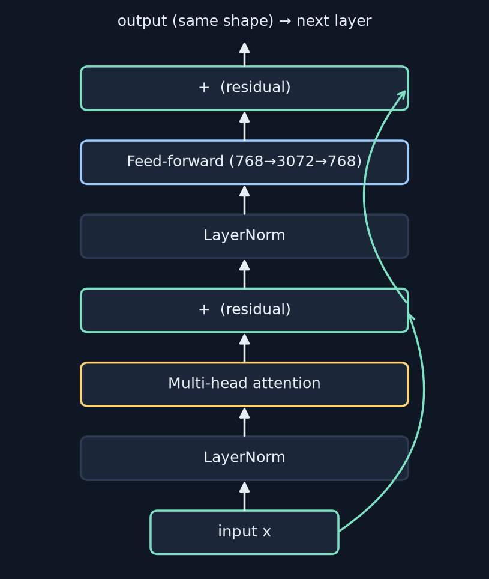

<!-- say: Here's one complete transformer layer, in the pre norm style that GPT-2 uses. Start with the input x. Normalise it, run multi head attention, and add the result back to x. That's the first residual. Then normalise again, run the feed forward network, and add that back. That's the second residual. The output has the same shape as the input, so it can go straight into the next layer. -->

---

# The layer recipe

```text
h   = x + Attention(LayerNorm(x))     # gather context
out = h + FFN(LayerNorm(h))           # process each position
```

1. Normalise → 2. Attend → 3. Add residual
4. Normalise → 5. Feed-forward → 6. Add residual

- Stack it: GPT-2 small **12** · GPT-3 **96** · large models **80–120+**

<!-- say: In two lines of pseudocode: h equals x plus attention of layer norm of x, then the output equals h plus the feed forward network of layer norm of h. Six steps: normalise, attend, add, normalise, process, add. Then you stack the layer. GPT-2 small has twelve layers, GPT-3 has ninety six, and big models today have eighty to a hundred and twenty or more. -->

---

# What each floor does

- 🏢 Every floor has the same layout: attention room + processing room
- Early layers: **local** patterns, syntax
- Middle layers: phrases, **semantic** relations
- Late layers: abstract structure, the **next-token** prediction
- By the top, "sat" knows **who** sat, **where**, and what may come next

<!-- say: The book compares the stack to a building. Every floor has the same layout, an attention room and a processing room, and the residual stream is the elevator. Researchers generally find that early layers capture local patterns and syntax, middle layers build phrases and semantic relationships, and late layers handle abstract structure and the final prediction. By the top floor, a simple word like sat carries who sat, where, and what's likely to come next. -->

---

# The complete model

```text
token ids ─► token embedding (wte) + position embedding (wpe)
          ─► [ Transformer layer ] × N
          ─► final LayerNorm
          ─► linear "unembedding" → logits over the vocabulary
          ─► softmax → P(next token)
```

<!-- say: And here's the whole model. Token IDs go into the token embedding table, and position embeddings are added. The result flows through N transformer layers. A final layer norm, then a linear layer maps each vector back onto the vocabulary, producing a score, called a logit, for every possible next token. Softmax turns those into probabilities. That's GPT, end to end. -->

---

# Where GPT-2's 124M parameters live (my count)

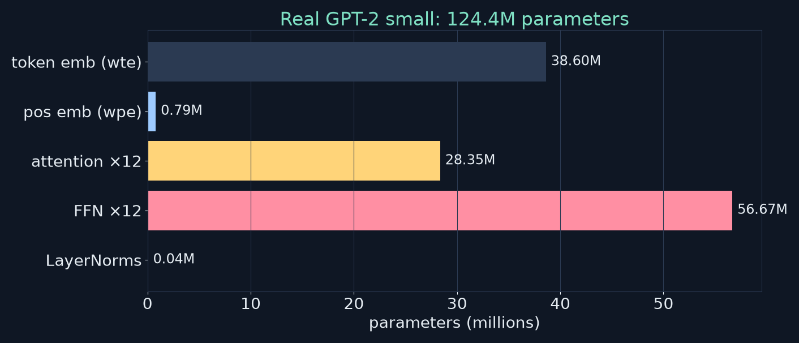

- Total **124,439,808** · per layer: attention 2.36M, FFN 4.72M
- Token embeddings 38.6M (50,257 × 768) are reused as the output layer (weight tying)

<!-- say: I counted every parameter in the real GPT-2 small. The total is a hundred and twenty four million, four hundred and thirty nine thousand, eight hundred and eight. The token embedding table, fifty thousand two hundred and fifty seven tokens by seven sixty eight, is thirty eight point six million on its own. Each layer has two point three six million parameters in attention and four point seven two million in the feed forward network, twice as many. Across twelve layers, that's fifty seven million in the feed forward networks and twenty eight million in attention. Layer norms are tiny. GPT-2 also reuses the token embedding matrix as its output layer, which is called weight tying, so it isn't counted twice. -->

---

<!-- _class: divider -->
# Part 6
## Encoder vs decoder

<!-- say: Part six. Encoders versus decoders. -->

---

# Encoder vs decoder attention

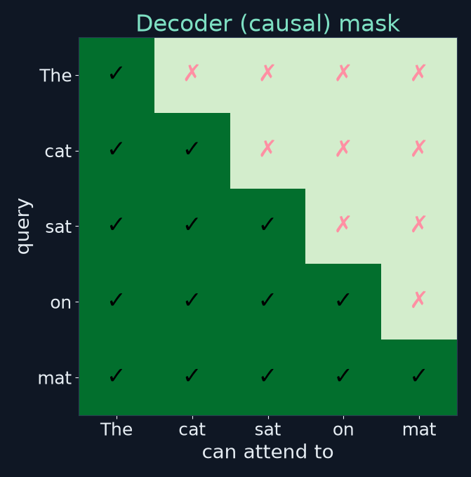

- **Encoder:** every position sees every position (bidirectional)
- **Decoder:** each position sees only itself and the **past** (causal mask)

<!-- say: An encoder lets every position attend to every other position, so it has full, bidirectional visibility. A decoder uses a causal mask: each position can see itself and earlier positions, but nothing later. In the grid, the ticks below the diagonal are allowed and the crosses above it are blocked. When you're generating, you can't look at words you haven't written yet. That would be cheating. -->

---

# Three families (my redraw)

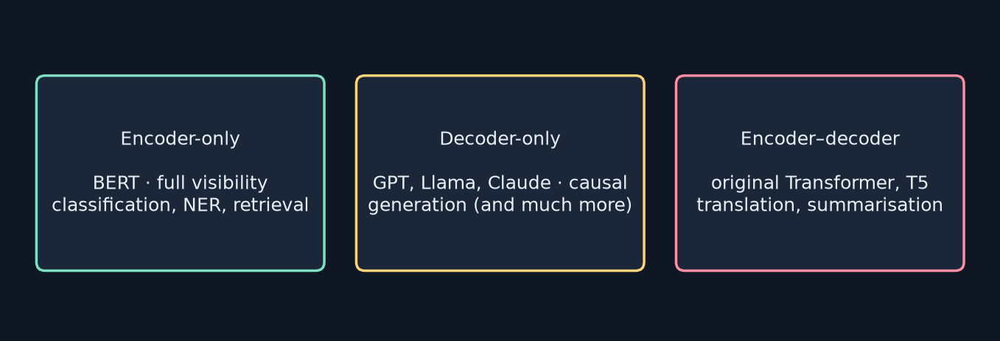

<!-- say: That gives three families. Encoder only models, like BERT, see everything, which makes them great for classification, entity extraction and retrieval, but they don't naturally generate text. Decoder only models, like GPT, Llama and Claude, are causal and generate text one token at a time. Encoder decoder models, like the original transformer and T5, read the source fully with an encoder, then generate with a decoder that cross attends to it. That's natural for translation and summarisation. -->

---

# GPT vs BERT — who won?

- **BERT (2018):** encoder-only, bidirectional, understanding tasks
- **GPT (2018→):** decoder-only, causal, generation
- At scale, decoders learned to **understand** too → ChatGPT, Claude, Llama are decoder-only
- **This book (Part III):** we build a **decoder-only**, GPT-style model
- GPT = **G**enerative **P**re-trained **T**ransformer

<!-- say: The two famous lineages are BERT and GPT, both from 2018. BERT is encoder only and bidirectional, built for understanding. GPT is decoder only and causal, built for generation. As models scaled up, the decoders turned out to be good at understanding too, just by predicting what comes next, and they won the scaling race. ChatGPT, Claude and Llama are all decoder only. That's what we'll build in part three of this book. And GPT stands for generative pre-trained transformer: it generates, it's pre-trained on lots of text, and it's a transformer. -->

---

<!-- _class: divider -->
# Part 7
## From architecture to application

<!-- say: Part seven. From architecture to application. -->

---

# Training vs inference

| Training | Inference |
|---|---|
| Input: a token sequence | Input: your prompt |
| Target: the **next token at every position** | Output: P(next token) at the **last** position |
| Loss → backward pass → update **all** weights | Sample a token, **append**, repeat |
| Billions of steps, trillions of tokens | One forward pass per new token |

<!-- say: Training and inference use the same architecture in different ways. In training, we feed a sequence and ask the model to predict the next token at every position at once, measure how wrong it was with a loss, run the backward pass, and update every weight: embeddings, attention, feed forward networks, norms, everything. Billions of times. In inference, we feed a prompt, read the probabilities at the last position, pick a token, append it, and run again. One forward pass per new token, which is why long outputs take time. -->

---

# Real inference: "The capital of France is" (my experiment)

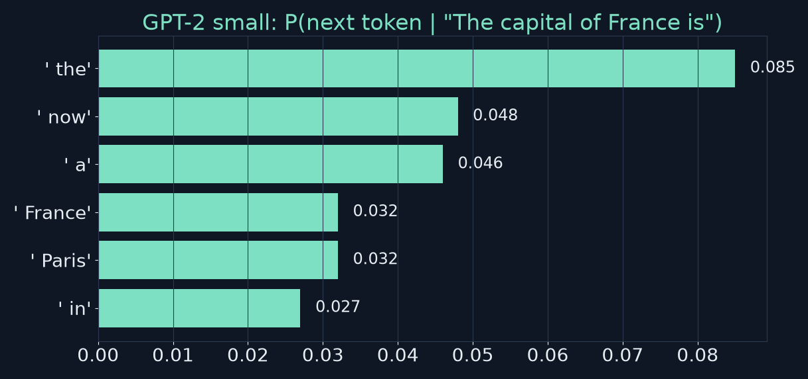

- GPT-2 small's top choice is **" the"** (8.5 %); **" Paris"** is only **3.2 %**
- Greedy continuation: "…is **the capital of the French Republic, and**"

<!-- say: The book's inference example uses the capital of France is, with the model picking Paris. So I asked real GPT-2 small. Its top choice is not Paris but the word the, at eight and a half percent, followed by now, a, and France. Paris is only fifth, at three point two percent. If we always pick the most likely token, it continues the capital of the French Republic, and so on. That's a nice lesson about scale. A hundred and twenty four million parameter model, trained only to predict web text, knows Paris is relevant but doesn't answer like an assistant. Bigger models and instruction tuning, which come later in the book, change that. -->

---

# Scale: same architecture, more of it

| Model | Layers | d_model | Heads | Params |
|---|---|---|---|---|
| GPT-2 small | 12 | 768 | 12 | 124M |
| GPT-2 large | 36 | 1,280 | 20 | 774M |
| GPT-3 | 96 | 12,288 | 96 | 175B |
| Llama 3.1 405B | 126 | 16,384 | 128 | 405B |

- Bigger → **emergent** abilities (reasoning, instruction following) — not fully understood

<!-- say: Here's how the same architecture scales. GPT-2 small: twelve layers, width seven sixty eight, twelve heads, a hundred and twenty four million parameters. GPT-2 large: thirty six layers, width twelve eighty, twenty heads, about seven seventy four million. GPT-3: ninety six layers, width twelve thousand two hundred and eighty eight, ninety six heads, a hundred and seventy five billion. Llama three point one four oh five B: a hundred and twenty six layers, width sixteen thousand three hundred and eighty four, a hundred and twenty eight heads. These figures come from the published papers and model cards. The design is the same; the scale changes, and with scale come abilities nobody fully understands yet. -->

---

# Everything you now know

1. **Embeddings** (Ch 2) — words → vectors
2. **Position encodings** — vectors carry location
3. **Attention** (Ch 3) — vectors gather context
4. **Feed-forward** — each position is transformed
5. **Residuals** — the signal is preserved
6. **LayerNorm** — values stay stable
7. **Stacking** — depth builds understanding

<!-- say: Let's take stock. You now know every major part of a transformer. Embeddings turn words into vectors. Position encodings add location. Attention gathers context. Feed forward networks transform each position. Residual connections preserve the signal. Layer norm keeps the values stable. And stacking builds depth. Every response from a modern chatbot flows through exactly this design. -->

---

<!-- _class: divider -->
# Part 8
## Hands-on

<!-- say: Part eight. Hands on. -->

---

# Exercise 1 & 2: trace "The cat sat"

1. **Tokens:** ["The", " cat", " sat"] → GPT-2 IDs **[464, 3797, 3332]**
2. **Embedding:** each → 768 numbers → a (3 × 768) matrix
3. **+ position:** wpe[0], wpe[1], wpe[2]
4. **Attention L1:** "sat" queries for a subject → "cat"'s key matches
5. **FFN L1:** each row transformed independently (768→3072→768)
6. **More layers** refine · **Output:** P(next) — e.g. " on", " down"…
- Residual keeps the original "cat" signal alive through both layers

<!-- say: Exercises one and two ask you to trace the cat sat through the model. Tokenise it: in GPT-2 that's three tokens, with IDs four six four, three seven nine seven and three three three two. Look up embeddings, giving a three by seven sixty eight matrix. Add position vectors zero, one and two. In layer one's attention, sat queries for its subject and finds cat. The feed forward network transforms each row on its own. More layers refine the picture, and at the top we get a distribution over the next token, with words like on or down likely. And through it all, the residual stream keeps the original signal for cat alive. -->

---

# Exercise 3 & 4: design and choose

- **Tiny transformer** (predict a word's last letter): 2 layers · d = 64 · 4 heads · learned positions (short, fixed length)
- **Which architecture?**
  1. Review sentiment → **encoder**
  2. English → French → **encoder–decoder** (or a big decoder)
  3. Continue a story → **decoder**
  4. Extract entities → **encoder**
  5. QA over a passage → **encoder** (extractive) or **decoder** (generative)

<!-- say: Exercise three: design a tiny transformer for predicting the last letter of a word. My choice would be two layers, width sixty four, four heads, and learned positions, because words are short and have a fixed maximum length. Exercise four asks which architecture fits each task. Sentiment classification: an encoder. Translation: classically an encoder decoder, though big decoders do it well too. Continuing a story: a decoder. Extracting entities: an encoder. Question answering over a passage: an encoder if you're extracting a span, a decoder if you're generating an answer. -->

---

<!-- _class: divider -->
# Part 9
## Checkpoint exercise

<!-- say: Part nine. The checkpoint exercise. -->

---

# Checkpoint (25–30 min)

1. **Draw** one layer from memory: LNs, attention, FFN, both residuals
2. **Trace** a word of "The quick brown fox jumps" through two layers
3. **Design questions** — remove residuals? remove LayerNorm? why positions before attention? more layers: help or hurt?
4. **Pick the architecture:** document QA · essay writer · translator

<!-- say: The checkpoint has four parts. First, draw one transformer layer from memory, with both layer norms, attention, the feed forward network and both residual paths. Second, pick a word from the quick brown fox jumps and trace it through two layers. Third, answer four design questions. And fourth, pick the architecture for a document question answerer, an essay writer and a translator. Pause the video and try it before you look at my answers. -->

---

# My answers to the design questions

- **No residuals:** deep stacks degrade, gradients vanish → early layers barely learn
- **No LayerNorm:** activations drift and explode/vanish → unstable training
- **Positions before attention:** attention is order-blind; position must be in Q and K when scores are computed
- **More layers:** more refinement and capacity — but more compute, harder optimisation, and overfitting on small data
- **Part 4:** QA reader → encoder · essay → decoder · translator → encoder–decoder

<!-- say: My answers. Without residuals, a deep stack degrades and the gradients vanish, so the early layers barely learn. Without layer norm, activations drift and blow up or shrink, and training becomes unstable. Positions have to be added before attention, because attention is blind to order: the position information needs to be inside the queries and keys when the scores are computed. More layers give more capacity and more refinement, but they cost compute, are harder to optimise, and can overfit small data sets. And for part four: a document question answerer is naturally an encoder, an essay writer a decoder, and a translator an encoder decoder. -->

---

<!-- _class: divider -->
# Part 10
## Wrap-up

<!-- say: Part ten. Wrapping up. -->

---

# Key takeaways

1. Attention is order-blind → **add position** (sinusoidal, learned, RoPE)
2. **FFN**: expand ×4 → GELU → contract, per position
3. **Residuals**: x + f(x) — the highway through depth
4. **LayerNorm/RMSNorm**: stable ranges — Pre-Norm in modern models
5. Layer = Norm → Attn → +x → Norm → FFN → +x, stacked N times
6. **Encoder** = bidirectional · **Decoder** = causal · GPT is decoder-only

<!-- say: The key takeaways. One: attention is blind to order, so we add position information, with sinusoidal, learned or rotary encodings. Two: the feed forward network expands by four, applies GELU, and contracts, separately at each position. Three: residual connections, x plus f of x, are the highway through depth. Four: LayerNorm or RMSNorm keeps values in a stable range, and modern models normalise before each sublayer. Five: a layer is norm, attend, add, norm, feed forward, add, stacked N times. Six: encoders are bidirectional, decoders are causal, and GPT is decoder only. -->

---

# Notes on the book (checked)

- ✅ 0.99⁹⁶ ≈ 0.38 · 1.01⁹⁶ ≈ 2.6 · GELU values · 768→3072→768
- ⚠️ **LayerNorm example** wrong: should be **[0.52, −0.53, 1.32, −1.31]**
- ⚠️ **"GPT, Claude, LLaMA use GELU"**: LLaMA uses **SwiGLU**; Claude unpublished
- ⚠️ **"GPT-4 uses RoPE"**: GPT-4's architecture is **not public**
- ℹ️ "Paris" is illustrative — GPT-2 small ranks it 5th (3.2 %)

<!-- say: My notes on the book for this chapter. The compounding numbers, the GELU values and the feed forward shapes are all correct. Three items go into the errata. The LayerNorm example output is wrong, and the correct values are point five two, minus point five three, one point three two and minus one point three one. Llama uses SwiGLU rather than GELU, and Claude's architecture isn't published. And GPT-4's architecture, including its position scheme, isn't public. Finally, the Paris example is illustrative: real GPT-2 small ranks Paris fifth. -->

---

# Review questions 1

**Q1. Why position encodings?** Attention is permutation-equivariant; without them "dog bites man" = "man bites dog".
**Q2. Two approaches?** Sinusoidal (formula; extrapolates) vs learned (table; often better in range, capped at max length). RoPE: rotate Q/K, relative.
**Q3. FFN?** Per-position MLP: expand ×4 for scratch space, nonlinearity, contract to fit the next layer.
**Q4. Residuals?** Highway with exits; x + f(x) preserves signal and gradients through depth.

<!-- say: Review questions, with my answers. One: why position encodings? Because attention treats its inputs as an unordered set, so without them dog bites man equals man bites dog. Two: the two main approaches are sinusoidal, a formula that extrapolates, and learned, a table that often works better within range but stops at the maximum length. RoPE is the modern relative variant. Three: the feed forward network is a per position network that expands for scratch space, applies a nonlinearity, and contracts to fit the next layer. Four: residuals are a highway with exits. Adding x back preserves both the signal and the gradients through depth. -->

---

# Review questions 2

**Q5. LayerNorm?** Stops values drifting; normalises each vector (mean 0, var 1, then γ, β). Modern: before each sublayer (Pre-Norm).
**Q6. One layer?** LN → multi-head attention → +x → LN → FFN → +h.
**Q7. Encoder vs decoder?** Full vs causal attention; encoders for understanding (BERT), decoders for generation (GPT).
**Q8. Causal mask?** Set future scores to −∞ before softmax → zero weight; needed so generation can't peek ahead.

<!-- say: Five: layer norm stops values drifting by normalising each vector to mean zero and variance one, then applying a learned scale and shift. Modern models apply it before each sublayer. Six: one layer is layer norm, multi head attention, add x, layer norm, feed forward, add again. Seven: encoders use full attention and suit understanding, like BERT. Decoders use causal attention and suit generation, like GPT. Eight: the causal mask sets future scores to minus infinity before the softmax, so they get zero weight. It's needed so that a model trained to predict the next token can't simply look at it. -->

---

# Practice this

- ☐ Draw the Pre-Norm layer from memory; then check against the slide
- ☐ Verify the LayerNorm fix: mean, std, then (x − μ)/σ by hand
- ☐ Count GPT-2's parameters with `sum(p.numel() for p in model.parameters())`
- ☐ Do Exercises 3–4 and the checkpoint design questions
- ☐ Set up Python for Part II: **github.com/FirstLLM/code** — Ch 5 notebook next

<small>Code on these slides is my own illustration (Ch 1–4 have no book notebook).</small>

<!-- say: Your practice list. Draw the pre norm layer from memory and check it against the slide. Verify the LayerNorm correction by hand. Load GPT-2 and count its parameters with one line of Python. Do exercises three and four and the checkpoint design questions. And get your Python environment ready, because the book's chapter five notebook is next. The code in this video is my own, since part one has no book notebook. -->

---

# Up next: Chapter 5 — Part II begins

**Python Essentials & PyTorch**
Theory is in place — time to write code
→ the book's **ch05 notebook** on github.com/FirstLLM/code

<!-- say: That's chapter four, and the end of part one. You understand what AI is, how words become numbers, how attention works, and how the transformer puts it all together. Part two is hands on. In chapter five we set up Python and start writing real code with the book's notebooks. The theory is in place. Time to build. -->

---

<!-- _class: lead -->
# Credits
Based on **"Build Your First LLM"** by **Hasan Degismez** — buy the book: **leanpub.com/FirstLLM**
Code: **github.com/FirstLLM/code** (MIT License) · GPT-2 weights: OpenAI via Hugging Face
Slides, narration and diagrams: my own teaching adaptation · **Waqar Shaikh Builds**

<!-- say: This video is based on the book Build Your First LLM by Hasan Degismez. Everything here is my own adaptation for study, so please support the author and buy the book at leanpub dot com slash First LLM. The companion code is at github dot com slash First LLM slash code, under the MIT license. Thanks for watching, and see you in chapter five. -->
