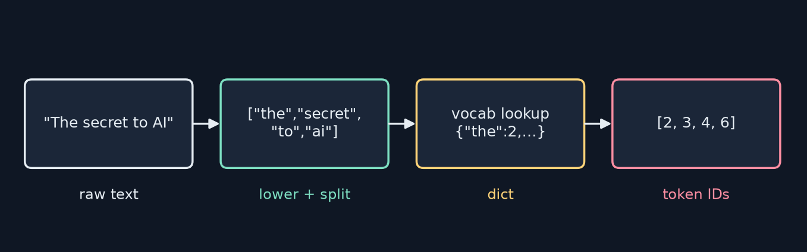
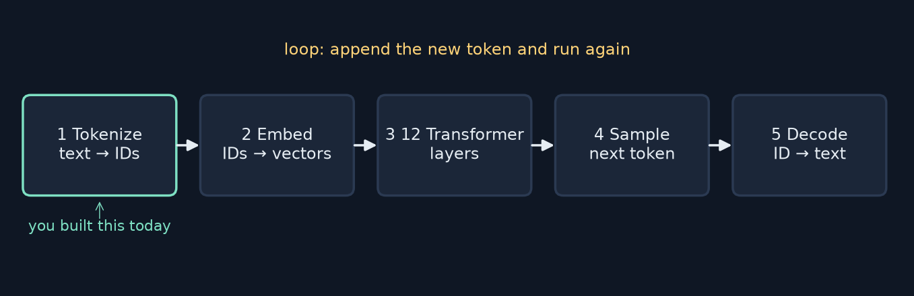
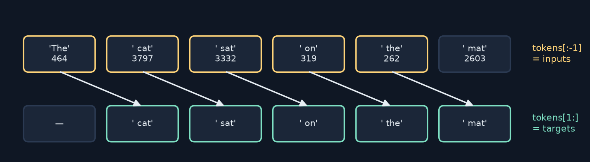
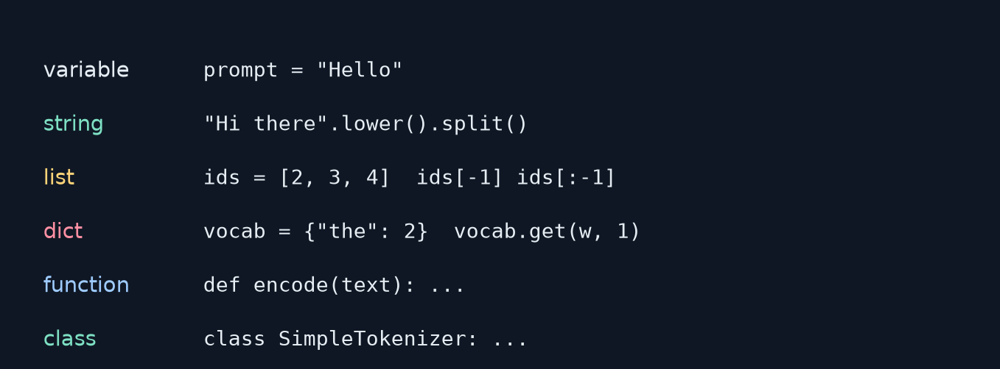

<!-- _class: lead -->
<!-- _paginate: false -->
# Build Your First LLM
## Chapter 5 — Your First Python Program
A study companion to *Build Your First LLM* by Hasan Degismez
**Waqar Shaikh Builds**

<!-- say: Welcome to chapter five of my study series on Build Your First LLM by Hasan Degismez. This is where part two begins, and where we stop drawing diagrams and start writing code. In this chapter we'll run a real language model in a few lines, learn the Python we need to understand what just happened, and build our own tokenizer from scratch, the very first stage of every LLM. I ran the book's chapter five notebook end to end for this video, and I'll show you the real outputs. -->

---

# Where we are

- **Part I (Ch 1–4):** what LLMs are — embeddings, attention, the Transformer
- **Part II (Ch 5–9):** the tools — Python, NumPy, PyTorch, tokenizers, neural nets
- **Today:** run GPT-2 · Python essentials · build a **tokenizer**
- Notebook: **FirstLLM/code → notebooks/ch05.ipynb** (Colab link in description)

<!-- say: In part one we learned how LLMs work on paper. Part two gives us the tools: Python, NumPy, PyTorch, tokenizers and small neural networks. Today we run GPT-2, learn the Python essentials, and build a tokenizer. Everything follows the book's chapter five notebook, which you can open in Colab from the link in the description. -->

---

# Chapter 5 roadmap

1. The hook: run GPT-2 in ~10 lines
2. Why Python?
3. Variables, strings, numbers, f-strings
4. Lists and dictionaries → a **vocabulary**
5. Control flow and loops → handling **unknown words**
6. Functions → `tokenize` / `detokenize`
7. Classes → `SimpleTokenizer`, shaped like Hugging Face's
8. Full circle · exercises (solved) · review

<!-- say: Here's the roadmap. We start with the hook: running GPT-2 in about ten lines. Then why Python. Then the basics: variables, strings, numbers and f-strings. Lists and dictionaries give us a vocabulary. Control flow and loops handle unknown words. Functions give us tokenize and detokenize. A class packages it all into a SimpleTokenizer shaped like Hugging Face's. Then we come full circle, solve the exercises and do the review questions. -->

---

# Key terms for this chapter

| Term | One-line meaning |
|---|---|
| **Variable** | A name attached to a value |
| **String** | Text — what LLMs read and write |
| **List** | An ordered collection — a sequence of tokens |
| **Dictionary** | Key → value mapping — a vocabulary |
| **Function** | Reusable code with inputs and a return value |
| **Class** | A blueprint bundling data + methods (a tokenizer object) |
| **Tokenizer** | Converts text ↔ numbers |
| **Token** | One unit of text the model processes |

<!-- say: The vocabulary for today. A variable is a name attached to a value. A string is text, which is what language models read and write. A list is an ordered collection, perfect for a sequence of tokens. A dictionary maps keys to values, which is exactly what a vocabulary is. A function is reusable code with inputs and an output. A class is a blueprint that bundles data and functions, like a tokenizer object. A tokenizer converts text to numbers and back. And a token is one unit of text, a word, a piece of a word, or a character. -->

---

<!-- _class: divider -->
# Part 1
## The hook: run GPT-2

<!-- say: Part one. The hook. Let's run GPT-2. -->

---

# GPT-2 in a few lines (book notebook, cell 3)

```python
# Load GPT-2 text generation model (124M parameters)
generator = pipeline('text-generation', model='gpt2')

# Generate text from a starting prompt
result = generator(
    'The secret to building AI is',  # Starting text
    max_new_tokens=20,                # Generate 20 more words
    do_sample=True,                   # Use randomness (not just most likely words)
    pad_token_id=50256                # Technical: avoids a warning
)
print(result[0]['generated_text'])
```
<small>Code: FirstLLM/code (MIT License) · notebooks/ch05.ipynb</small>

<!-- say: Here's the cell from the book's notebook. pipeline, from Hugging Face's transformers library, downloads and loads GPT-2, a hundred and twenty four million parameters. Then we call the generator with a prompt, the secret to building AI is, ask for twenty new tokens, and turn on sampling so the output is a little random. The pad token ID just silences a warning. That's it. You're driving one of the most important models in AI history. -->

---

# What I got (real run, CPU)

```text
The secret to building AI is to know that people are not afraid to learn.

Conducted by the National Academy of
```

- Your output **will differ** — `do_sample=True` draws random tokens
- Small base model: fluent-ish, drifts off topic — that's GPT-2 small
- Note: "20 more words" in the comment is really **20 tokens**

<!-- say: And here's what I got when I ran it on a plain CPU. The secret to building AI is to know that people are not afraid to learn. Then it wanders off into conducted by the National Academy of. Your output will be different, because sampling draws random tokens each time. It's fluent-ish but drifts off topic, which is typical of a small base model. One small detail: the comment says twenty more words, but max new tokens counts tokens, and a token can be part of a word. -->

---

# Why Python?

- **Readable:** `for word in sentence:` says what it does
- **Ecosystem:** NumPy, PyTorch, Hugging Face — already built
- "Isn't Python slow?" — it **orchestrates**; the heavy maths runs in optimised C/CUDA
- 🎼 Python conducts; the orchestra plays

<!-- say: Why Python? Two reasons. It's readable: for word in sentence says exactly what it does. And the ecosystem: NumPy, PyTorch and Hugging Face already exist. Isn't Python slow? Raw Python is, yes. But it doesn't do the heavy lifting. When you called pipeline, Python was gluing together highly optimised C and GPU code. Python conducts, and the orchestra plays. -->

---

<!-- _class: divider -->
# Part 2
## Storing and processing text

<!-- say: Part two. Storing and processing text. -->

---

# Variables and strings (notebook cell 5)

```python
output = 'The secret to building AI is understanding how machines learn from data'
prompt = 'The secret to building AI is'
print(len(output))   # Length in characters
print(type(output))  # Confirm it's a string
words = output.lower().split()
generated = output[len(prompt):]
print(f'Generated: {generated.strip()}')
```
```text
71
<class 'str'>
Generated: understanding how machines learn from data
```

<!-- say: A variable is a labelled container. Here output and prompt hold two strings. len gives the number of characters, and type confirms it's a string. split breaks the text into a list of words, and lower makes everything lowercase first, which is called method chaining. And output, square bracket, len of prompt, colon, is slicing: everything after the prompt. When I ran it, the length printed was seventy one. -->

---

# ⚠️ Book check: `len(output)`

- Book §5.4.1: `print(len(output))  # 68`
- Real run (and the book's own notebook): **71**
- Count it: 12 words = **60 letters + 11 spaces = 71** — `len()` counts every character
- Lesson: never trust a comment — **run it**

<!-- say: A small erratum. In the book's text, the comment says this prints sixty eight. But the real answer, and what the book's own notebook prints, is seventy one. len counts every character, including the eleven spaces between the twelve words. It's a trivial slip, but it's a good habit to form right now: never trust a comment over the actual output. Run it. -->

---

# Slicing — you'll use it everywhere

```python
s = "The secret"
s[0]     # 'T'          first
s[-1]    # 't'          last
s[:3]    # 'The'        first three
s[4:]    # 'secret'     from index 4 on
ids[:-1] # all but last   ← LLM inputs
ids[1:]  # all but first  ← LLM targets
```

<!-- say: Slicing deserves a slide of its own, because we'll use it constantly. Index zero is the first item, minus one is the last. Colon three means the first three. Four colon means from index four to the end. And two slices we'll see in every training loop: colon minus one, everything except the last, and one colon, everything except the first. Keep those last two in mind, because they come back in the review questions. -->

---

# Numbers and f-strings (notebook cell 7)

```python
num_parameters = 124_000_000  # 124 million (GPT-2 size)
learning_rate = 0.0001        # Small step size for training
vocab_size = 50257            # GPT-2's vocabulary size
print(f'GPT-2 has {num_parameters:,} parameters')   # :, adds comma separators
print(f'Learning rate is {learning_rate:.2e}')      # :.2e = scientific notation
print(f'Half the vocab: {vocab_size // 2}')         # You can compute inside {}!
```
```text
GPT-2 has 124,000,000 parameters
Learning rate is 1.00e-04
Half the vocab: 25128
```

<!-- say: Numbers come in two main kinds: integers like fifty thousand two hundred and fifty seven, and floats like point zero zero zero one. Underscores make big numbers readable. And f-strings let you put values straight into text: colon comma adds thousands separators, colon point two e gives scientific notation, and you can even compute inside the braces, like integer division by two. Fifty thousand two hundred and fifty seven divided by two, rounded down, is twenty five thousand one hundred and twenty eight. You'll write f-strings in every training loop. -->

---

<!-- _class: divider -->
# Part 3
## Building a vocabulary

<!-- say: Part three. Building a vocabulary. -->

---

# GPT-2 sees numbers, not words



- "The secret to building AI is" → GPT-2 IDs **[464, 3200, 284, 2615, 9552, 318]** ✓ (I checked)

<!-- say: Here's the crucial insight. GPT-2 never sees words. It sees numbers. The book's prompt, the secret to building AI is, becomes four six four, three two hundred, two eight four, two six one five, nine five five two, three one eight. I checked those with the real tokenizer and they're right. So we need a tokenizer. Text goes in, gets lowercased and split, each word is looked up in a vocabulary, and out come token IDs. -->

---

# Lists: collect the words (notebook cell 9)

```python
texts = [
    'The secret to building AI is',
    'The key to machine learning is data',
    'AI systems learn from examples'
]
all_words = []
for text in texts:
    words = text.lower().split()  # Normalize to lowercase
    all_words.extend(words)
print(all_words[0], all_words[-1], all_words[:3])  # First, last, first 3
```
```text
the examples ['the', 'secret', 'to']
```

<!-- say: First, collect all the words from some training text. The notebook uses three short sentences. We loop over them, lowercase and split each one, and use extend to add the words to one big list. extend adds each item separately. If you used append, you'd add the whole list as a single item, a classic beginner bug. Then indexing: the first word is the, the last is examples, and the first three are the, secret, to. -->

---

# Dictionaries: word → ID (notebook cell 9)

```python
vocab = {'<PAD>': 0, '<UNK>': 1}  # Special tokens first (reserved IDs)
for word in all_words:
    if word not in vocab:
        vocab[word] = len(vocab)
print(f'Vocabulary size: {len(vocab)}')
```
```text
Vocabulary size: 16
{'<PAD>': 0, '<UNK>': 1, 'the': 2, 'secret': 3, 'to': 4, 'building': 5,
 'ai': 6, 'is': 7, 'key': 8, 'machine': 9, 'learning': 10, 'data': 11, ...}
```

- `<PAD>` fills batches to equal length · `<UNK>` = "never seen this word"

<!-- say: Now the key step: a dictionary mapping each word to a number. We start with two special tokens. PAD, ID zero, fills empty space so that sequences in a batch line up to the same length. UNK, ID one, is the fallback for words we've never seen. Then for each word, if it isn't in the vocabulary yet, we give it the next free ID, which is just the current size of the dictionary. Fourteen unique words plus two special tokens gives sixteen. The IDs follow the order in which words were first seen. -->

---

<!-- _class: divider -->
# Part 4
## Handling edge cases

<!-- say: Part four. Handling edge cases. -->

---

# Unknown words: `if/else` and `.get()`

```python
vocab['neural']                     # KeyError! — crashes
if word in vocab: token_id = vocab[word]
else:             token_id = vocab['<UNK>']
token_id = vocab.get(word, vocab['<UNK>'])   # same thing, one line
```

- `dict.get(key, default)` — the pattern you'll see in all ML code
- 'neural' → **1** (`<UNK>`)

<!-- say: What happens with a word that isn't in the vocabulary? Indexing the dictionary directly raises a KeyError and crashes. We could check with if and else: if the word is in the vocabulary use its ID, otherwise use UNK. Or more neatly, use dot get with a default value. That pattern is everywhere in machine learning code. With our vocabulary, neural maps to one, the unknown token. -->

---

# Loops and list comprehensions (notebook cell 11)

```python
sentence = 'The neural network learns'
token_ids = []
for word in sentence.lower().split():
    token_id = vocab.get(word, vocab['<UNK>'])  # Get ID or <UNK> if unknown
    token_ids.append(token_id)
token_ids = [vocab.get(w, vocab['<UNK>']) for w in sentence.lower().split()]
```
```text
Token IDs (loop): [2, 1, 1, 1]
Token IDs (comprehension): [2, 1, 1, 1]
```

<!-- say: Now a whole sentence: the neural network learns. The loop version goes word by word, gets each ID with a fallback, and appends it to a list. The list comprehension does exactly the same thing in one line: square brackets, the expression, for each w in the words. Both give two, one, one, one. Three unknowns. Our tiny vocabulary has never seen neural, network or learns. That's the weakness of word level tokenizers, and subword tokenizers in chapter eight fix it. -->

---

<!-- _class: divider -->
# Part 5
## Functions and classes

<!-- say: Part five. Functions and classes. -->

---

# Functions: encode and decode (notebook cell 13)

```python
def tokenize(text, vocab):
    words = text.lower().split()
    return [vocab.get(w, vocab['<UNK>']) for w in words]

def detokenize(ids, vocab):
    id_to_word = {v: k for k, v in vocab.items()}
    return ' '.join(id_to_word.get(i, '<UNK>') for i in ids)
```
```text
Encoded: [2, 3, 4, 6]        Decoded: the secret to ai
Our tokens:   [2, 3, 4, 6]   GPT-2 tokens: [464, 3200, 284, 9552]
```

<!-- say: Functions package reusable code. def, a name, parameters in parentheses, and return sends back the result. tokenize lowercases, splits, and looks up each word. detokenize needs the reverse mapping, from ID to word, so it builds one with a dictionary comprehension that flips every pair, then joins the words with spaces. The secret to AI encodes to two, three, four, six and decodes back. Notice we lost the capital letters, because we lowercased. GPT-2's tokenizer gives completely different numbers, from a different vocabulary, but the principle is the same: text to numbers. -->

---

# Classes: a blueprint with state

- A **class** = blueprint · an **object** = one thing built from it
- `__init__` runs once at creation: the starting state
- `self` = "this particular object"
- Methods = functions that live on the object (`fit`, `encode`, `decode`)
- `__len__` lets you write `len(tok)`

<!-- say: Hugging Face organises its tokenizers as classes, so let's do the same. A class is a blueprint, and an object is one thing built from it. You can build many objects from one class, each with its own data. The special method init runs once when the object is created and sets up its starting state. self means this particular object. Methods are functions that live on the object. And defining the special method len lets you call len on your tokenizer. -->

---

<!-- _class: small -->
# SimpleTokenizer (notebook cell 15)

```python
class SimpleTokenizer:
    def __init__(self):
        # Initialize vocabulary with special tokens
        self.word_to_id = {'<PAD>': 0, '<UNK>': 1}
        self.id_to_word = {0: '<PAD>', 1: '<UNK>'}

    def fit(self, texts):
        """Build vocabulary from training texts"""
        for text in texts:
            for word in text.lower().split():
                if word not in self.word_to_id:
                    idx = len(self.word_to_id)
                    self.word_to_id[word] = idx  # Add new word
                    self.id_to_word[idx] = word  # Reverse mapping

    def encode(self, text):
        """Convert text to token IDs"""
        return [self.word_to_id.get(w, 1) for w in text.lower().split()]  # 1 = <UNK>

    def decode(self, ids):
        """Convert token IDs back to text"""
        return ' '.join(self.id_to_word.get(i, '<UNK>') for i in ids)

    def __len__(self):
        return len(self.word_to_id)
```

<!-- say: Here's the full class from the notebook. init creates both directions of the mapping, word to ID and ID to word, already containing the two special tokens. fit builds the vocabulary from training texts, assigning each new word the next ID and recording the reverse mapping at the same time. encode turns text into IDs, using one for unknown words. decode turns IDs back into text. And len returns the vocabulary size. About twenty lines, and it's a real, working tokenizer. -->

---

# Using it — same interface as Hugging Face

```python
tok = SimpleTokenizer()                         # ours
tok.fit(texts); ids = tok.encode('The secret to AI')

from transformers import GPT2Tokenizer          # Hugging Face
gpt2_tok = GPT2Tokenizer.from_pretrained('gpt2'); ids = gpt2_tok.encode('The secret to AI')
```
```text
Vocabulary size: 16   Encoded: [2, 3, 4, 6]   Decoded: the secret to ai
GPT-2 tokenizer: [464, 3200, 284, 9552]
```

- Theirs adds: **subword BPE**, special tokens, save/load, batching

<!-- say: Using it looks just like using Hugging Face. Create the object, fit it on texts, and call encode. With GPT-2's tokenizer, you load it with from pretrained and call encode, the same interface. My run printed a vocabulary of sixteen, the encoding two, three, four, six, and the decoding. The real tokenizer just has many more features: subword tokenization, more special tokens, saving and loading, and batching. -->

---

# Word-level vs subword (preview of Ch 8)

| | SimpleTokenizer | GPT-2 (BPE) |
|---|---|---|
| unit | whole words | subword pieces |
| vocab | grows with data (16 here) | fixed **50,257** |
| unknown words | `<UNK>` | never — falls back to pieces/bytes |
| case | lowercased | case-sensitive, spaces are part of tokens |

- "understanding" → `['under', 'standing']` · " understanding" (with space) → **one** token
- ℹ️ Book's example is the no-space form — spaces matter in GPT-2

<!-- say: Our tokenizer is word level. GPT-2 uses subword byte pair encoding, which we'll build in chapter eight. Our vocabulary grows with the data, sixteen words here, while GPT-2's is fixed at fifty thousand two hundred and fifty seven. We map unseen words to UNK, while GPT-2 never needs to, because it can always fall back to smaller pieces or raw bytes. And GPT-2 keeps case, and treats the leading space as part of the token. The book says understanding can split into under and standing. I checked: that's true without a leading space, but with a space in front, as it would appear mid-sentence, GPT-2 keeps it as one token. Spaces matter. -->

---

<!-- _class: divider -->
# Part 6
## Full circle

<!-- say: Part six. Full circle. -->

---

# What `pipeline()` really did (my redraw)



1. **Tokenize** — you built this · 2. **Embed** (Ch 2) · 3. **12 layers** (Ch 3–4)
4. **Sample** a token · 5. **Decode** — then repeat

<!-- say: Now we can explain the hook. When you called pipeline at the start, five things happened. One: your text went through a tokenizer, like the one you just built. Two: the IDs became embeddings, from chapter two. Three: those vectors flowed through twelve transformer layers with attention, chapters three and four. Four: a token was sampled from the predicted probabilities. Five: it was decoded back to text. And then it looped, appending the new token and running again, twenty times. You've now built stage one. -->

---

# Why `tokens[:-1]` matters (my redraw)



- Inputs = `tokens[:-1]`, targets = `tokens[1:]` → predict the **next** token at every position

<!-- say: And here's why those two slices matter. To train a language model, we take a sequence of token IDs. The inputs are all tokens except the last, and the targets are all tokens except the first, shifted by one. At every position, the model sees the tokens so far and has to predict the next one. The cat sat on the mat gives five training examples from one sentence. This one line of slicing is at the heart of every LLM training loop. -->

---

<!-- _class: divider -->
# Part 7
## Exercises (my solutions)

<!-- say: Part seven. The exercises, with my solutions. -->

---

<!-- _class: small -->
# Exercises 1–3 solved (my own code)

```python
import json, string
class SimpleTokenizer:
    ...
    @staticmethod
    def _clean(text):                      # Ex 1: strip punctuation
        return text.lower().translate(str.maketrans("", "", string.punctuation)).split()
    def encode(self, text): return [self.word_to_id.get(w, 1) for w in self._clean(text)]
    def count_unknowns(self, sentences):   # Ex 2: count <UNK>
        return sum(self.encode(s).count(1) for s in sentences)
    def save(self, path):                  # Ex 3: persist to JSON
        json.dump(self.word_to_id, open(path, "w"))
    @classmethod
    def load(cls, path):
        t = cls(); t.word_to_id = json.load(open(path))
        t.id_to_word = {i: w for w, i in t.word_to_id.items()}; return t
```
- Ran it: "learning, data!" → `learning data` · 3 unknowns in my test · save→load round-trip ✓

<!-- say: Here are my solutions to the three exercises. This is my own code, not from the book's repository. Exercise one, strip punctuation: a clean helper that lowercases, removes every punctuation character using string dot punctuation and translate, and splits. Both fit and encode use it, so learning comma becomes learning. Exercise two, count unknowns: encode each sentence and count how many ones appear. Exercise three, save and load: dump the word to ID dictionary to JSON, and a class method loads it and rebuilds the reverse mapping. I ran all three: the punctuation was stripped, my test sentences had three unknown words, and a saved and reloaded tokenizer encoded identically. The full file is in the repo next to the notes. -->

---

# A gotcha in Exercise 3

- JSON keys are always **strings** → you can't save `id_to_word` ({0: …}) as-is
- Save `word_to_id`, **rebuild** `id_to_word` on load (as above)
- Hugging Face does the same: `vocab.json` maps **token → id**

<!-- say: One gotcha in exercise three. JSON keys are always strings, so if you save the ID to word dictionary directly, your integer keys come back as strings, and decoding silently fails. The fix is to save only word to ID, and rebuild the reverse mapping on load. Hugging Face does exactly this: GPT-2's vocab dot json maps token strings to IDs. -->

---

<!-- _class: divider -->
# Part 8
## Wrap-up

<!-- say: Part eight. Wrapping up. -->

---

# Python cheat sheet (my redraw)



<!-- say: Here's everything from today on one page. Variables to name values. Strings, with lower and split. Lists, with indexing like minus one and slicing like colon minus one. Dictionaries, with dot get and a default. Functions with def. And classes that bundle data and methods together. That's enough Python to read most of the code in this book. -->

---

# Key takeaways

1. You ran a 124M-parameter model with ~10 lines — Python **orchestrates**
2. LLMs see **token IDs**, never words
3. A **vocabulary** is a dict: word → ID, with `<PAD>` and `<UNK>`
4. `encode` = text → IDs · `decode` = IDs → text
5. `SimpleTokenizer` mirrors the Hugging Face interface
6. `tokens[:-1]` / `tokens[1:]` = inputs / targets for next-token training

<!-- say: The key takeaways. One: you ran a hundred and twenty four million parameter model in about ten lines, because Python orchestrates optimised code. Two: language models see token IDs, never words. Three: a vocabulary is a dictionary from words to IDs, with special tokens for padding and unknowns. Four: encode turns text into IDs, and decode turns IDs back into text. Five: our SimpleTokenizer has the same interface as Hugging Face's. Six: the two slices, colon minus one and one colon, give the inputs and targets for next token training. -->

---

# Notebook run & book check

- ✅ **ch05.ipynb** ran end-to-end on CPU — all 9 code cells, no errors
- ✅ GPT-2 IDs for the prompt, vocab size 16, `[2, 1, 1, 1]`, `[2, 3, 4, 6]` all match
- ⚠️ `len(output)` is **71**, not 68 (book text; the notebook itself prints 71)
- ℹ️ "understanding" → under + standing only **without** a leading space
- ℹ️ Notebook pins `transformers==4.46.1`; it also ran on a newer version

<!-- say: My notebook run and book check. The chapter five notebook ran end to end on a CPU, all nine code cells, with no errors. The GPT-2 token IDs, the vocabulary size of sixteen and the encodings all match the book. One erratum: the length of the output string is seventy one, not sixty eight. One clarification: understanding splits into under and standing only without a leading space. And the notebook pins transformers version four point four six, but it ran fine with a newer version too. -->

---

# Review questions

**Q1. What does GPT-2 see?** Token IDs — integers from a 50,257-entry vocabulary.
**Q2. Why `vocab.get(w, UNK)`?** Unknown words would raise `KeyError`; `.get` returns a safe default.
**Q3. Function vs class?** A function is one reusable operation; a class bundles **state** (the vocab) with methods.
**Q4. `tokens[:-1]`?** All but the last — the **inputs**; paired with `tokens[1:]` as **targets**.
**Q5. Like Hugging Face?** Same pattern: create → fit/load → `encode`/`decode`; theirs adds BPE, specials, save/load.

<!-- say: The review questions, with my answers. One: what does GPT-2 see? Token IDs, integers from a vocabulary of fifty thousand two hundred and fifty seven. Two: why use dot get with UNK? Because looking up an unknown word directly raises a KeyError, while get returns a safe default. Three: a function is one reusable operation, while a class bundles state, like the vocabulary, together with the methods that use it. Four: tokens colon minus one is everything but the last token, used as the inputs, while tokens one colon gives the targets. Five: our tokenizer follows the same pattern as Hugging Face's, create, fit or load, encode and decode, but theirs adds subword BPE, special tokens and saving. -->

---

# Practice this

- ☐ Open **ch05.ipynb in Colab** and run every cell; change the prompt and `max_new_tokens`
- ☐ Set `do_sample=False` — is the output now the same every run?
- ☐ Add my Exercise 1–3 methods; test with your own sentences
- ☐ Compare `tok.encode` vs `gpt2_tok.tokenize` on a sentence with a rare word
- ☐ Next: NumPy & PyTorch — **ch06.ipynb**

<small>Code: FirstLLM/code (MIT License) · notebooks/ch05.ipynb · Colab link in the description</small>

<!-- say: Your practice list. Open the chapter five notebook in Colab and run every cell, then change the prompt and the number of new tokens. Set do sample to false and check whether the output becomes the same every run. Add the three exercise methods and test them with your own sentences. Compare our tokenizer with GPT-2's on a sentence containing a rare word. And next up, the chapter six notebook. -->

---

# Up next: Chapter 6

**NumPy & PyTorch — the language of tensors**
Token IDs → vectors → matrices. How do we compute on millions of numbers at once?

<!-- say: That's chapter five. We can now turn text into token IDs. But IDs are just the start: next they become vectors, and vectors become matrices, and we need to compute on millions of numbers at once. That's chapter six, with NumPy and PyTorch, the language of tensors. -->

---

<!-- _class: lead -->
# Credits
Based on **"Build Your First LLM"** by **Hasan Degismez** — buy the book: **leanpub.com/FirstLLM**
Code: **github.com/FirstLLM/code** (MIT License) · notebooks/ch05.ipynb
Slides, narration and diagrams: my own teaching adaptation · **Waqar Shaikh Builds**

<!-- say: This video is based on the book Build Your First LLM by Hasan Degismez. Everything here is my own adaptation for study, so please support the author and buy the book at leanpub dot com slash First LLM. The code shown comes from the companion repository at github dot com slash First LLM slash code, under the MIT license. Thanks for watching, and see you in chapter six. -->
