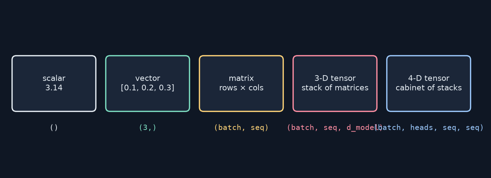
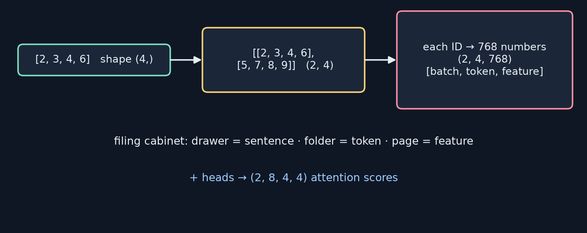
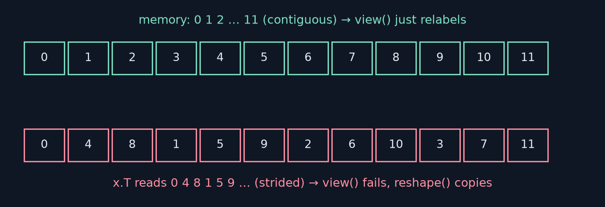
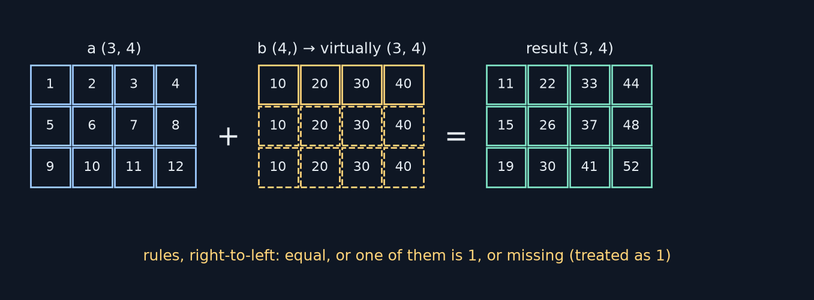
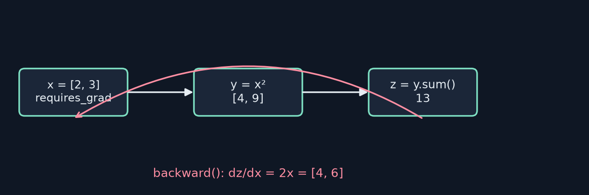
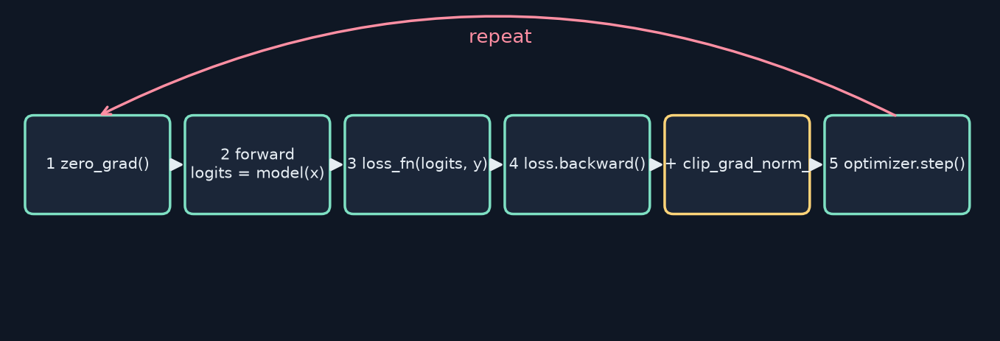
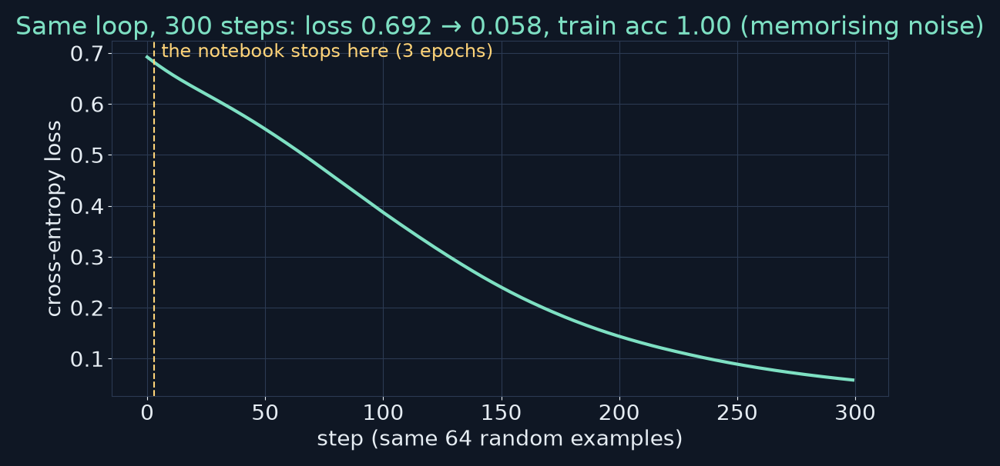

<!-- _class: lead -->
<!-- _paginate: false -->
# Build Your First LLM
## Chapter 6 — NumPy & PyTorch Survival Guide
A study companion to *Build Your First LLM* by Hasan Degismez
**Waqar Shaikh Builds**

<!-- say: Welcome to chapter six of my study series on Build Your First LLM by Hasan Degismez. This is the survival guide to tensors. Every number inside a language model lives in a tensor, and almost every bug you'll hit is a shape bug. So today we learn to think in shapes: creating tensors, reshaping them, slicing, broadcasting, matrix multiplication, attention in four lines, autograd, nn dot Module, embeddings, and the five step training loop. I ran the book's chapter six notebook on a CPU for this video, and I'll show the real outputs plus a few experiments of my own. -->

---

# Where we are

- **Ch 5:** text → token IDs (a Python list)
- **Ch 6 (today):** IDs → **tensors** → embeddings → attention → training loop
- **Ch 7+:** Part III — build the LLM itself
- Notebook: **FirstLLM/code → notebooks/ch06.ipynb** (Colab link in description)

<!-- say: In chapter five we turned text into a list of token IDs. Today those IDs become tensors, then embeddings, then we run attention on them and write a training loop. From chapter seven, part three of the book, we build the model itself. Everything today follows the chapter six notebook, linked in the description. -->

---

# Chapter 6 roadmap

1. Why tensors · NumPy → PyTorch: what changes
2. Building up dimensions: 1-D → 2-D → 3-D → 4-D
3. Creating tensors · seeds · dtype & device
4. Reshaping, view vs reshape, squeeze/unsqueeze, permute
5. Indexing & slicing · broadcasting · essential ops
6. Attention in four lines (+ causal mask, + one-liner)
7. Autograd · nn.Module · token & position embeddings
8. The 5-step training loop · exercises · review

<!-- say: Here's the plan. Why tensors, and what changes moving from NumPy to PyTorch. Then building up dimensions from one to four. Creating tensors, seeds, data types and devices. Reshaping, including the view versus reshape puzzle. Indexing, broadcasting and the essential operations. Attention in four lines of code. Then autograd, nn dot Module and embeddings. And finally the five step training loop, the exercises and the review. -->

---

# Key terms for this chapter

| Term | One-line meaning |
|---|---|
| **Tensor** | Multi-dimensional array with a shape and dtype |
| **Shape** | Its dimensions, e.g. (batch, seq, features) |
| **Broadcasting** | Virtually expanding a smaller tensor to match |
| **`@` (matmul)** | Combines features — core of attention & FFNs |
| **Autograd** | Records operations and computes gradients |
| **Gradient** | How much the loss changes per change in a parameter |
| **nn.Module** | Building block bundling parameters + `forward()` |
| **Loss · Device** | How wrong we are · CPU or GPU |

<!-- say: The vocabulary. A tensor is a multi-dimensional array with a shape and a data type. The shape lists its dimensions, like batch, sequence and features. Broadcasting virtually expands a smaller tensor to match a bigger one. The at sign is matrix multiplication, the core of attention and feed forward layers. Autograd records operations and computes gradients, and a gradient tells you how much the loss changes when you nudge a parameter. nn dot Module is PyTorch's building block that bundles parameters with a forward method. The loss measures how wrong we are, and the device is where a tensor lives, on the CPU or the GPU. -->

---

<!-- _class: divider -->
# Part 1
## Why tensors?

<!-- say: Part one. Why tensors? -->

---

# Shapes: "how many of what" (my redraw)



- Text input **(batch, seq)** · embeddings **(batch, seq, d_model)** · attention **(batch, heads, seq, seq)**

<!-- say: Python lists are like loose pages on a desk: fine for scribbles, terrible for maths. Tensors are organised stacks of numbers that the computer can optimise. Every tensor is just how many of what. A scalar is one number. A vector is a row of numbers. A matrix is rows by columns. A three dimensional tensor is a stack of matrices, and a four dimensional tensor is a cabinet of stacks. In LLM code you'll mostly see three shapes: token IDs as batch by sequence, embeddings as batch by sequence by model width, and attention scores as batch by heads by sequence by sequence. -->

---

# NumPy → PyTorch: what changes

| | NumPy | PyTorch |
|---|---|---|
| create | `np.array([1,2,3])` | `torch.tensor([1,2,3])` |
| matmul | `np.dot(a,b)` or `a @ b` | `a @ b` |
| dtype | `.astype(np.float32)` | `.to(torch.float32)` |
| default float | **float64** | **float32** ✓ (checked) |
| GPU | ✗ | `.to("cuda")` |
| autograd | ✗ | ✓ |

<!-- say: The good news is that PyTorch feels like NumPy with extras. Creating an array becomes creating a tensor. Matrix multiplication is the at operator in both. Changing type uses dot astype in NumPy and dot to in PyTorch, and dot to also moves tensors between devices. Defaults differ: NumPy floats are float sixty four, PyTorch floats are float thirty two. I checked both. For deep learning float thirty two is what you want: half the memory and faster. And PyTorch adds the two superpowers: GPUs and automatic gradients. -->

---

# Devices and the zero-copy bridge

```python
tensor.to("cuda")          # move to GPU   (cpu + cuda tensors can't mix → RuntimeError)
pt = torch.from_numpy(np_arr)   # shares memory!
np_arr[0] = 999
print(pt)                  # tensor([999, 2, 3])  ← changed (I ran it)
torch.tensor(np_arr)       # a true copy
```

- GPUs: often **10–100×** faster for deep learning
- My CPU run: `CUDA available: False` — everything in this video ran on CPU

<!-- say: Two practical things. Devices: you move a tensor to the GPU with dot to cuda, and you can't mix CPU and GPU tensors in one operation, or you get a runtime error. GPUs are often ten to a hundred times faster for this kind of work, although everything in this video ran on a CPU. And the zero copy bridge: torch dot from numpy shares memory with the NumPy array, so changing one changes the other. I ran it: set element zero of the NumPy array to nine nine nine, and the tensor shows nine nine nine too. If you want an independent copy, use torch dot tensor. -->

---

<!-- _class: divider -->
# Part 2
## Building up dimensions

<!-- say: Part two. Building up dimensions. -->

---

# From token IDs to 4-D (my redraw)



<!-- say: Let's connect to chapter five. Our tokenizer gave us two, three, four, six: a one dimensional tensor with shape four. Add a second sentence and we have a batch, a two by four matrix: two sentences, four tokens each. Replace every ID with its seven sixty eight dimensional embedding and we get a three dimensional tensor, two by four by seven sixty eight. The book's filing cabinet analogy fits well: the drawer is the sentence, the folder is the token, and the page is one feature. And multi head attention adds a fourth dimension: two by eight by four by four, one four by four score grid per head. -->

---

# The notebook confirms each step

```text
1D shape: torch.Size([4])            Data: tensor([2, 3, 4, 6])
2D batch shape: torch.Size([2, 4])   Second token of first sentence: tensor(3)
3D embeddings shape: torch.Size([2, 4, 768])
First token of first sentence: torch.Size([768])
4D attention shape: torch.Size([2, 8, 4, 4])
```

- Naming you'll see everywhere: **B** batch · **S/L** sequence · **d_model** features · **H** heads

<!-- say: Here's the notebook's real output for those steps. Shape four, then two by four, then two by four by seven sixty eight, where a single token's embedding is seven sixty eight numbers, then the four dimensional attention tensor. Get used to the names, because they're everywhere in transformer code: B for batch, S or L for sequence length, d model for features, and H for heads. -->

---

<!-- _class: divider -->
# Part 3
## Creating tensors

<!-- say: Part three. Creating tensors. -->

---

# Four ways to fill the box

```python
data   = torch.tensor([[1, 2, 3], [4, 5, 6]])   # from Python data
zeros  = torch.zeros(3, 4);  ones = torch.ones(2, 3, 4)
uniform= torch.rand(3, 4);   normal = torch.randn(3, 4)
ints   = torch.randint(0, 10, (3, 4))
seq    = torch.arange(0, 10, 2)       # 0 2 4 6 8
lin    = torch.linspace(0, 1, 5)      # 0 .25 .5 .75 1
t      = torch.randn(3, 4, device=device, dtype=torch.float32)
```

<!-- say: There are four ways to fill a tensor. From existing data with torch dot tensor. With a fill rule: zeros, ones, uniform random with rand, normally distributed with randn, or random integers with randint. As evenly spaced number lines, with arange and linspace, which are handy for positions and masks. And by choosing the kind of number and where it lives, with the dtype and device arguments. Set those deliberately rather than relying on defaults. -->

---

# Seeds: reproducible randomness

```python
torch.manual_seed(42)
a = torch.randn(3, 4)
torch.manual_seed(42)
b = torch.randn(3, 4)        # identical to a
```
```text
With seed, tensors match: True
```

- Pseudo-random = a formula with a starting point (the **seed**)
- 42 = a Hitchhiker's Guide joke; any integer works

<!-- say: Computers don't make truly random numbers. They run a formula from a starting point called the seed. Set the same seed and you get exactly the same random numbers, which is essential for debugging and comparing experiments. The notebook checks it and prints true. Why forty two? It's a nod to the Hitchhiker's Guide to the Galaxy. Any integer works. -->

---

<!-- _class: divider -->
# Part 4
## Shapes and reshaping

<!-- say: Part four. Shapes and reshaping. -->

---

# Shapes are contracts

```python
batch_embeddings  = torch.randn(2, 4, 768)
attention_weights = torch.randn(2, 4, 512)
batch_embeddings + attention_weights
# RuntimeError: The size of tensor a (768) must match the size of
#               tensor b (512) at non-singleton dimension 2
```

- Read shapes left → right as nested containers: 2 batches · 4 tokens · 768 features
- **Print shapes** constantly — half of all bugs are here

<!-- say: Shapes are contracts between your code and the operations you call. Try to add a tensor ending in seven sixty eight to one ending in five twelve, and PyTorch refuses with a clear error: size seven sixty eight must match size five twelve at dimension two. Read shapes from left to right like nested containers: two batches, each of four tokens, each of seven sixty eight features. And print shapes all the time. Half of all deep learning bugs live here. -->

---

# reshape, -1, squeeze, unsqueeze, permute

```python
x = torch.arange(12).reshape(3, 4)     # 12 = 3×4  (3×5 would fail)
x.reshape(-1, 2).shape                  # (6, 2) — -1 = "infer"
torch.randn(768).unsqueeze(0).shape     # (1, 768)  add batch dim
torch.randn(1, 4, 1, 768).squeeze().shape   # (4, 768)
attn.permute(0, 2, 1, 3)                # reorder dims
```
```text
After view(3,4): [3, 4]  After reshape(2,2,3): [2, 2, 3]  After view(-1,3): [4, 3]
After permute: [2, 4, 3]  Fully flattened: [24]  Flatten features: [2, 12]
```

<!-- say: The reshaping toolkit. reshape rearranges the same numbers into a new shape, and the total must stay the same: twelve can be three by four, but not three by five. Minus one means infer this dimension for me. unsqueeze adds a dimension of size one, typically to make a single example into a batch of one. squeeze removes size one dimensions. And permute reorders dimensions, for example swapping heads and sequence. Below is the notebook's real output, walking a tensor through view, reshape, squeeze, permute and flatten. -->

---

# view vs reshape: contiguity (my redraw)



- `x.T.view(12)` → **RuntimeError** (I triggered it) · `x.T.reshape(12)` works (copies)
- Default to **`.reshape()`**

<!-- say: Why does view sometimes fail? Think of memory as numbered boxes in a row. A freshly created tensor is contiguous, stored in order, so view can just relabel the boxes without moving anything. After a transpose or permute, the logical order jumps around memory: zero, four, eight, one, five, nine. view refuses to move data and raises an error. I triggered it on the permuted heads tensor from exercise two. reshape is happy to make a copy when it needs to. So the book's advice is right: default to reshape. -->

---

<!-- _class: divider -->
# Part 5
## Indexing, broadcasting, essential ops

<!-- say: Part five. Indexing, broadcasting, and the essential operations. -->

---

# Indexing & slicing a 4-D tensor (notebook)

```python
x = torch.randn(2, 4, 6, 6)      # (batch, heads, seq, seq)
x[0].shape            # (4, 6, 6)     first batch
x[:, :, :-1].shape    # (2, 4, 5, 6)  all but last token
x[:, -1, ...]         # last head, ... = "the rest"
torch.tril(torch.ones(5, 5))     # causal mask: lower triangle
```
```text
Original: [2, 4, 6, 6]  First batch: [4, 6, 6]  All but last token: [2, 4, 5, 6]
```

<!-- say: Indexing works like Python lists, one dimension at a time. x zero takes the first batch. A colon keeps a whole dimension, and colon minus one drops the last element, here the last token. Three dots, the ellipsis, means all the remaining dimensions. And torch dot tril, lower triangle, builds the causal mask from chapter three in one line. The outputs here are from the notebook. -->

---

# Broadcasting (my redraw)



<!-- say: Broadcasting lets you combine tensors of different shapes without copying. Add a three by four matrix and a vector of four. PyTorch virtually repeats the vector for each row, the dashed cells, and adds element by element. Eleven, twenty two, thirty three, forty four, and so on. The rules, read from the right: two dimensions are compatible if they're equal or if one of them is one, and missing dimensions count as one. Otherwise it fails. -->

---

# Broadcasting in LLMs (my Exercise 1 run)

```python
A = torch.randn(4, 3, 768)
A + torch.randn(768)       # → (4, 3, 768)  bias over features ✓
A + torch.randn(3, 768)    # → (4, 3, 768)  also fine (per-position bias) ✓
A + torch.randn(4, 768)    # ✗ size 3 vs 4 at dimension 1
scores.masked_fill(mask == 0, float('-inf'))  # (1,1,S,S) mask over (B,H,S,S)
```

<!-- say: Here's exercise one, which I ran. A four by three by seven sixty eight tensor plus a bias of seven sixty eight broadcasts across batch and sequence: that's how every linear layer adds its bias. The exercise asks what happens with a three by seven sixty eight tensor. It works too. Aligning from the right, three matches three and the batch dimension is missing, so it's treated as one. But four by seven sixty eight fails, because it lines up four against three. And the causal mask, shape one by one by S by S, broadcasts across every batch and head. -->

---

# Essential operations

```python
a * b                       # element-wise      a @ W   # matrix multiply
x = torch.randn(32, 10, 64); W = torch.randn(64, 128)
(x @ W).shape               # (32, 10, 128)  — combines features
a.sum(dim=1, keepdim=True)  # (3, 1)          a.mean(dim=0)  # (4,)
torch.cat([a, b], dim=0)    # (6, 4)          torch.stack([a, b]) # (2, 3, 4)
torch.softmax(logits, dim=-1)   # each row sums to 1
```

- `*` ≠ `@` · always check **which `dim`** softmax/sum runs over

<!-- say: The operations you'll use ninety percent of the time. Star is element-wise, while at is matrix multiplication. A thirty two by ten by sixty four tensor times a sixty four by one twenty eight matrix gives thirty two by ten by one twenty eight. That's how a linear layer mixes features at every position. Reductions like sum and mean take a dim argument, and keepdim keeps the reduced dimension as size one. cat joins along an existing dimension, while stack creates a new one. And softmax with dim minus one normalises each row. The two classic bugs are confusing star with at, and running softmax over the wrong dimension. -->

---

<!-- _class: divider -->
# Part 6
## Attention in four lines

<!-- say: Part six. Attention in four lines. -->

---

<!-- _class: small -->
# Scaled dot-product attention (notebook cell 16)

```python
batch, seq_len, d_head = 2, 5, 64
Q = torch.randn(batch, seq_len, d_head)  # (2, 5, 64)
K = torch.randn(batch, seq_len, d_head)
V = torch.randn(batch, seq_len, d_head)

# K.transpose(-2, -1) swaps the last two dimensions: (2, 5, 64) → (2, 64, 5)
# Result: (2, 5, 64) @ (2, 64, 5) → (2, 5, 5) — a 5×5 grid of scores per batch
scores = Q @ K.transpose(-2, -1)
# Step 2: Scale (prevent softmax saturation)
scores = scores / (d_head ** 0.5)  # divide by sqrt(64) = 8
# Step 3: Softmax (turn scores into probabilities)
attn_weights = torch.softmax(scores, dim=-1)  # each row sums to 1
# Step 4: Weighted sum (blend values using probabilities)
output = attn_weights @ V  # (2, 5, 64)
```
```text
Scores shape: torch.Size([2, 5, 5])   Output shape: torch.Size([2, 5, 64])
Attention weights sum to 1: 1.0000
Token 2's attention weights: tensor([0.7634, 0.0332, 0.1282, 0.0501, 0.0251])
```

<!-- say: Here's chapter three's attention as real code, from the notebook. Q, K and V are random two by five by sixty four tensors. Step one: Q times K transposed over the last two dimensions gives a five by five score grid per batch. Step two: divide by the square root of sixty four, which is eight. Step three: softmax over the last dimension, so each row sums to one. Step four: multiply by V to blend the values. The output has the same shape as the input. In my run, token two put seventy six percent of its attention on token zero. -->

---

# + causal mask, then the one-liner

```python
causal_mask = torch.triu(torch.ones(seq_len, seq_len), diagonal=1).bool()
scores = scores.masked_fill(causal_mask, float('-inf'))  # -inf becomes 0 after softmax
```
```text
tensor([0.8256, 0.0359, 0.1386, 0.0000, 0.0000])   ← token 2 sees only 0,1,2
```
```python
output = F.scaled_dot_product_attention(Q, K, V, is_causal=True)
```
- My check: manual == `F.scaled_dot_product_attention` → **True** (atol 1e-5)
- My CPU timing (B4·H12·S512·d64): manual **166 ms** vs fused **13.7 ms** (~12×)

<!-- say: Add the causal mask. The notebook builds an upper triangle of trues above the diagonal, the future, and fills those scores with minus infinity, which becomes zero after softmax. Token two's weights now end in two zeros: it can only see tokens zero, one and two. In practice, PyTorch does all of this in one call: F dot scaled dot product attention, with is causal equals true. I checked that my manual version and the one liner give the same result. And I timed them on my CPU, with four sequences, twelve heads, five hundred and twelve tokens: the manual version took a hundred and sixty six milliseconds and the fused one under fourteen. About twelve times faster, even without a GPU. -->

---

<!-- _class: divider -->
# Part 7
## Autograd, nn.Module, embeddings

<!-- say: Part seven. Autograd, nn dot Module, and embeddings. -->

---

# Autograd (my redraw + notebook cell 30)



```text
Gradients: tensor([4., 6.])      Manual check: dz/dx = 2x → tensor([4., 6.])
```

- `torch.no_grad()` = a block without tracking · `.detach()` = one tensor without history

<!-- say: A gradient tells you how much the output changes when you nudge an input. Mark x as requires grad, and PyTorch records every operation on it. Here y is x squared and z is the sum of y, which is thirteen. Call z dot backward, and PyTorch walks the graph in reverse and fills in x dot grad. The derivative of x squared is two x, so at two and three we get four and six. The notebook prints exactly that. To stop tracking, for example during inference, use torch dot no grad for a whole block, or dot detach for a single tensor. -->

---

# nn.Module: the building block

```python
class SimpleMLP(nn.Module):
    def __init__(self, input_dim, hidden_dim, output_dim):
        super().__init__()                    # required
        self.fc1  = nn.Linear(input_dim, hidden_dim)
        self.norm = nn.LayerNorm(hidden_dim)
        self.fc2  = nn.Linear(hidden_dim, output_dim)
        self.act  = nn.ReLU()
    def forward(self, x):
        return self.fc2(self.norm(self.act(self.fc1(x))))
```

- `SimpleMLP(768, 3072, 768)` → **4,728,576** params (my count) · `model(x)` calls `forward`

<!-- say: Every network in PyTorch inherits from nn dot Module. You define layers in init, after calling super init, and you define the data flow in forward. Calling model of x runs forward. The module automatically tracks every parameter, moves them all to a device at once, and saves and loads them. This is the book's example MLP, condensed onto one line in forward, with GPT-2's feed forward shapes: seven sixty eight to three oh seven two and back. I counted its parameters: four million seven hundred and twenty eight thousand, five hundred and seventy six. -->

---

# Token + position embeddings (notebook cell 18)

```python
token_embedding = nn.Embedding(50257, 768)   # 38,597,376 params
pos_embedding   = nn.Embedding(1024, 768)    #    786,432 params
position_ids = torch.arange(seq_len).unsqueeze(0).expand(batch_size, -1)
x = token_embedding(token_ids) + pos_embedding(position_ids)   # (2, 5, 768)
```
```text
Token params: 38,597,376   Position params: 786,432   Total: 39,383,808
```

- Token embeddings ≈ **31 %** of GPT-2 small — vocab size drives model size

<!-- say: An embedding layer is just a lookup table: row i is the vector for token i. GPT-2 has fifty thousand two hundred and fifty seven rows of seven sixty eight, thirty eight point six million parameters. Position embeddings are a second table, one thousand and twenty four by seven sixty eight. Position IDs are just arange of the sequence length, given a batch dimension and expanded across the batch. Add the two lookups, and that's what goes into the first transformer block. The notebook confirms the totals: thirty nine million, three hundred and eighty three thousand, eight hundred and eight. Token embeddings are about thirty one percent of GPT-2 small, which is why vocabulary size matters so much for small models. -->

---

# ⚠️ Book check: "BERT uses sinusoidal (fixed)"

- Book §6.12 gotcha: "GPT-2 uses learned position embeddings; BERT uses sinusoidal"
- **BERT also uses learned** absolute position embeddings (512 × 768 in BERT-base)
- Sinusoidal = the **original 2017 Transformer**
- The GPT-2 half is correct ✓

<!-- say: One correction. A gotcha box in the book says GPT-2 uses learned position embeddings, while BERT uses sinusoidal, fixed ones. The GPT-2 part is right. But BERT also uses learned absolute position embeddings, a five hundred and twelve by seven sixty eight table in BERT base. Sinusoidal encodings belong to the original 2017 transformer. That's in the errata. -->

---

<!-- _class: divider -->
# Part 8
## The training loop

<!-- say: Part eight. The training loop. -->

---

# The 5-step recipe (my redraw)



- Gradients **accumulate** by default → always `zero_grad()` first
- **Clip** between backward and step — essential for LLMs (`max_norm=1.0`)

<!-- say: Training is always the same five steps. One: zero the gradients, because PyTorch adds new gradients to old ones by default. Two: the forward pass, to get predictions. Three: compute the loss. Four: the backward pass, to fill every parameter's gradient. For LLMs, clip the gradients here, between backward and step, to prevent explosive updates. A max norm of one is a safe default. Five: the optimizer step updates the weights. Then repeat. -->

---

<!-- _class: small -->
# The loop in code (notebook cell 19, condensed)

```python
model = SimpleMLP(16, 32, 2)  # input 16-dim, hidden 32-dim, output 2 classes
optimizer = optim.Adam(model.parameters(), lr=1e-3)  # adaptive learning rate
loss_fn = nn.CrossEntropyLoss()  # for classification
inputs = torch.randn(64, 16)          # 64 examples, 16 features each
labels = torch.randint(0, 2, (64,))   # 64 labels (class 0 or 1)
for epoch in range(3):
    model.train()
    optimizer.zero_grad(set_to_none=True)  # set_to_none saves memory
    logits = model(inputs)
    loss = loss_fn(logits, labels)
    loss.backward()
    torch.nn.utils.clip_grad_norm_(model.parameters(), max_norm=1.0)
    optimizer.step()
    print(f'Epoch {epoch}: loss={loss.item():.4f}')
model.eval()
with torch.no_grad():
    preds = model(inputs).argmax(dim=-1)
```
```text
Epoch 0: loss=0.6955   Epoch 1: loss=0.6925   Epoch 2: loss=0.6896   Accuracy: 0.56
```

<!-- say: Here's the notebook's loop, condensed. A small MLP, the Adam optimizer, cross entropy loss, and sixty four random examples with random labels. Each epoch: train mode, zero the gradients, forward, loss, backward, clip, step. Then evaluation mode and no grad to measure accuracy. My run printed losses of point six nine five, point six nine two and point six eight nine, and an accuracy of fifty six percent. Basically chance, because the labels are random and we only took three steps. -->

---

# What happens if we keep going? (my experiment)



- 300 steps: loss **0.692 → 0.058**, train accuracy **1.00** — on **random labels**
- The model **memorised** noise → why we always check a **validation** set

<!-- say: I wondered what happens if you keep going, so I ran the same loop for three hundred steps. The loss falls from point six nine two to point zero five eight, and training accuracy reaches a hundred percent. On random labels! There's nothing to learn, so the model has simply memorised sixty four random examples. That's a powerful lesson for later: a falling training loss alone proves nothing. You always need a separate validation set, which we'll use when we train our LLM. -->

---

# train() vs eval(), no_grad vs detach

- `model.train()`: dropout **on**, batch-norm uses batch stats
- `model.eval()`: dropout **off**, deterministic behaviour
- `torch.no_grad()`: no graph built for a block — saves memory at inference
- `.detach()`: one tensor cut out of the graph
- `zero_grad(set_to_none=True)`: grads become `None` instead of zero tensors — less memory

<!-- say: A few switches that confuse everybody. model dot train turns dropout on, and model dot eval turns it off for deterministic behaviour. torch dot no grad stops building the computation graph for a whole block of code, saving memory during inference. dot detach cuts a single tensor out of the graph. And zero grad with set to none equals true sets the gradients to None instead of filling them with zeros, which saves memory and is slightly faster. -->

---

<!-- _class: divider -->
# Part 9
## Exercises (my solutions)

<!-- say: Part nine. The exercises, with my solutions. -->

---

# Exercise 2: split into heads (my run)

```python
x = torch.randn(2, 5, 512)
h = x.reshape(2, 5, 8, 64).permute(0, 2, 1, 3)   # (2, 8, 5, 64)
scores = h @ h.transpose(-2, -1)                  # (2, 8, 5, 5) ✓
h.is_contiguous()     # False → h.view(2, 8, 320) raises; use reshape
```

- This exact reshape → permute is how **multi-head attention** splits d_model (Ch 10)

<!-- say: Exercise two simulates splitting into attention heads. Take a two by five by five twelve tensor, reshape the last dimension into eight heads of sixty four, then permute so heads come before sequence: two by eight by five by sixty four. Now a batched matmul with its own transpose gives scores of two by eight by five by five, one score grid per head, as expected. And note that after permute the tensor isn't contiguous, so view would fail. This exact reshape and permute is how multi head attention splits the model width, which we'll see in chapter ten. -->

---

# Exercise 3: one step + clipping (my run)

```python
model = nn.Sequential(nn.Linear(10, 20), nn.ReLU(), nn.Linear(20, 5))
opt = torch.optim.Adam(model.parameters(), lr=1e-2)
opt.zero_grad(); loss = loss_fn(model(x), y); loss.backward()
norm = torch.nn.utils.clip_grad_norm_(model.parameters(), 1.0)  # returns pre-clip norm
opt.step()
```
- Loss **1.6769 → 1.6082** after one step (lr 1e-2, seed 0)
- Bonus: `clip_grad_norm_` **returns the total norm before clipping** → 0.555 < 1.0 → **not** clipped

<!-- say: Exercise three: one training step on a tiny network. My loss went from one point six seven seven to one point six oh eight after a single step, with a learning rate of point zero one. For the bonus question, how do you know whether gradients were actually clipped? clip grad norm returns the total gradient norm before clipping. Mine was point five five five, which is below the max norm of one, so nothing was clipped this time. Log that number in real training runs. It's one of the best early warnings of trouble. -->

---

<!-- _class: divider -->
# Part 10
## Wrap-up

<!-- say: Part ten. Wrapping up. -->

---

# Key takeaways

1. Tensors = arrays with **shapes** · think "how many of what"
2. PyTorch ≈ NumPy + **GPU** + **autograd** · default float32
3. LLM shapes: (B, S) → (B, S, d_model) → (B, H, S, S)
4. **Broadcasting** aligns from the right; size-1 or missing dims expand
5. `@` combines features; attention = 4 lines (or one fused call)
6. Recipe: zero_grad → forward → loss → backward → (clip) → step

<!-- say: The key takeaways. One: tensors are arrays with shapes, so think how many of what. Two: PyTorch is NumPy plus GPUs plus autograd, with float thirty two by default. Three: the LLM shapes go from batch by sequence, to batch by sequence by model width, to batch by heads by sequence by sequence. Four: broadcasting aligns shapes from the right, expanding dimensions of size one or missing ones. Five: matrix multiplication combines features, and attention is four lines of code, or one fused call. Six: the training recipe is zero grad, forward, loss, backward, clip, step. -->

---

# Notebook run & book check

- ✅ **ch06.ipynb** ran end-to-end on CPU (torch 2.15) — all **19** code cells, no errors
- ✅ Shapes, 39,383,808 embedding params, gradients [4, 6] all match
- ✅ My checks: float64 vs float32 · zero-copy · manual == fused attention
- ⚠️ "BERT uses sinusoidal (fixed)" — BERT uses **learned** positions
- ℹ️ "2–4× faster via FlashAttention" — GPU claim; on my CPU the fused call was ~12× faster than the manual version

<!-- say: My notebook run and book check. The chapter six notebook ran end to end on a CPU, all nineteen code cells, with no errors, and the shapes, parameter counts and gradients all match the book. My own checks of the default data types, zero copy sharing and fused attention all agree with the text. One erratum: BERT uses learned positions, not sinusoidal ones. And a note: the book's two to four times speed-up refers to FlashAttention on GPUs. On my CPU, the fused call was about twelve times faster than the manual version, mostly from avoiding all those separate operations. -->

---

# Review questions 1

**Q1. float32 vs float64?** NumPy targets scientific precision (64); PyTorch targets speed/memory (32). Matters when mixing them (dtype errors) or for precision-sensitive maths.
**Q2. reshape vs view?** `view` needs contiguous memory; `reshape` copies if needed — prefer reshape after transpose/permute.
**Q3. Broadcasting compatibility?** Align from the right; each pair must be equal or contain a 1 (missing = 1).
**Q4. `dim` in softmax?** The axis that sums to 1; for logits use `dim=-1`. Wrong dim → probabilities across the batch/positions — silently wrong.

<!-- say: Review questions, with my answers. One: why the different default floats? NumPy targets scientific precision, so sixty four bits. PyTorch targets speed and memory, so thirty two bits. It matters when you mix them, which can cause dtype errors, and for calculations that need high precision. Two: view needs contiguous memory, while reshape copies when needed, so prefer reshape after a transpose or permute. Three: broadcasting aligns shapes from the right, and each pair must be equal or contain a one, with missing dimensions counting as one. Four: the dim in softmax is the axis that sums to one, usually minus one for logits. Pick the wrong one and you normalise across the batch or across positions, and it's silently wrong. -->

---

# Review questions 2

**Q5. no_grad vs detach?** `no_grad` disables tracking for a whole block; `.detach()` returns one tensor without history.
**Q6. Why zero_grad first?** Gradients **accumulate**; without clearing, each step adds old gradients. `set_to_none` saves memory.
**Q7. train() vs eval()?** Toggles dropout (and batch-norm statistics); eval is deterministic for evaluation/inference.

<!-- say: Five: torch dot no grad disables gradient tracking for a whole block, while detach returns a single tensor with no history. Six: why zero the gradients first? Because gradients accumulate, so without clearing them each step would add the old gradients to the new ones. Set to none also saves memory. Seven: switching from train to eval turns off dropout and changes batch norm to use stored statistics, so evaluation and inference become deterministic. -->

---

# Practice this

- ☐ Run **ch06.ipynb** in Colab (try a GPU runtime and compare timings)
- ☐ Print `.shape` after every line of the attention cell
- ☐ Break broadcasting on purpose; read the error message carefully
- ☐ Run the training loop for 300 steps — watch it memorise noise
- ☐ Solve exercises 1–3 + the clipping bonus

<small>Code: FirstLLM/code (MIT License) · notebooks/ch06.ipynb · Colab link in the description</small>

<!-- say: Your practice list. Run the chapter six notebook in Colab, and try a GPU runtime to compare timings. Print the shape after every line of the attention cell. Break broadcasting on purpose, and read the error carefully. Run the training loop for three hundred steps and watch it memorise noise. And solve the three exercises plus the clipping bonus. -->

---

# Up next: Chapter 7 — Part III begins

**Build your first LLM**
Wire tensors, embeddings and the training loop into a real **data pipeline** and model

<!-- say: That's chapter six. You can now read and write the tensor code at the heart of every modern LLM. Next, part three begins: we wire these pieces into a real data pipeline and start building the model itself. Same maths, aimed at real text. -->

---

<!-- _class: lead -->
# Credits
Based on **"Build Your First LLM"** by **Hasan Degismez** — buy the book: **leanpub.com/FirstLLM**
Code: **github.com/FirstLLM/code** (MIT License) · notebooks/ch06.ipynb
Slides, narration and diagrams: my own teaching adaptation · **Waqar Shaikh Builds**

<!-- say: This video is based on the book Build Your First LLM by Hasan Degismez. Everything here is my own adaptation for study, so please support the author and buy the book at leanpub dot com slash First LLM. The code shown comes from the companion repository at github dot com slash First LLM slash code, under the MIT license. Thanks for watching, and see you in chapter seven. -->
