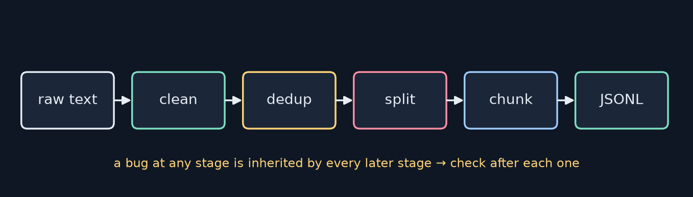
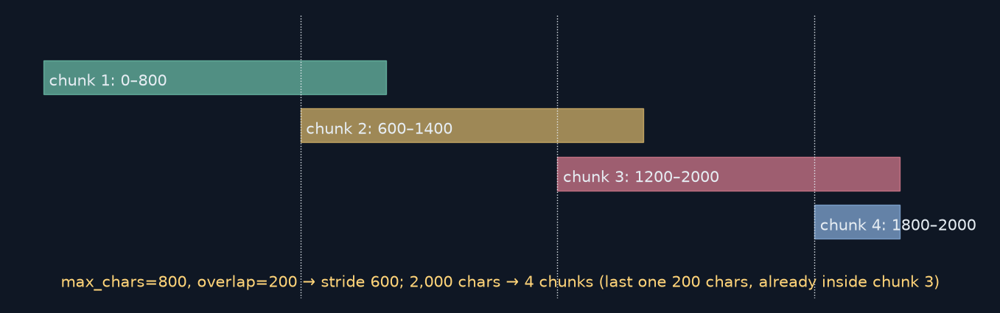
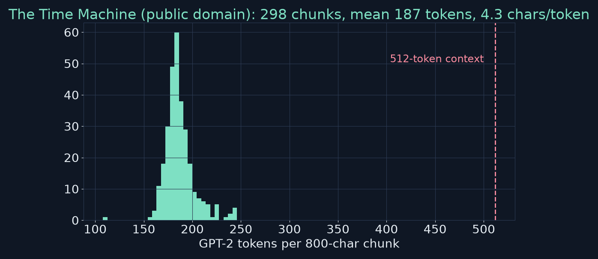

<!-- _class: lead -->
<!-- _paginate: false -->
# Build Your First LLM
## Chapter 7 — Preparing Your Data
A study companion to *Build Your First LLM* by Hasan Degismez
**Waqar Shaikh Builds**

<!-- say: Welcome to chapter seven of my study series on Build Your First LLM by Hasan Degismez. Part three begins, and it begins not with the model but with the data. Garbage in, garbage out is truer for language models than for almost anything else. Today we build a complete data pipeline: clean, deduplicate, split, chunk and store. I ran the book's chapter seven notebook, and I also pushed three real public domain novels through the same pipeline to see what happens on real text. And I found a couple of mistakes in the book's worked example. -->

---

# Where we are

- **Part II:** Python, tensors, the training loop
- **Ch 7 (today):** raw text → clean, deduped, split, chunked **JSONL**
- **Ch 8:** tokenize it · **Ch 9+:** embed it, model it, train it
- Notebook: **FirstLLM/code → notebooks/ch07.ipynb**

<!-- say: In part two we learned Python, tensors and the training loop. Today we produce a clean dataset in JSON lines format. In chapter eight we tokenize it, and from there we embed it, model it and train on it. Everything follows the chapter seven notebook, which is linked in the description. -->

---

# Chapter 7 roadmap

1. Why data quality rules everything
2. Sourcing text: ethics & licensing
3. New Python tools: files, sets, JSON, regex, hashing
4. Cleaning & normalising (NFKC)
5. Deduplication & filtering
6. Train / val / test splits — without leakage
7. Chunking for the context window
8. JSONL storage · quality checks · real-book experiment · review

<!-- say: Here's the roadmap. Why quality matters. Where to get text you're allowed to use. Five new Python tools: files, sets, JSON, regular expressions and hashing. Then the pipeline itself: cleaning, deduplication, splitting without leakage, chunking, storage and quality checks. Then my experiment with three real novels, and the review. -->

---

# Key terms for this chapter

| Term | One-line meaning |
|---|---|
| **Corpus** | The collection of texts you train on |
| **Split** | Train / validation / test partitions |
| **Data leakage** | Evaluation data sneaking into training |
| **Deduplication** | Removing repeated text |
| **Chunk** | A context-sized piece of a long text |
| **Context window** | Max tokens the model sees at once |
| **JSONL** | One JSON object per line |

<!-- say: The vocabulary. A corpus is the collection of text you train on. Splits divide it into training, validation and test sets. Data leakage is when evaluation data sneaks into training, making scores look better than they are. Deduplication removes repeated text. A chunk is a piece of long text sized to fit the model. The context window is the maximum number of tokens the model can see at once. And JSON lines stores one JSON object per line. -->

---

<!-- _class: divider -->
# Part 1
## Why data quality rules everything

<!-- say: Part one. Why data quality rules everything. -->

---

# Junk in, junk out

- LLMs happily **memorise** typos, boilerplate, spam
- A clean pipeline is the **cheapest accuracy boost** you can buy
- 🥗 Fresh ingredients + good recipe > fancy stove with rotten produce



<!-- say: Language models happily memorise whatever you give them: typos, navigation menus, licence boilerplate, spam. Cleaning your data is the cheapest accuracy boost there is. The book's analogy is cooking: fresh ingredients and a good recipe beat a fancy stove with rotten produce. The pipeline goes raw text, clean, deduplicate, split, chunk, and store as JSON lines. And because each stage inherits the problems of the one before, check the data after every stage. -->

---

# Sourcing text: ethics & licensing

- You don't need billions of tokens: **a few MB** is enough to learn
- ✅ Public domain (Project Gutenberg) · CC0 / CC-BY · MIT docs · your own writing
- ❌ Personal data · sensitive records · "scraped from everywhere" dumps
- 📝 Keep a provenance README: source + licence

*My corpus: The Time Machine, The War of the Worlds, The Invisible Man (H. G. Wells) — Project Gutenberg, public domain in the US*

<!-- say: Where do you get text? You don't need billions of tokens to learn the pipeline. A few megabytes is plenty. Use public domain books like Project Gutenberg, permissively licensed text, documentation, or your own writing. Avoid personal data, sensitive records, and giant scraped dumps, where you inherit every mess and every legal risk. And keep a small README recording where each text came from and its licence. For my experiment I used three H. G. Wells novels from Project Gutenberg, which are public domain in the United States. -->

---

<!-- _class: divider -->
# Part 2
## New Python tools

<!-- say: Part two. Five new Python tools. -->

---

# Files, sets, JSON

```python
with open("test.txt", "w", encoding="utf-8") as f:   # auto-closes, even on error
    f.write("Hello, world!\n")
seen = set(); seen.add("hello"); seen.add("hello")   # {'hello'} — unique only
"hello" in seen                                       # O(1) vs O(n) for a list
json.dumps({"text": "Hello 世界"}, ensure_ascii=False) # keeps non-ASCII readable
```

- **JSONL**: one record per line → stream without loading everything

<!-- say: Three of the tools. Files: open with a with block, which closes the file automatically even if something crashes, and always pass encoding utf eight. Sets: they store only unique items, and checking whether something is in a set is instant, while a list checks item by item. That matters when you ask have I seen this before thousands of times. JSON: dumps converts a dictionary to a string, and ensure ascii equals false keeps characters like Chinese or emoji readable instead of escaping them. JSON lines puts one record per line, so you can stream a huge file without loading it all. -->

---

# Regex and hashing

```python
re.sub(r"<[^>]+>", " ", "<p>Hello</p>")   # strip any HTML tag
re.sub(r"\s+", " ", text)                    # collapse whitespace
hashlib.sha1("hello".encode("utf-8")).hexdigest()
# aaf4c61ddcc5e8a2dabede0f3b482cd9aea9434d   ✓ (I checked)
```

- Hash = short fixed-length **fingerprint**; same text → same hash
- Compare 40-char hashes instead of 800-char chunks

<!-- say: Regular expressions describe patterns. Less than, then one or more characters that aren't greater than, then greater than, matches any HTML tag. Backslash s plus matches any run of whitespace. And hashing gives a short fingerprint of any text. The same input always gives the same hash, and a tiny change gives a completely different one. I checked the book's SHA-1 values for hello and world, and they're correct. For deduplication we compare forty character fingerprints instead of eight hundred character chunks. -->

---

# ⚠️ Book check: SHA-1 collision odds

- Book: SHA-1 collision risk "roughly **1 in 2¹⁶⁰**"
- 2¹⁶⁰ is the output space; by the **birthday bound**, accidental collisions become likely around **2⁸⁰** hashes
- And SHA-1 is **cryptographically broken** (deliberate collision shown in 2017)
- For accidental dedup of thousands–millions of chunks: still fine. For anything adversarial: use **SHA-256**

<!-- say: One correction. The book says SHA-1's collision risk is roughly one in two to the power one sixty. That's the size of the output space, but the birthday paradox means collisions become likely after about two to the power eighty hashes, not one sixty. And SHA-1 is cryptographically broken: researchers produced a deliberate collision in 2017. For removing accidental duplicates from a small corpus, the book's conclusion still holds: SHA-1 is fine. But if anyone could craft inputs against you, use SHA-256. -->

---

<!-- _class: divider -->
# Part 3
## Cleaning & normalising

<!-- say: Part three. Cleaning and normalising. -->

---

# `clean_text` (notebook)

```python
def clean_text(text: str) -> str:
    text = unicodedata.normalize("NFKC", text)
    text = re.sub(r"<[^>]+>", " ", text)       # strip HTML tags
    text = re.sub(r"[\r\t]", " ", text)        # control characters
    text = re.sub(r"\s+", " ", text).strip()   # collapse whitespace
    return text
```
```text
Cleaned 0: THE TIME MACHINE — CHAPTER I This is a sample text... with odd spacing, smart “q...
```

- **NFKC**: "fi" ligature → "fi", full-width "２" → "2"; "é" stays "é" · "…" → "..."

<!-- say: Here's the cleaning function. First, NFKC Unicode normalisation, which converts compatibility characters to standard forms: the fi ligature becomes two letters, full width digits become normal digits, and the ellipsis character becomes three dots, which you can see in the notebook's output. Accented letters like é stay as they are. Then strip HTML tags, turn tabs and carriage returns into spaces, and collapse runs of whitespace. Notice the smart quotes survive. NFKC doesn't straighten them. -->

---

# Decisions to make

- **Lowercase?** Smaller vocab, but loses names/acronyms (US vs us) — be consistent
- **Punctuation?** Keep it — models learn structure from it
- **Emoji / non-Latin?** Keep if you'll support them; otherwise filter
- Always **eyeball** before/after — did anything important vanish?

<!-- say: A few policy decisions. Lowercasing shrinks the vocabulary but loses information, for example US the country versus us the pronoun. Either choice is fine if you're consistent. Keep punctuation, because models learn sentence structure from it. Keep emoji and non-Latin scripts only if you'll support them. And always look at the text before and after cleaning to make sure nothing important vanished. -->

---

<!-- _class: divider -->
# Part 4
## Deduplication & filtering

<!-- say: Part four. Deduplication and filtering. -->

---

# Dedup by hash (notebook)

```python
def dedup_chunks(chunks: list[str]) -> list[str]:
    seen = set(); unique = []
    for chunk in chunks:
        h = hash_chunk(chunk)
        if h in seen:
            continue            # drop duplicate, keep first occurrence
        seen.add(h); unique.append(chunk)
    return unique
```
```text
Before dedup: 4 docs     After dedup:  3 docs
```

- Filters: drop < 40 chars or > 2,000 chars · optional language/NSFW checks

<!-- say: Models memorise duplicates instead of learning patterns, so remove them early. Hash every chunk, keep a set of hashes you've seen, and keep only first occurrences. continue skips to the next loop iteration. The notebook goes from four documents to three. Then filter: drop chunks that are very short, under forty characters, or very long, over two thousand, and optionally run a language or content check. -->

---

# Exact vs near duplicates

- SHA-1 catches only **exact** matches (after cleaning)
- "The cat sat." vs "The cat sat!" → different hashes
- Near-dup methods at scale: **MinHash / LSH**, n-gram overlap
- Cleaning **before** hashing turns many near-dups into exact dups

<!-- say: One limitation to keep in mind. Hashing only catches exact duplicates. The cat sat full stop and the cat sat exclamation mark get completely different hashes. Large scale pipelines use near duplicate detection, like MinHash with locality sensitive hashing, or n-gram overlap. A cheap trick is to clean and normalise before hashing, which turns many near duplicates into exact ones. That's why cleaning comes first. -->

---

<!-- _class: divider -->
# Part 5
## Splits without leakage

<!-- say: Part five. Splits without leakage. -->

---

# Split by document, with a seed

```python
def split_docs(docs, train_p=0.8, val_p=0.1, seed=42):
    docs = list(docs)
    random.seed(seed); random.shuffle(docs)
    n = len(docs); n_train = int(n * train_p); n_val = int(n * val_p)
    return docs[:n_train], docs[n_train:n_train+n_val], docs[n_train+n_val:]
```

- 80 / 10 / 10 typical · seed → same split every run
- **Leakage:** chapter 1 in train, chapter 2 in val → val score inflated

<!-- say: Splits measure how well the model generalises to text it hasn't seen. The rules: split by whole document, not by paragraph; eighty, ten, ten is typical; and set a seed so the split is reproducible. The function copies the list, shuffles it with a fixed seed, and slices it. Leakage example: if chapter one of a book is in training and chapter two is in validation, the model already knows the author's style and characters, and the validation score looks better than it really is. Keep whole documents together. -->

---

# ⚠️ Book check: the worked example's split

- Book §7.11: `split_docs(3 docs, train_p=0.34, val_p=0.33)` → "Train: 1 · Val: 1 · Test: 1"
- Real: `int(3×0.34)=1`, `int(3×0.33)=`**0** → **Train 1 · Val 0 · Test 2**
- The book's own notebook prints `Train: 1, Val: 0, Test: 2` (I ran it)
- Also `'The bird flew over the house.'` has length **29**, not 33
- Lesson: `int()` **truncates** — for tiny n, compute counts with `round` or `max(1, …)`

<!-- say: And here's a real bug in the book's worked example. It splits three documents with train at point three four and validation at point three three, and claims one document in each split. But int of three times point three three is int of point nine nine, which is zero. So validation is empty, and test gets two documents. The book's own notebook prints exactly that: train one, validation zero, test two. The same example also says the bird flew over the house has length thirty three, but it's twenty nine characters. The lesson: int truncates, so for tiny data sets compute split sizes with round, or guarantee at least one item per split. -->

---

<!-- _class: divider -->
# Part 6
## Chunking for the context window

<!-- say: Part six. Chunking for the context window. -->

---

# Overlapping chunks

```python
def chunk_text(text, max_chars=800, overlap=200):
    chunks = []; start = 0
    while start < len(text):
        end = min(len(text), start + max_chars)
        chunk = text[start:end].strip()
        if chunk: chunks.append(chunk)
        start += max_chars - overlap      # stride = 600
    return chunks
```

- Rule of thumb: **~4 characters ≈ 1 token** → 800 chars ≈ 200 tokens

<!-- say: Transformers have a fixed context window, so long text must be cut into chunks. The function takes windows of eight hundred characters, and advances by eight hundred minus the overlap of two hundred, a stride of six hundred, so neighbouring chunks share two hundred characters. The rule of thumb is about four characters per token for English, so eight hundred characters is roughly two hundred tokens, leaving room inside a five hundred and twelve token window. -->

---

# Overlap, visualised (my redraw)



- Overlap keeps sentences near a boundary **whole in at least one chunk**
- Side effect: the final stride can produce a short, fully-redundant tail

<!-- say: Here's the overlap visualised. Chunk one is zero to eight hundred, chunk two six hundred to fourteen hundred, chunk three twelve hundred to two thousand. A sentence near position seven hundred appears whole in chunk two. One side effect the book doesn't mention: with two thousand characters, the loop makes a fourth chunk from eighteen hundred to two thousand, which is entirely contained in chunk three. That's a small duplicate. You can stop the loop once a chunk reaches the end of the text. -->

---

# Store as JSONL + quality checks

```python
def save_jsonl(records, path):
    with open(path, "w", encoding="utf-8") as f:
        for r in records:
            f.write(json.dumps(r, ensure_ascii=False) + "\n")
# fields: text · source · split · length
```

- Check per split: counts, avg/max length, **top words**, random samples
- Red flags: `div`/`href` in top words · dup rate > 5 % · max ≫ avg · `�` mojibake
- **Dedup before splitting** — or train and test share chunks

<!-- say: Store the result as JSON lines, with fields for the text, its source, its split, and optionally its length. Then run quality checks on every split: counts, average and maximum lengths, the most common words, and a few random samples read by a human. Red flags include HTML words like div or href among the top words, a duplicate rate above five percent, a maximum length many times the average, and the replacement character that signals an encoding problem. And always deduplicate before splitting, otherwise the same chunk can land in both train and test. -->

---

# The notebook's end-to-end walkthrough

```text
STEP 1: Raw documents: 4      (doc1 and doc2 identical, HTML, a tab)
STEP 2: Cleaning     → The cat sat on the mat. ×2 · The dog ran in the park. · The bird flew…
STEP 3: Dedup        → 3 unique texts
STEP 4: Split        → Train: 1 · Val: 0 · Test: 2
STEP 5: Chunking     → 1 train chunk
STEP 6: JSONL        → {'text': 'The dog ran in the park.', 'split': 'train', 'length': 24, ...}
```

- Real notebook output (CPU run) — compare with the book's printed version

<!-- say: Here's the notebook's complete walkthrough, as it actually printed on my run. Four raw documents, two of them identical once the HTML is removed. Cleaning normalises the tab and the extra spaces. Deduplication leaves three. The split gives one, zero and two, as we just saw. The single training document becomes one chunk, and the JSON record has a length of twenty four. The book's printed version shows a different, impossible split, so always trust the run over the page. -->

---

# Sanity checks after every stage (notebook)

```python
def sanity_check(chunks, stage_name):
    print(f"Total chunks: {len(chunks)}")
    lengths = [len(c) for c in chunks]
    print(f"Avg length: {sum(lengths) / len(lengths):.0f}")
    print(f"Max length: {max(lengths)}   Min length: {min(lengths)}")
```
```text
✓ Total chunks: 4   ✓ Avg length: 63   ✓ Max length: 98   ✓ Min length: 8
✓ No HTML leakage detected     ⚠️  WARNING: 1 chunks are < 10 chars
```

<!-- say: The notebook includes a sanity check function that prints the count, average, maximum and minimum length of the chunks, plus a sample. On the toy corpus it found four chunks, average sixty three characters, no HTML leakage, and it warned that one chunk is shorter than ten characters. That's exactly the kind of thing you want to catch before training, not after. Run it after every stage. -->

---

# Duplicate rate and top words (notebook)

```python
def duplicate_rate(hashes): return 1 - (len(set(hashes)) / len(hashes))
def top_words(texts, k=20):
    return Counter(" ".join(texts).lower().split()).most_common(k)
```
```text
Duplicate rate: 0.0
Top words: [('the', 3), ('is', 3), ('ai', 2), ('machine', 2), ('tabs', 2), ('.', 2), ...]
```

- Wells top words: the 2,986 · and 1,598 · **i 1,538** · of · a … (a first-person narrator!)

<!-- say: Two more quick checks. The duplicate rate is one minus unique hashes over total hashes. And top words just counts the most frequent lowercase words. If markup words like div or href show up, cleaning isn't done. On the Time Machine, the top words were the, and, then I, at fifteen hundred and thirty eight, and of. The capital I ranks third because the story is told by a first person narrator. Top words tell you about your corpus, not just about bugs. -->

---

# Dedup **before** split — why order matters

- Dedup after split: the same paragraph can sit in **train and test**
- The model has literally seen the test answer → test score lies
- Web-scale corpora repeat boilerplate thousands of times
- Order: **clean → dedup → split → chunk**

<!-- say: Let's stress the ordering rule, because it's the most common pipeline mistake. If you split first and deduplicate afterwards within each split, a paragraph that appears twice can land once in train and once in test. Then the model has literally seen the test answer, and the test score lies. On web scale data, boilerplate repeats thousands of times, so this matters enormously. The order is clean, deduplicate, split, then chunk. -->

---

# A provenance README (example)

```text
corpus/README.md
- time_machine.txt  — H. G. Wells, Project Gutenberg #35, public domain (US)
- war_worlds.txt    — H. G. Wells, Project Gutenberg #36, public domain (US)
- invisible_man.txt — H. G. Wells, Project Gutenberg #5230, public domain (US)
- processing: strip PG header/footer · NFKC · dedup (SHA-1) · ≥40 chars · 800/200 chunks
```

<!-- say: And here's what a provenance README might look like: each file, its author, its source with the Gutenberg number, its licence status, and a one line summary of how it was processed. It takes two minutes to write, and future you, or anyone reviewing your model, will be grateful. -->

---

<!-- _class: divider -->
# Part 7
## A real-book experiment

<!-- say: Part seven. A real book experiment. -->

---

# Three Wells novels through the pipeline (my experiment)

| Book | Raw chars | After Gutenberg header/footer strip | Paragraphs | 800-char chunks |
|---|---|---|---|---|
| The Time Machine | 198,946 | 179,708 | 328 | 298 |
| The War of the Worlds | 356,689 | 337,430 | 921 | 558 |
| The Invisible Man | 292,176 | 272,824 | 1,145 | 446 |

- Paragraph duplicate rate **0.38 %** — repeats like "“Well?”" ×7, "by H. G. Wells" ×3
- 338 paragraphs **< 40 chars** (dialogue lines!) — the length filter drops them

<!-- say: I ran three public domain novels through the same steps. First I stripped Project Gutenberg's licence header and footer, which is about ten percent of each file. Pure boilerplate you don't want the model to memorise. Then I split into paragraphs, cleaned them, deduplicated, filtered and chunked. The duplicate rate was only zero point three eight percent: things like the one word line Well, in quotes, which appears seven times, and by H. G. Wells three times. But three hundred and thirty eight paragraphs were shorter than forty characters, mostly short lines of dialogue. The book's length filter drops all of them, which for fiction may be throwing away good data. Filters are policy decisions, not universal truths. -->

---

# Is "4 chars ≈ 1 token" right? (my experiment)



- GPT-2 tokenizer on Wells: **4.3 chars/token** ✓ · 800-char chunks = 108–246 tokens (mean **187**)
- All comfortably under a **512-token** window

<!-- say: Is the four characters per token rule right? I ran GPT-2's real tokenizer over The Time Machine. The answer is four point three characters per token, so the rule holds well for English prose. The eight hundred character chunks came out between a hundred and eight and two hundred and forty six tokens, averaging a hundred and eighty seven, all comfortably inside a five hundred and twelve token window. Victorian prose with long words and dialogue gives a fair amount of spread. -->

---

<!-- _class: divider -->
# Part 8
## Wrap-up

<!-- say: Part eight. Wrapping up. -->

---

# Exercises (my answers)

1. **Hash detective:** duplicate paragraph → identical SHA-1; hashes compare in O(1) via a set
2. **Splitter check (seed 123, 12 docs):** int(9.6)=9 train · int(1.2)=1 val · 2 test — identical on rerun
3. **Chunk reality (3,000 chars, 800/200):** starts 0, 600, 1200, 1800, 2400 → **5 chunks** (last = 600 chars)
- Book exercises 1–3 (full pipeline, stats, lowercase vs cased top-50) → done with Wells above

<!-- say: My answers to the exercises. Hash detective: a duplicated paragraph gives an identical SHA-1, and with a set each check is instant. Splitter check with seed one twenty three and twelve documents: int of nine point six is nine for training, int of one point two is one for validation, and the remaining two go to test. A rerun gives exactly the same split. Chunk reality, three thousand characters with eight hundred and two hundred: chunks start at zero, six hundred, twelve hundred, eighteen hundred and twenty four hundred, so five chunks, with the last one six hundred characters long. And the end of chapter exercises, the full pipeline, the statistics and the casing comparison, are what I did with the Wells novels. -->

---

# Key takeaways

1. Data quality is the cheapest accuracy boost
2. Use text you're **allowed** to use; record provenance
3. Clean (NFKC, tags, whitespace) → **dedup before split** → split **by document**
4. Chunk with overlap; ~4 chars/token (4.3 measured)
5. JSONL + sanity checks after **every** stage

<!-- say: The key takeaways. Data quality is the cheapest accuracy boost you can buy. Use text you're allowed to use, and record where it came from. Clean it, deduplicate before splitting, and split by whole documents. Chunk with overlap, remembering about four characters per token, four point three in my measurement. And store it as JSON lines, with sanity checks after every stage. -->

---

# Notebook run & book check

- ✅ **ch07.ipynb** ran end-to-end on CPU — all **11** code cells, no errors
- ⚠️ §7.11 worked example: split is **1 / 0 / 2**, not 1 / 1 / 1 (notebook agrees)
- ⚠️ `len('The bird flew over the house.')` = **29**, not 33
- ⚠️ SHA-1 "1 in 2¹⁶⁰" overstates safety (birthday bound 2⁸⁰; SHA-1 broken)
- ℹ️ Overlap loop can emit a redundant final chunk

<!-- say: My notebook run and book check. The chapter seven notebook ran end to end on a CPU, all eleven code cells, no errors. Three errata: the worked example's split is one, zero, two rather than one, one, one, which the notebook itself confirms. The bird sentence is twenty nine characters, not thirty three. And the SHA-1 collision odds are overstated. Plus one note: the chunking loop can produce a redundant final chunk. -->

---

# Review questions

**Q1. Lowercasing?** Shrinks vocab/merges variants, but loses names/acronyms; keep case for NER, code, generation quality.
**Q2. Dedup solves?** Memorisation and wasted compute; inflated eval if dups cross splits.
**Q3. Hash / SHA-1?** A fixed-length fingerprint; fine for accidental dups at small scale (not adversarial).
**Q4. Split by document?** Same-document text is correlated → leakage, inflated validation.
**Q5. Overlap?** Text near a boundary appears whole in some chunk.
**Q6. JSONL?** Streamable, greppable, appendable, one record per line.

<!-- say: The review questions, with my answers. One: lowercasing shrinks the vocabulary and merges variants, but loses names and acronyms. Keep case when they matter, or when you want natural looking generated text. Two: deduplication prevents memorisation and wasted compute, and stops inflated evaluation when duplicates cross splits. Three: a hash is a fixed length fingerprint, and SHA-1 is fine for accidental duplicates at small scale, though not against an adversary. Four: split by document because text from the same document is correlated, which would leak into validation. Five: overlap ensures text near a boundary appears whole in at least one chunk. Six: JSON lines is streamable, greppable and appendable, with one record per line. -->

---

# Practice this

- ☐ Run **ch07.ipynb**; fix the worked-example split with `max(1, round(...))`
- ☐ Download a Gutenberg book, strip its header/footer, run the full pipeline
- ☐ Measure chars/token with GPT-2's tokenizer on your text
- ☐ Compare lowercased vs cased top-50 words
- ☐ Keep your `train.jsonl` — Chapter 8 tokenizes it

<small>Code: FirstLLM/code (MIT License) · notebooks/ch07.ipynb · Colab link in the description</small>

<!-- say: Your practice list. Run the chapter seven notebook, and fix the worked example's split so every set gets at least one document. Download a Gutenberg book, strip its header and footer, and run the full pipeline. Measure characters per token on your own text. Compare the top fifty words with and without lowercasing. And keep your train dot jsonl, because chapter eight tokenizes it. -->

---

# Up next: Chapter 8

**Tokenization**
Strings → token IDs with byte-pair encoding, from scratch and production-grade

<!-- say: That's chapter seven. We now have clean, deduplicated, well split text chunks. In chapter eight, we turn those strings into token IDs, building byte pair encoding from scratch and comparing it to production tokenizers. -->

---

<!-- _class: lead -->
# Credits
Based on **"Build Your First LLM"** by **Hasan Degismez** — buy the book: **leanpub.com/FirstLLM**
Code: **github.com/FirstLLM/code** (MIT License) · notebooks/ch07.ipynb · Texts: Project Gutenberg (public domain)
Slides, narration and diagrams: my own teaching adaptation · **Waqar Shaikh Builds**

<!-- say: This video is based on the book Build Your First LLM by Hasan Degismez. Everything here is my own adaptation for study, so please support the author and buy the book at leanpub dot com slash First LLM. The code shown comes from the companion repository at github dot com slash First LLM slash code, under the MIT license, and the novels came from Project Gutenberg. Thanks for watching, and see you in chapter eight. -->
