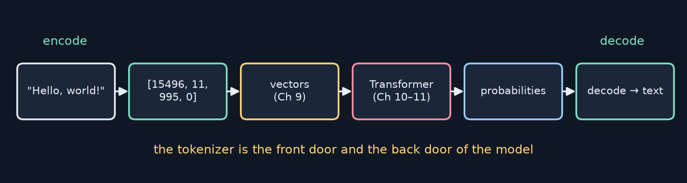
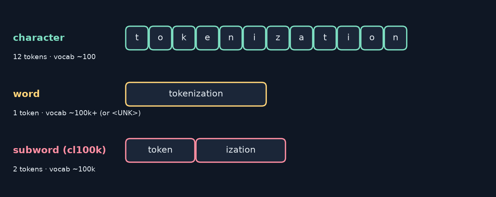
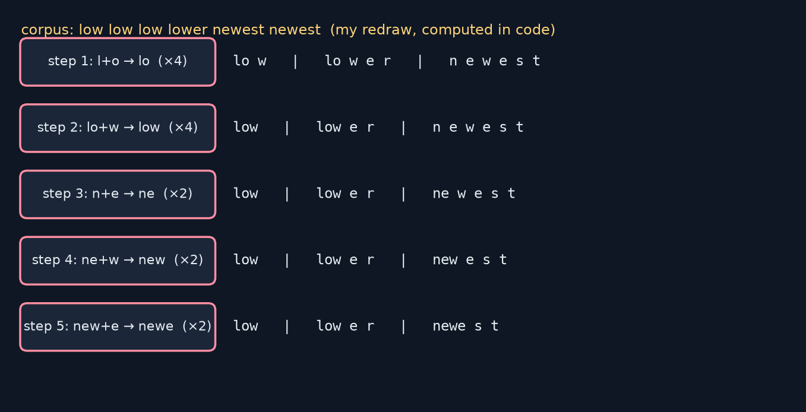
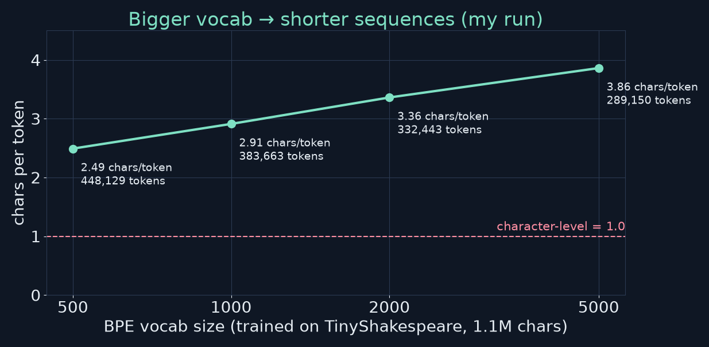
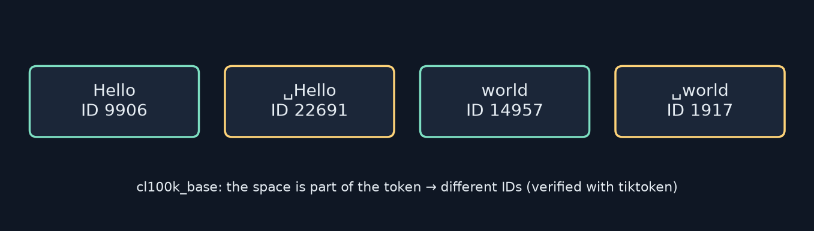

<!-- _class: lead -->
<!-- _paginate: false -->
# Build Your First LLM
## Chapter 8 — Building the Tokenizer
A study companion to *Build Your First LLM* by Hasan Degismez
**Waqar Shaikh Builds**

<!-- say: Welcome to chapter eight of my study series on Build Your First LLM by Hasan Degismez. Today we build the tokenizer, the piece that turns text into numbers and back. We'll write a character tokenizer and a word tokenizer from scratch, understand byte pair encoding, train our own BPE tokenizer on Shakespeare, and then use the production tokenizers, tiktoken and Hugging Face. I ran the whole notebook, and this chapter has more printed outputs that don't match a real run than any chapter so far, so I'll flag each one as we go. -->

---

# Where we are

- **Ch 7:** raw text → clean, deduped, split **JSONL**
- **Ch 8 (today):** JSONL text → **token IDs**
- **Ch 9:** token IDs → embedding vectors
- Notebook: **FirstLLM/code → notebooks/ch08.ipynb**

<!-- say: Last chapter we produced a clean dataset in JSON lines. Today we turn that text into token IDs. Next chapter, those IDs become embedding vectors. Everything follows the chapter eight notebook, linked in the description. -->

---

# Chapter 8 roadmap

1. Why tokenize? The pipeline and special tokens
2. Character-level tokenizer (from scratch)
3. Word-level tokenizer with `<UNK>` (from scratch)
4. Subword tokenization and the BPE algorithm
5. Training BPE on TinyShakespeare
6. Production tokenizers: tiktoken & Hugging Face
7. Quirks: spaces, numbers, emoji, other languages
8. Connecting to Chapter 9 · exercises · review

<!-- say: Here's the plan. Why we tokenize at all. Then three strategies in rising sophistication: characters, words, and subwords with byte pair encoding. We'll train BPE ourselves, then use the real tools, then look at the quirks that affect prompts and costs. Finally we connect to chapter nine. -->

---

# Key terms for this chapter

| Term | One-line meaning |
|---|---|
| **Token** | A unit of text (char, word or piece) with an ID |
| **Vocabulary** | Every token the tokenizer knows, with its ID |
| **Encode / decode** | Text → IDs / IDs → text |
| **Special tokens** | `<PAD>` `<UNK>` `<BOS>` `<EOS>` — structure, not content |
| **BPE** | Learn subwords by repeatedly merging the most frequent pair |
| **Round trip** | decode(encode(text)) == text — the first test of any tokenizer |

<!-- say: A few terms. A token is a unit of text with an ID. The vocabulary is every token the tokenizer knows. Encoding goes from text to IDs, decoding goes back. Special tokens mark structure: padding, unknown, beginning and end. BPE, byte pair encoding, learns subword pieces by merging the most frequent pair again and again. And the round trip test, decode of encode equals the original text, is the first thing to check on any tokenizer. -->

---

<!-- _class: divider -->
# Part 1
## Why tokenize?

<!-- say: Part one. Why tokenize? -->

---

# Text in, numbers out (my redraw)



- GPT-2 never saw *"The secret to building AI is"* — it saw `[464, 3200, 284, 2615, 9552, 318]`

<!-- say: Models only process numbers. Back in chapter five, when we typed the secret to building AI is, GPT-2 actually received six integers. The tokenizer encodes text into those IDs, the embedding layer turns them into vectors, the transformer processes them, and the output is a probability for every token in the vocabulary. Then the tokenizer decodes the chosen ID back into text. It's the front door and the back door of every model. -->

---

# Special tokens

| Token | Purpose |
|---|---|
| `<UNK>` | Fallback for anything not in the vocabulary |
| `<BOS>` | "A sequence starts here" |
| `<EOS>` | "Stop here" — also how generation knows when to end |
| `<PAD>` | Fill shorter sequences so a batch is rectangular |

- GPT-2 uses one token, `<|endoftext|>` (ID 50256), for both BOS and EOS, and has **no PAD** by default

<!-- say: Special tokens aren't words, they're structure. Unknown is the fallback. Beginning of sequence and end of sequence mark boundaries, and end of sequence is how a model signals that it's done generating. Padding fills short sequences so a batch has a rectangular shape. GPT-2 is a good real example: it uses a single token, end of text, ID fifty thousand two hundred and fifty six, for both beginning and end, and it has no padding token at all by default. -->

---

<!-- _class: divider -->
# Part 2
## Character-level tokenization

<!-- say: Part two. The simplest possible tokenizer: one character, one token. -->

---

# `CharTokenizer` (notebook cell 3)

```python
class CharTokenizer:
    def __init__(self):
        self.char_to_id = {}
        self.id_to_char = {}

    def fit(self, text):
        chars = sorted(set(text))
        for i, c in enumerate(chars):
            self.char_to_id[c] = i
            self.id_to_char[i] = c

    def encode(self, text):
        return [self.char_to_id[c] for c in text]

    def decode(self, ids):
        return "".join(self.id_to_char[i] for i in ids)
```

<!-- say: Here's the character tokenizer from the notebook, trimmed of comments. Two dictionaries, one for each direction, so both lookups are instant. Fit takes the set of characters, which removes duplicates, and sorts it so the IDs are deterministic. Encode is a list comprehension that looks each character up. Decode joins the characters back with an empty string, because characters have no spaces between them. -->

---

# Try it (notebook cell 5 — my run)

```text
Vocabulary size: 10
Vocab: {' ': 0, '!': 1, ',': 2, 'H': 3, 'd': 4, 'e': 5, 'l': 6, 'o': 7, 'r': 8, 'w': 9}
'Hello' → [3, 5, 6, 6, 7]
[3, 5, 6, 6, 7] → 'Hello'
Perfect round trip? True
```

- Sorted order puts space and punctuation first (their code points are smallest)
- `encode` crashes with **KeyError** on a character it never saw

<!-- say: Fitting on hello world gives ten characters. Because we sorted them, space and punctuation come first: their Unicode code points are smaller than letters. Hello encodes to three, five, six, six, seven, and decodes back perfectly. One thing to notice: this encode has no fallback, so a character it never saw raises a key error. Production character tokenizers either include every byte or add an unknown token. -->

---

# ⚠️ Book check: the tradeoff example

```text
sentence = "Tokenization is the first step in any language model."
Original text: 53 characters      Vocab size: 22      Sequence length: 53
```

- Book prints **54** characters and vocab **24** — a real run gives **53** and **22**
- Same story for *"The quick brown fox…"*: real run **43** chars, **28** unique (book: 44, 20)
- The point stands: **1 character = 1 token** → long sequences

<!-- say: Here's the first book check. The notebook's sentence, tokenization is the first step in any language model, is fifty three characters with twenty two unique characters. The book prints fifty four and twenty four. The quick brown fox sentence later on is forty three characters with twenty eight unique ones, where the book says forty four and twenty. These are small slips, and the lesson is unchanged: at character level, every character is one token, so sequences get long fast. -->

---

# Characters: pros and cons

| ✅ Pros | ❌ Cons |
|---|---|
| Tiny vocab (~100–200 for English) | Very long sequences |
| No unknowns (if every char seen) | Model must learn spelling → words |
| Trivial to implement | More tokens = more compute |
| | Poor fit for scripts with thousands of chars |

- A 3,000-char essay ≈ 3,000 tokens — GPT-2's context is **1,024**

<!-- say: Pros: a tiny vocabulary, no unknowns as long as every character was seen, and it's trivial to write. Cons: very long sequences, the model has to learn how letters form words, and more tokens means more compute, since attention grows with the square of the length. A three thousand character essay would be three thousand tokens, and GPT-2 can only see one thousand and twenty four. -->

---

<!-- _class: divider -->
# Part 3
## Word-level tokenization

<!-- say: Part three. The other extreme: whole words as tokens. -->

---

# `WordTokenizer.fit` (notebook cell 9, condensed)

```python
def fit(self, text):
    words = text.lower().split()
    counts = Counter(words)
    self.word_to_id = {"<PAD>": 0, "<UNK>": 1, "<BOS>": 2, "<EOS>": 3}
    self.id_to_word = {v: k for k, v in self.word_to_id.items()}
    top_words = counts.most_common(self.max_vocab_size - 4)
    for i, (word, count) in enumerate(top_words, start=4):
        self.word_to_id[word] = i
        self.id_to_word[i] = word
```

- Keep the **most frequent** words; IDs 0–3 are reserved for special tokens

<!-- say: The word tokenizer lowercases, splits on whitespace, and counts words. IDs zero to three are reserved for the special tokens. Then it keeps only the most frequent words, enough to fill the maximum vocabulary size, starting at ID four. Everything rarer will become unknown. -->

---

# encode / decode with `<UNK>` (notebook cell 9)

```python
def encode(self, text, add_special_tokens=False):
    words = text.lower().split()
    ids = [self.word_to_id.get(w, 1) for w in words]   # 1 = <UNK>
    if add_special_tokens:
        ids = [2] + ids + [3]                           # <BOS> … <EOS>
    return ids

def decode(self, ids, skip_special_tokens=True):
    words = []
    for i in ids:
        word = self.id_to_word.get(i, "<UNK>")
        if skip_special_tokens and word in ["<PAD>", "<BOS>", "<EOS>"]:
            continue
        words.append(word)
    return " ".join(words)
```

<!-- say: Encoding uses dot get with a default of one, so an unknown word becomes the unknown token instead of crashing. Optionally we wrap the sequence in beginning and end tokens. Decoding looks up each ID, optionally skips the structural tokens, and joins with spaces. Notice the round trip is already lossy: we lowercased, and any unknown word is gone for good. -->

---

# ⚠️ Book check: which words make the cut (cell 11)

```text
Vocabulary: {'<PAD>': 0, '<UNK>': 1, '<BOS>': 2, '<EOS>': 3,
             'the': 4, 'on': 5, 'mat.': 6, 'cat': 7, 'sat': 8, 'was': 9}
'the elephant sat' → [4, 1, 8]   Decoded: 'the <UNK> sat'
With special tokens: [2, 4, 7, 3]
```

- Book shows `'mat.': 5, 'on': 6 … 'dog': 9` — but `was` and `dog` both appear once; `Counter` breaks ties by **first appearance**, so **`was`** wins
- Note `mat.` keeps its period — `.split()` doesn't separate punctuation

<!-- say: Here's the real output on the cat, mat example with ten slots. The book shows mat before on, and dog as the last word in. In my run, on comes before mat, and was takes the last slot, not dog. Why? Was and dog each appear once, and Counter's most common breaks ties by first appearance, and was appears first. Also notice the token mat with a full stop attached: plain split doesn't separate punctuation, which is why the book suggests a regex like backslash b, backslash w plus, backslash b. -->

---

# ⚠️ Book check: vocab size vs coverage (my run)

```text
test = "neural networks learn from data"
Vocab 10 → Unknown 1/5 (80% coverage)    Vocab 20 → 0/5    Vocab 50 → 0/5
```

- Book: **3/5** unknown at vocab 10. Only 6 word slots; ties again go to **first appearance**
- `learning` and `of` (×2) come first, then *neural, networks, learn, from* → only **data** is unknown
- Lesson: on tiny corpora, the "most frequent" list is mostly tie-breaking

<!-- say: The next example in the book isn't in the notebook, so I ran it myself. With a vocabulary of ten, the book says three of the five test words are unknown. I get one. With only six word slots, learning and of come first because they appear twice, and the remaining slots go, by first appearance, to neural, networks, learn and from, which happen to be exactly our test words. Only data is unknown. The lesson: on a tiny corpus, the most frequent list is mostly tie breaking, so be careful drawing conclusions from it. -->

---

# Characters vs words, side by side (cell 13 — my run)

```text
"The quick brown fox jumps over the lazy dog"
CHARACTER: vocab 28 · sequence 43
WORD:      vocab 12 · sequence 9   tokens [4, 5, 6, 7, 8, 9, 4, 10, 11]
```

- Words give ~**5×** shorter sequences here
- But a word vocab grows with every new name, typo, number and language
- Each vocab entry costs a row in the embedding table (Ch 9)

<!-- say: Side by side on the quick brown fox. Characters: vocabulary twenty eight, sequence forty three. Words: vocabulary twelve, eight distinct words plus four special tokens, and a sequence of nine. Notice the repeats ID four for both thes, because we lowercased. Words are about five times shorter here. But a word vocabulary keeps growing with every new name, typo, number and language, and each entry costs a row in the embedding table we'll build in chapter nine. Neither extreme is right. -->

---

<!-- _class: divider -->
# Part 4
## Subwords and BPE

<!-- say: Part four. Subwords and byte pair encoding, the middle ground every modern LLM uses. -->

---

# Three ways to split "tokenization" (my redraw)



- Subword split verified with tiktoken `cl100k_base`: `token` + `ization`

<!-- say: Here are the three strategies on one word. Character level gives twelve tokens. Word level gives one token, but only if tokenization is in a huge vocabulary, and otherwise it's unknown. Subword gives two meaningful pieces, token and ization, which I confirmed with GPT-4's tokenizer. A small side note: the book says tokenization is thirteen characters in one place and twelve in another. It's twelve. -->

---

# The BPE idea

1. Start with **characters** as the vocabulary
2. Count every **adjacent pair** in the corpus
3. **Merge** the most frequent pair into one new token
4. Add it to the vocabulary
5. Repeat until the vocabulary reaches the target size

- Invented for **data compression** (Philip Gage, 1994); adopted for NMT in 2015 (Sennrich et al.)

<!-- say: Byte pair encoding is beautifully simple. Start with single characters. Count every adjacent pair. Merge the most frequent pair into a single new token and add it to the vocabulary. Repeat until you reach your target vocabulary size. It was invented by Philip Gage in nineteen ninety four as a compression trick, and Sennrich and colleagues adapted it for machine translation in twenty fifteen. GPT-2 then made a byte level version of it standard. -->

---

# BPE merges, step by step (my redraw)



<!-- say: Here's BPE on the book's toy corpus: low three times, lower once, newest twice. I computed this in code rather than by hand. Step one: l and o appear together four times, so they merge. Step two: lo plus w, also four times, gives low. Now every remaining pair appears twice, so there's a tie. My code picks the first pair it finds, n plus e. The book picks e plus s. Both are valid; real implementations need a deterministic tie break rule, and different libraries use different ones. After a few more merges, newest becomes one token while lower stays as low plus pieces. -->

---

# Why BPE won

- **Manageable vocab:** ~30k–100k pieces cover practically all text
- **No true unknowns:** byte-level BPE can always fall back to raw bytes
- **Efficient on common text:** frequent words are one token
- **Learned, not hand-written:** "un-", "-ing", "-tion" emerge from counts
- Variants: **WordPiece** (BERT), **Unigram/SentencePiece** (T5, LLaMA 1/2)

<!-- say: BPE won because it balances everything. Tens of thousands of pieces cover practically any text. A byte level version, like GPT-2's, can always fall back to raw bytes, so there are no true unknowns. Frequent words are a single token. And useful prefixes and suffixes emerge just from counting. There are close cousins: WordPiece in BERT, and the Unigram model in SentencePiece, used by T5. LLaMA one and two use SentencePiece's BPE mode. -->

---

<!-- _class: divider -->
# Part 5
## Training BPE on Shakespeare

<!-- say: Part five. Let's train a real BPE tokenizer on Shakespeare. -->

---

# Setup (notebook cells 17 & 21)

```python
from tokenizers import Tokenizer
from tokenizers.models import BPE
from tokenizers.trainers import BpeTrainer
from tokenizers.pre_tokenizers import Whitespace

bpe_tokenizer = Tokenizer(BPE(unk_token="<UNK>"))
bpe_tokenizer.pre_tokenizer = Whitespace()
trainer = BpeTrainer(
    vocab_size=1000,
    min_frequency=2,
    special_tokens=["<PAD>", "<UNK>", "<BOS>", "<EOS>"]
)
bpe_tokenizer.train(files=["shakespeare.txt"], trainer=trainer)
```

- TinyShakespeare: **1,115,394** characters · training took **0.4 s** on my CPU

<!-- say: We use Hugging Face's tokenizers library, written in Rust. A BPE model, a whitespace pre tokenizer so merges never cross word boundaries, and a trainer with a vocabulary of one thousand, a minimum pair frequency of two, and our four special tokens. TinyShakespeare is just over one point one million characters, and training took four tenths of a second on my CPU. -->

---

# ⚠️ Book check: the Hamlet line (cell 23 — my run)

```text
Tokens: ['To', 'be', 'or', 'not', 'to', 'be', ',', 'that', 'is', 'the', 'que', 'st', 'ion', '.']
Number of tokens: 14
Decoded: 'To be or not to be , that is the que st ion .'
Perfect round-trip: False
```

- Book: 12 tokens with `question` whole — at vocab 1,000 it's **que + st + ion**
- Book: round trip **True** — it's **False**: no decoder is set, so pieces are joined with spaces

<!-- say: Now the most important correction in this chapter. The book shows twelve tokens, with question as a single token, and says the round trip is perfect. In the actual run, question splits into que, st and ion, giving fourteen tokens. And the round trip is false: the decoded text has spaces before the comma and inside question. That's because the whitespace pre tokenizer throws away spacing information and no decoder was set. Which is exactly why GPT-2 uses byte level BPE that keeps the space inside the token. Always run the round trip test yourself. -->

---

# Fixing the round trip (my code)

```python
from tokenizers import pre_tokenizers, decoders
tok = Tokenizer(BPE(unk_token="<UNK>"))
tok.pre_tokenizer = pre_tokenizers.ByteLevel(add_prefix_space=False)
tok.decoder = decoders.ByteLevel()
tok.train(["shakespeare.txt"], BpeTrainer(vocab_size=1000, min_frequency=2,
          initial_alphabet=pre_tokenizers.ByteLevel.alphabet()))
```

- Byte-level pre-tokenizer keeps the space **inside** the token (`Ġbe`) → lossless decode
- Same approach as GPT-2 — and no `<UNK>` is ever needed

<!-- say: Here's my fix, my own code. Swap the whitespace pre tokenizer for a byte level one and set a matching byte level decoder. Now the space is stored inside the token, shown as a G with a dot in front of be, and decoding reproduces the text exactly. That's the GPT-2 approach, and because every byte is in the starting alphabet, no unknown token is ever needed. -->

---

# Domain mismatch (cell 25 — my run)

```text
'ChatGPT generates amazing neural network responses' → 25 tokens
['C','hat','G','P','T','g','en','er','ates','a','ma','z','ing',
 'ne','ur','al','n','et','wor','k','res','p','on','s','es']
```

- `ing` and `hat` are tokens; `ChatGPT`, `neural`, `network` shatter
- Book's shorter example prints 14 tokens — my run gives **18**
- A tokenizer is only as good as the text it learned from

<!-- say: Now modern text that Shakespeare never wrote. Twenty five tokens. Ing is a single token, because Shakespeare is full of ing words, and hat is a token, so Chat becomes C plus hat. But ChatGPT, neural and network shatter into fragments. The book's shorter version of this example prints fourteen tokens; my run gives eighteen. The lesson is right though: a tokenizer is only as good as the text it learned from. -->

---

# ⚠️ Book check: what the vocabulary looks like (my run)

```text
0 <PAD>  1 <UNK>  2 <BOS>  3 <EOS>  4 !  5 $  6 &  7 '  8 ,  9 -  10 .  11 3  12 :
… 15 A  16 B … 41 a  42 b  43 c  44 d  45 e …
'ing' tokens: BOLINGBROKE, BUCKINGHAM, KING, King, being, bring, ing, ings, king, nothing, thing
Longest: BOLINGBROKE, GLOUCESTER, BUCKINGHAM, CORIOLANUS, VINCENTIO, …, therefore
```

- Book: low IDs are the **most frequent** characters (e, t, o, a…). In fact the base alphabet is **sorted**; only **merges** are in frequency order
- Longest tokens are **character names** — speaker labels repeat thousands of times

<!-- say: The book says the lowest IDs hold the most frequent characters, e, t, o, a. In a real run, the starting alphabet is simply sorted: punctuation, then capitals, then lowercase. Only the merged tokens after the alphabet are in the order they were learned. And the longest tokens aren't common English words; they're character names like Bolingbroke and Buckingham, because every speech in the play starts with the speaker's name in capitals. That's a nice data lesson from chapter seven: your formatting gets learned too. -->

---

# Vocab size is a dial (my experiment)



<!-- say: I trained four BPE tokenizers on the same Shakespeare file with vocabularies of five hundred, one thousand, two thousand and five thousand, then tokenized the whole file. Characters per token rose from about two and a half to almost three point nine, and the token count fell from four hundred and forty eight thousand to two hundred and eighty nine thousand. Character level would be one character per token. Bigger vocabularies mean shorter sequences, at the cost of a bigger embedding table. -->

---

# Save and load

```python
bpe_tokenizer.save("shakespeare_bpe.json")
loaded = Tokenizer.from_file("shakespeare_bpe.json")
assert loaded.encode("To be or not to be").tokens == \
       bpe_tokenizer.encode("To be or not to be").tokens
```

- My file: **59,956 bytes** (book: 38,412 — size depends on library version)
- Version-control your tokenizer: **the model is useless without the exact same one**

<!-- say: A trained tokenizer is an artifact. Save it to JSON, load it back, and check the outputs match. My file was about sixty thousand bytes; the book's was thirty eight thousand, and the size depends on the library version and the exact merges. The key point: a model's embedding table is tied to one exact tokenizer. Lose or change it, and the model's IDs mean nothing. -->

---

<!-- _class: divider -->
# Part 6
## Production tokenizers

<!-- say: Part six. The production tokenizers you'll actually use. -->

---

# tiktoken — GPT-4's `cl100k_base` (cells 27 & 29)

```python
import tiktoken
enc = tiktoken.get_encoding("cl100k_base")
tokens = enc.encode("Hello, world! How are you?")
```
```text
Tokens: [9906, 11, 1917, 0, 2650, 527, 499, 30]     Number of tokens: 8
9906 → 'Hello'  11 → ','  1917 → ' world'  0 → '!'  2650 → ' How'  527 → ' are'  499 → ' you'  30 → '?'
Perfect round-trip: True
```

- Vocabulary: **100,277** tokens (`enc.n_vocab`)

<!-- say: Tiktoken is OpenAI's tokenizer library. The cl100k base encoding is the one used by GPT-4 and GPT three point five turbo. Hello, world, how are you becomes eight tokens, and notice the spaces live at the start of tokens: space world, space how. The round trip is perfect, because it's byte level. Its vocabulary has one hundred thousand two hundred and seventy seven entries. Newer OpenAI models use a larger encoding called o two hundred k base. -->

---

# ⚠️ Book check: token counts for prompts (cell 31)

```text
'Write a haiku about programming.'                                    → 7 tokens
'Explain quantum computing in simple terms for a 10-year-old child.'  → 15 tokens
'Generate a 500-word essay on climate change.'                        → 10 tokens
```

- Book: **6, 14, 9** — each is one short. Example: `haiku` = ` ha` + `iku`
- And the Hamlet line in cl100k is **12** tokens (book: 11); *"…backpropagation."* is **9** (`back`+`prop`+`agation`), not 8
- Lesson from the book itself: **don't assume, measure**

<!-- say: The notebook counts tokens for three prompts. The real counts are seven, fifteen and ten. The book prints six, fourteen and nine, each one short. Haiku, for example, is two tokens. The same kind of slip appears in the comparison section: the Hamlet line is twelve tokens in GPT-4's tokenizer, not eleven, and the backpropagation sentence is nine, with backpropagation split into back, prop and agation. Ironically, the book's own advice is the right one: don't assume, measure. -->

---

# Hugging Face `AutoTokenizer` — GPT-2 (cells 33 & 35)

```python
from transformers import AutoTokenizer
tokenizer = AutoTokenizer.from_pretrained("gpt2")
encoded = tokenizer("Hello, world! How are you?", return_tensors="pt")
```
```text
Token IDs: tensor([[15496,    11,   995,     0,  1374,   389,   345,    30]])
Attention mask: tensor([[1, 1, 1, 1, 1, 1, 1, 1]])
```

- Same split as GPT-4 here, **different IDs** — every model has its own vocabulary
- The attention mask marks real tokens (1) vs padding (0)

<!-- say: Hugging Face's auto tokenizer loads the tokenizer that matches any model on the hub. For GPT-2, the same sentence splits into the same eight pieces, but the IDs are completely different, because each model has its own vocabulary. You also get an attention mask: one for real tokens, zero for padding. Here there's no padding, so it's all ones. -->

---

# Vocabulary sizes in the wild

| Model | Vocab | Type |
|---|---|---|
| GPT-2 / GPT-3 | 50,257 | byte-level BPE |
| GPT-4 (`cl100k_base`) | 100,277 | byte-level BPE |
| GPT-4o (`o200k_base`) | ~200k | byte-level BPE |
| BERT-base | 30,522 | WordPiece |
| LLaMA 1/2 | 32,000 | SentencePiece BPE |
| LLaMA 3 | 128,256 | tiktoken-style BPE |

<!-- say: Here are some real vocabulary sizes. GPT-2 and GPT-3: fifty thousand two hundred and fifty seven. GPT-4's encoding: about one hundred thousand. GPT-4o: about two hundred thousand. BERT: thirty thousand five hundred and twenty two, with WordPiece. LLaMA one and two: thirty two thousand, and LLaMA three jumped to one hundred and twenty eight thousand. The trend is clear: bigger vocabularies, shorter sequences. I added the GPT-4o and LLaMA 3 rows myself. -->

---

<!-- _class: divider -->
# Part 7
## Quirks and gotchas

<!-- say: Part seven. Tokenizer quirks that affect prompts and costs. -->

---

# Quirk 1: the leading space (cell 37, my redraw)



- `"Translate:Hello"` and `"Translate: Hello"` → same length, **different** last ID (9906 vs 22691)

<!-- say: Quirk one: the leading space. Hello and space Hello are different tokens with different IDs, and the same for world. Because most words in running text follow a space, BPE learns the spaced version as the common token. So Translate colon Hello and Translate colon space Hello give the same number of tokens, but the model sees a different final token. Spacing in prompts is not cosmetic. -->

---

# Quirk 2: numbers split (cell 39 — my run)

```text
'10' → ['10']   '100' → ['100']   '1000' → ['100','0']   '10000' → ['100','00']
'42' → ['42']   '2024' → ['202','4']
"The answer is 10000."        → 7 tokens
"The answer is ten thousand." → 6 tokens
```

- cl100k groups digits in chunks of **at most 3**
- Odd splits like `202|4` are one reason LLMs struggle with arithmetic

<!-- say: Quirk two: numbers. In cl100k, digits are grouped into chunks of at most three, so ten thousand becomes one hundred, then zero zero, and twenty twenty four becomes two zero two, then four. In my run, the answer is ten thousand in digits takes seven tokens, while spelling it out takes six. Splits like this are one reason models struggle with arithmetic: the same digit sits in different positions inside different tokens. -->

---

# ⚠️ Book check: emoji (cell 41 — my run)

```text
'😀' → 2 tokens     '🚀' → 3 tokens     '👍' → 3 tokens
'Hello 😀 world' → 3 tokens: ['Hello', ' 😀', ' world']
'🔥🔥🔥' → 9 tokens
```

- Book: each emoji is **1** token and 🔥🔥🔥 is **3** — in cl100k most emoji are **2–3 byte-pieces**
- Book's "Hello 😀 world → 4 tokens" lists 3 — the real answer is **3**
- Emoji are 4 bytes in UTF-8; byte-level BPE only merges the ones it saw often

<!-- say: Quirk three, and another correction. The book says common emoji are single tokens and three fire emoji are three tokens. In my run, the smiley is two tokens, the rocket and thumbs up are three each, and three fire emoji are nine. An emoji is four bytes in UTF-8, and byte level BPE only merges the byte sequences it saw often enough. Interestingly, space smiley inside a sentence is one token, so context matters. The book also says hello smiley world is four tokens while listing three; three is right. -->

---

# Quirk 4: other languages (my run)

```text
'café'  → ['ca', 'fé']               (2)
'naïve' → ['na', 'ï', 've']          (3)
'日本語' → ['日', '本', '�', '�']     (4 — last char split into 2 byte-pieces)
'Привет мир' → ['Пр','ив','ет',' м','ир']   (5 for 2 words)
```

- English ≈ **1 token per word**; many languages pay 2–3× more
- Higher cost, less fits in context → reason to use a multilingual tokenizer

<!-- say: Quirk four: other languages. Café is two tokens, naive with a diaeresis is three, the Japanese word for Japanese language is four, with the last character split into two byte pieces, and hello world in Russian is five tokens for two words. English gets roughly one token per word, while many other languages pay two or three times more. That means higher cost and less text in the context window, which is why multilingual models train multilingual tokenizers. -->

---

<!-- _class: divider -->
# Part 8
## To Chapter 9, exercises and review

<!-- say: Part eight. Connecting to chapter nine, then exercises and review. -->

---

# Tokenize the Chapter 7 dataset (cell 43 — my run)

```text
Tokenized 3 examples
Average tokens per example: 5.7     Max tokens: 7     Min tokens: 5
{"text": "AI systems learn from examples", "split": "train",
 "token_ids": [15836, 6067, 4048, 505, 10507], "token_count": 5}
```

- Each JSONL record gains `token_ids` and `token_count` → ready for embeddings

<!-- say: The notebook closes the loop with chapter seven. Each JSON lines record gets two new fields, its token IDs and its token count. Three examples average five point seven tokens. That's exactly the input chapter nine needs. -->

---

# ⚠️ Book check: `nn.Embedding` arguments

```python
# Book:   torch.nn.Embedding(vocab_size=50257, embedding_dim=768)   → TypeError
torch.nn.Embedding(num_embeddings=50257, embedding_dim=768)       # ✓ (or positional)
```

- I ran it: `vocab_size=` raises **TypeError** — the parameter is `num_embeddings`
- Result: a table of 50,257 × 768 ≈ **38.6M** parameters — one row per token

<!-- say: One last book check, in the preview of chapter nine. The book creates an embedding layer with a keyword called vocab size. PyTorch doesn't have that keyword; I ran it and got a type error. The parameter is called num embeddings, or you can pass the numbers positionally. The result is a table of fifty thousand two hundred and fifty seven rows by seven hundred and sixty eight columns, about thirty eight point six million parameters, one row per token. That's the cost of vocabulary size made concrete. -->

---

# Exercises (my answers)

- **Ex 1:** *"Artificial intelligence systems require careful data preparation and tokenization."* → char vocab **23**, length **82**; word vocab **13**, length **9**, no `<UNK>` (word `tokenization.` keeps its period)
- **Ex 3:** cost = (input + max_output) × price — read current prices from the provider's page
- **Ex 4:** leading space changes the ID for **every** word tried; for rarer words it can also change the **count**
- **Ex 5:** English is cheapest in cl100k; most other scripts cost more per word

<!-- say: Some answers to the exercises, from my own runs. Exercise one: the sentence has twenty three distinct characters and eighty two characters total; the word tokenizer has thirteen entries including the four special tokens and a sequence of nine words, with no unknowns since it was fit on the same text, and note tokenization keeps its full stop. Exercise three: estimate cost as input tokens plus maximum output tokens, times the current price. Exercise four: the leading space changes the ID for every word, and for rarer words it can change the count too. Exercise five: English is usually cheapest. -->

---

# Key takeaways

1. Tokenization is **reversible** text ↔ IDs — always test the **round trip**
2. Core tradeoff: **vocab size vs sequence length**
3. **BPE** merges the most frequent pair, again and again
4. Byte-level BPE (GPT-2/4) keeps spaces in tokens → lossless, no `<UNK>`
5. Tokenizers are **data-dependent**: Shakespeare ≠ tech text
6. Quirks (spaces, numbers, emoji, languages) change counts → **measure**

<!-- say: Key takeaways. Tokenization is a reversible mapping, so always test the round trip. The core tradeoff is vocabulary size against sequence length. BPE merges the most frequent pair over and over. Byte level BPE keeps spaces inside tokens, so it's lossless and never needs an unknown token. Tokenizers depend on their training data. And quirks with spaces, numbers, emoji and languages change token counts, so measure rather than assume. -->

---

# Notebook run & book check

- ✅ **ch08.ipynb** on CPU: all 19 output cells ran (installed `tiktoken` first)
- ⚠️ Corrections: char counts (53/22; 43/28) · word vocab tie-break (`was`, not `dog`) · coverage 1/5 · BPE `question` → 3 pieces & round trip **False** · base alphabet sorted · cl100k counts (12, 9; 7/15/10) · emoji 2–3 tokens · `num_embeddings`
- None of these change the ideas — they change the **numbers you'll see**

<!-- say: The notebook ran completely on my CPU once tiktoken was installed. The corrections are summarised here, and they're all in the errata file in the repo. None of them change the ideas in the chapter, but they do change the numbers you'll see on your screen, and now you know why. -->

---

# Review questions

1. What is the vocab-size vs sequence-length tradeoff? Give numbers.
2. When is `<UNK>` used? When is `<PAD>` used?
3. Explain BPE in your own words. Why do "-ing" and "un-" emerge?
4. Why do `"Hello"` and `" Hello"` get different IDs?
5. Why might `"10000"` cost more tokens than `"ten thousand"`?
6. Building a Chinese chatbot: tiktoken or a custom tokenizer?
7. Why did our Shakespeare tokenizer's round trip fail?

<!-- say: Pause and try these. The tradeoff, with numbers. When unknown and padding are used. BPE in your own words. Why the leading space changes the ID. Why digits can cost more than words. Which tokenizer to use for a Chinese chatbot. And, from our own run, why the Shakespeare tokenizer's round trip failed. -->

---

# Practice this

- Open **ch08.ipynb** in Colab; run every cell and compare with the book
- Add `ByteLevel` pre-tokenizer + decoder and make the round trip **True**
- Train BPE at vocab 500 / 5,000 and compare token counts
- Tokenize your Chapter 7 JSONL with both GPT-2 and cl100k
- Code: FirstLLM/code (MIT) — link in the description

<!-- say: To practise: run the notebook in Colab and compare every output with the book. Fix the round trip with a byte level pre tokenizer and decoder. Train at different vocabulary sizes. And tokenize your chapter seven dataset with two different tokenizers and compare the counts. -->

---

# Up next: Chapter 9

**Embeddings** — token IDs become vectors that carry meaning

- `nn.Embedding`, positional information, and why similar words end up close

<!-- say: Next time, chapter nine: embeddings, where those token IDs become vectors that carry meaning. -->

---

<!-- _class: lead -->
# Credits

Based on ***Build Your First LLM*** by **Hasan Degismez** — buy the book: **leanpub.com/FirstLLM/**
Code: **github.com/FirstLLM/code** (MIT License) · notebook ch08.ipynb
Slides, narration and diagrams: my own study materials · **Waqar Shaikh Builds**

<!-- say: This video is based on Build Your First LLM by Hasan Degismez. The explanations and diagrams here are my own, but the book goes deeper, with exercises, appendices and the full text, so please support the author and buy it at leanpub dot com slash First LLM. The code is on GitHub at First LLM slash code, under the MIT licence. Thanks for watching, and see you in chapter nine. -->
