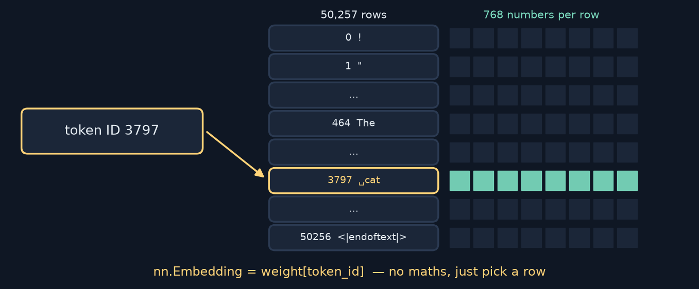
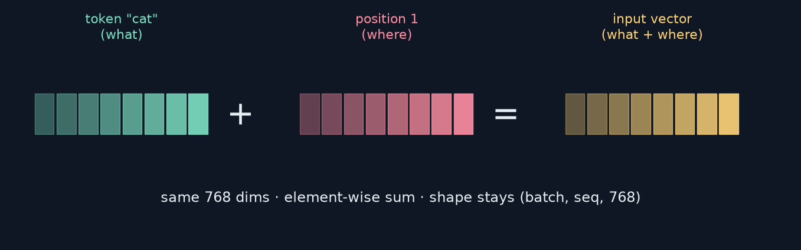
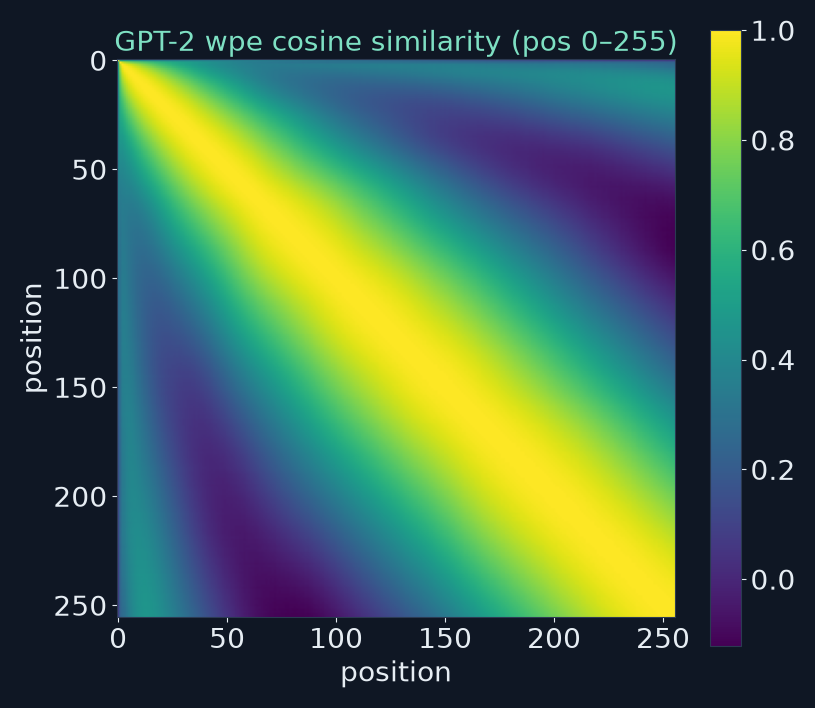
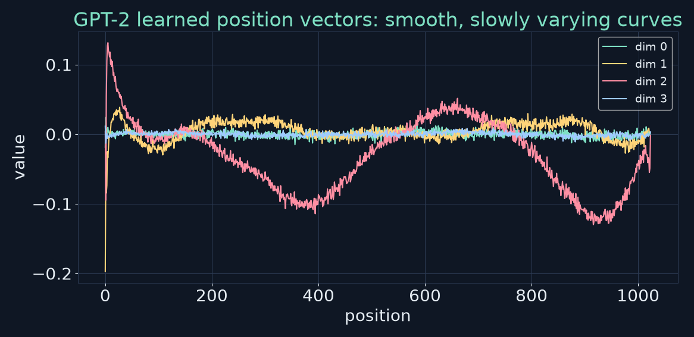

<!-- _class: lead -->
<!-- _paginate: false -->
# Build Your First LLM
## Chapter 9 — The Embedding Layer
A study companion to *Build Your First LLM* by Hasan Degismez
**Waqar Shaikh Builds**

<!-- say: Welcome to chapter nine of my study series on Build Your First LLM by Hasan Degismez. Today token IDs become vectors. We'll build token embeddings and position embeddings from scratch, combine them into GPT-2's embedding layer, and then open up the real GPT-2 to see what its embeddings learned. I ran the notebook and some experiments of my own, and one of them shows why the book's similarity search returns odd results, and how a single space fixes it. -->

---

# Where we are

- **Ch 7:** clean JSONL · **Ch 8:** text → token IDs
- **Ch 9 (today):** token IDs → **position-aware vectors**
- **Ch 10:** attention mixes those vectors using context
- Notebook: **FirstLLM/code → notebooks/ch09.ipynb**

<!-- say: We have clean data and token IDs. Today those IDs become vectors that also know their position. Next chapter, attention lets those vectors look at each other. Everything follows the chapter nine notebook, linked in the description. -->

---

# Chapter 9 roadmap

1. Why raw token IDs don't work
2. Token embeddings = a lookup table
3. Why position matters (permutation invariance)
4. Learned positional embeddings
5. Token + position → `GPT2Embeddings`
6. Exploring real GPT-2 embeddings
7. Initialization, devices, length limits, weight tying
8. Exercises and review

<!-- say: Here's the plan. Why token IDs alone fail. Token embeddings as a lookup table. Why order is invisible without positions, and how learned position embeddings fix it. Putting both together into GPT-2's embedding layer. Then exploring the real thing, some practical details, and the review. -->

---

# Key terms for this chapter

| Term | One-line meaning |
|---|---|
| **Embedding** | A learned dense vector for a token |
| **Lookup table** | Matrix with one row per token; the ID is the row number |
| **`wte`** | GPT-2's token embedding table (50,257 × 768) |
| **`wpe`** | GPT-2's position embedding table (1,024 × 768) |
| **One-hot** | Vocab-length vector of zeros with a single 1 |
| **Cosine similarity** | Angle-based similarity: 1 same direction, 0 unrelated |

<!-- say: Some terms. An embedding is a learned dense vector for a token. The lookup table is a matrix with one row per token. In GPT-2 the token table is called w t e, and the position table is called w p e. One hot is the naive alternative: a huge vector of zeros with a single one. And cosine similarity measures how aligned two vectors are. -->

---

<!-- _class: divider -->
# Part 1
## Why not just use token IDs?

<!-- say: Part one. Why can't we feed token IDs straight into the network? -->

---

# IDs are labels, not quantities

- `' cat'` → **3797** · `' dog'` → **3290** · `' car'` → **1097** · `' kitten'` → **42143**
- 3797 is "closer" to 3290 than to 42143 — meaningless
- IDs come from BPE merge order, not meaning
- A network multiplying IDs would treat **cat ≈ 1.16 × dog**

<!-- say: Token IDs are labels, not quantities. In GPT-2, space cat is three seven nine seven, space dog is three two nine zero, space car is one zero nine seven, and space kitten is forty two thousand one hundred and forty three. Numerically cat is close to dog and far from kitten, but that means nothing: the IDs come from the order in which BPE merges were learned. If a network multiplied raw IDs, it would treat cat as roughly one point one six times dog. We need a representation where distance means something. -->

---

# ⚠️ Book check: the example IDs

| Word | Book | GPT-2 (my run) |
|---|---|---|
| `cat` | 3797 | 3797 is **`' cat'`** (with space); `'cat'` = 9246 |
| `dog` | 4273 | **3290** (4273 = `' pet'`) |
| `kitten` | 28387 | **42143** (28387 = `' WC'`) |
| `mat` (in "The cat sat on the mat") | 21547 | **2603** (notebook agrees) |

- Also *"I will help you"* → `[40, 481, 1037, 345]`, not `[314, 588, 4695, 345]` (= " I like animals you")

<!-- say: A book check on those IDs. Three seven nine seven is right for cat, but it's the version with a leading space. Without the space, cat is nine two four six. The book's dog, four two seven three, is actually the token space pet, and its kitten ID is the token space W C. The real IDs are three two nine zero and forty two thousand one hundred and forty three. In the full pipeline example, mat is two six zero three, and the notebook agrees. And the batch example labelled I will help you actually decodes to I like animals you. The point the book makes is right; the specific numbers aren't. -->

---

# One-hot vs dense

- One-hot for ID 3797: a **50,257**-long vector with a single 1
  - Huge, and every pair of words is equally far apart
- Dense embedding: **768** learned numbers
  - Small, and similar words can sit close together
- Fun fact (I checked): `one_hot @ W == W[3797]` — a lookup **is** a one-hot matmul

<!-- say: The naive alternative is one hot: a vector fifty thousand long with a single one. It's huge, and every pair of words is exactly the same distance apart. A dense embedding uses seven hundred and sixty eight learned numbers, and similar words can be close. Here's a nice fact I verified in code: multiplying a one hot vector by the embedding matrix gives exactly the same result as picking row three seven nine seven. An embedding lookup is just a fast one hot matrix multiply. -->

---

# Why 768?

- 768 = 2⁸ × 3 → splits cleanly into **12 heads × 64** (Ch 10)
- GPT-2 sizes: Small **768** · Medium 1,024 · Large 1,280 · XL 1,600
- GPT-3 175B: **12,288**
- Bigger = more capacity, more parameters: `wte` alone is **38.6M** of GPT-2's **124.4M**

<!-- say: Why seven hundred and sixty eight? It's two to the eighth times three, which splits cleanly into twelve attention heads of sixty four each. GPT-2's sizes go from seven sixty eight up to sixteen hundred, and the largest GPT-3 uses twelve thousand two hundred and eighty eight. More dimensions means more capacity but more parameters. In GPT-2 small, the token table alone is thirty eight point six million of the one hundred and twenty four point four million parameters, nearly a third, which I counted from the real model. -->

---

<!-- _class: divider -->
# Part 2
## Token embeddings: a lookup table

<!-- say: Part two. Token embeddings are just a lookup table. -->

---

# The lookup (my redraw)



<!-- say: Here's the whole idea in one picture. The embedding matrix has one row per token, fifty thousand two hundred and fifty seven rows, and seven hundred and sixty eight numbers per row. Token ID three seven nine seven, space cat, simply selects row three seven nine seven. No arithmetic, just indexing. -->

---

# Manual lookup with fancy indexing (cells 8–12)

```python
embedding_matrix = torch.randn(vocab_size, embed_dim)   # (50257, 768)
token_ids = torch.tensor([464, 3797, 3332])             # "The cat sat"
embeddings = embedding_matrix[token_ids]                # (3, 768)

token_ids_batch = torch.tensor([[464, 3797, 3332, 319],
                                [314, 588, 4695, 345]])
embeddings_batch = embedding_matrix[token_ids_batch]    # (2, 4, 768)
```

- Shape rule: **(batch, seq) → (batch, seq, embed_dim)**

<!-- say: In code, it's fancy indexing. A random matrix of fifty thousand by seven sixty eight. Index it with three IDs and you get three rows, shape three by seven sixty eight. Index it with a batch of two sequences of four, and you get two by four by seven sixty eight. Remember this shape rule: batch by sequence becomes batch by sequence by embedding dimension. -->

---

# `TokenEmbedding` (notebook cell 14)

```python
class TokenEmbedding(nn.Module):
    def __init__(self, vocab_size, embed_dim):
        super().__init__()
        self.embedding = nn.Embedding(vocab_size, embed_dim)
        nn.init.normal_(self.embedding.weight, mean=0.0, std=0.02)

    def forward(self, token_ids):
        return self.embedding(token_ids)
```
```text
Input shape: torch.Size([1, 4])     Output shape: torch.Size([1, 4, 768])
First token embedding (first 5 dims): tensor([ 0.0248, -0.0141,  0.0320, -0.0173,  0.0032], …)
```

<!-- say: The module version wraps nn dot Embedding, which is the same table but registered as a trainable parameter. It's initialised from a normal distribution with standard deviation zero point zero two, GPT-2's choice. Forward just looks up the IDs. On my run, one sequence of four becomes one by four by seven sixty eight, and the values are small, around plus or minus zero point zero two, exactly as initialised. -->

---

<!-- _class: divider -->
# Part 3
## Why position matters

<!-- say: Part three. Why position matters. -->

---

# Order is invisible to attention (my experiment)

```text
"The cat sat" vs "sat cat The", same random embeddings
same set of vectors:                       True
attention output just permutes (no pos):   True
… after adding position embeddings:        False
```

- Without positions, *"dog bites man"* and *"man bites dog"* look the same
- Attention is **permutation-equivariant**: shuffle in → shuffle out

<!-- say: I tested this directly. I embedded the cat sat and sat cat the with the same table, and ran both through a real PyTorch attention layer. Without positions, the output for cat in the first sentence is exactly the output for cat in the second, just at a different index. Attention is permutation equivariant: shuffle the input, and the output shuffles the same way, and nothing else changes. Once I added position embeddings, the outputs differed. So without position information, dog bites man and man bites dog would mean the same thing to the model. -->

---

# Two ways to add position

| Approach | Used by | Idea |
|---|---|---|
| **Learned** absolute | GPT-2, BERT | A trainable table: one vector per position |
| **Sinusoidal** | Original Transformer (2017) | Fixed sin/cos waves at many frequencies |
| **RoPE** (rotary) | LLaMA, Mistral, Qwen… | Rotate Q and K by an angle ∝ position |

- Book: "modern LLMs like GPT-2 prefer learned" — GPT-2 is 2019; most **current** open models use **RoPE** (I added this row)

<!-- say: There are several ways to add position. Learned absolute embeddings, a trainable table with one vector per position, used by GPT-2 and BERT. Sinusoidal encodings, fixed waves from the original transformer paper. And rotary embeddings, RoPE, which rotate queries and keys by an angle that depends on position. The book describes GPT-2 as a modern LLM that prefers learned embeddings; GPT-2 is from twenty nineteen, and most current open models such as LLaMA, Mistral and Qwen use RoPE. I added that row myself. We'll implement learned positions, like GPT-2. -->

---

# `PositionalEmbedding` (notebook cell 18, condensed)

```python
class PositionalEmbedding(nn.Module):
    def __init__(self, max_seq_len, embed_dim):
        super().__init__()
        self.pos_embed = nn.Embedding(max_seq_len, embed_dim)
        nn.init.normal_(self.pos_embed.weight, mean=0.0, std=0.02)
        self.max_seq_len = max_seq_len

    def forward(self, token_ids):
        batch_size, seq_len = token_ids.shape
        if seq_len > self.max_seq_len:
            raise ValueError(f"Sequence length {seq_len} exceeds max_seq_len {self.max_seq_len}")
        position_ids = torch.arange(seq_len, device=token_ids.device)
        position_ids = position_ids.unsqueeze(0).expand(batch_size, seq_len)
        return self.pos_embed(position_ids)
```

<!-- say: The position module is another embedding table, indexed by position instead of token ID. Forward reads the sequence length, checks it against the maximum, creates positions zero to length minus one on the same device as the input, adds a batch dimension with unsqueeze, and expands it across the batch without copying memory. Then it looks them up. Note it never looks at the token values, only at the shape. -->

---

# What happens past `max_seq_len`? (my run)

```text
nn.Embedding(1024, 768)(torch.arange(1500))  →  IndexError: index out of range in self
```

- That's the cryptic error the explicit `ValueError` replaces
- Learned positions **can't extrapolate**: position 1,024 was never trained
- Common fix: **truncate** or slide a window (Exercise 7)

<!-- say: What if a sequence is longer than the table? I tried looking up fifteen hundred positions in a table of one thousand and twenty four, and got index error, index out of range in self. That's the cryptic error that the explicit check replaces with a clear message. And it's a real limitation of learned positions: there's no vector for position one thousand and twenty four, because it was never trained. The usual fixes are truncating or sliding a window over long text. -->

---

<!-- _class: divider -->
# Part 4
## Token + position = `GPT2Embeddings`

<!-- say: Part four. Combining token and position embeddings. -->

---

# Add, don't concatenate (my redraw)



- Concatenation → 1,536 dims and every later layer gets bigger
- Addition keeps 768; the network learns to use different **directions** for "what" and "where"

<!-- say: We combine the two by simple element wise addition. The token vector says what, the position vector says where, and their sum carries both in the same seven sixty eight dimensions. Concatenating would double the width to fifteen thirty six and make every later layer bigger. Addition works because in a high dimensional space the network can learn to use somewhat different directions for content and for position. -->

---

# `GPT2Embeddings` (notebook cell 20, condensed)

```python
class GPT2Embeddings(nn.Module):
    def __init__(self, vocab_size, max_seq_len, embed_dim):
        super().__init__()
        self.token_embed = nn.Embedding(vocab_size, embed_dim)
        self.pos_embed = nn.Embedding(max_seq_len, embed_dim)
        nn.init.normal_(self.token_embed.weight, mean=0.0, std=0.02)
        nn.init.normal_(self.pos_embed.weight, mean=0.0, std=0.02)
        self.max_seq_len = max_seq_len

    def forward(self, token_ids):
        batch_size, seq_len = token_ids.shape
        # (validate length as before)
        position_ids = torch.arange(seq_len, device=token_ids.device)
        position_ids = position_ids.unsqueeze(0).expand(batch_size, seq_len)
        return self.token_embed(token_ids) + self.pos_embed(position_ids)
```

<!-- say: Here's the complete GPT-2 embedding layer. Two tables, both initialised with standard deviation zero point zero two. Forward builds the position indices exactly as before, looks up both, and adds them. Batch by sequence in, batch by sequence by seven sixty eight out. In the notebook, a batch of two sequences of six gives two by six by seven sixty eight. -->

---

# Full pipeline: text → vectors (cell 22 — my run)

```text
Text: The cat sat on the mat
Token IDs: tensor([[ 464, 3797, 3332,  319,  262, 2603]])     Shape: torch.Size([1, 6])
Embeddings shape: torch.Size([1, 6, 768])
```

- Chapter 8 tokenizer → Chapter 9 embeddings → Chapter 10 attention
- Common mistakes: looking up `token_ids` in `pos_embed` · positions on the wrong device · no length check

<!-- say: Now the full pipeline. The GPT-2 tokenizer turns the cat sat on the mat into six IDs, and our embedding layer turns them into one by six by seven sixty eight. The book lists three common mistakes worth remembering: passing token IDs to the position table instead of positions, creating positions on the CPU when the input is on the GPU, and forgetting the length check. -->

---

<!-- _class: divider -->
# Part 5
## Inside the real GPT-2

<!-- say: Part five. Let's open up the real, trained GPT-2. -->

---

# Loading `wte` and `wpe` (cell 24)

```python
from transformers import AutoModel
model = AutoModel.from_pretrained("gpt2")
token_embeddings = model.wte.weight      # torch.Size([50257, 768])
position_embeddings = model.wpe.weight   # torch.Size([1024, 768])
```

- My measurement: trained `wte` std ≈ **0.144**, `wpe` std ≈ **0.123**
- They started at 0.02 — training spread them out ~7×

<!-- say: Hugging Face exposes the two tables as w t e and w p e: fifty thousand by seven sixty eight, and one thousand and twenty four by seven sixty eight. I measured their spread. The trained token table has a standard deviation of about zero point one four four, and the position table about zero point one two three. Both started at zero point zero two, so training spread them out by about seven times. -->

---

# ⚠️ Book check: "similar words" (notebook cell 26)

```text
Words most similar to 'king':   0.683 'ked'  0.570 'KING'  0.558 'kers'  0.531 'King'  0.529 'ker' …
Words most similar to 'happy':  0.696 ' happy'  0.679 'Happy'  0.645 ' Happy'  0.572 ' unhappy' …
```

- Book prints neat lists (prince, Queen, throne…) — the **notebook gives these**
- Cause: `encode("king")` returns the **no-space** token, a word-piece used inside other words
- Also: excluding only `[0]` assumes the top hit is the word itself

<!-- say: Here's the book check. The book shows a beautiful list for king: prince, queen, kingdom, royal, throne. When I ran the notebook, the nearest neighbours of king were ked, KING in capitals, kers and ker. Why? Encoding king without a leading space gives the no space token, which is mostly used as a fragment inside other words, for example at the end of making. Its neighbours are other fragments. The function also assumes the top hit is always the word itself, which isn't guaranteed. The book's printed lists don't come from this code. -->

---

# The one-space fix (my experiment)

```text
' king'     → ' kings' .733  ' King' .696  ' queen' .657  'King' .604  ' prince' .590  ' monarch' .581
' computer' → ' computers' .790  ' Computer' .731  'computer' .713  'Computer' .692  ' laptop' .603
' doctor'   → ' doctors' .780  ' physician' .771  'doctor' .712  ' Doctor' .677  ' physicians' .664
' fast'     → ' Fast' .670  'fast' .633  'Fast' .615  ' faster' .614  ' quick' .577
```

- Use the **space-prefixed** token — that's how words appear mid-sentence
- Even so, the top hits are mostly **case and plural variants** of the same word

<!-- say: The fix is one character. Use space king, the token for king in the middle of a sentence. Now the neighbours are kings, King, queen, prince and monarch. Space computer gives computers and laptop. Space doctor gives doctors and physician. Space fast gives faster and quick. Even so, notice that most top hits are case and plural variants of the same word. GPT-2's input embeddings encode spelling and form as much as meaning. -->

---

# Analogies, fixed (my experiment)

```text
notebook ('king' − 'man' + 'woman'):     'ked' .544   'KING' .502   'women' .475 …
mine     (' king' − ' man' + ' woman'):  ' queen' .709  ' princess' .605  ' Queen' .596
mine     (' Paris' − ' France' + ' Germany'): ' Berlin' .666  'Paris' .609  ' Munich' .601
```

- With the right tokens, **king − man + woman ≈ queen** works even in GPT-2's input table
- The input words are excluded from results — standard practice for analogy tests

<!-- say: Same story with analogies. The notebook's king minus man plus woman returns ked and KING. With the space prefixed tokens, the top answer is queen, at zero point seven one, followed by princess. And Paris minus France plus Germany gives Berlin, then Munich. So the classic analogy really does work in GPT-2's input embeddings, as long as you look up the right tokens. Note that the three input words are excluded from the results, which is standard practice and flatters these tests a little. -->

---

# What did `wpe` learn? (my experiment)

 

- Nearby positions are similar; similarity fades with distance → a **smooth** notion of order
- Learned from data alone — no formula told it to do this

<!-- say: And what did the position table learn? On the left, the cosine similarity between every pair of the first two hundred and fifty six positions. There's a bright diagonal band: nearby positions have similar vectors, and similarity fades with distance. On the right, a few individual dimensions plotted across all positions: smooth, slowly varying curves. Nobody told GPT-2 to do this; it learned a smooth sense of order purely from predicting the next token. -->

---

<!-- _class: divider -->
# Part 6
## Practical details

<!-- say: Part six. Some practical details. -->

---

# Initialization

- GPT-2 / BERT: **Normal(0, 0.02)** for embeddings
- Too big (std 1.0) → large activations, unstable early training
- Too small → tiny signals, slow start
- Book calls 0.02 "proven across billions of training runs" — I'd say: **a well-tested default**, not a law (many modern models scale init with width)

<!-- say: Initialization. GPT-2 and BERT use a normal distribution with standard deviation zero point zero two. Too large and activations blow up early in training; too small and the signal is tiny and learning starts slowly. The book calls zero point zero two proven across billions of training runs. I'd call it a well tested default rather than a law: many newer models scale their initialization with the model width. -->

---

# Devices and length checks

```python
position_ids = torch.arange(seq_len, device=token_ids.device)   # follows the input
```

- Model on GPU + IDs on CPU → **RuntimeError** — move IDs with `.to(device)` (Exercise 6)
- Validate `seq_len ≤ max_seq_len` with a clear message
- Positions created inside `forward` never need `.to("cuda")`

<!-- say: Devices and length checks. Creating positions with device equals token IDs dot device means they always follow the input. If the model is on the GPU and the IDs are on the CPU, you get a runtime error, so move the IDs first; that's exercise six. And validate the length with a clear error message. -->

---

# Weight tying

- Input: ID → row of `wte` → vector
- Output: hidden state × `wteᵀ` → a score for every token
- Same matrix both ways → saves **38.6M** parameters in GPT-2 small
- GPT-2 does tie them; we'll do it in Chapter 11

<!-- say: Weight tying. On the way in, a token ID selects a row of the embedding matrix. On the way out, the final hidden state is multiplied by the transpose of that same matrix to get a score for every token. Sharing one matrix for both saves thirty eight point six million parameters in GPT-2 small, and it makes intuitive sense: if a hidden state points towards cat's embedding, cat should score highly. GPT-2 ties them, and we'll do the same in chapter eleven. -->

---

# Embeddings are **static** — attention fixes that

- `' bank'` has one vector in *"river bank"* and *"savings bank"*
- Attention (Ch 10) lets each token update its vector using its neighbours
- After attention: two different "bank" vectors

<!-- say: One important limitation. These embeddings are static. Space bank has exactly the same vector in river bank and in savings bank. Attention, in chapter ten, lets each token look at its neighbours and update its vector, so after attention the two banks become different. -->

---

<!-- _class: divider -->
# Part 7
## Exercises and review

<!-- say: Part seven. Exercises and review. -->

---

# Exercises (my answers)

- **Ex 1:** `torch.randn(10, 8)` → (10, 8); IDs `[2, 5, 7]` → (3,); `W[ids]` → **(3, 8)** (notebook cell 32 is a fill-in template with `???` — it errors until you fill it)
- **Ex 3:** positions are looked up by **index**, so position 0's vector is identical whatever token sits there
- **Ex 4:** pad the length-5 sequence to 8 → output **(2, 8, d)**; use an attention mask later so padding is ignored
- **Ex 5:** use `' Python'`, `' doctor'`, `' fast'` with a leading space (see my results)
- **Ex 7:** `ids[:, :max_seq_len]` before embedding

<!-- say: Exercise answers. Exercise one: a ten by eight matrix, three IDs, and the lookup gives three by eight. The notebook cell for this is a template with question marks, so it raises a syntax error until you fill it in; that's intended, not a bug. Exercise three: positions are looked up by index, so position zero gets the same vector whatever token is there. Exercise four: pad the shorter sequence to eight, giving two by eight by d, and later use an attention mask so padding is ignored. Exercise five: use the space prefixed tokens. Exercise seven: slice the IDs to the maximum length before embedding. -->

---

# Key takeaways

1. Token IDs are **labels**; embeddings give them geometry
2. An embedding layer is a **lookup table** (= one-hot × W)
3. Attention can't see order → add **position** embeddings
4. GPT-2: **token + learned position**, added, 768 dims
5. Real GPT-2 embeddings cluster related words — **use the space-prefixed token**
6. Embeddings are static; **attention** makes them contextual

<!-- say: Key takeaways. Token IDs are labels; embeddings give them geometry. An embedding layer is a lookup table, equivalent to a one hot matrix multiply. Attention can't see order, so we add position embeddings. GPT-2 adds token and learned position embeddings in seven sixty eight dimensions. Real GPT-2 embeddings do cluster related words, as long as you use the space prefixed token. And embeddings are static until attention makes them contextual. -->

---

# Notebook run & book check

- ✅ **ch09.ipynb** on CPU: all cells ran except cell 32 (an intentional `???` exercise template)
- ⚠️ Example IDs: dog **3290**, kitten **42143**, mat **2603**; batch IDs decode to *"I like animals you"*
- ⚠️ Similarity / analogy outputs in the book don't match the code; fix = **leading space**
- ⚠️ GPT-2 isn't "modern" in position terms — current models use **RoPE**

<!-- say: The notebook ran on my CPU; the only error is the exercise template, which is meant to be filled in. The book checks: several example token IDs are wrong, the printed similarity and analogy results don't come from the code shown, and the fix is a leading space, and current models mostly use RoPE rather than learned positions. All of these are in the errata file in the repo. -->

---

# Review questions

1. Why can't we feed raw token IDs to a network? Use cat / kitten / dog.
2. Vocab 10,000, dim 512, batch 4 × 20 tokens: what are the shapes?
3. Give two sentences with the same words but different meaning.
4. Why add instead of concatenate? What shape would concatenation give?
5. What does `normal_(std=0.02)` do?
6. What happens with a length-1,500 sequence when `max_seq_len=1024`?
7. Why did `'king'` return `'ked'`?

<!-- say: Pause and try these. Why raw IDs fail. The shapes for a vocabulary of ten thousand, dimension five twelve, and a batch of four by twenty; the answer is a ten thousand by five twelve table and an output of four by twenty by five twelve. Two sentences with the same words but different meanings. Add versus concatenate. What the initialization does. What happens past the maximum length. And from our own experiment, why king returned ked. -->

---

# Practice this

- Run **ch09.ipynb** in Colab; then change `"king"` → `" king"` and re-run
- Plot `wpe` similarity yourself; try positions 0–1023
- Compare `wte[' cat']` with `wte[' kitten']`, `' dog'`, `' car'` (I got .501, .454, .381)
- Code: FirstLLM/code (MIT) — link in the description

<!-- say: To practise: run the notebook, then add a leading space to the similarity queries and run it again. Plot the position similarity across all one thousand and twenty four positions. And compare cat with kitten, dog and car. I got cosine similarities of zero point five, zero point four five and zero point three eight, which is at least in the right order. -->

---

# Up next: Chapter 10

**Self-attention in code** — tokens look at each other and update their vectors

- Q, K, V projections · scaled dot-product · causal mask · multi-head

<!-- say: Next time, chapter ten: self attention in code, where tokens finally look at each other. -->

---

<!-- _class: lead -->
# Credits

Based on ***Build Your First LLM*** by **Hasan Degismez** — buy the book: **leanpub.com/FirstLLM/**
Code: **github.com/FirstLLM/code** (MIT License) · notebook ch09.ipynb
Slides, narration and diagrams: my own study materials · **Waqar Shaikh Builds**

<!-- say: This video is based on Build Your First LLM by Hasan Degismez. The explanations and diagrams here are my own, but the book goes deeper, so please support the author and buy it at leanpub dot com slash First LLM. The code is on GitHub at First LLM slash code, under the MIT licence. Thanks for watching, and see you in chapter ten. -->
