# Chapter 10 — Attention Is All You Need (Study Notes)

> Study notes for **Build Your First LLM** by Hasan Degismez (2025), in my own words. Buy the book: <https://leanpub.com/FirstLLM/>.
> **Code: FirstLLM/code (MIT License)** — notebook <https://github.com/FirstLLM/code/blob/main/notebooks/ch10.ipynb> · Colab <https://colab.research.google.com/github/FirstLLM/code/blob/main/notebooks/ch10.ipynb>

**Slides:** [slides.md](slides.md) · **Narration:** [script.md](script.md) · **Captions:** [captions.srt](captions.srt)

**Verification:** I executed every code cell of `ch10.ipynb` (repo commit `d77f832`) on CPU with PyTorch 2.x — **all cells ran without errors**. All "real output" values below are from that run. "Cell N" = index of the cell in the notebook file counting from 0, markdown cells included.

---

## Contents
1. [Why static embeddings aren't enough](#101-why-static-embeddings-arent-enough)
2. [Intuition: committee, search engine, spotlight](#102-what-is-attention)
3. [Self-attention step by step](#103-self-attention-step-by-step)
4. [Causal masking](#104-causal-masking)
5. [Multi-head attention](#105-multi-head-attention)
6. [The Transformer block](#106-the-transformer-block)
7. [Visualising attention](#107-visualising-attention)
8. [Practical considerations](#108-practical-considerations)
9. [Takeaways, review answers, practice](#109-key-takeaways)

### Notation
| Symbol | Meaning | GPT-2 small |
|---|---|---|
| batch | sequences per batch | 2 in examples |
| seq, n | tokens per sequence | 6 |
| d_model | embedding width | 768 |
| h, num_heads | heads | 12 |
| d_head = d_k | d_model / h | 64 |
| d_ff | FFN hidden width, 4·d_model | 3072 |

---

## 10.1 Why static embeddings aren't enough

Chapter 9's `GPT2Embeddings` returns `token_embed(ids) + pos_embed(positions)` with shape `(batch, seq, 768)`. The token part is a pure lookup: " bank" is GPT-2 token **3331** and fetches the same row whether the sentence is about a river or money. Position vectors differ, but nothing encodes the *neighbours*.

Analogy (book): a static embedding is a dictionary entry listing all senses at once; attention is a reader who sees the sentence and highlights the right sense. Shape stays `(seq, 768) → (seq, 768)`; values change.

**My experiment — real GPT-2:** hidden state of " bank" in four sentences ("I sat on the river bank", "We fished from the muddy bank", "I deposited money at the bank", "She got a loan from the bank"), cosine similarity per layer:

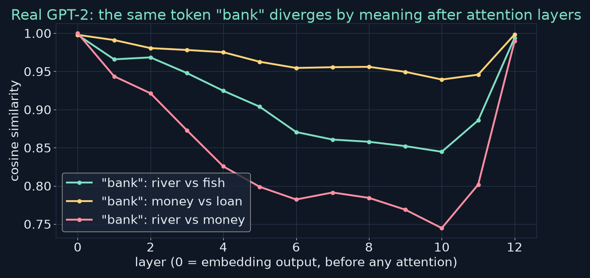

| Layer | river vs money | river vs fish | money vs loan |
|---|---|---|---|
| 0 (embeddings) | 1.000 | 0.998 | 0.998 |
| 4 | 0.826 | 0.925 | 0.975 |
| 10 | 0.745 | 0.845 | 0.939 |
| 12 (final) | 0.990 | 0.994 | 0.998 |

Same-sense pairs stay closer than cross-sense pairs through the middle layers. (The final-layer jump is GPT-2's known tendency for last-layer vectors to all point in similar directions.)

Attention also handles coreference (*She* → *Alice*), long-range agreement (*are* → *keys*, not *cabinet*), syntax (*sat* → *cat* across a relative clause) and semantic links (*capital* → *Paris*). It's a general mechanism for tokens to exchange information.

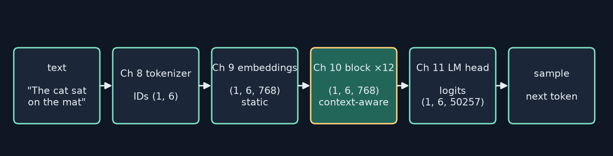

---

## 10.2 What IS attention?

**Committee meeting:** each token listens to all tokens, weighs their relevance, and updates itself with a weighted blend. "sat" leans on "cat" (who?) and "on" (where?).

**Search engine → Q, K, V:**
| Library | Attention |
|---|---|
| Your search text | **Query**: what am I looking for? |
| Index terms of each book | **Key**: how can I be found? |
| Book contents | **Value**: what I pass on |

Separate vectors because the roles differ: "cat"'s key might advertise "subject noun" while its value carries "animal, feline, pet".

**Spotlight:** attention weights are brightnesses that sum to 1, e.g. (illustrative) 0.70 on *cat*, 0.20 on *on*, 0.10 on the rest → `new_sat = 0.7·v_cat + 0.2·v_on + 0.1·(others)`.

### The math

For X ∈ ℝ^{n×d_model}:

- Q = X·W_q, K = X·W_k, V = X·W_v (each n × d_k)
- S = Q·Kᵀ / √d_k (n × n)
- A = softmax(S) row-wise (rows sum to 1)
- Output = A·V (n × d_k)

**Attention(Q, K, V) = softmax(Q·Kᵀ / √d_k)·V**

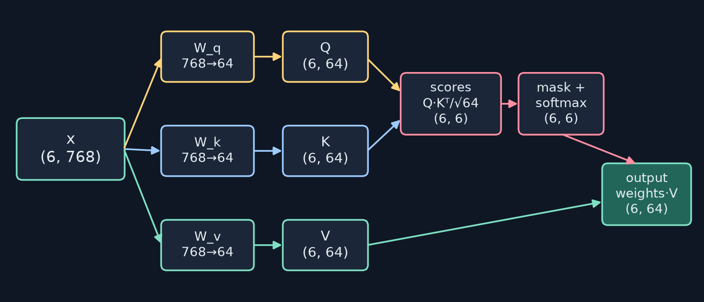

**Self- vs cross-attention:** self = Q, K, V from the same sequence (GPT). Cross = queries from the decoder, keys/values from an encoder (original translation Transformer). GPT is decoder-only → causal self-attention only.

---

## 10.3 Self-attention step by step

### Step 0 — setup (cells 2, 4)
```python
import torch, torch.nn as nn, torch.nn.functional as F, math
batch_size, seq_len, embed_dim = 2, 6, 768
embeddings = torch.randn(batch_size, seq_len, embed_dim)
```
Real output: `torch.Size([2, 6, 768])`. Random stand-in for Chapter 9 output.

### Step 1 — projections (cell 6)
```python
d_model = 768; d_k = 64
W_q = nn.Linear(d_model, d_k, bias=False)
W_k = nn.Linear(d_model, d_k, bias=False)
W_v = nn.Linear(d_model, d_k, bias=False)
Q = W_q(embeddings)  # (2, 6, 64)
K = W_k(embeddings)  # (2, 6, 64)
V = W_v(embeddings)  # (2, 6, 64)
```
- `nn.Linear(768, 64)` stores W of shape (64, 768) and computes `x @ W.T` on the last dim; leading dims are treated as batch.
- 768 × 64 = **49,152** params per projection. `bias=False` (GPT-2-style simplification; the pre-attention LayerNorm already centres).
- Real output: `Q shape: torch.Size([2, 6, 64])` (same for K, V).

### Step 2 — scores (cell 8)
```python
scores = Q @ K.transpose(-2, -1)   # (2, 6, 64) @ (2, 64, 6) -> (2, 6, 6)
```
- `transpose(-2, -1)` swaps the last two axes so inner dims match.
- `scores[b, i, j]` = q_i · k_j: row = query (from), column = key (to).
- Real row 0 (sentence 0): `[-2.5993, 2.4851, -4.4173, -0.1669, 2.6049, 3.9415]`.

### Worked example by hand (notebook Exercise 1, cell 32) — verified in PyTorch
Q = [[1,0,1],[0,1,1]], K = [[1,1,0],[0,1,1]], V = [[2,0,1],[1,2,0]], d_k = 3.

| step | row 0 | row 1 |
|---|---|---|
| Q·Kᵀ | [1, 1] | [1, 2] |
| ÷ √3 | [0.5774, 0.5774] | [0.5774, 1.1547] |
| softmax | [0.5000, 0.5000] | [0.3595, 0.6405] |
| ·V | [1.5000, 1.0000, 0.5000] | [1.3595, 1.2809, 0.3595] |

### Step 3 — scale (cell 10)
```python
scores = scores / math.sqrt(d_k)   # ÷ 8
```
**Why √d_k:** if q, k have i.i.d. entries with mean 0 and variance 1, then q·k = Σ qᵢkᵢ has variance d and std √d. I measured with 20,000 random pairs:

| d | 4 | 16 | 64 | 256 | 768 | 1024 |
|---|---|---|---|---|---|---|
| std(q·k) | 2.00 | 3.96 | 7.94 | 16.12 | 27.95 | 31.90 |

After ÷√d the std is ≈ 1.00 at every d.

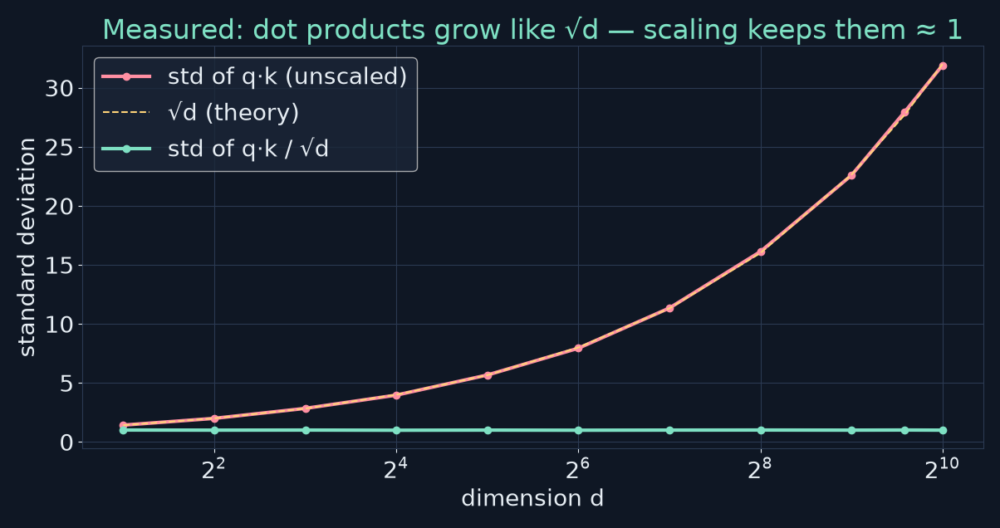

**Why it matters:** softmax exaggerates gaps. softmax([1,2,3]) = [0.090, 0.245, 0.665]; softmax([8,16,24]) = [0.000, 0.000, 1.000]. A saturated softmax concentrates on one token and its gradient is ≈ 0, so Q/K weights stop learning.

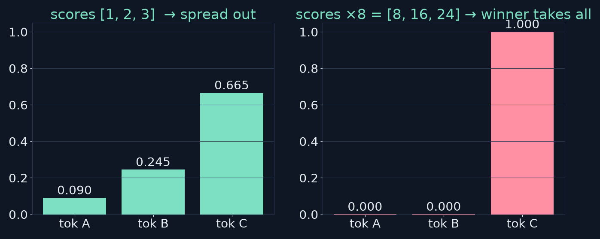

### Step 4 — softmax (cell 12)
```python
attn_weights = F.softmax(scores, dim=-1)   # each row sums to 1
```
softmax(sᵢ) = e^{sᵢ} / Σⱼ e^{sⱼ}, along **dim = −1** (across keys). Real: token 0 → `[0.1084, 0.2047, 0.0864, 0.1470, 0.2078, 0.2456]`, sum 1.0000.

### Step 5 — weighted sum (cell 14)
```python
output = attn_weights @ V   # (2, 6, 6) @ (2, 6, 64) -> (2, 6, 64)
```
Row i of the output = Σⱼ w_ij·v_j.

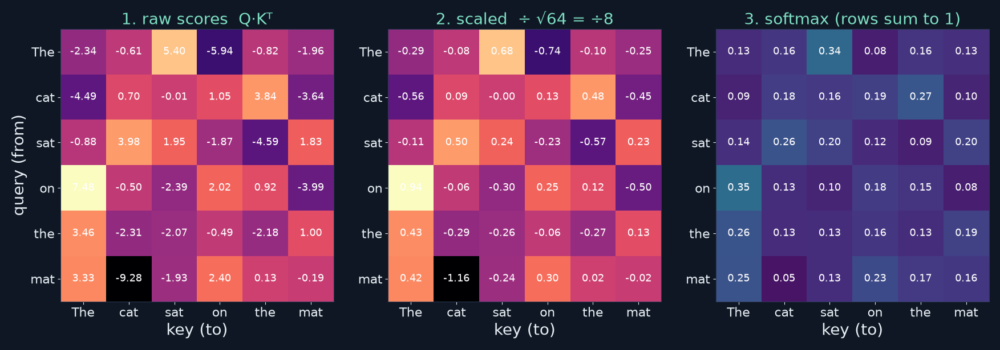

### The function (cell 16)
```python
def scaled_dot_product_attention(Q, K, V, mask=None):
    d_k = Q.size(-1)
    scores = Q @ K.transpose(-2, -1)            # (batch, seq, seq)
    scores = scores / math.sqrt(d_k)
    if mask is not None:
        scores = scores.masked_fill(mask == 0, float('-inf'))
    attn_weights = F.softmax(scores, dim=-1)    # (batch, seq, seq)
    output = attn_weights @ V                   # (batch, seq, d_k)
    return output, attn_weights
```

### Shape table
| Op | In | Out |
|---|---|---|
| Q/K/V proj | (2, 6, 768) | (2, 6, 64) |
| Kᵀ | (2, 6, 64) | (2, 64, 6) |
| Q@Kᵀ | (2,6,64)@(2,64,6) | (2, 6, 6) |
| scale/mask/softmax | (2, 6, 6) | (2, 6, 6) |
| A@V | (2,6,6)@(2,6,64) | (2, 6, 64) |

Common bugs: `Q @ K` without transpose (and it can silently "work" if d_k == seq); softmax on the wrong dim; a mask that doesn't broadcast.

---

## 10.4 Causal masking

**The cheating problem:** one training sentence yields many next-token lessons processed in parallel. Without a mask, the position predicting what follows "cat" can attend to "sat" — the answer. Training would teach copying; generation (where the future doesn't exist) would fail.

**Rule:** position i attends only to 0…i → lower-triangular pattern.

### Cell 18
```python
def create_causal_mask(seq_len):
    mask = torch.tril(torch.ones(seq_len, seq_len))
    return mask
```
Real output for 6: ones on and below the diagonal. (Docstring says "boolean"; it's actually float 0/1 — fine, since we test `mask == 0`.)

### Cell 20 — applying it
`masked_fill(mask == 0, -inf)` before softmax → e^{−∞} = 0 → future weights exactly 0; each row still sums to 1. Real output rows:
```
[1.0000, 0.0000, 0.0000, 0.0000, 0.0000, 0.0000]
[0.3963, 0.6037, 0.0000, 0.0000, 0.0000, 0.0000]
[0.4882, 0.0887, 0.4230, 0.0000, 0.0000, 0.0000]
[0.2584, 0.1539, 0.3468, 0.2408, 0.0000, 0.0000]
...
```
Why −∞ and not 0? A score of 0 still gets e⁰ = 1 → real weight.

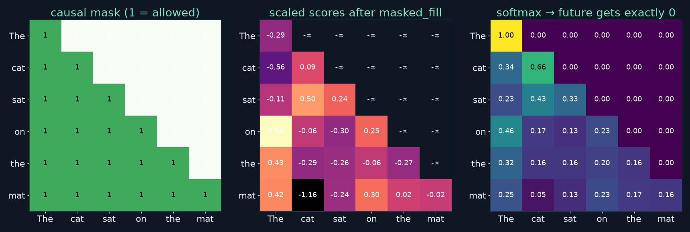

| | Training | Inference |
|---|---|---|
| Input | whole sequence at once | one token per step |
| Future tokens | present → must mask | don't exist |

---

## 10.5 Multi-head attention

One head = one distribution per token; language has many simultaneous relations (agreement, coreference, syntax, semantics, "previous word"). Run h heads in parallel on d_model/h dims each: 12 × 64 = 768, **same parameter count** (I verified: `MultiHeadAttention(768, 1)` and `(768, 12)` both have **2,359,296** params).

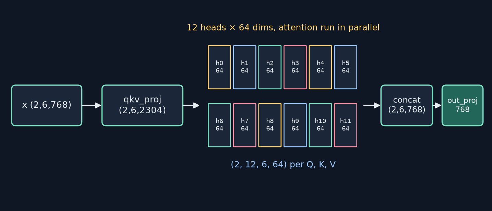

### Cell 22 — `__init__`
```python
self.d_head = d_model // num_heads                           # 64
self.qkv_proj = nn.Linear(d_model, 3 * d_model, bias=False)   # 768 -> 2304 (fused Q,K,V)
self.out_proj = nn.Linear(d_model, d_model, bias=False)       # mixes heads
self.dropout = nn.Dropout(dropout)                            # on attention weights
```

### Cell 22 — `forward`, with shapes (batch 2, seq 6)
```python
qkv = self.qkv_proj(x)                                         # (2, 6, 2304)
qkv = qkv.reshape(batch, seq, 3, self.num_heads, self.d_head)  # (2, 6, 3, 12, 64)
qkv = qkv.permute(2, 0, 3, 1, 4)                               # (3, 2, 12, 6, 64)
Q, K, V = qkv[0], qkv[1], qkv[2]                               # each (2, 12, 6, 64)
scores = Q @ K.transpose(-2, -1) / math.sqrt(d_k)              # (2, 12, 6, 6)
mask = mask.unsqueeze(0).unsqueeze(0)                          # (1, 1, 6, 6) broadcast
scores = scores.masked_fill(mask == 0, float('-inf'))
attn_weights = self.dropout(F.softmax(scores, dim=-1))         # (2, 12, 6, 6)
attn_output = attn_weights @ V                                 # (2, 12, 6, 64)
attn_output = attn_output.transpose(1, 2)                      # (2, 6, 12, 64)
attn_output = attn_output.reshape(batch, seq, d_model)         # (2, 6, 768) = concat
output = self.out_proj(attn_output)                            # (2, 6, 768)
```
(Condensed from the notebook; see cell 22 for the full commented version.)

**The reshape trick:** reshape only *labels* numbers (Q/K/V? head? dim?); `permute(2,0,3,1,4)` moves Q/K/V to the front and heads before seq. Because `@` works on the last two dims and broadcasts over the rest, one call computes all batch × heads = 24 attention maps — no Python loop.

**Real test output:** input (2, 6, 768) → output (2, 6, 768), weights (2, 12, 6, 6).

**reshape vs view:** transpose/permute change strides → non-contiguous → `.view()` raises; use `.reshape()` or `.contiguous().view()`.

---

## 10.6 The Transformer block

Attention alone lacks non-linearity, struggles to train deep, and only moves information *between* tokens. A block adds an FFN, LayerNorm and residuals.

### FFN (cell 24)
```python
x = self.fc1(x)      # 768 -> 3072
x = F.gelu(x)
x = self.dropout(x)
x = self.fc2(x)      # 3072 -> 768
```
Position-wise (same weights for every token). Params: fc1 2,362,368 + fc2 2,360,064 = **4,722,432** (≈ 2/3 of the block). GELU(x) = x·Φ(x): GELU(−1) = −0.1587, GELU(1) = 0.8413, GELU(2) = 1.9545.

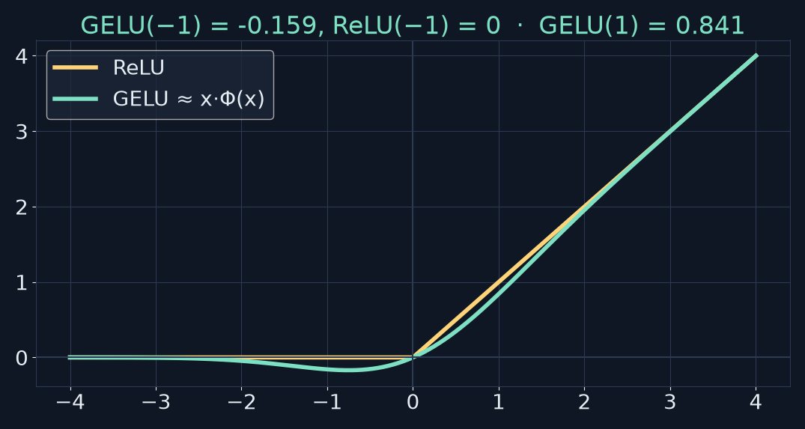

FFN keeps `bias=True`; attention here uses `bias=False`. Original GPT-2 does have attention biases — Ch 11's weight loader handles that.

### LayerNorm
LN(x) = γ ⊙ (x − μ)/√(σ² + ε) + β, μ and σ over the 768 features of *each token*. Params 2 × 768 = 1,536.
⚠️ **Book erratum:** the printed snippet `nn.LayerNorm(d_model=768)` raises `TypeError: LayerNorm.__init__() got an unexpected keyword argument 'd_model'` (the parameter is `normalized_shape`). Use `nn.LayerNorm(768)` — the notebook classes do.

### Residuals
`x = x + sublayer(x)`: the layer learns a refinement; ∂(x + f(x))/∂x = I + ∂f/∂x gives gradients a direct path. Book's illustration: 0.5 × 0.8¹² ≈ 0.034 without skips.

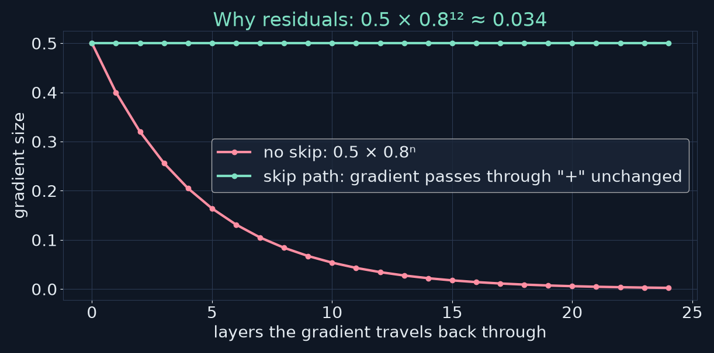

### Pre-norm vs post-norm
- Post-norm (2017): `x = LN(x + F(x))`
- Pre-norm (GPT-2): `x = x + F(LN(x))` → residual stream is pure addition → more stable deep training, often no warmup needed.

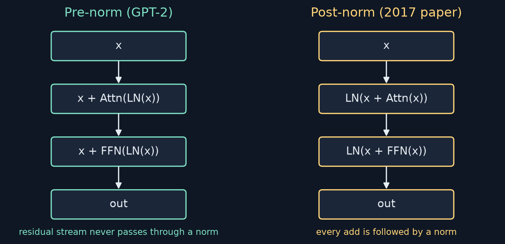

### Cell 26 — `TransformerBlock`
```python
def forward(self, x, mask=None):
    attn_out, attn_weights = self.attn(self.ln1(x), mask)
    x = x + self.dropout(attn_out)
    ffn_out = self.ffn(self.ln2(x))
    x = x + self.dropout(ffn_out)
    return x, attn_weights
```
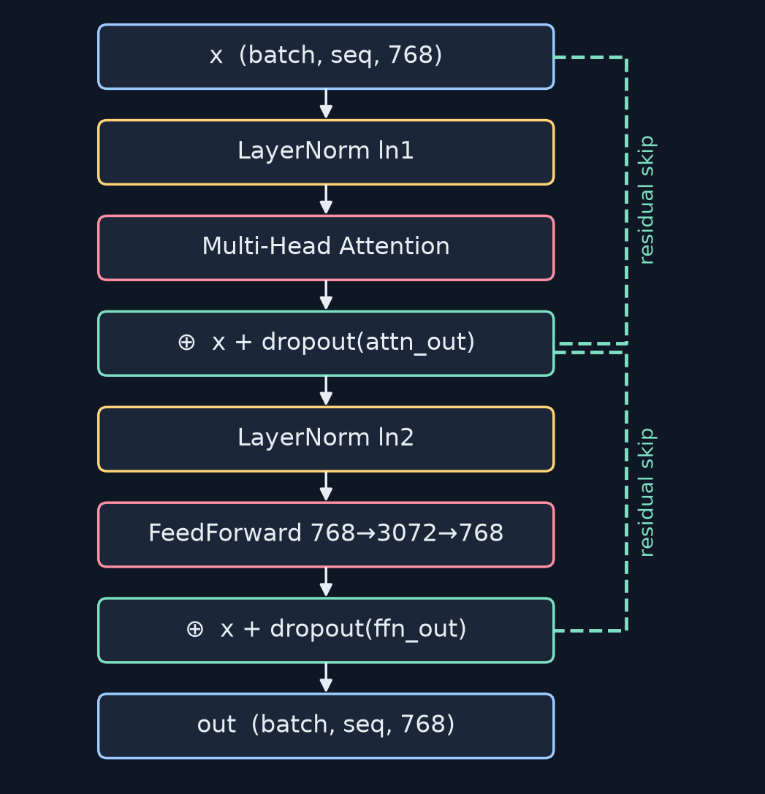

Real test output: (2, 6, 768) → (2, 6, 768), weights (2, 12, 6, 6); input mean 0.0108, output mean 0.0122, mean |diff| 0.2575.

### Parameter count (verified with `sum(p.numel())`)
| Part | Params |
|---|---|
| QKV proj 768×2304 | 1,769,472 |
| out proj 768×768 | 589,824 |
| fc1 (+bias) | 2,362,368 |
| fc2 (+bias) | 2,360,064 |
| 2 × LayerNorm | 3,072 |
| **Total** | **7,084,800** |

× 12 ≈ 85M; GPT-2 small ≈ 124M total (embeddings + final LN make up most of the rest).

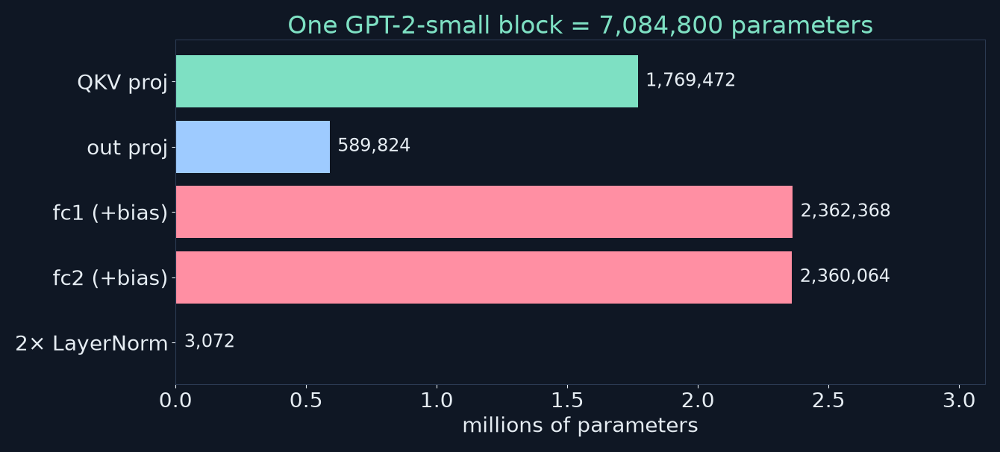

Mental model: **attention = communication between tokens; FFN = computation within a token.**

Ch 11 preview: `GPT2 = embeddings → 12 × TransformerBlock → ln_f → lm_head (768 → 50,257)`.

---

## 10.7 Visualising attention

Cell 28 defines `visualize_attention(attn_weights, tokens, head_idx)` (heatmap of `attn_weights[0, head_idx]`) and runs "The quick brown fox jumps over the lazy dog" → 9 tokens `['The', ' quick', ' brown', ' fox', ' jumps', ' over', ' the', ' lazy', ' dog']`, weights `(1, 12, 9, 9)` through an **untrained** block.

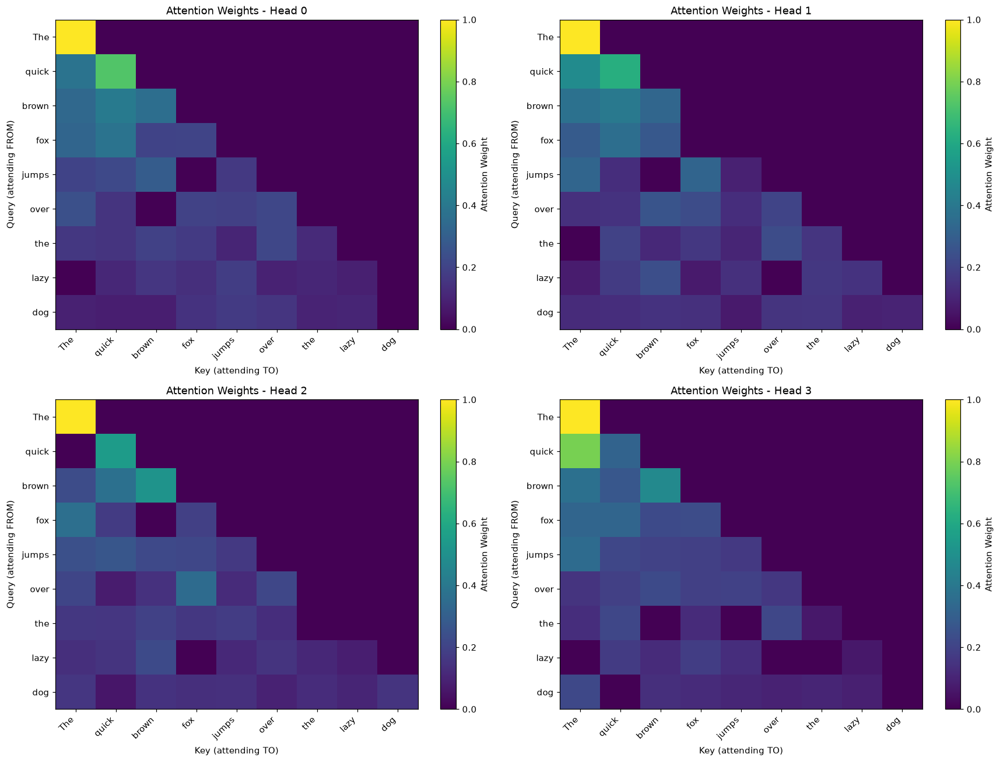

**My experiment — pretrained GPT-2** on "The cat sat on the mat because it was tired":

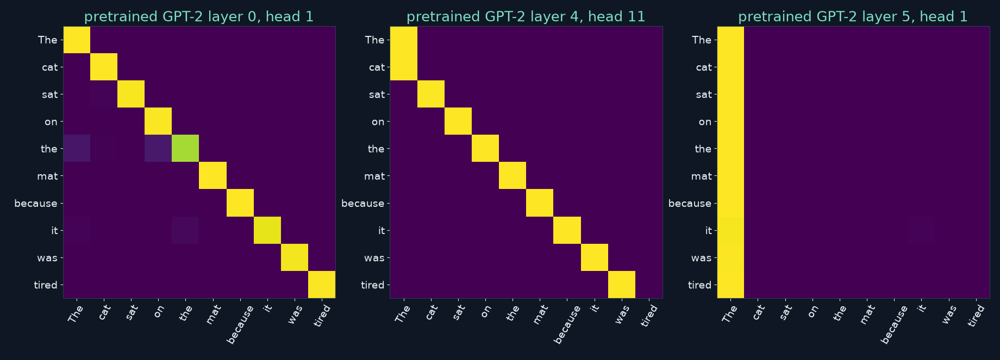

- Layer 0 head 1: attends to itself.
- Layer 4 head 11: previous-token head.
- Layer 5 head 1: ~all weight on the first token ("it" → "The": 0.98) — an **attention sink**, not coreference.

**Can conclude:** masking works; heads differ; some local, some long-range. **Cannot conclude:** "this head does syntax", or that weights explain decisions — FFNs/residuals matter, heads interact, and weights show *where* a head reads, not *what* it computes.

---

## 10.8 Practical considerations

**O(n²) memory:** scores are (batch, heads, n, n) per layer. batch 8, 12 heads, n = 2048 → 8·12·2048² = 402,653,184 floats ≈ **1.6 GB** (fp32) for one layer's scores. Double n → 4×.

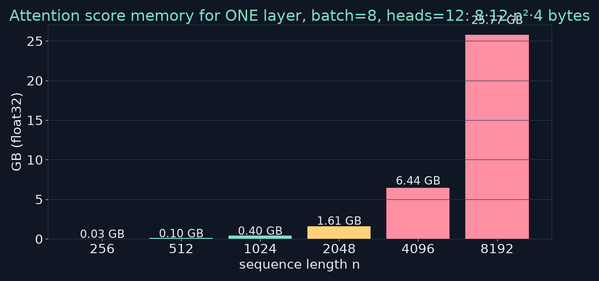

**Full pipeline (cell 30), real output:** "The cat sat on the mat" → IDs `[464, 3797, 3332, 319, 262, 2603]` → embeddings (1, 6, 768) → block → (1, 6, 768).
⚠️ The book's text lists " mat" as 21547; the actual GPT-2 ID is **2603** (the notebook output confirms).

---

## 10.9 Key takeaways

1. Scaled dot-product attention: softmax(QKᵀ/√d_k)·V.
2. Causal mask: `tril` + `masked_fill(-inf)`.
3. Multi-head: 12 × 64 = 768, fused QKV, reshape/permute, no extra params.
4. Pre-norm block: MHA + GELU FFN + two residuals = 7,084,800 params.
5. Heatmaps: verify masking; don't over-interpret.

## Review questions (my answers; book's are in Appendix D)
1. **Static embeddings insufficient?** "bank" gets one vector regardless of context; attention mixes in neighbours so senses separate (see GPT-2 table above).
2. **Q, K, V; why Q·Kᵀ = relevance?** Q seeks, K advertises, V carries content; dot product is large when q and k align.
3. **Why √d_k?** std(q·k) ≈ √d_k; unscaled scores saturate softmax → near one-hot weights and vanishing gradients.
4. **Causal masking?** Future scores → −∞ → 0 weight; makes training match generation.
5. **Perspectives without extra params?** 12 × 64 = 768; fused projection still 768 × 2304; each head gets a slice.
6. **Reshape trick?** (B,S,2304) → (B,S,3,12,64) → permute → (3,B,12,S,64); heads become a batch dim → one batched matmul.
7. **Four components?** Attention (exchange), FFN (per-token non-linear processing), residuals (preserve signal, gradient highway), LayerNorm (stable scale).
8. **Pre vs post norm?** Post `LN(x+F(x))`, pre `x+F(LN(x))`; GPT-2 uses pre-norm for stability in deep stacks.
9. **Memory for batch 4, 12 heads, n 2048?** 4·12·2048² = 201,326,592 floats × 4 B ≈ 0.81 GB per layer's scores.
10. **Caution with heatmaps?** They show where, not what; other components matter; heads interact; sinks. Can: confirm masking, head diversity. Can't: assign linguistic roles or explanations.

## Practice this — notebook exercises
Open <https://colab.research.google.com/github/FirstLLM/code/blob/main/notebooks/ch10.ipynb>
- [ ] Run cells 2–30; print shapes after every line.
- [ ] **Cell 32 — Ex 1** manual attention → `[[1.50, 1.00, 0.50], [1.36, 1.28, 0.36]]`.
- [ ] **Cell 34 — Ex 2** seq 5 with/without mask; assert `torch.triu(w, 1).sum() == 0`.
- [ ] **Cell 36 — Ex 3** d_model 512, 8 heads, seq 10 → qkv (1, 10, 1536), Q (1, 8, 10, 64), scores (1, 8, 10, 10).
- [ ] **Cell 38 — Ex 4** 1 vs 12 heads → both 2,359,296 params.
- [ ] **Cell 40 — Ex 5** visualise heads 0, 3, 7, 11 for "Alice gave Bob a book".
- [ ] **Cell 42 — Ex 6** stack 3 blocks; compare input vs output.
- [ ] **Cell 44 — Ex 7** post-norm block; compare gradient magnitudes.
- [ ] **Cell 46 — Ex 8** count block params → 7,084,800.

## Up next
Chapter 11 — Building the Transformer: stack 12 blocks, final LN, LM head, load GPT-2 weights, generate.

---

### Credits
Based on **"Build Your First LLM"** by **Hasan Degismez** — please buy the book: <https://leanpub.com/FirstLLM/>. **Code: FirstLLM/code (MIT License)** — <https://github.com/FirstLLM/code>. Notes, diagrams and extra experiments (GPT-2 "bank" similarity, pretrained head plots, √d measurement): my own teaching adaptation · Waqar Shaikh Builds.
