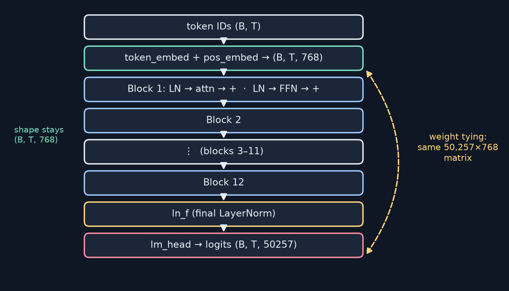
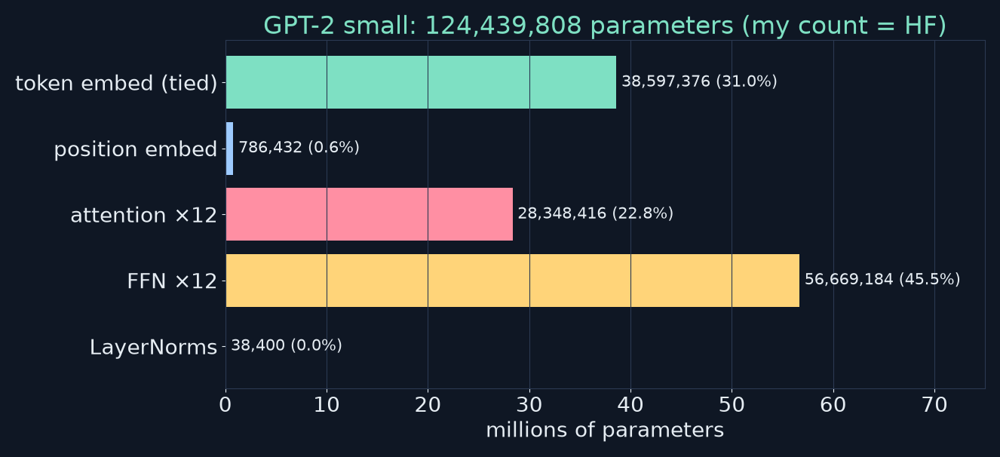
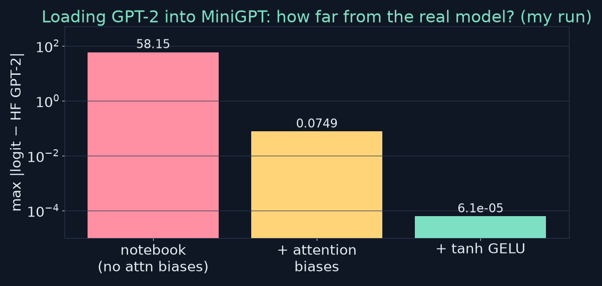

<!-- _class: lead -->
<!-- _paginate: false -->
# Build Your First LLM
## Chapter 11 — Building the Transformer
A study companion to *Build Your First LLM* by Hasan Degismez
**Waqar Shaikh Builds**

<!-- say: Welcome to chapter eleven of my study series on Build Your First LLM by Hasan Degismez. Today we assemble everything into a complete GPT: a config object, a stack of transformer blocks, a final layer norm, a language modelling head and weight tying. Then we run five sanity checks and load the real GPT-2 weights into our own code. And that's where my run of the notebook turned up the most interesting bug in the series so far: the loaded model produces garbage, and I'll show you exactly why, and the two line fix that makes it match GPT-2 to four decimal places. -->

---

# Where we are

- **Ch 9:** embeddings · **Ch 10:** attention + the Transformer block
- **Ch 11 (today):** stack blocks → a complete **MiniGPT**, load GPT-2 weights
- **Ch 12:** train it ourselves
- Notebook: **FirstLLM/code → notebooks/ch11.ipynb**

<!-- say: We built embeddings in chapter nine and the transformer block in chapter ten. Today we stack the blocks into a complete model and load real GPT-2 weights into it. Next chapter we train it ourselves. Everything follows the chapter eleven notebook. -->

---

# Chapter 11 roadmap

1. From one block to a model: what's missing
2. `GPTConfig` — the configuration pattern
3. `MiniGPT`: ModuleList, final LayerNorm, LM head
4. Weight tying
5. Five sanity checks
6. First forward pass (random weights)
7. Loading GPT-2 weights — **the bug and the fix**
8. train/eval modes · exercises · review

<!-- say: Here's the plan. What a single block is missing. The configuration pattern. The full model class. Weight tying. Five sanity checks. A forward pass with random weights. Loading GPT-2, including the bug and the fix. Then training versus evaluation mode, exercises and review. -->

---

# Key terms for this chapter

| Term | One-line meaning |
|---|---|
| **LM head** | Linear layer: hidden state (768) → a score per vocab token (50,257) |
| **Logits** | Raw, unnormalised scores before softmax |
| **Weight tying** | LM head reuses the token-embedding matrix |
| **`nn.ModuleList`** | A list that registers its layers' parameters |
| **Config object** | One dataclass holding every hyperparameter |
| **Greedy decoding** | Always pick the highest-scoring next token |

<!-- say: A few terms. The language modelling head maps a seven sixty eight hidden state to a score for each of fifty thousand tokens. Those raw scores are logits. Weight tying reuses the embedding matrix for that head. Module list registers a list of layers properly. A config object holds every hyperparameter. And greedy decoding always picks the top token. -->

---

<!-- _class: divider -->
# Part 1
## From block to model

<!-- say: Part one. From a single block to a full model. -->

---

# The complete model (my redraw)



<!-- say: Here's the whole model. Token IDs go into the token and position embeddings, giving batch by sequence by seven sixty eight. Then twelve identical blocks, each with layer norm, attention and a residual, then layer norm, feed forward and a residual. The shape stays the same all the way through. A final layer norm, and then the head projects to fifty thousand two hundred and fifty seven scores per position. The dashed arrow is weight tying: the head reuses the embedding matrix. -->

---

# Why stack identical blocks?

- Same architecture ×12, **different learned weights**
- Each layer refines the residual stream a little more
- Probing studies: early layers ≈ local/syntactic, later layers ≈ more semantic, task-specific
- Book's "detective team" analogy — a useful picture, not a literal division of labour

<!-- say: Why stack identical blocks? Every block has the same architecture but its own learned weights, and each one adds a refinement to the residual stream. Research that probes trained models finds a rough trend: earlier layers capture more local and syntactic patterns, later ones more semantic and task specific ones. The book uses a team of detectives as an analogy. It's a helpful picture, but the real division of labour is much messier. -->

---

<!-- _class: divider -->
# Part 2
## `GPTConfig`

<!-- say: Part two. The configuration object. -->

---

# A dataclass for hyperparameters (notebook cell 8)

```python
@dataclass
class GPTConfig:
    vocab_size: int = 50257
    max_seq_len: int = 1024
    embed_dim: int = 768
    num_heads: int = 12
    num_layers: int = 12
    d_ff: int = 3072
    dropout: float = 0.1

    def __post_init__(self):
        assert self.embed_dim % self.num_heads == 0
```

- `GPTConfig()` = GPT-2 small · `GPTConfig(embed_dim=64, num_heads=2, num_layers=2, d_ff=256)` = tiny

<!-- say: All seven hyperparameters live in one dataclass, with GPT-2 small as the default. Post init runs right after construction and checks that the embedding dimension divides evenly by the number of heads. A tiny model for experiments is just a different set of arguments. And because it's a dataclass, a typo in a field name is an error, not a silently created new key as with a dictionary. -->

---

<!-- _class: divider -->
# Part 3
## `MiniGPT`

<!-- say: Part three. The MiniGPT class. -->

---

# `__init__` (notebook cell 10, condensed)

```python
self.token_embed = nn.Embedding(config.vocab_size, config.embed_dim)
self.pos_embed   = nn.Embedding(config.max_seq_len, config.embed_dim)
self.dropout     = nn.Dropout(config.dropout)
self.blocks = nn.ModuleList([
    TransformerBlock(d_model=config.embed_dim, num_heads=config.num_heads,
                     d_ff=config.d_ff, dropout=config.dropout)
    for _ in range(config.num_layers)])
self.ln_f    = nn.LayerNorm(config.embed_dim)
self.lm_head = nn.Linear(config.embed_dim, config.vocab_size, bias=False)
self.lm_head.weight = self.token_embed.weight          # weight tying
```

<!-- say: The constructor has the two embedding tables and dropout, a module list of transformer blocks, the final layer norm, and the head, a linear layer from seven sixty eight to the vocabulary with no bias. The last line ties the weights: the head's weight becomes the very same tensor as the token embedding. -->

---

# Why `nn.ModuleList`, not a list?

```python
self.blocks = [TransformerBlock(...) for _ in range(12)]               # ✗ invisible
self.blocks = nn.ModuleList([TransformerBlock(...) for _ in range(12)])  # ✓
```

- A plain list hides the blocks from `model.parameters()`, `.to(device)` and `state_dict()`
- Result: the optimizer never updates them — training "works" but the blocks never learn

<!-- say: Why a module list? A plain Python list hides the blocks from PyTorch. They don't appear in model dot parameters, they don't move with dot to device, and they aren't saved in the state dict. The optimizer would never update them, so training would appear to run while the blocks stay random. It's a classic silent bug. -->

---

# `forward` (notebook cell 10, condensed)

```python
batch, seq = token_ids.shape
tok_emb = self.token_embed(token_ids)
pos_emb = self.pos_embed(torch.arange(seq, device=token_ids.device))
x = self.dropout(tok_emb + pos_emb)
mask = torch.tril(torch.ones(seq, seq, device=token_ids.device))
for block in self.blocks:
    x, attn = block(x, mask)
x = self.ln_f(x)
return self.lm_head(x)                       # (batch, seq, vocab_size)
```

<!-- say: The forward pass. Embed tokens and positions and add them; the position embeddings broadcast across the batch. Build a lower triangular causal mask. Run every block, final layer norm, and the head. The output is batch by sequence by vocabulary: a full set of next token scores at every position, which is what makes training so efficient. -->

---

# Logits: a score for every token

- Output at each position: **50,257** raw scores
- `softmax` → probabilities; training pushes up the score of the true next token
- Only the **last** position matters for generation; **all** positions are used in training

<!-- say: Logits are a raw score for every token at every position. Softmax turns them into probabilities. During training, every position predicts its own next token, so one sequence gives many training examples at once. During generation, we only look at the last position. -->

---

<!-- _class: divider -->
# Part 4
## Weight tying

<!-- say: Part four. Weight tying. -->

---

# One matrix, two jobs

- Embedding: ID → row of **W** (50,257 × 768)
- LM head: hidden state → **h · Wᵀ** → a score per token
- Tied → saves **50,257 × 768 = 38,597,376** parameters (≈ 31% of GPT-2 small)
- `lm_head.weight` **is** `token_embed.weight` — same object, not a copy

<!-- say: The embedding matrix maps an ID to a vector. The head maps a vector to scores by multiplying with the transpose of a matrix of the same shape. Tie them, and you save thirty eight point six million parameters, about thirty one percent of GPT-2 small. In PyTorch, assigning the weight attribute makes both modules point at one tensor; an update through either path changes both. -->

---

# ⚠️ Book check: weight-tying gotchas (my run)

```text
model.parameters()  → the shared matrix counted once           ✓ (book is right)
'lm_head.weight' in model.state_dict()  → True                 ✗ (book: "it shouldn't")
```

- `state_dict()` lists **both** keys; they share storage, so `torch.save` writes the data **once**
- Order matters: tie **after** both layers exist; re-tie after loading weights if you replace tensors

<!-- say: The book lists four gotchas. Three are right. But it says lm head dot weight shouldn't appear in the state dict keys. In my run, it does: the state dict lists both keys. They share storage, so torch dot save writes the data only once and the file doesn't double in size. Also remember to tie only after both layers exist, and if you ever replace the tensor rather than copying into it, you have to tie again. -->

---

<!-- _class: divider -->
# Part 5
## Five sanity checks

<!-- say: Part five. Five sanity checks before any training. -->

---

# The five checks (notebook cells 13–17 — my run)

| Test | What it proves | Result |
|---|---|---|
| Shape | (2, 16) → (2, 16, 50257) | ✅ PASSED |
| Parameters | count matches the formula | ✅ 124,402,944 |
| Causal mask | changing token 4 leaves logits 0–2 unchanged | ✅ PASSED |
| Weight tying | `lm_head.weight is token_embed.weight` | ✅ PASSED |
| Gradient flow | every parameter gets a `.grad` | ✅ PASSED |

<!-- say: The five checks all passed on my CPU. Shape: two by sixteen IDs become two by sixteen by fifty thousand two hundred and fifty seven logits. Parameter count. Causal masking: changing only the last token leaves the logits at earlier positions identical. Weight tying: the two weights are literally the same object. And gradient flow: every parameter receives a gradient. Keep an eye on that parameter count; it's a clue. -->

---

# The causal-mask test (notebook cell 15)

```python
tokens_a = torch.tensor([[100, 200, 300, 400]])
tokens_b = torch.tensor([[100, 200, 300, 999]])     # only the last token differs
logits_a, logits_b = model(tokens_a), model(tokens_b)
for pos in range(3):
    assert torch.allclose(logits_a[0, pos], logits_b[0, pos], atol=1e-5)
assert not torch.allclose(logits_a[0, 3], logits_b[0, 3], atol=1e-5)
```

- If a future token leaks, training is cheating → great loss, useless generation

<!-- say: The causal test is my favourite. Two inputs that differ only in the last token. Positions zero to two must produce identical logits, because they can't see the future, and position three must differ. If the mask were broken, the model could peek at the answer during training: the loss would look fantastic, and generation would be useless. -->

---

# Parameter count: where do 124M go? (my redraw)



<!-- say: Here's where GPT-2 small's parameters live, from my own count, which matches Hugging Face exactly at one hundred and twenty four million four hundred and thirty nine thousand eight hundred and eight. The feed forward layers are the biggest share at forty five percent. The tied embedding is thirty one percent, attention twenty three percent, and positions and layer norms are tiny. -->

---

# ⚠️ Book check: the parameter count

- Book prints **124,439,808** for `MiniGPT(GPTConfig())` — the notebook gives **124,402,944**
- Difference: **36,864 = 12 × (2,304 + 768)** → the attention **biases**
- The notebook's attention uses `nn.Linear(..., bias=False)`; GPT-2's attention **has** biases
- Book's formula "expected 124,354,560": the formula actually gives **124,356,864**

<!-- say: And here's the clue. The book prints one hundred and twenty four million four hundred and thirty nine thousand eight hundred and eight, the real GPT-2 number. But the notebook's model has thirty six thousand eight hundred and sixty four fewer parameters. That's exactly twelve layers times two thousand three hundred and four plus seven hundred and sixty eight: the query key value bias and the output projection bias. The notebook's attention is built without biases, but GPT-2's attention has them. Keep that in mind. As a small aside, the book's rough formula evaluates to one hundred and twenty four million three hundred and fifty six thousand eight hundred and sixty four, not the number printed. -->

---

<!-- _class: divider -->
# Part 6
## First forward pass

<!-- say: Part six. Our first forward pass, with random weights. -->

---

# Random weights → random words (cells 19–20 — my run)

```text
Prompt: 'The quick brown fox'   Tokens: ['The', ' quick', ' brown', ' fox']
Logits shape: torch.Size([1, 4, 50257])
Top 5 predictions:  ' RC' 0.0001 · ' Abel' 0.0001 · '136' 0.0001 · ' unob' 0.0001 · ' impat' 0.0001
```

- Every probability ≈ **1/50,257 ≈ 0.00002** → an untrained model is (almost) uniform
- Expected starting loss ≈ **ln(50,257) ≈ 10.8** — remember this for Chapter 12

<!-- say: With random weights, the four token prompt gives a one by four by fifty thousand logits tensor, and the top predictions are random junk like RC and Abel, each with probability about one in ten thousand. An untrained model is close to uniform over fifty thousand tokens. That gives a useful number for chapter twelve: the starting loss should be about the natural log of fifty thousand, around ten point eight. If your first loss is far from that, something's wrong. -->

---

<!-- _class: divider -->
# Part 7
## Loading GPT-2 — the bug and the fix

<!-- say: Part seven. Loading GPT-2's weights, the bug, and the fix. -->

---

# Name mapping and the transpose

| Ours | Hugging Face GPT-2 |
|---|---|
| `token_embed.weight` / `pos_embed.weight` | `wte.weight` / `wpe.weight` |
| `blocks.i.ln1/ln2` | `h.i.ln_1/ln_2` |
| `blocks.i.attn.qkv_proj.weight` | `h.i.attn.c_attn.weight` **(transposed)** |
| `blocks.i.attn.out_proj.weight` | `h.i.attn.c_proj.weight` **(transposed)** |
| `blocks.i.ffn.fc1/fc2` | `h.i.mlp.c_fc/c_proj` **(transposed)** |

- GPT-2 uses a `Conv1D` layer storing **(in, out)**; `nn.Linear` stores **(out, in)**

<!-- say: To load GPT-2, we map names: w t e to token embed, h dot i dot l n one to our layer norms, c attn to our combined query key value projection, and so on. The projection weights must be transposed, because GPT-2's original code uses a Conv1D layer that stores weights as in by out, while nn dot Linear stores out by in. Notice what's missing from this table: there's no row for the attention biases. -->

---

# ⚠️ Book check: "coherent text" (notebook cells 25–28)

```text
'The quick brown fox'          → The quick brown foxeseseseseseseseseseseseseseseses…
'Artificial intelligence will' → Artificial intelligence will be used to to to to to to to…
'The capital of France is'     → The capital of France is France is is is is is is is…
```

- Book shows *"…jumps over the lazy dog. The dog is a small dog…"* — the notebook can't produce it
- The weights loaded, the shapes matched, every sanity check passed — **and the model is broken**

<!-- say: Here's what the notebook actually generated after loading GPT-2. The quick brown foxeseseses. Artificial intelligence will be used to to to to. The capital of France is France is is is. The book shows a fluent continuation about the lazy dog, but this code cannot produce it. And notice: the weights loaded without errors, the shapes all matched, and every sanity check passed. The model is still broken. That's a lesson in itself. -->

---

# Finding the bug (my experiment)



1. Compare with HF on the same input: max logit error **58** — not a rounding issue
2. Add GPT-2's **attention biases** (`c_attn.bias`, `c_proj.bias`) → error **0.075**
3. Use GPT-2's **tanh GELU** (`F.gelu(x, approximate="tanh")`) → error **0.00006** ✓

<!-- say: To debug, I compared our model's logits with Hugging Face's GPT-2 on the same input. The largest difference was fifty eight, which is not rounding; something is missing. Step two: I added the attention biases that the loader was silently dropping, and copied in GPT-2's values. The error fell to seven hundredths. Step three: GPT-2 uses the tanh approximation of GELU, while the notebook uses the exact version. Switching that brought the error down to six hundred thousandths. Now our model computes exactly what GPT-2 computes. -->

---

# The fix in code (my patch)

```python
# 1. In MultiHeadAttention.__init__: keep the biases GPT-2 was trained with
self.qkv_proj = nn.Linear(d_model, 3 * d_model)          # bias=True (default)
self.out_proj = nn.Linear(d_model, d_model)

# 2. In load_gpt2_weights: copy them too
our_state[f'blocks.{i}.attn.qkv_proj.bias'].copy_(hf_state[f'transformer.h.{i}.attn.c_attn.bias'])
our_state[f'blocks.{i}.attn.out_proj.bias'].copy_(hf_state[f'transformer.h.{i}.attn.c_proj.bias'])

# 3. In FeedForward.forward
x = F.gelu(x, approximate="tanh")
```

- Parameter count becomes **124,439,808** — identical to Hugging Face

<!-- say: Here's the patch, my own code on top of the notebook. Keep the biases in the attention projections. Copy them in the loader. And use the tanh GELU. With that, the parameter count becomes one hundred and twenty four million four hundred and thirty nine thousand eight hundred and eight, identical to Hugging Face. -->

---

# After the fix (my run, greedy, 20 tokens)

```text
The quick brown fox      → …foxes are a great way to get a little bit of a kick out of your dog.
Artificial intelligence will → …be able to do things like search for and find people, and to do things like
Once upon a time         → …, the world was a place of great beauty and great danger. The world was a
The capital of France is → …the capital of the French Republic, and the capital of the French Republic is
```

- Fluent — and still repetitive: that's **greedy decoding**, not a bug (sampling: Ch 14)
- On my CPU: 30 new tokens in **10.1 s** (no KV cache — every step re-reads the whole prefix)

<!-- say: After the fix, the same model with the same weights is fluent. Foxes are a great way to get a little bit of a kick out of your dog. Once upon a time, the world was a place of great beauty and great danger. It still repeats itself, but that's greedy decoding, which always picks the top token, not a bug; sampling comes in chapter fourteen. On my CPU, thirty tokens took about ten seconds, because this simple loop recomputes the whole prefix at every step. -->

---

# The lesson: test against a reference

- Passing shape, tying, masking and gradient checks ≠ **correct**
- When a reference exists, compare **numbers**: `(ours − reference).abs().max()`
- Silent mismatches: missing biases, GELU variant, LayerNorm eps, transposes, tied weights
- Add it as a sixth sanity check

<!-- say: The lesson is bigger than this bug. All five sanity checks passed, and the model was still wrong. Those checks test wiring, not correctness. When a reference implementation exists, compare the actual numbers, as a maximum absolute difference. Typical silent mismatches are missing biases, the GELU variant, layer norm epsilon, transposes and tied weights. I'd add this as a sixth sanity check. -->

---

# `train()` vs `eval()`, devices

- `model.train()` → dropout **on**; `model.eval()` → dropout **off**
- `@torch.no_grad()` for generation → no graph, less memory
- `model.to(device)` and `token_ids.to(device)` — always both
- Preview (Ch 12): no weight decay on biases, LayerNorms, embeddings

<!-- say: A few practical details. Train mode enables dropout, eval mode disables it, so call eval before generating. Wrap generation in no grad to skip building the autograd graph. Move both the model and the inputs to the same device. And a preview of chapter twelve: weight decay is usually not applied to biases, layer norms and embeddings. -->

---

<!-- _class: divider -->
# Part 8
## Exercises and review

<!-- say: Part eight. Exercises and review. -->

---

# Exercises (my answers)

- **Ex 1 / Checkpoint:** vocab 500, seq 16, d 64, 2 heads, 2 layers, d_ff 256 → **132,608** params (book: "~150,000"); **133,120** with attention biases
- **Ex 2:** wte 38,597,376 · wpe 786,432 · blocks 85,017,600 (+36,864 attention biases) · ln_f 1,536 · lm_head 0 (tied)
- **Ex 3:** the mask heatmap is a lower triangle for every length
- **Ex 4:** after the fix, *"def fibonacci(n):"* → `return n` loops — GPT-2 small is weak at code
- **Ex 5:** temperature needs **sampling**; argmax ignores it

<!-- say: Exercise answers. The tiny checkpoint model has one hundred and thirty two thousand six hundred and eight parameters, not about one hundred and fifty thousand as the book says, or one hundred and thirty three thousand one hundred and twenty with attention biases. The full breakdown for GPT-2 small is on screen, with zero for the tied head. The causal mask is always a lower triangle. With the fixed model, def fibonacci produces return n in a loop: GPT-2 small is weak at code. And temperature only matters if you sample; argmax ignores it. -->

---

# Key takeaways

1. A GPT = embeddings → **N identical blocks** → final LN → LM head
2. `GPTConfig` keeps experiments clean; `nn.ModuleList` keeps parameters visible
3. **Weight tying** saves 38.6M params (≈31%)
4. Sanity checks test **wiring**; a **reference comparison** tests correctness
5. Loading GPT-2 needs transposes, **attention biases** and **tanh GELU**
6. Random model ≈ uniform → starting loss ≈ **10.8**

<!-- say: Key takeaways. A GPT is embeddings, a stack of identical blocks, a final layer norm and a head. A config dataclass keeps experiments clean, and module list keeps parameters visible. Weight tying saves about a third of GPT-2 small. Sanity checks test wiring; comparing with a reference tests correctness. Loading GPT-2 needs the transposes, the attention biases and the tanh GELU. And a random model starts near a loss of ten point eight. -->

---

# Notebook run & book check

- ✅ **ch11.ipynb** on CPU: every cell ran; all 5 sanity checks pass
- ⚠️ Loaded GPT-2 **degenerates** ("foxeseses…") — attention biases dropped + exact GELU; fixed above
- ⚠️ Param count 124,402,944 (not 124,439,808); formula 124,356,864
- ⚠️ `lm_head.weight` **is** in `state_dict()`; checkpoint ≈ 132.6k params, not ~150k

<!-- say: The notebook ran completely on my CPU. The book checks: the loaded GPT-2 degenerates because of the missing attention biases and the GELU variant, which we fixed; the parameter count differs for the same reason; the lm head key does appear in the state dict; and the checkpoint model is about one hundred and thirty three thousand parameters. All in the errata file. -->

---

# Review questions

1. What four pieces turn one block into a language model?
2. Why a dataclass for configuration? Two benefits.
3. What shape does the LM head produce?
4. How many parameters does tying save in GPT-2 small?
5. Why must positions 0–2 be unchanged in the causal test?
6. Why transpose when loading from Hugging Face?
7. All five checks passed but generation was garbage. Why?

<!-- say: Pause and try these. The four pieces. Why a dataclass. The output shape of the head. The savings from tying. Why earlier positions must be unchanged in the causal test. Why we transpose. And the big one: why could every sanity check pass while generation was garbage? -->

---

# Practice this

- Run **ch11.ipynb** in Colab; reproduce "foxeseses…"
- Apply the 3-line fix; check `max |ours − HF| < 1e-3`
- Count parameters per component and compare to the chart
- Swap greedy for temperature sampling (Ex 5)
- Code: FirstLLM/code (MIT) — link in the description

<!-- say: To practise: run the notebook and reproduce the broken output. Apply the three line fix and verify the difference with Hugging Face is under one thousandth. Count parameters per component. And swap greedy decoding for temperature sampling. -->

---

# Up next: Chapter 12

**Training your LLM** — the loop, cross-entropy, warmup, clipping, perplexity

- We'll train a small MiniGPT on TinyShakespeare, on CPU

<!-- say: Next time, chapter twelve: training. The full loop, cross entropy, warmup, gradient clipping and perplexity, training a small MiniGPT on Shakespeare, on my CPU. -->

---

<!-- _class: lead -->
# Credits

Based on ***Build Your First LLM*** by **Hasan Degismez** — buy the book: **leanpub.com/FirstLLM/**
Code: **github.com/FirstLLM/code** (MIT License) · notebook ch11.ipynb
Slides, narration and diagrams: my own study materials · **Waqar Shaikh Builds**

<!-- say: This video is based on Build Your First LLM by Hasan Degismez. The explanations and diagrams here are my own, but the book goes deeper, so please support the author and buy it at leanpub dot com slash First LLM. The code is on GitHub at First LLM slash code, under the MIT licence. Thanks for watching, and see you in chapter twelve. -->
