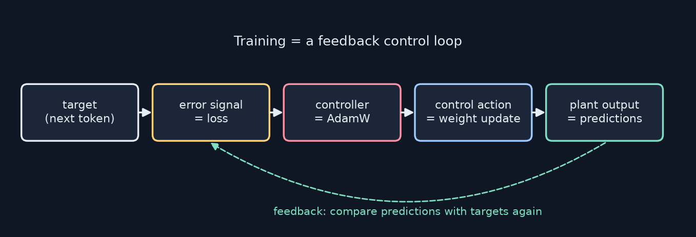
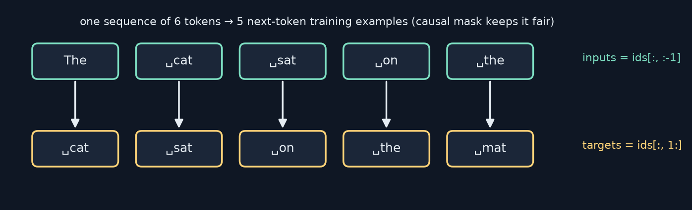
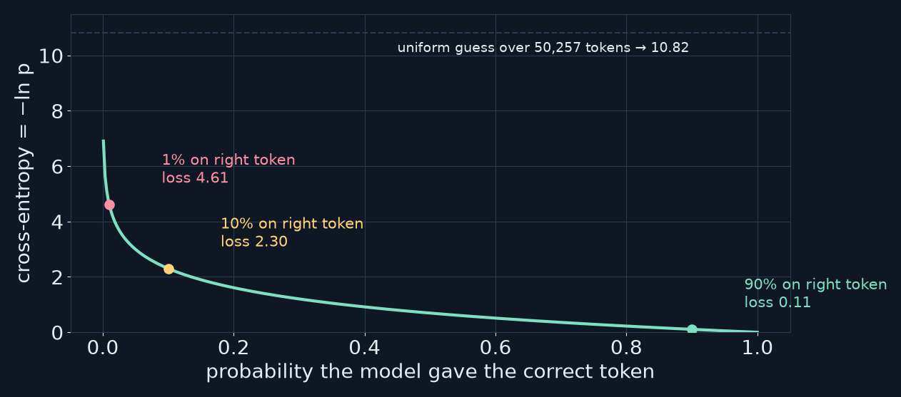
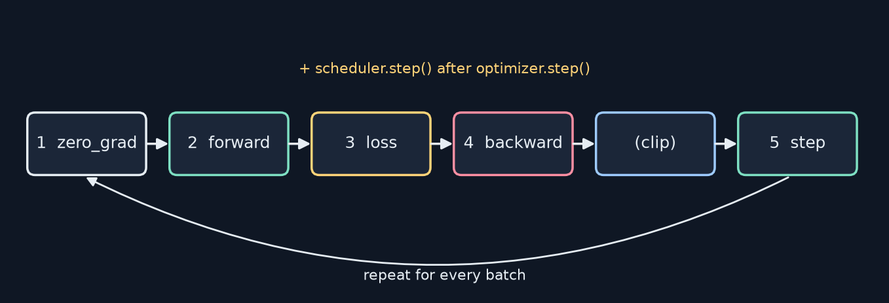
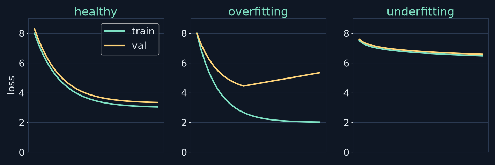
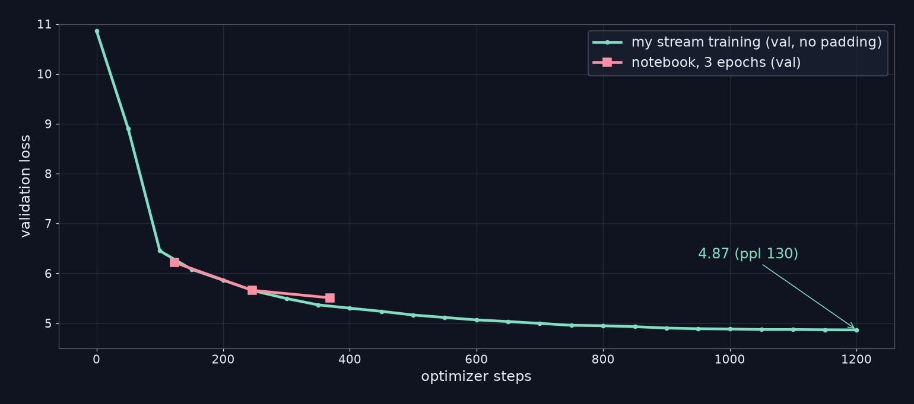

<!-- _class: lead -->
<!-- _paginate: false -->
# Build Your First LLM
## Chapter 12 — Training Your Model
A study companion to *Build Your First LLM* by Hasan Degismez
**Waqar Shaikh Builds**

<!-- say: Welcome to chapter twelve of my study series on Build Your First LLM by Hasan Degismez. This is the chapter where our hand built MiniGPT finally learns something. We cover the next token objective, cross entropy, data loaders, the five step training loop, validation, perplexity, checkpoints and sampling. I ran the notebook on a CPU for the full three epochs, and the numbers I got are very different from the book's. I'll show you why: a padding bug hiding in one argument, and a data pipeline that wastes a lot of compute. Then I'll show a fixed version and how much better it trains. -->

---

# Where we are

- **Ch 8–11:** tokenizer → embeddings → attention → a complete **MiniGPT**
- **Ch 12 (today):** turn random weights into *learned* weights
- **Ch 13:** fine-tuning and LoRA
- Notebook: **FirstLLM/code → notebooks/ch12.ipynb**

<!-- say: So far we have a tokenizer, embeddings, attention and a complete MiniGPT, but every weight is random. Today we train it on Shakespeare. Next chapter we fine tune. Everything follows the chapter twelve notebook. -->

---

# Chapter 12 roadmap

1. Training as a feedback loop
2. The objective: shifted inputs and targets
3. Cross-entropy and the ignore index
4. Dataset, collate function, DataLoader
5. The 5-step recipe, warmup, clipping
6. Validation, overfitting, perplexity, early stopping
7. Checkpoints · generation with temperature
8. **My CPU run vs the book**, the padding bug, a better pipeline
9. Exercises and review

<!-- say: Here's the plan. Training as a feedback loop. The objective. Cross entropy and the ignore index. The data pipeline. The five step recipe with warmup and clipping. Validation, overfitting and perplexity. Checkpoints and generation. Then my run against the book, the bug, and a better pipeline. Then exercises and review. -->

---

# Key terms for this chapter

| Term | One-line meaning |
|---|---|
| **Cross-entropy** | −ln(probability given to the correct token) |
| **Learning rate** | Step size for each weight update |
| **Warmup** | Ramp the learning rate up from ~0 at the start |
| **Epoch** | One full pass over the training set |
| **Perplexity** | e^loss: "how many tokens it's torn between" |
| **Overfitting** | Train loss ↓ while validation loss ↑ |
| **Checkpoint** | Saved model + optimizer + scheduler state |

<!-- say: Some terms. Cross entropy is minus the log of the probability given to the right token. The learning rate is the step size. Warmup ramps it up gently. An epoch is one pass over the data. Perplexity is e to the loss. Overfitting is when training loss falls but validation loss rises. And a checkpoint saves everything you need to resume. -->

---

<!-- _class: divider -->
# Part 1
## Training as a feedback loop

<!-- say: Part one. What training actually is. -->

---

# Learning = closing a loop



- Measure the error, nudge the knobs (weights), repeat thousands of times
- If you've tuned a thermostat or a PID controller, this will feel familiar

<!-- say: The book uses a nice engineering framing, which I've redrawn here. The target is the true next token. The error signal is the loss. The controller is the optimizer, AdamW. Its action is a weight update, and the plant output is the model's new predictions, which we compare with the targets again. Measure, adjust, repeat, thousands of times. -->

---

<!-- _class: divider -->
# Part 2
## The language-modelling objective

<!-- say: Part two. What exactly are we asking the model to do? -->

---

# One sequence, many examples



- `inputs = ids[:, :-1]` · `targets = ids[:, 1:]`
- The causal mask means position *t* only sees tokens ≤ *t*, so each guess is fair

<!-- say: Take one sequence of six tokens. Drop the last token to get the inputs, and drop the first to get the targets. Now every position has a job: predict the next token. Six tokens give five training examples in one forward pass. And because of the causal mask from chapter ten, position two can only see positions zero to two, so asking it for token three is a fair question. -->

---

# The label-shifting helper

```python
def create_lm_labels(token_ids, pad_token_id=0):
    inputs = token_ids[:, :-1]
    targets = token_ids[:, 1:].clone()
    targets[targets == pad_token_id] = -100
    return inputs, targets
```

- `-100` is PyTorch's default `ignore_index` → those positions add nothing to the loss
- Note the **default `pad_token_id=0`** — keep that in mind for Part 8

<sub>Code: FirstLLM/code (MIT License)</sub>

<!-- say: Here's the book's helper. Slice the inputs, slice and clone the targets, then replace padding with minus one hundred, which cross entropy ignores by default. Notice that the default padding id is zero. Hold on to that, because it comes back to bite us in part eight. -->

---

<!-- _class: divider -->
# Part 3
## Cross-entropy loss

<!-- say: Part three. How we score a prediction. -->

---

# Cross-entropy = −ln p(correct)



- Confidently right → near 0 · unsure → medium · confidently wrong → huge
- A random model scores about **ln 50,257 ≈ 10.8**. Remember that number

<!-- say: Cross entropy looks only at the probability the model gave the correct token, and takes minus its log. Ninety percent gives a loss of about point one. Ten percent gives two point three. One percent gives four point six. A brand new model that spreads probability evenly over fifty thousand tokens scores about ten point eight, which is why a loss stuck near ten or eleven means nothing has been learned. -->

---

# Flattening for `F.cross_entropy`

```python
logits = model(inputs)                    # (B, T, 50257)
loss = F.cross_entropy(
    logits.view(-1, logits.size(-1)),     # (B*T, 50257)
    targets.reshape(-1),                  # (B*T,)
    ignore_index=-100)
```

- It wants `(N, C)` scores and `(N,)` class indices, so merge batch and time
- `reshape` not `view` for targets: the slice `[:, 1:]` isn't contiguous

<sub>Code: FirstLLM/code (MIT License)</sub>

<!-- say: PyTorch's cross entropy wants a two D table of scores and a one D list of correct classes, so we flatten batch and time together. The targets use reshape rather than view, because slicing off the first column leaves a tensor that isn't contiguous in memory. -->

---

# Before training: noise

- Prompt "The fair maiden", greedy, random 16M-param MiniGPT (my run):

> The fair maidenovi democratically Stronghase simplifiedaine compress Positive sentences…

- Every token is roughly equally likely → the argmax is arbitrary

<!-- say: Before any training, here's what my random model wrote after "The fair maiden". Pure noise. Every token is about equally likely, so whichever one happens to score highest wins. That's our starting point. -->

---

<!-- _class: divider -->
# Part 4
## Data: Dataset, collate, DataLoader

<!-- say: Part four. Getting data into the model. -->

---

# TinyShakespeare

- ~1.1 million characters of plays (Karpathy's char-rnn dataset)
- Small enough for a CPU, recognisable output
- My count: **1,115,394 chars → 338,025 GPT-2 tokens**

```python
class TextDataset(Dataset):
    def __init__(self, text, chunk_size=128):
        self.chunks = [text[i:i+chunk_size]
                       for i in range(0, len(text)-chunk_size, chunk_size)]
```

<sub>Code: FirstLLM/code (MIT License), condensed</sub>

<!-- say: The data is TinyShakespeare, about one point one million characters. With the GPT-2 tokenizer that's about three hundred and thirty eight thousand tokens. The dataset class cuts the raw text into fixed size chunks. Note that the chunks are measured in characters, not tokens. That matters later. -->

---

# The collate function

```python
def collate_fn(batch, tokenizer, max_length=128):
    enc = tokenizer(batch, padding=True, truncation=True,
                    max_length=max_length, return_tensors="pt")
    return enc["input_ids"], enc["attention_mask"]
```

- Tokenises a list of strings and pads them to the longest one in the batch
- GPT-2 has no pad token, so the notebook sets `pad_token = eos_token` → **id 50256**

<sub>Code: FirstLLM/code (MIT License)</sub>

<!-- say: The collate function turns a list of strings into a padded tensor. It tokenises them, truncates at one hundred and twenty eight tokens and pads each batch to its longest member. GPT-2 has no padding token, so the notebook borrows the end of text token. Its id is fifty thousand two hundred and fifty six, not zero. -->

---

# Batch vs epoch

- **Batch:** 32 chunks processed together → one weight update
- **Epoch:** one pass over every training chunk
- Book's example: 10,000 examples ÷ 32 ≈ 312 batches
- Notebook reality: 4,357 chunks of 256 chars → 3,921 train / 436 val → **123 batches per epoch**

<!-- say: A batch is the group processed together for one update. An epoch is one pass over everything. The book's arithmetic example says ten thousand examples give about three hundred and twelve batches. But the actual notebook, with two hundred and fifty six character chunks, has three thousand nine hundred and twenty one training chunks, so one epoch is only one hundred and twenty three batches. And the book's printed training output also shows three hundred and twelve, which doesn't match its own code. -->

---

# The DataLoader

```python
train_ds, val_ds = random_split(dataset, [train_size, val_size],
        generator=torch.Generator().manual_seed(42))
collate = partial(collate_fn, tokenizer=tokenizer, max_length=128)
train_loader = DataLoader(train_ds, batch_size=32, shuffle=True,
                          collate_fn=collate)
```

- `partial` pre-fills the tokenizer so DataLoader can call `collate(batch)`
- Shuffle the training set, not the validation set

<sub>Code: FirstLLM/code (MIT License)</sub>

<!-- say: A seeded ninety ten split, a partial to bind the tokenizer into the collate function, and data loaders that shuffle the training set but not the validation set. Standard and sensible. -->

---

<!-- _class: divider -->
# Part 5
## The training loop

<!-- say: Part five. The heart of the chapter. -->

---

# The 5-step recipe



- Zero grads → forward → loss → backward → (clip) → step, then advance the scheduler

<!-- say: Every neural network trains with the same five steps. Zero the gradients, because PyTorch accumulates them. Run the forward pass. Compute the loss. Backpropagate. Optionally clip the gradients. Then let the optimizer step, and advance the learning rate scheduler. Repeat for every batch. -->

---

# Learning rate and warmup

- Too high → overshoot and diverge · too low → painfully slow
- **Warmup:** random weights give unreliable gradients, so start tiny and ramp up
- Notebook: AdamW, lr 3e-4, weight decay 0.01, **100 warmup steps**, then linear decay to 0

> With only 123 steps per epoch, warmup eats most of epoch 1

<!-- say: The learning rate is the step size. Too big and you overshoot, too small and it takes forever. Warmup starts tiny because early gradients from random weights aren't trustworthy. The notebook uses AdamW at three e minus four, with a hundred warmup steps and a linear decay. One thing I noticed: with only a hundred and twenty three steps per epoch, warmup takes up most of the first epoch. -->

---

# Gradient clipping

```python
loss.backward()
torch.nn.utils.clip_grad_norm_(model.parameters(), max_norm=1.0)
optimizer.step()
```

- Rescales the whole gradient vector if its norm exceeds 1.0
- Order matters: **after** backward (gradients exist), **before** step

<sub>Code: FirstLLM/code (MIT License)</sub>

<!-- say: Gradient clipping is a safety limiter. If the overall gradient norm is bigger than one, the whole gradient is scaled down, so one bad batch can't wreck the weights. It has to happen after backward, when the gradients exist, and before the optimizer step. -->

---

# `train_epoch`, in the notebook

```python
for input_ids, attention_mask in progress:
    inputs, targets = input_ids[:, :-1], input_ids[:, 1:]
    optimizer.zero_grad(set_to_none=True)
    logits = model(inputs)
    loss = F.cross_entropy(logits.view(-1, logits.size(-1)),
                           targets.reshape(-1),
                           ignore_index=0)   # "Ignore padding (token ID 0)"
    loss.backward(); clip_grad_norm_(model.parameters(), 1.0)
    optimizer.step(); scheduler.step()
```

<sub>Code: FirstLLM/code (MIT License), condensed</sub>

<!-- say: Here's the training function, condensed. It's the five step recipe exactly, after calling model dot train. But look at the loss: ignore index zero, with a comment saying padding is token id zero. We just saw that the padding id is fifty thousand two hundred and fifty six. I'll come back to this. -->

---

<!-- _class: divider -->
# Part 6
## Validation, overfitting, perplexity

<!-- say: Part six. Is it learning, or memorising? -->

---

# Reading loss curves



- **Healthy:** both fall · **Overfitting:** val turns up · **Underfitting:** both stay high

<!-- say: Always watch training and validation loss together. If both fall, you're healthy. If training keeps falling but validation turns upward, the model is memorising, which is overfitting. If both stay high, the model is underfitting: too small, too little training or a bug. -->

---

# Perplexity = e^loss

| Val loss | Perplexity | Meaning |
|---|---|---|
| 10.8 | ~50,000 | uniform guessing |
| 6.0 | ~400 | learned word frequencies |
| 4.5 | 90 | decent small model |
| 3.4 | 30 | about GPT-2 on Wikipedia (book's figure) |

- Read it as "torn between about *P* equally likely tokens"
- Only comparable across models with the **same tokenizer and data**

<!-- say: Perplexity is e to the validation loss, and you can read it as how many equally likely tokens the model is torn between. Ten point eight means guessing across the whole vocabulary. Six means it has learned word frequencies, around four hundred. Four and a half is ninety. And it's only fair to compare perplexities that use the same tokenizer and the same data. -->

---

# Evaluation and early stopping

```python
@torch.no_grad()
def evaluate(model, dataloader, device):
    model.eval()
    ...  # sum the loss, count the non-ignored tokens
    return avg_loss, math.exp(avg_loss)
```

- `no_grad` saves memory · `eval()` turns dropout off
- Early stopping: stop when val loss rises for *patience* epochs in a row

<sub>Code: FirstLLM/code (MIT License), condensed</sub>

<!-- say: Evaluation runs without gradients and with dropout off. It sums the loss and divides by the number of counted tokens to get average loss and perplexity. Early stopping halts training when validation loss has risen several epochs in a row. With only three epochs, the book's patience of three can never actually trigger. -->

---

<!-- _class: divider -->
# Part 7
## Checkpoints and generation

<!-- say: Part seven. Saving and sampling. -->

---

# What goes in a checkpoint

```python
torch.save({'epoch': epoch,
            'model_state_dict': model.state_dict(),
            'optimizer_state_dict': optimizer.state_dict(),
            'scheduler_state_dict': scheduler.state_dict(),
            'train_loss': train_loss, 'val_loss': val_loss}, path)
```

- AdamW keeps two running averages per weight. Lose them and resuming isn't the same run
- Keep the **best** checkpoint by validation loss

<sub>Code: FirstLLM/code (MIT License)</sub>

<!-- say: A checkpoint needs more than the weights. AdamW keeps two running averages for every parameter, and the scheduler knows where it is in the warmup and decay. Save all of it, and keep the checkpoint with the best validation loss. -->

---

# Sampling with temperature

```python
next_logits = model(token_ids)[:, -1, :] / temperature
probs = F.softmax(next_logits, dim=-1)
next_token = torch.multinomial(probs, num_samples=1)
```

- T < 1 sharpens (safer, repetitive) · T > 1 flattens (wilder)
- Divide logits **before** softmax; T → 0 becomes greedy

<sub>Code: FirstLLM/code (MIT License)</sub>

<!-- say: Generation now samples instead of always picking the top token. Divide the last position's logits by a temperature, softmax, and draw one token. Below one sharpens the distribution. Above one flattens it. As temperature goes to zero you get greedy decoding back. Chapter fourteen goes deeper with top k and top p. -->

---

<!-- _class: divider -->
# Part 8
## My CPU run vs the book

<!-- say: Part eight. What actually happened when I ran it. -->

---

# The book's printed result vs my run

| | Book (GPU) | My run (CPU, same notebook) |
|---|---|---|
| Parameters | 10,789,121 | **16,054,016** |
| Batches/epoch | 312 | **123** |
| Epoch 1 train / val | 4.82 / 4.22 | **8.38 / 6.22** |
| Epoch 2 train / val | 3.98 / 3.89 | **5.90 / 5.66** |
| Epoch 3 train / val | 3.62 / 3.75 | **5.54 / 5.51** |
| Final perplexity | 42.3 | **246.2** |

<!-- say: Here's the book's printed run next to mine, same notebook, same seed, on a CPU. The parameter count is sixteen million, not ten point eight. One epoch is a hundred and twenty three batches, not three hundred and twelve. My validation loss went six point two two, five point six six, five point five one, ending at a perplexity of two hundred and forty six. The book prints three point seven five and forty two. That's a big gap, and the perplexity table from part six tells us what it means: my model has learned word frequencies and some line structure, nothing like a perplexity of forty two. -->

---

# What it wrote after 3 epochs

> To be or not to be breathed by / The already, you you hathAM. / But me in Ty her, of thee,CA: / CORBut thy d counsel, heavenly.

- Line breaks, speaker-like tags and "thee/thy/hath": the *shape* of a play, not sentences. The book prints "The king is a man of great virtue and honour…"

<!-- say: And here's what it actually wrote after three epochs, for "to be or not to be". It has learned the shape of a play: short lines, speaker tags in capitals, thee, thy and hath. But these aren't sentences. The book shows the king is a man of great virtue and honour, which my run is nowhere near. The notebook's own closing message says training makes all the difference. It does, but three epochs on this setup isn't enough to get there. -->

---

# Bug 1: `ignore_index=0` ignores the wrong token

- Token **0** in GPT-2 is `!`, a real character (0.62% of Shakespeare tokens)
- The padding is **50256** (eos), and it is *not* ignored
- So the loss trains the model to predict `!`-blind and to emit pad after pad
- Padded batches average ~100 tokens while chunks average ~78 → **22% of target positions are padding** (my count)

```python
pad = tokenizer.pad_token_id   # 50256
targets = targets.masked_fill(attention_mask[:, 1:] == 0, -100)
```

<!-- say: Here's the first bug. Ignore index zero doesn't ignore padding, because in GPT-2 token zero is the exclamation mark, a real character, about point six percent of the text. Meanwhile the real padding token, fifty thousand two hundred and fifty six, is counted in the loss. Batches are padded to about a hundred tokens when the average chunk is about seventy eight. I counted: twenty two percent of all target positions are padding that the model is scored on. The fix is to mask using the attention mask, or the real pad id, and set those targets to minus one hundred. -->

---

# Bug 2 (design): short, padded, character chunks

- 256-character chunks ≈ 78 tokens, but the model supports 128
- Chunks start mid-word and every batch is padded
- 3 epochs = only **369 updates**, and 100 of them are warmup
- Better: tokenise once, then sample random 128-token windows from the stream (no padding at all)

<!-- say: The second issue is design rather than a bug. Chunks are measured in characters, so they're only about seventy eight tokens long, less than the model's hundred and twenty eight. Every batch needs padding. And three epochs is only three hundred and sixty nine weight updates, a hundred of which are warmup. A better pipeline tokenises the whole text once and samples random hundred and twenty eight token windows, which needs no padding at all. -->

---

# My fix: stream training, same model, same lr



- Same 16M MiniGPT, lr 3e-4, warmup 100, batch 32 × 128 tokens, **1,200 steps** on CPU
- Final val loss **4.87** → perplexity **130 (notebook: 246)**

<!-- say: Here's my fix: the same sixteen million parameter model, same learning rate and warmup, but trained on random hundred and twenty eight token windows from the token stream, with no padding at all. The two curves overlap early, which is reassuring. At step three fifty, mine was at five point three seven, against the notebook's five point five one after three sixty nine steps, and my metric counts every token, with no padding to make it easier. Running on to twelve hundred steps reached a validation loss of four point eight seven, a perplexity of about a hundred and thirty, roughly half the notebook's. Still nowhere near the book's forty two. It took about an hour and a half on a shared CPU. -->

---

# Stream model samples

> KING HENRY:<br>It should said long:<br>A saved before, my lord.<br><br>QUEEN MARGARET:<br>I tell me not it, and knee,<br>And being my heart as thou shall be as I love,

- Real character names, line breaks, *thou* and *my lord*, but still no sense: about what perplexity 130 buys you

<!-- say: And here's what that model writes when prompted with King Henry. It answers with Queen Margaret, a real character from the history plays, uses line breaks, thou and my lord, and sounds roughly like Shakespeare. But it makes no sense. That's honestly what a perplexity of a hundred and thirty looks like on a small model trained for an hour on a CPU. -->

---

# Why the book's 42 is suspicious

- 338k tokens and 16M parameters: a perplexity of ~42 after 369 small updates is very optimistic
- The printed outputs ("a man of great virtue and honour…") read like illustrations, not a logged run
- Lesson: **trust your logs, not the printed output**, and always check what `ignore_index` points at

<!-- say: Why do I doubt the book's perplexity of forty two? Three hundred and thirty eight thousand tokens, sixteen million parameters, and only three hundred and sixty nine small updates. Neither the notebook nor my better pipeline gets anywhere near that, and the printed sample about a man of great virtue and honour reads like an illustration rather than a logged run. The lesson: trust your own logs, and always check what your ignore index actually points at. -->

---

<!-- _class: divider -->
# Part 9
## Exercises and review

<!-- say: Part nine. Practice. -->

---

# Exercises, worked

1. **Custom dataset:** swap the text file. Below ~1 MB, overfitting arrives fast, so watch val
2. **LR sweep:** 1e-5 barely moves · 3e-4 healthy · 1e-2 spikes/diverges without clipping
3. **Temperature:** 0.3 loops, 1.0 varied, 2.0 is soup
4. **Resume:** reload model + optimizer + scheduler. Same loss curve ± dropout noise
5. **Early stopping:** needs more epochs than patience to ever fire
6. **Perplexity table:** % improvement = 1 − ppl_final / ppl_epoch1

<!-- say: Quick notes on the exercises. A custom dataset smaller than about a megabyte overfits quickly, so watch the validation curve. In the learning rate sweep, one e minus five barely moves, three e minus four is healthy, and one e minus two tends to spike. Low temperature loops, high temperature is soup. For resuming, reload the optimizer and scheduler too. Early stopping needs more epochs than its patience. And the perplexity improvement is one minus final over first. -->

---

# Review questions: short answers

- **Recipe:** `zero_grad` · forward · loss · `backward` · `step`
- **Why shift?** Without it the model just copies its input
- **ignore_index=-100:** skips positions in the loss. *Point it at the real pad id!*
- **10,000 / 32** → 313 batches (312.5 rounded up) · 5 epochs → 1,565 updates
- **Only weights saved?** Resuming resets AdamW moments and the LR schedule

<!-- say: Short answers. The five steps, as we've seen. Without shifting, the model can see the answer and learns to copy. Ignore index skips positions, but only if it points at the right id. Ten thousand over thirty two is three hundred and twelve point five, so three hundred and thirteen batches including the last partial one, or one thousand five hundred and sixty five updates over five epochs. And saving only weights resets the optimizer and the schedule. -->

---

# Practice this

- Run ch12 in Colab, then change one line: `ignore_index=tokenizer.pad_token_id`. Compare val loss
- Plot `train` and `val` per **step**, not just per epoch
- Try my stream sampler (in my notes) for 1,000 steps

<!-- say: Your practice: run the notebook, change the ignore index to the real pad id, and compare. Log loss every few steps, not just every epoch. And try the stream sampler from my notes for a thousand steps. -->

---

# Credits

Based on ***Build Your First LLM*** by **Hasan Degismez** — buy the book: **leanpub.com/FirstLLM/**
Code: **github.com/FirstLLM/code** (MIT License) · notebook ch12.ipynb
Slides, narration and diagrams: my own study materials · **Waqar Shaikh Builds**

<!-- say: This video is based on Build Your First LLM by Hasan Degismez. The explanations and diagrams are my own, but the book goes deeper, so please support the author and buy it at leanpub dot com slash First LLM. The code is on GitHub at First LLM slash code, under the MIT licence. Thanks for watching, and see you in chapter thirteen. -->
