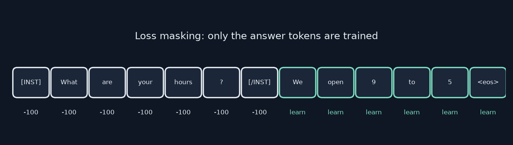
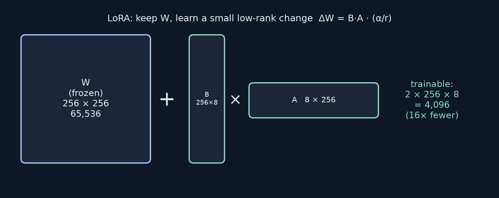
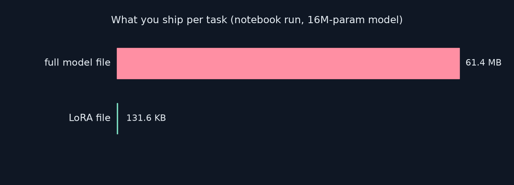
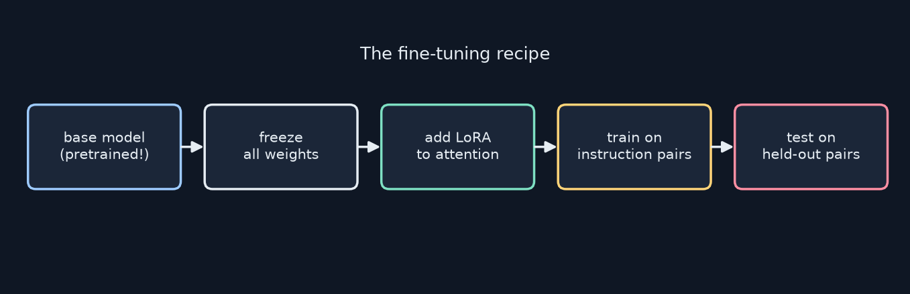

<!-- _class: lead -->
<!-- _paginate: false -->
# Build Your First LLM
## Chapter 13 — Fine-Tuning Your Model
A study companion to *Build Your First LLM* by Hasan Degismez
**Waqar Shaikh Builds**

<!-- say: Welcome to chapter thirteen of my study series on Build Your First LLM by Hasan Degismez. Today we turn a generalist model into a specialist: instruction data, loss masking, and LoRA adapters built from scratch. I ran the notebook, found why it can't show any improvement, and then ran the same recipe on a properly pretrained GPT-2 with a real held-out test set, so you can see what fine-tuning actually does. -->

---

# Where we are

- **Ch 12:** pretraining MiniGPT on Shakespeare: next-token prediction on raw text
- **Ch 13 (today):** specialise a model with **instruction → response** pairs
- **Ch 14:** change behaviour without touching weights: prompting
- Notebook: **FirstLLM/code → notebooks/ch13.ipynb**

<!-- say: Chapter twelve was pretraining: predict the next token of raw text. Today is fine-tuning: teach the model to answer in a specific way using question and answer pairs. Chapter fourteen gets better behaviour without touching the weights at all. -->

---

# Chapter 13 roadmap

1. Fine-tune or prompt? A decision rule
2. Instruction data and JSONL
3. Supervised fine-tuning with **loss masking**
4. **LoRA**: the maths, the layer, injecting it
5. Evaluation: exact match, word overlap, before/after
6. Saving, loading and merging adapters
7. **My runs:** the notebook, then GPT-2 + LoRA with a real test set

<!-- say: The plan. When to fine tune at all. How to shape the data. Loss masking. LoRA, from the maths to the code. How to evaluate. How to ship adapters. And then my two runs: the notebook as written, and a fixed version on GPT-2. -->

---

# Key terms for this chapter

| Term | One-line meaning |
|---|---|
| **SFT** | Supervised fine-tuning on input → output pairs |
| **Loss masking** | Grade only the answer tokens, not the question |
| **LoRA** | Learn a small low-rank change beside frozen weights |
| **Adapter** | A small trainable add-on module |
| **Rank r** | Width of LoRA's bottleneck (e.g. 8) |
| **Freezing** | `requires_grad = False`: weights never update |

<!-- say: Key terms. Supervised fine tuning trains on input and output pairs. Loss masking grades only the answer. LoRA learns a small low rank change next to frozen weights. An adapter is a small trainable add on. The rank is the width of LoRA's bottleneck. And freezing means a weight never updates. -->

---

<!-- _class: lead -->
# Part 1
## Fine-tune, or just prompt better?

<!-- say: Part one. Do you even need to fine tune? -->

---

# Generalist vs specialist

- Pretraining = broad knowledge, nothing mastered
- Fine-tuning = the same model, practised on one narrow job
- Ask a Shakespeare model about refunds → you get *thee* and *thou*
- Two levers: **better instructions** (prompting) or **better examples** (fine-tuning)

<!-- say: A pretrained model is a generalist. It knows language but hasn't mastered any job. Ask a Shakespeare model about your refund policy and you get thee and thou. You have two levers. Give it better instructions, which is prompting, or show it many examples of the right behaviour, which is fine tuning. -->

---

# When each one wins

| Prompting wins when… | Fine-tuning wins when… |
|---|---|
| The task is simple and common | You need a fixed vocabulary or format every time |
| You switch between many tasks | One task runs at high volume |
| You have no examples yet | You have 100+ good examples |
| You need results today | Reliability beats flexibility |

<!-- say: Prompting wins for simple, varied tasks, when you have no examples and need results today. Fine tuning wins when you need the same format and vocabulary every time, on one high volume task, and you have at least a hundred good examples. -->

---

# My decision rule (from the book's idea)

1. Try **5–10 prompt variations** first
2. Then count "yes" answers:
   - 100+ correct examples?
   - Must use specific terms every time?
   - Task far from the base model's training?
3. **Two or more yes → fine-tune.** Otherwise keep prompting

<!-- say: The rule of thumb. Try five to ten prompt variations first. Then ask three questions. Do I have a hundred or more correct examples? Must the model use specific terms every time? Is the task far from what the base model saw? Two or more yeses, fine tune. Otherwise keep working on the prompt. -->

---

# The cost trade-off

- Prompting: minutes, free, but **extra tokens on every request**
- Fine-tuning: hours + compute, once, then **short prompts forever**
- At high volume the fine-tune can be the cheaper option
- Hidden cost: every fine-tune is an artifact to **store, version, deploy**

<!-- say: Cost. Prompting is fast and free to set up, but long instructions cost tokens on every single request. Fine tuning costs compute once, then prompts stay short. At high volume that can win. The hidden cost is that every fine tune is a new artifact to store, version and deploy. -->

---

<!-- _class: lead -->
# Part 2
## Instruction data

<!-- say: Part two. The data. -->

---

# From raw text to instruction pairs

```python
# Ch 7 (pretraining): just text
{"text": "To be or not to be, that is the question..."}

# Ch 13 (fine-tuning): instruction + response
{"instruction": "What does TechStartup Inc do?",
 "response": "TechStartup Inc builds AI-powered tools."}
```

- Pretraining = reading the textbook. Fine-tuning = **flashcards**

<!-- say: In chapter seven a record was just text. Now each record is an instruction and the ideal response. Pretraining is like reading the whole textbook; fine tuning is drilling flashcards. -->

---

# The TechStartup FAQ dataset

- A fictional company: products, pricing, accounts, support
- Book text: "80 for training and 20 for evaluation"
- **Notebook reality: `FAQ_DATA` has 69 examples**
- `train_data = FAQ_DATA[:80]` → takes all 69 → **test set is empty**

<!-- say: The dataset is an FAQ for a fictional company called TechStartup. The book says eighty training examples and twenty test examples. The notebook actually has sixty nine, and it takes the first eighty for training, which is all of them. So the test set is empty, and that breaks evaluation later. Keep that in mind. -->

---

# JSONL: one example per line

```python
def save_as_jsonl(examples, filepath):
    with open(filepath, 'w') as f:
        for example in examples:
            f.write(json.dumps(example) + '\n')

def load_jsonl(filepath):
    with open(filepath) as f:
        return [json.loads(line) for line in f]
```

- Streamable, appendable, diff-friendly. <small>Code: FirstLLM/code (MIT License)</small>

<!-- say: JSON lines stores one JSON object per line. You can stream it, append to it and diff it. Saving is a loop of json dumps; loading reads each line back. -->

---

# Quality over quantity

- Pretraining: millions of examples, **each seen once**
- Fine-tuning: dozens to hundreds, **each seen many times**
- Repetition amplifies mistakes: one bad pair teaches bad habits
- Check: accurate · consistent terms · no contradictions · varied · safe

<!-- say: In fine tuning, each example is seen many times, so errors get amplified. One wrong answer becomes a habit. Check that answers are accurate, use consistent terms, never contradict each other, cover varied phrasings, and contain nothing unsafe. If one record says Amsterdam and another says Berlin, the model learns confusion. -->

---

<!-- _class: lead -->
# Part 3
## Supervised fine-tuning with loss masking

<!-- say: Part three. Loss masking. -->

---

# Why not train on every token?

- Ch 12 graded **every** next-token prediction
- Here, predicting "does" after "What" teaches nothing new
- It wastes signal and rewards **parroting the question**
- We only care about: given the question, produce the answer

<!-- say: In chapter twelve every position was graded. For question answer data, that means grading the model on predicting the words of the question itself, which teaches nothing useful and even encourages it to parrot the question. We only care about producing the answer. -->

---

# Loss masking: grade only the answer



- Label = **-100** on prompt tokens → `cross_entropy` skips them

<!-- say: Here's the idea. The prompt tokens, from the instruction marker to the closing marker, get the label minus one hundred. Only the answer tokens are graded. Like a teacher who doesn't mark you for copying the question correctly. -->

---

# Building the labels

```python
prompt = f"[INST] {instruction} [/INST] "
input_ids  = tokenizer.encode(prompt + response, return_tensors="pt").squeeze()
prompt_ids = tokenizer.encode(prompt, return_tensors="pt").squeeze()
labels = input_ids.clone()
labels[:len(prompt_ids)] = -100   # mask the instruction
```

- Notebook check: one example → **115 masked, 13 trained** (padding is masked too)

<!-- say: In code: format the prompt with the markers, tokenize prompt plus response, tokenize the prompt alone to find where the answer starts, then set everything before that to minus one hundred. In the notebook, one example had a hundred and fifteen masked positions and only thirteen trained ones, because the padding is masked too. -->

---

# The masked loss

```python
def compute_masked_loss(logits, labels):
    shift_logits = logits[..., :-1, :].contiguous()
    shift_labels = labels[..., 1:].contiguous()
    return F.cross_entropy(shift_logits.view(-1, shift_logits.size(-1)),
                           shift_labels.view(-1), ignore_index=-100)
```

- Same shift as Ch 12; the loop is the same 5 steps. <small>Code: FirstLLM/code (MIT License)</small>
- Tip: append an **end-of-text** token to the answer so the model learns to *stop*

<!-- say: The loss is chapter twelve's shifted cross entropy with ignore index minus one hundred. The training loop is the same five steps. One tip the chapter skips: put an end of text token after each answer, so the model learns when to stop. My GPT-2 run does that. -->

---

<!-- _class: lead -->
# Part 4
## LoRA: low-rank adaptation

<!-- say: Part four. LoRA. -->

---

# The efficiency problem

- Full fine-tuning: gradients + optimizer state for **every** weight
- A full copy of the model **per task**
- GPT-2: 124M weights. GPT-3: 175B
- Plus **catastrophic forgetting**: new task overwrites old skills

<!-- say: Full fine tuning needs gradients and optimizer state for every weight, and you ship a full copy of the model for every task. At billions of weights that's impractical. And updating everything risks catastrophic forgetting, where the new task overwrites the old skills. -->

---

# The LoRA idea



- Freeze **W**. Learn a thin correction **ΔW = B·A**, scaled by α/r

<!-- say: LoRA's insight is that the change a fine tune needs is low rank. So freeze the big matrix W and learn a thin correction made of two small matrices, scaled by alpha over r. On a two fifty six square layer with rank eight, that's four thousand ninety six trainable numbers instead of sixty five thousand. Sixteen times fewer. -->

---

# Counting parameters honestly

| Layer | Full | LoRA r=8 | Ratio |
|---|---|---|---|
| 768 × 768 (book's example) | 589,824 | 12,288 | **48×** |
| MiniGPT `qkv_proj` 256 → 768 | 196,608 | 8,192 | **24×** |
| Notebook demo 256 × 256 | 65,536 | 4,096 | **16×** |

- The ratio depends on the layer shape: "48×" is not universal

<!-- say: The book's headline is forty eight times. That's true for a seven sixty eight square layer. MiniGPT's real attention projection goes from two fifty six to seven sixty eight, which gives twenty four times. The notebook's demo layer gives sixteen. The ratio depends on the shape, so don't quote forty eight as a property of LoRA. -->

---

# Scale = α / r

- `output = x @ W + (x @ down @ up) * (alpha / rank)`
- α is a **volume knob** for the adapter
- Dividing by r keeps the update size steady when you change r
- Common: r = 8, α = 16 → scale 2

<!-- say: The scale is alpha divided by rank. Alpha is a volume knob for the adapter. Dividing by rank means that if you try a different rank, the update size stays roughly the same, so you don't need to retune the learning rate. Rank eight with alpha sixteen gives a scale of two. -->

---

# The LoRALinear layer (book)

```python
class LoRALinear(nn.Module):
    def __init__(self, in_features, out_features, rank=8, alpha=16):
        super().__init__()
        self.base = nn.Linear(in_features, out_features, bias=False)
        self.lora_B = nn.Parameter(torch.zeros(in_features, rank))
        self.lora_A = nn.Parameter(torch.zeros(rank, out_features))
        self.scale = alpha / rank
        nn.init.kaiming_uniform_(self.lora_B, a=math.sqrt(5))
        nn.init.zeros_(self.lora_A)
    def forward(self, x):
        return self.base(x) + (x @ self.lora_B @ self.lora_A) * self.scale
```
<small>Code: FirstLLM/code (MIT License)</small>

<!-- say: Here's the book's layer. A frozen base linear layer, two small matrices, and a scale. One matrix gets a small random start; the other starts at zero, so the adapter adds exactly nothing at step zero and training grows the correction from there. -->

---

# Naming gotcha: A and B are swapped

- Book: **B** = down (in × r, random), **A** = up (r × out, zeros)
- LoRA paper and Hugging Face PEFT: **A** = down (random), **B** = up (zeros)
- The maths still works; the **names** won't match PEFT checkpoints
- Notebook confirms: `lora_B [256, 8]`, `lora_A [8, 768]`

<!-- say: A naming gotcha. The book calls the down projection B and the up projection A. The original paper and Hugging Face's PEFT library do the opposite: A is down and starts random, B is up and starts at zero. The maths is the same, but if you ever load or compare PEFT weights, the names are reversed. The notebook shows lora B as two fifty six by eight. -->

---

# Freeze, then inject

```python
for p in model.parameters():
    p.requires_grad = False          # freeze everything
for block in model.blocks:
    old = block.attn.qkv_proj
    new = LoRALinear(old.in_features, old.out_features, rank, alpha)
    new.base.weight.data = old.weight.data.clone()
    new.freeze_base()
    block.attn.qkv_proj = new
```
<small>Code: FirstLLM/code (MIT License)</small>

<!-- say: Injecting LoRA: freeze every parameter, then in every block replace the combined query key value projection with a LoRA version that copies the old weights into its frozen base. Only the new small matrices can learn. -->

---

# Does it "primarily affect Q and V"?

- The book targets the **fused** `qkv_proj` and says it mostly adapts Q and V
- One adapter on the fused output adjusts **Q, K and V alike**
- To target only Q and V: split the projection, or zero the K slice of the update
- (The paper's Q+V finding is about *which* matrices to adapt, not a side effect)

<!-- say: The book says adapting the fused projection primarily affects queries and values. It doesn't. One adapter on the fused output can change queries, keys and values equally. If you want only Q and V, split the projection or mask the key slice. The paper's finding was about which matrices you choose to adapt. -->

---

# Notebook: trainable parameters

- Book: "24,576 / 10,789,121 (0.23%)"
- **Notebook: 32,768 / 16,086,784 (0.20%)**
- 4 layers × (256×8 + 8×768) = 4 × 8,192 = 32,768 ✔
- Either way: **one fifth of one percent** of the model learns

<!-- say: In the notebook, thirty two thousand seven hundred and sixty eight parameters are trainable out of sixteen million, which is zero point two percent. The book prints a different pair of numbers from an older configuration. Either way only a fifth of a percent of the model learns. -->

---

# QLoRA in one line

- Store frozen base weights in **4-bit**, train LoRA on top
- Lets you fine-tune 7B+ models on one consumer GPU
- Tools: `bitsandbytes` + Hugging Face **PEFT**
- Learn plain LoRA first; QLoRA is the same idea plus quantisation

<!-- say: QLoRA keeps the frozen base in four bit precision and trains LoRA on top, which is how people fine tune seven billion parameter models on one consumer GPU. It's the same idea plus quantisation, using bitsandbytes and PEFT. -->

---

<!-- _class: lead -->
# Part 5
## Evaluating the fine-tune

<!-- say: Part five. Did it work? -->

---

# Simple metrics

- **Exact match**: generated == expected (case-insensitive). Strict
- **Word overlap**: share of expected words that appear
- **Read the outputs**: numbers hide nonsense
- Always on **held-out** questions, never only training ones

<!-- say: Three checks. Exact match, which is strict. Word overlap, the share of expected words that show up. And actually reading the outputs, because numbers can hide nonsense. All on held out questions the model never trained on. -->

---

# A gotcha in the eval code

```python
output = model.generate(input_ids, max_new_tokens=50, do_sample=False)
```

- MiniGPT has **no** `.generate()` with these arguments (that's Hugging Face's API)
- Write a small greedy loop: argmax → append → stop at end-of-text
- Set seeds (`torch.manual_seed`) before training **and** eval

<!-- say: The book's evaluation calls model dot generate with Hugging Face style arguments. MiniGPT doesn't have that method. You need a small greedy loop: take the argmax, append it, stop at end of text. And set seeds before both training and evaluation. -->

---

# Notebook run: what actually happens

- Base = **randomly initialised** MiniGPT (Ch 12 weights not loaded)
- Training loss: **10.8632 → 10.7390** (−1.1%)
- Before and after outputs: **gibberish** both times
- Test set empty → cell 27 **ZeroDivisionError**, cell 28 NameError

<!-- say: Here's my notebook run. The base model is randomly initialised, so it knows nothing. Loss moved from ten point eight six to ten point seven four, about one percent. Outputs were gibberish before and after. And because the test set is empty, the evaluation cell divides by zero. LoRA can't teach language to a random model; it can only nudge one that already knows it. -->

---

# Notebook: adapter file size



- Book: 0.10 MB vs 41.2 MB ("400×"). Mine: **131.6 KB vs 61.4 MB (478×)**

<!-- say: The part that does work in the notebook: file size. The adapter is a hundred and thirty two kilobytes, the full model sixty one megabytes, four hundred and seventy eight times bigger. The book's numbers come from an older configuration, but the point stands. -->

---

# My fix: the same recipe on a real base



- GPT-2 small (124M, pretrained) · LoRA r=8, α=16 on every `c_attn`
- Book's 69 FAQs, shuffled: **55 train / 14 held-out** · masked loss + end-of-text

<!-- say: So I ran the same recipe properly. A pretrained GPT-2 small, LoRA rank eight alpha sixteen on every attention projection, the book's sixty nine FAQ examples shuffled into fifty five for training and fourteen held out, with loss masking and an end of text token. -->

---

# My GPT-2 + LoRA results

| | Before LoRA | After 12 epochs |
|---|---|---|
| Train loss (masked) | — | 3.15 → **0.73** |
| Held-out exact match (14) | 0% | **0%** |
| Held-out word overlap | 5.3% | **18.5%** |
| Seen-question overlap (14 train) | — | 53.4% (exact 21%) |

- Trainable **294,912 / 124,734,720 (0.24%)** · adapter file **1.16 MB** · CPU, ~7 min

<!-- say: Here are my numbers. Training loss fell from three point one five to point seven three over twelve epochs. On the fourteen held out questions, exact match stayed at zero, and word overlap rose from five percent to eighteen and a half. On questions it trained on, overlap was fifty three percent, with three of fourteen word perfect. Only a quarter of a percent of GPT-2's weights trained, and the adapter is about one megabyte. So the book's fifty percent exact match isn't realistic for unseen questions: with sixty nine examples, the model learns the style, not facts it never saw. -->

---

# What the held-out answers look like

| Held-out question | Expected | GPT-2 + LoRA said |
|---|---|---|
| Where are you based? | …headquartered in Amsterdam, Netherlands | "We're based in Amsterdam, Netherlands." (repeats) |
| How can I reach customer service? | support@… or chat widget | "Contact customerservice@techstartupinc.com or 1-855-…" ✗ |
| What's your uptime guarantee? | 99.9% | "…based on your annual needs." ✗ |
| Is there training available? | free webinars at learn.… | "We offer online courses…" (close) |

- Right **tone and format**; facts it never saw are **made up** → that's a job for RAG (Ch 15)

<!-- say: Reading the answers tells the real story. Where are you based: Amsterdam, correct, because other training answers mention it, though it repeats itself. Customer service: it invents an email address and a phone number. Uptime: a vague non answer instead of ninety nine point nine percent. The fine tune learned the company's voice and answer format perfectly, but facts it never saw get made up. Fine tuning teaches behaviour; for facts, use retrieval, which is chapter fifteen. -->

---

<!-- _class: lead -->
# Part 6
## Shipping adapters

<!-- say: Part six. Shipping. -->

---

# Save and load only the adapter

```python
lora = {n: p for n, p in model.state_dict().items() if 'lora_' in n}
torch.save(lora, 'techstartup_lora.pt')

model = add_lora_to_model(MiniGPT(config), rank=8)   # same structure
model.load_state_dict(torch.load('techstartup_lora.pt'), strict=False)
```
<small>Code: FirstLLM/code (MIT License)</small>
- `strict=False` because the base weights aren't in the file

<!-- say: Save only the parameters whose names contain lora. To use it, build the same model, add the same LoRA structure, and load with strict equals false, because the base weights aren't in the adapter file. Remember the base must be the same pretrained weights you trained against. -->

---

# Merge or keep separate?

| Keep separate | Merge into W |
|---|---|
| Swap adapters per task | One file, simpler deploy |
| Update one task alone | No extra add at inference |
| Slightly more code | Permanent: hard to undo |

- Merge = `W += (down @ up * scale).T`, then zero the adapter

<!-- say: Keep adapters separate if you want to swap tasks like apps. Merge if you want one simple file and slightly faster inference, accepting that it's permanent. Merging is just adding the scaled product into W, transposed for the linear layer's layout. -->

---

# Key takeaways

- Try prompting first; fine-tune with **100+** good examples and a clear need
- **Loss masking** grades only answers (-100 labels)
- **LoRA** = frozen W + a tiny low-rank update: 0.2% of weights here
- Fine-tuning needs a **pretrained** base and a **real test set**
- Adapters are tiny: KB, not MB

<!-- say: Takeaways. Prompt first, fine tune when you have the data and a clear need. Loss masking grades only the answer. LoRA trains a tiny low rank update on frozen weights. And the lesson from my runs: fine tuning only works on a pretrained base, and you only know it worked with a real held out test set. -->

---

# Review questions: short answers

1. **200 Q&A + fixed format:** fine-tune (after trying prompts)
2. **Masking:** don't waste signal or reward parroting the question
3. **LoRA works:** task changes are low-rank; harder shifts may need higher r
4. **Freezing:** prevents catastrophic forgetting
5. **10,000 vs 100:** quality and consistency matter more; noise gets amplified

<!-- say: Short answers. Two hundred examples and a fixed format: fine tune, after trying prompts. Masking stops wasted signal. LoRA works because task changes are low rank, though bigger shifts may need more rank. Freezing prevents forgetting. And ten thousand noisy examples can be worse than a hundred clean ones. -->

---

# Checkpoint exercise (fixed)

- Load **Ch 12 trained weights** (or GPT-2) before adding LoRA
- Make a real split: e.g. `FAQ_DATA[:55]` / `FAQ_DATA[55:]`, after shuffling
- r = 8, a few epochs, end-of-text on answers, greedy eval loop
- Report exact match + overlap, 3 before/after pairs, adapter size

<!-- say: The checkpoint, fixed. Load trained weights first. Shuffle and split the data so the test set isn't empty. Rank eight, end of text on answers, a greedy evaluation loop. Report exact match, overlap, three before and after pairs and the adapter size. -->

---

# Practice this

- Rank sweep: r = 4, 8, 16. Plot held-out overlap vs parameters
- Masking ablation: train once **without** `-100`. Does it parrot questions?
- Adapter swap: a second FAQ domain, load each adapter in turn

<!-- say: Practice. Sweep the rank and plot overlap against parameters. Train once without masking and see if it parrots the questions. And train a second adapter for another domain and swap between them. -->

---

# Credits

Based on ***Build Your First LLM*** by **Hasan Degismez** — buy the book: **leanpub.com/FirstLLM/**
Code: **github.com/FirstLLM/code** (MIT License) · notebook ch13.ipynb
Slides, narration, diagrams and experiments: my own study materials · **Waqar Shaikh Builds**

<!-- say: This video is based on Build Your First LLM by Hasan Degismez. The explanations and diagrams are my own, but the book goes deeper, so please support the author and buy it at leanpub dot com slash First LLM. The code is on GitHub at First LLM slash code, under the MIT licence. Thanks for watching, and see you in chapter fourteen. -->
