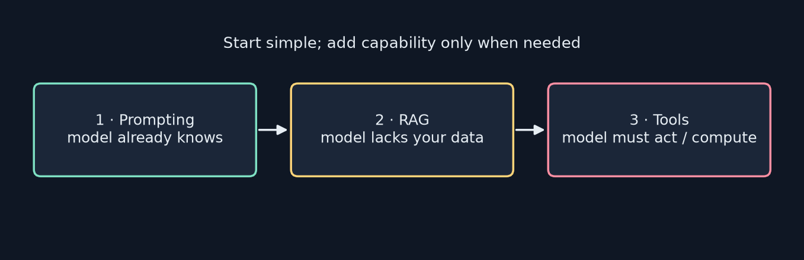
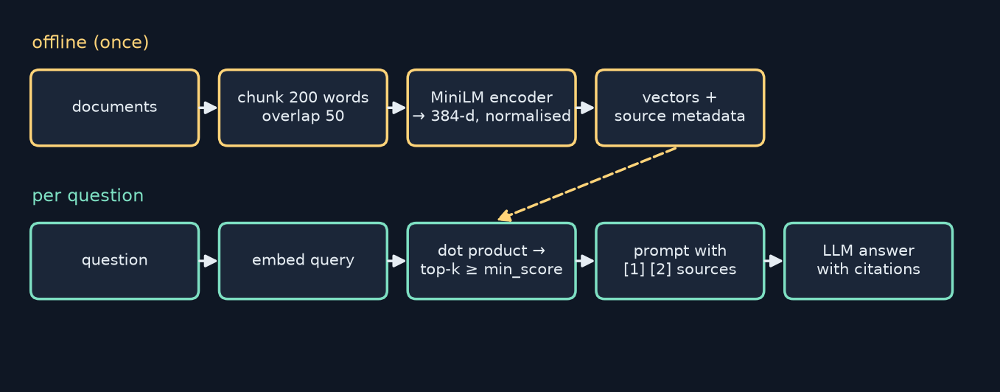
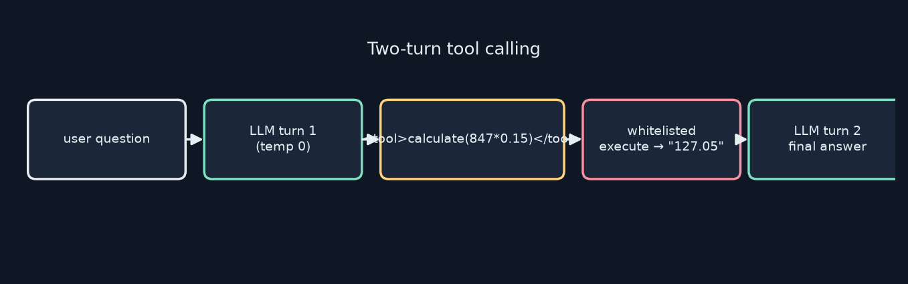

<!-- _class: lead -->
<!-- _paginate: false -->
# Build Your First LLM
## Chapter 15 — Building Applications
A study companion to *Build Your First LLM* by Hasan Degismez
**Waqar Shaikh Builds**

<!-- say: Welcome to chapter fifteen of my study series on Build Your First LLM by Hasan Degismez. We stop training and start building: a chat loop with memory, a retrieval augmented generation system with citations, a first look at tool calling, and simple automatic evaluation. I ran the whole pipeline against a real Llama 3.2 3B on my own machine, and I also found that the calculator tool's sandbox isn't a sandbox at all. -->

---

# Where we are

- **Ch 13–14:** change the weights, or change the prompt
- **Ch 15 (today):** wrap a model in an **application**: memory, documents, tools
- **Ch 16–17:** make it production-ready, then deploy it
- Notebook: **FirstLLM/code → notebooks/ch15.ipynb** (Ollama + sentence-transformers)

<!-- say: We've changed weights and we've changed prompts. Today we build an application around the model: memory, documents and tools. Then chapters sixteen and seventeen make it production ready and deploy it. The notebook uses Ollama and sentence transformers. -->

---

# Chapter 15 roadmap

1. From model trainer to application builder
2. Three patterns: prompting, RAG, tools
3. A chat loop with a context budget
4. RAG step by step: embeddings → chunks → retrieval → citations
5. Tool calling, and why the sandbox matters
6. Evaluating the app: **my real Llama 3.2 run**
7. Production tips and debugging

<!-- say: The plan. The mindset shift. The three application patterns. A chat loop. RAG, step by step. Tool calling and its safety. Evaluation with my real model run. And production tips. -->

---

# Key terms for this chapter

| Term | One-line meaning |
|---|---|
| **RAG** | Retrieve relevant text, put it in the prompt, then generate |
| **Sentence embedding** | One vector for a whole passage |
| **Chunking** | Splitting documents into retrievable pieces |
| **Context window** | Max tokens the model can see at once |
| **Tool calling** | Model asks *your code* to run a function |
| **Citation** | A marker like [1] tying a claim to a source |

<!-- say: Key terms. RAG means retrieve, then generate. A sentence embedding is one vector for a whole passage. Chunking splits documents. The context window is how much the model can see. Tool calling lets the model ask your code to run a function. And a citation ties a claim to its source. -->

---

<!-- _class: lead -->
# Part 1
## From trainer to builder

<!-- say: Part one. A change of role. -->

---

# Your training skills transfer

| Training (Ch 7–12) | Application (Ch 15) |
|---|---|
| Token embeddings | Sentence embeddings for retrieval |
| Chunking training data | Chunking documents; fitting the context |
| Data quality checks | Input/output validation |
| Seeds and logging | Debugging and observability |
| Loss metrics | Evaluation heuristics |

- Cosine similarity and embeddings: **Ch 9** (the book says Ch 6)

<!-- say: Nearly every training skill has an application twin. Token embeddings become sentence embeddings. Chunking data becomes chunking documents. Data quality becomes validation. Seeds and logs become debugging. Loss becomes evaluation. One correction: the book says embeddings and cosine similarity were chapter six. They were chapter nine. -->

---

# Three application patterns



<!-- say: Three patterns, each adding capability and complexity. Pure prompting uses only what the model knows. RAG adds documents it has never seen. Tools let it fetch live data or take actions. -->

---

# Choosing a pattern

1. **Prompt first**: can better wording do it?
2. **Add RAG** when knowledge is missing (private, recent, specific)
3. **Add tools** when it must *do* something or compute exactly
- This chapter: RAG in depth, tools as a preview

<!-- say: Start simple. Prompt first. Add retrieval when the model lacks knowledge. Add tools when it needs to act or calculate exactly. This chapter goes deep on RAG and previews tools. -->

---

<!-- _class: lead -->
# Part 2
## A chat loop with memory

<!-- say: Part two. The chat loop. -->

---

# The basic loop

```python
history = []
while True:
    user_input = input("You: ")
    if user_input.lower() == 'quit': break
    history.append({"role": "user", "content": user_input})
    reply = chat_with_history(history, system="You are a helpful assistant.")
    history.append({"role": "assistant", "content": reply})
```
<small>Code: FirstLLM/code (MIT License)</small>

- Memory = **resending the whole history** every turn. It grows forever

<!-- say: A chat loop. Read input, append it to history, send the whole history, append the reply. The model has no memory of its own; memory is just resending the conversation every turn. Which means the history grows forever. -->

---

# The context window

- Every model has a token limit for prompt **+** reply
- Llama 3.2 3B: **131,072 tokens** (book: "about 8,192")
- Ollama's *runtime* default is far smaller (my server ran `-c 4096`) → set `num_ctx`
- Long contexts also cost time and can **dilute** attention

<!-- say: Every model has a context window covering prompt plus reply. The book says Llama 3.2's is about eight thousand. The model actually supports a hundred and thirty one thousand. But Ollama runs it with a much smaller window by default; on my machine the server ran with four thousand ninety six. So the practical limit is whatever you configure, using num ctx. -->

---

# ChatSession: trim old turns

```python
def trim_history_if_needed(self):
    while len(self.history) > self.max_history:      # count messages
        self.history.pop(0)                          # drop oldest
        if self.history and self.history[0]["role"] == "assistant":
            self.history.pop(0)                      # keep pairs aligned
```
<small>Code: FirstLLM/code (MIT License)</small>

- Simple: counts **messages**, not tokens · **80% rule**: leave room for the reply

<!-- say: The ChatSession class keeps at most twenty messages, dropping the oldest and keeping user and assistant turns paired. It counts messages, not tokens, which is simple but rough. And leave about twenty percent of the window for the reply. -->

---

# Logging, and a missing method

```python
logger.info(f"[{request_id}] History tokens: {self.count_history_tokens()}")
...
response_tokens = self.count_tokens(assistant_message)
```

- Neither `count_history_tokens` nor `count_tokens` exists → **AttributeError**
- Fix: `len(tokenizer.encode(text))`, or Ollama's `prompt_eval_count` / `eval_count`

<!-- say: The logging version calls count history tokens and count tokens, but neither method exists anywhere, so it crashes. Use a tokenizer, or read Ollama's prompt eval count and eval count from the response, which are the real token numbers. -->

---

<!-- _class: lead -->
# Part 3
## RAG: retrieval-augmented generation

<!-- say: Part three. The heart of the chapter. -->

---

# The problem RAG solves

- Training data is **frozen**: no news, no private docs
- Context is **finite**: you can't paste the whole handbook
- RAG = an **open-book exam**: look up the right pages, then answer
- Retriever = librarian · LLM = the reader

<!-- say: Models have frozen training data and finite context. RAG turns the test into an open book exam: a retriever finds the right pages, like a librarian, and the model reads them and answers. -->

---

# RAG by hand

```python
prompt = f"""Use the following information to answer the question.
Information:
{vacation_policy}
Question: How many vacation days do I get?
Answer:"""
```

- That's all RAG is. The hard part: **finding the right text automatically**

<!-- say: Here's RAG done by hand: paste the policy into the prompt, then ask. That's the whole idea. The engineering is in finding the right text automatically. -->

---

# Sentence embeddings

```python
encoder = SentenceTransformer('all-MiniLM-L6-v2')
doc   = encoder.encode("Employees receive 15 days of paid vacation.")
query = encoder.encode("How many vacation days do I get?")
doc.shape   # (384,)
```

- One **384-d** vector per passage, trained for *meaning similarity*
- My check: cosine = **0.657** (book: ~0.65) ✔

<!-- say: A sentence embedding model turns a whole passage into one vector, here three hundred and eighty four numbers, trained so that passages with similar meaning land close together. I ran the book's example: the cosine similarity is point six five seven, matching the book. -->

---

# Why not GPT-2's embeddings?

- Token embeddings learn **"what comes next?"**
- Sentence encoders learn **"do these mean the same?"**
- Different objective → different geometry
- Use a purpose-built encoder for retrieval

<!-- say: Why not reuse our own embeddings? Token embeddings are trained for predicting the next word. Sentence encoders are trained for matching meaning. Different objectives give different geometry, so use a purpose built encoder for retrieval. -->

---

# Chunking with overlap

```python
def chunk_text(text, chunk_size=200, overlap=50):
    words = text.split()
    return [" ".join(words[i:i+chunk_size])
            for i in range(0, len(words), chunk_size - overlap)]
```
<small>Code: FirstLLM/code (MIT License), condensed</small>

- Overlap keeps facts that **straddle a boundary**
- Too small: no context · too big: fuzzy matches · sweet spot ~200–500 words

<!-- say: Chunking splits text into windows of two hundred words that overlap by fifty, so a fact sitting on a boundary appears whole in at least one chunk. Too small and chunks lack context; too big and retrieval gets fuzzy. Two hundred to five hundred words is a good start. -->

---

# The RAG pipeline



<!-- say: The full pipeline. Offline, chunk and embed your documents. Online, embed the question, find the most similar chunks, build a prompt with numbered sources, and let the model answer with citations. -->

---

# Retrieval = a dot product

```python
self.embeddings = self.encoder.encode(self.documents, normalize_embeddings=True)
...
q = self.encoder.encode(query, normalize_embeddings=True)
sims = np.dot(self.embeddings, q)              # cosine, since all are unit length
top = np.argsort(sims)[-top_k:][::-1]
results = [... for i in top if sims[i] >= min_score]
```
<small>Code: FirstLLM/code (MIT License), condensed</small>

- Normalised vectors → dot product **is** cosine similarity

<!-- say: Retrieval is one matrix product. Normalise every vector to length one, and the dot product equals cosine similarity. Sort, take the top k, and drop anything below a minimum score. -->

---

# Prompting with citations

```text
Use the following sources to answer the question.
Cite sources using [1], [2], etc. Only use information from the provided sources.
If the sources don't contain the answer, say so.
Sources:
[1] (Source: vacation_policy.txt) Employees receive 15 days ...
Question: How many vacation days do I get?
Answer:
```

- Numbered sources · "only use" · permission to say **"not found"**

<!-- say: The prompt numbers each source and names it, tells the model to cite by number, to use only these sources, and gives it permission to say the answer isn't there. That last line is what keeps hallucination down. -->

---

# Notebook knowledge base

| File | Key facts |
|---|---|
| vacation_policy.txt | 15 days · carry over ≤ 5 · 2 weeks' notice · after 90-day probation |
| expense_policy.txt | 30 days to submit · receipt > $50 · meals $75/day · approval > $500 |
| remote_work_policy.txt | ≤ 3 days/week · core hours 10–3 · equipment ≤ $500 |

- Each document is one chunk (< 200 words) → **3 chunks**

<!-- say: The notebook's knowledge base is three short policies: vacation, expenses and remote work. Each is under two hundred words, so each becomes one chunk. -->

---

# My RAG run: retrieval + answers

| Question | Retrieved (cosine) | Llama 3.2 3B answer |
|---|---|---|
| How many vacation days do employees get? | vacation 0.791, remote 0.360 | "According to source [1], Employees receive 15 days…" ✔ |
| Can I work from home? | remote 0.420 | "…yes… up to 3 days per week with manager approval. [1]" ✔ |
| How many vacation days can I carry over? | vacation 0.668 | "…up to 5 unused vacation days" ✔ (no [n]) |
| What is the meaning of life? | **nothing ≥ 0.3** | an essay on Aristotle… with a **fake "[1]"** ✗ |

<!-- say: My real run. Retrieval works well on in-scope questions: the vacation policy scores point seven nine, the remote work policy point four two, and the answers are correct and mostly cited. The interesting failure is the out of scope question, the meaning of life. Nothing passed the minimum score, so the book's fallback prompt was sent, which offers to answer from general knowledge. The model did exactly that, wrote about Aristotle, and cited a source one that doesn't exist. -->

---

# My RAG run: the book's evaluation

| Case | Traits passed | Why |
|---|---|---|
| Vacation days | **3 / 3** | keywords, [1], not a refusal |
| Expense process | **2 / 3** | correct bullet list, but no [n] marker |
| Meaning of life (should refuse) | **0 / 2** | answered + invented a citation |
| **Total** | **5 / 8 (62.5%)** | |

- Fix: when retrieval is empty, **don't call the model**: return a fixed "not in my documents" reply

<!-- say: Scoring with the book's evaluation set gives five out of eight traits. The vacation case passes everything. The expense case is correct but forgot the citation marker. The out of scope case fails both checks: it didn't refuse, and it cited a source that wasn't there. The fix is simple: if retrieval comes back empty, don't call the model at all. Return a fixed reply saying it isn't in your documents. -->

---

<!-- _class: lead -->
# Part 4
## Tool calling

<!-- say: Part four. Tools. -->

---

# How tool calling works



- Model writes `<tool>calculate(847 * 0.15)</tool>` → **your code** runs it → result goes back

<!-- say: Tool calling is a two turn dance. You describe the tools. The model writes a tool request in an agreed format. Your code parses it, runs the function, and sends the result back so the model can write the final answer. The model never runs anything itself. -->

---

# The book's tools

```python
TOOLS = {
  "calculate": {"description": "Perform basic arithmetic...",
                "function": lambda expr: str(eval(expr, {"__builtins__": {}}, {}))},
  "get_date":  {"description": "Get the current date.",
                "function": lambda: datetime.now().strftime("%Y-%m-%d")}}
def parse_tool_call(response):
    m = re.search(r'<tool>(\w+)\((.*?)\)</tool>', response, re.DOTALL)
    return (m.group(1), m.group(2).strip()) if m else (None, None)
```
<small>Code: FirstLLM/code (MIT License), condensed</small>

<!-- say: Two tools: a calculator built on eval with empty builtins, and a date tool. A regular expression pulls out the tool name and argument. -->

---

# ⚠ Empty `__builtins__` is not a sandbox

- The book says it "prevents arbitrary code execution". **It doesn't**
- Python objects still reach every class via `().__class__.__base__.__subclasses__()`
- My test: one "expression" reached the **`os` module** and printed the working directory
- Fix: parse with `ast` and allow only numbers + `+ − × ÷`, or use `simpleeval`

<!-- say: Important. The book says eval with empty builtins prevents arbitrary code execution. It doesn't. From any Python object you can walk to every loaded class. In my test, a single calculator expression reached the os module and printed the working directory, which means it could run anything. The book does mention simpleeval for production, but treat this code as unsafe. Parse with the ast module and allow only numbers and arithmetic. -->

---

# My tool-calling run

| Question (T = 0) | Model's first reply | Tool run? |
|---|---|---|
| What is 15% of 847? | "calculate 15% of 847" | ✗ no `<tool>` tags |
| What's today's date? | `<get_date> </get_date>` | ✗ wrong format |
| Capital of France? | "I don't have a specific tool… Paris." | — (correctly none) |

- 3B model + a made-up text format = **0 / 2** tool calls. Use native tool calling (Ollama `tools=`), few-shot the format, or a bigger model

<!-- say: Tool calling, on my real run. For fifteen percent of eight four seven, the model just wrote calculate fifteen percent of eight four seven, with no tool tags, so nothing ran. For the date, it invented its own tag format. Only the capital of France went well: it correctly used no tool. So zero out of two tool calls. A three billion parameter model doesn't reliably follow an invented text format. Use the runtime's native tool calling, show the format with an example, or use a bigger model. -->

---

# Tool safety rules

1. **Whitelist** tool names. Never call arbitrary functions
2. **Validate arguments** (and never `eval` user-influenced text)
3. Start **read-only**; add write tools with confirmation
4. **Log** every call for audit
- Tools that email, delete, or spend money = a **security boundary**

<!-- say: Tool safety. Whitelist names. Validate arguments and never eval anything a user can influence. Start with read only tools and add write tools only with confirmation. Log every call. A tool that can send email, delete files or spend money is a security boundary. -->

---

<!-- _class: lead -->
# Part 5
## Testing and production tips

<!-- say: Part five. Testing and production. -->

---

# Trait-based evaluation

- LLM text varies → test **traits**, not exact strings
- Keywords present? Cites [n]? Refuses when out of scope? Long enough?
- `evaluate_response()` returns pass/fail per trait
- Refusal detection = a phrase list: **"I couldn't find…" isn't on it**

<!-- say: LLM answers vary, so test traits. Does it contain the key words, cite a source, refuse when it should, and say enough? The checker uses a phrase list for refusals, which misses natural wordings like I couldn't find. -->

---

# Temperature per task

| Task | T |
|---|---|
| RAG / factual Q&A | ~0.2–0.3 |
| Tool calling | 0 (reliable parsing) |
| Creative writing | ~0.8 |

- The book shows this with `client.chat.completions.create(model="gpt-3.5-turbo")`: no such client in this chapter. With Ollama: `chat(prompt, temperature=0.2)`

<!-- say: Temperature by task. Low for RAG, zero for tool calls, higher for creative work. The book's snippet here uses an OpenAI client with GPT three point five that the chapter never sets up; with Ollama you just pass temperature to chat. -->

---

# Streaming and caching

- **Streaming**: show tokens as they arrive. Feels faster at the same total time
  - Ollama: `"stream": True`, read JSON lines
- **Cache embeddings**: key = hash of text, store the vector once
- Re-embed only what changed

<!-- say: Two production tips. Stream tokens as they arrive; users feel it's faster even when it isn't. And cache embeddings keyed by a hash of the text, so you only embed what changed. -->

---

# Debugging checklist

| Layer | Ask |
|---|---|
| Input | What exactly went to the model? Token count? |
| Retrieval | Right chunks? Scores vs `min_score`? Docs current? |
| Generation | Temperature? Prompt clear? Possible at all? |
| Repro | Saved the exact input? Seeds? What changed? |

<!-- say: When it misbehaves, go layer by layer. Input: what exactly was sent. Retrieval: which chunks, what scores. Generation: temperature and prompt. And reproducibility: can you replay the exact input? -->

---

# Notebook run summary

| Cell | Result |
|---|---|
| Chat memory | "What did I just ask you?" → "You just asked me what 2+2 is." ✔ |
| Retrieval | 1 chunk passes `min_score` per query (0.712 vacation, 0.546 expenses) |
| RAG answers | "According to source [1], employees receive 15 days…" ✔ |
| Tools | Llama 3.2 3B **ignored** `<tool>…</tool>`: "calculate 15% of 847" → no tool ran |
| Eval / work-from-home | 2 calls **timed out** (helper's 120 s limit, busy CPU) |
| Streaming | ✔ token by token |

<!-- say: My notebook run. Memory works: asked what it just asked, the model answered correctly. Retrieval passes one chunk per question, with scores of point seven one and point five five. The RAG answers cite source one. Tool calling did not work: the three billion parameter model ignored the tool format and replied with plain text, so no tool ran. Two calls timed out at the helper's two minute limit because my CPU was busy, so I reran those in my own script. Streaming worked. -->

---

# Key takeaways

- An app = model + **memory** + **knowledge** + **actions** + **checks**
- RAG: chunk → embed → retrieve → cite. Retrieval quality is everything
- Tools: your code runs them, so **you** own the safety
- Evaluate traits automatically, then read the answers
- Check context limits in your **runtime**, not just the model card

<!-- say: Takeaways. An application is a model plus memory, knowledge, actions and checks. RAG is chunk, embed, retrieve, cite, and retrieval quality decides everything. Your code runs the tools, so you own their safety. Evaluate traits automatically and read the answers too. And check the context limit your runtime actually uses. -->

---

# Review questions: short answers

1. **RAG vs prompting:** adds facts the model never saw
2. **Token vs sentence embeddings:** per-token inside the model vs one vector per passage for retrieval
3. **Chunking:** fits context and sharpens matches. Too small = no context, too big = fuzzy
4. **Irrelevant retrieval:** `min_score` + "say so if not in sources"
5. **Whitelisting:** stops calls to arbitrary code, e.g. `delete_file`

<!-- say: Short answers. RAG adds facts the model never saw. Token embeddings live inside the model; sentence embeddings represent whole passages for retrieval. Chunking keeps things focused. A minimum score plus permission to say not found handles bad retrieval. And whitelisting stops the model calling functions you never meant to expose. -->

---

# Review 6–7 + checkpoint

- **Accuracy:** an eval set with expected traits + reading samples
- **Log:** request id, prompt length, retrieved sources + scores, tokens, latency, errors
- **Checkpoint:** 5–10 files → `SimpleRAG` → chat loop with history + citations → 10-question eval → % cited, % correct

<!-- say: Evaluate accuracy with an eval set and by reading samples. Log request ids, lengths, which sources were retrieved with their scores, tokens, latency and errors. The checkpoint is a personal knowledge assistant over your own files, with a ten question evaluation. -->

---

# Practice this

- Add 2 questions the docs can't answer. Does your app say so?
- Replace the `eval` calculator with an `ast`-based one; retry my escape
- Log `prompt_eval_count` from Ollama instead of counting messages

<!-- say: Practice. Add questions your documents can't answer and check the app admits it. Replace the eval calculator with an ast based one and confirm the escape no longer works. And log real token counts from Ollama. -->

---

# Credits

Based on ***Build Your First LLM*** by **Hasan Degismez** — buy the book: **leanpub.com/FirstLLM/**
Code: **github.com/FirstLLM/code** (MIT License) · notebook ch15.ipynb
Slides, narration, diagrams and Llama runs: my own study materials · **Waqar Shaikh Builds**

<!-- say: This video is based on Build Your First LLM by Hasan Degismez. The explanations and diagrams are my own, but the book goes deeper, so please support the author and buy it at leanpub dot com slash First LLM. The code is on GitHub at First LLM slash code, under the MIT licence. Thanks for watching, and see you in chapter sixteen. -->
