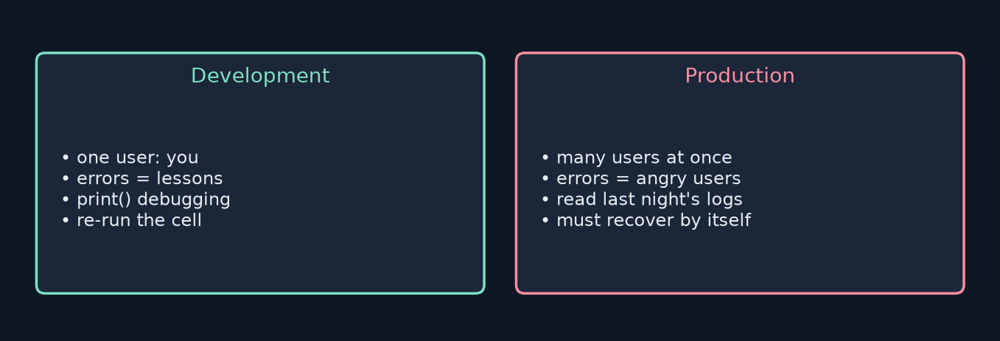
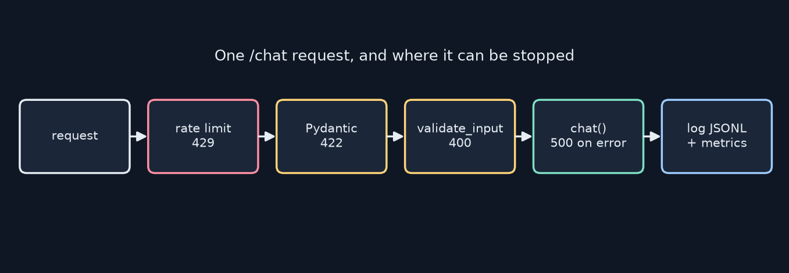
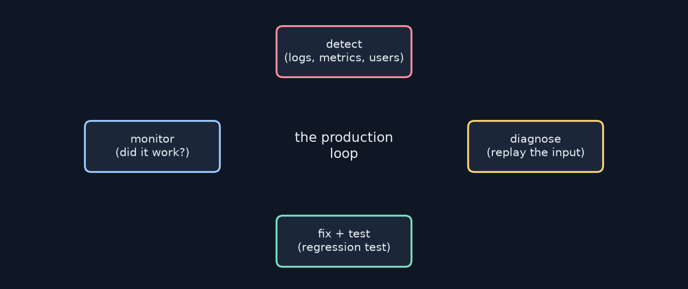

<!-- _class: lead -->
<!-- _paginate: false -->
# Build Your First LLM
## Chapter 16 — Preparing for Production
A study companion to *Build Your First LLM* by Hasan Degismez
**Waqar Shaikh Builds**

<!-- say: Welcome to chapter sixteen of my study series on Build Your First LLM by Hasan Degismez. Today we turn a working notebook into software other people can use: a versioned config, a FastAPI service, JSON lines logging, metrics, input validation, rate limiting and tests. I ran the notebook, and then I ran the book's complete app against a real local Llama 3.2 through Ollama, with all four of the book's tests plus two of my own. One of mine found a false positive in the injection filter. -->

---

# Where we are

- **Ch 15:** a RAG app with citations that works on *your* laptop
- **Ch 16 (today):** make it reliable for other people
- **Ch 17:** put it on a cloud GPU
- Notebook: **FirstLLM/code → notebooks/ch16.ipynb** (uses a mock `chat`, so no LLM is needed)

<!-- say: Chapter fifteen gave us an app that works when we're watching. Today we make it reliable for other people, and next chapter we deploy it. The chapter sixteen notebook uses a mock chat function, so it runs without any model. -->

---

# Chapter 16 roadmap

1. What changes in production
2. Packaging: config + semantic versions
3. Serving: FastAPI, Pydantic, `/health`
4. Keeping it running: JSONL logs, metrics, latency
5. Safety: input validation, rate limiting
6. Testing with pytest + TestClient
7. The complete `app.py`: **my real-LLM test run**
8. Review and checkpoint

<!-- say: The plan. What changes in production. Packaging. Serving with FastAPI. Logs and metrics. Validation and rate limits. Testing. Then the complete app, which I ran against a real model. Then review. -->

---

# Key terms for this chapter

| Term | One-line meaning |
|---|---|
| **Production** | Code running for real users, without you watching |
| **Endpoint** | A URL + method your service answers, e.g. `POST /chat` |
| **Health check** | An endpoint that says "I'm alive (and my dependencies are)" |
| **Rate limiting** | Capping requests per client per time window |
| **Graceful degradation** | Failing in a controlled, helpful way |
| **JSONL log** | One JSON object per line, append-only |

<!-- say: Key terms. Production is code running for real users without you watching. An endpoint is a URL and method. A health check reports whether you're alive. Rate limiting caps requests per client. Graceful degradation means failing helpfully. And JSON lines logs are one object per line. -->

---

<!-- _class: divider -->
# Part 1
## What changes in production

<!-- say: Part one. A different world. -->

---

# Two different worlds



<!-- say: In development you are the only user, errors are lessons, you debug with print and you can rerun a cell. In production many people use it at once, errors mean frustrated users, you debug by reading last night's logs, and the system has to recover on its own. -->

---

# What goes wrong (it will)

- A 10,000-character prompt → crash
- A viral link → 100 users at once
- "Ignore your instructions…" → it complies
- Fails at night, and `print()` left no trace
- A bug fix breaks something else, because there were no tests

> **Fail gracefully:** don't crash · tell the user something useful · log it · keep serving others

<!-- say: The book lists the classic failures. A huge prompt, a sudden crowd, a prompt injection, a failure at night with no logs, and a fix that breaks something else. The principle: fail gracefully. Don't crash, tell the user something useful, log it and keep serving everyone else. -->

---

<!-- _class: divider -->
# Part 2
## Packaging

<!-- say: Part two. What exactly are we shipping? -->

---

# Save the config, with a version

```python
config = {"model_name": model_name, "version": version,
          "system_prompt": system_prompt,
          "ollama_model": "llama3.2:3b",
          "created_at": datetime.now().isoformat()}
config_path = output_dir / f"config_v{version}.json"
```

- For an Ollama app the "model" is **model tag + system prompt + settings**
- My run wrote `models/config_v1.0.0.json` as shown

<sub>Code: FirstLLM/code (MIT License), condensed</sub>

<!-- say: For an Ollama based app, the model is really the model tag plus your system prompt and settings. The book saves them as a versioned JSON file with a timestamp. My run wrote config version one point zero point zero exactly as printed. -->

---

# Semantic versioning + a changelog

| Change | Example | Bump |
|---|---|---|
| Bug fix, same behaviour | fix a typo in the prompt | 1.0.0 → 1.0.**1** |
| New, backward-compatible | add `/metrics` | 1.0.0 → 1.**1**.0 |
| Behaviour changes | new model or system prompt | 1.0.0 → **2**.0.0 |

- A prompt change *is* a behaviour change. Version it like code

<!-- say: Use semantic versioning. A bug fix bumps the patch number, a compatible feature the minor number, and a behaviour change the major number. My opinion: changing the system prompt or the model is a behaviour change, so version it like code and keep a changelog. -->

---

# Why Ollama models fit on a laptop

- **Quantization:** 16/32-bit floats → 8- or 4-bit integers
- My `llama3.2` (3.2B params) GGUF is **Q4_K_M ≈ 2.0 GB** vs ~6.4 GB in fp16
- Small quality loss, a big memory win

<!-- say: Why does a three billion parameter model fit on a laptop? Quantization. The copy I use is a four bit build of about two gigabytes, against about six point four in sixteen bit. You lose a little quality and gain a lot of memory. -->

---

<!-- _class: divider -->
# Part 3
## Serving behind an API

<!-- say: Part three. Making it reachable over HTTP. -->

---

# HTTP in one slide

- **Endpoint** + **method**: `GET /health` (read) · `POST /chat` (send data)
- Request → server work → response with a **status code**

| Code | Meaning |
|---|---|
| 200 | OK |
| 400 | Bad request (our own validation) |
| 422 | Failed the Pydantic schema |
| 429 | Too many requests |
| 500 | Our server broke |

<!-- say: HTTP in one slide. An endpoint plus a method. Get reads, post sends data. Every response has a status code: two hundred OK, four hundred bad request, four twenty two failed the schema, four twenty nine too many requests, and five hundred means we broke. -->

---

# A minimal FastAPI service

```python
class ChatRequest(BaseModel):
    message: str
    @field_validator('message')
    @classmethod
    def message_not_empty(cls, v):
        if not v.strip(): raise ValueError('Message cannot be empty')
        return v

@app.post("/chat", response_model=ChatResponse)
def chat_endpoint(request: ChatRequest):
    start = time.time()
    response = chat(request.message)
    return ChatResponse(response=response,
                        latency_ms=round((time.time()-start)*1000, 2))
```

<sub>Code: FirstLLM/code (MIT License), condensed</sub>

<!-- say: Here's the minimal service. A Pydantic request model with a validator that rejects empty messages, a response model, and a chat endpoint that times the call. FastAPI validates both directions automatically and generates docs at slash docs. -->

---

# The health check

```python
@app.get("/health")
def health_check():
    try:
        chat("Say OK"); ollama_status = "healthy"
    except Exception:
        ollama_status = "unhealthy"
    return {"status": "healthy" if ollama_status == "healthy" else "degraded",
            "ollama": ollama_status, "version": "1.0.0"}
```

- My caution: this runs a **full generation per probe**. Monitors poll often
- Better: ping Ollama's `/api/tags` (cheap), cache the result for 30 s

<sub>Code: FirstLLM/code (MIT License)</sub>

<!-- say: A good health check also checks its dependencies. The book's version calls the model with "say OK". My caution: that's a full generation every time a monitor polls, which can be every few seconds. On my CPU one generation took over twenty seconds. Cheaper: ask Ollama for its model list, and cache the result briefly. -->

---

# Running and calling it

```bash
uvicorn app:app --reload --host 0.0.0.0 --port 8000
curl http://localhost:8000/health
curl -X POST http://localhost:8000/chat \
     -H "Content-Type: application/json" -d '{"message": "What is Python?"}'
```

- Or `requests.post(..., json={...})` · or the Swagger UI at `/docs`

<sub>Code: FirstLLM/code (MIT License)</sub>

<!-- say: Run it with uvicorn, then call it with curl, with Python requests, or from the interactive docs page. -->

---

# The request path



<!-- say: Here's my redrawing of the request path. Each stage can stop a bad request with its own status code: the rate limiter with four twenty nine, Pydantic with four twenty two, our validator with four hundred, and a failed generation with five hundred. Everything is logged at the end. -->

---

<!-- _class: divider -->
# Part 4
## Keeping it running

<!-- say: Part four. Knowing what it's doing. -->

---

# Structured JSONL logs

```python
entry = {"timestamp": datetime.now().isoformat(),
         "prompt_length": prompt_length, "response_length": response_length,
         "latency_ms": round(latency_ms, 2), "success": success}
if error: entry["error"] = error
with open(LOG_FILE, "a") as f:
    f.write(json.dumps(entry) + "\n")
```

- Log **metadata, not content** (privacy, GDPR/CCPA)
- One of my real log lines: `{"prompt_length": 28, "response_length": 4, "latency_ms": 26260.41, "success": true}`

<sub>Code: FirstLLM/code (MIT License)</sub>

<!-- say: Logs are a flight recorder. The book logs metadata only: lengths, latency, success and errors, never the prompt itself, for privacy. Here's a real line from my run: a twenty eight character prompt, a four character answer, twenty six seconds of latency on a busy CPU. -->

---

# Simple in-memory metrics

- `requests`, `errors`, `latency_sum` → `/metrics` gives average latency
- Resets on restart, and is **per process**
- Real dashboards add rate, error %, **P50/P99 latency**, active users
- Averages hide pain: one 30 s request in a hundred barely moves the mean

<!-- say: For metrics, a dictionary is enough to start: requests, errors and latency, exposed at slash metrics. It resets on restart and counts per process. Real dashboards add percentiles, because averages hide pain. One thirty second request in a hundred barely moves the mean, but P ninety nine shows it. -->

---

# Why LLMs are slow (and that's OK)

- Each new token = one forward pass → 100 tokens = 100 passes
- Book's guide: 1–3 s on GPU, 5–15 s on CPU
- My contended 8-core box: **~26 s** for a short reply
- So: timeouts ≥ 30 s · progress indicators · streaming

<!-- say: LLMs generate one token per forward pass, so a hundred tokens means a hundred passes. The book estimates five to fifteen seconds on a CPU. On my busy eight core box a short reply took twenty six seconds. So set generous timeouts, show progress, and stream when you can. -->

---

<!-- _class: divider -->
# Part 5
## Safety and guardrails

<!-- say: Part five. Expect bad input. -->

---

# Input validation

```python
MAX_PROMPT_LENGTH = 4000   # characters
SUSPICIOUS_PATTERNS = [
    r"ignore (?:all )?(?:previous )?instructions",
    r"you are now", r"act as (?:if )?you", r"pretend (?:to be|you)",
    r"disregard (?:all )?(?:prior )?"]
```

- Generic error back to the user. Log the attempt
- The book's comment says "tokens, roughly", but the check uses `len(text)` → **characters**

<sub>Code: FirstLLM/code (MIT License), condensed</sub>

<!-- say: The validator rejects long inputs and a few injection phrases with regular expressions, returns a generic error and logs the attempt. One small inconsistency: the comment says the limit is in tokens, roughly, but the code compares string length, so it's characters. -->

---

# My test: the filter blocks innocent input

- The complete `app.py` shortens the list to `r"act as"`, with no word boundary
- I sent: **"In fact as a beginner, how do I learn Python?"** → **400 Invalid input**
- "f**act as**" matches. So would "cont**act as** soon as possible"
- Fix: word boundaries, `r"\bact as\b"`, and accept that keyword filters are weak

<!-- say: Here's what my own test found. The complete app shortens one pattern to just "act as", with no word boundaries. I sent: in fact as a beginner, how do I learn Python? It was rejected with four hundred, because the letters "act as" appear inside "fact as". Contact as soon as possible would be blocked too. Add word boundaries, and remember keyword filters only stop casual attacks. -->

---

# Rate limiting

```python
request_counts[client_ip] = [t for t in request_counts[client_ip]
                             if now - t < RATE_WINDOW]
if len(request_counts[client_ip]) >= RATE_LIMIT:
    raise HTTPException(429, "Too many requests. Please wait.")
request_counts[client_ip].append(now)
```

- My test: 21 quick requests → the last ones got **429** ✓
- Caveats: per-process memory; behind a proxy, `request.client.host` may be **the proxy's IP**, so everyone shares one limit

<sub>Code: FirstLLM/code (MIT License)</sub>

<!-- say: The rate limiter keeps a list of recent timestamps per IP and returns four twenty nine past twenty a minute. My test confirmed it. Two caveats. It lives in one process's memory. And behind a proxy or a cloud platform, the client host may be the proxy's address, so every user shares one limit unless you read the forwarded header carefully. -->

---

<!-- _class: divider -->
# Part 6
## Testing before you ship

<!-- say: Part six. Insurance. -->

---

# pytest + TestClient

```python
client = TestClient(app)
def test_chat_with_empty_input():
    assert client.post("/chat", json={"message": ""}).status_code == 422
def test_chat_with_long_input():
    r = client.post("/chat", json={"message": "x" * 10000})
    assert r.status_code == 400 and "too long" in r.json()["detail"].lower()
```

- Happy path · error paths · edge cases (unicode, newlines) · rate limit · LLM down

<sub>Code: FirstLLM/code (MIT License)</sub>

<!-- say: FastAPI's test client calls your app in process, no server needed. Test the happy path, but also the error paths: empty input gets four twenty two, long input gets four hundred. Add unicode, the rate limit and what happens when the model is down. -->

---

# My results

| Test | Notebook (mock) | Book `app.py` + real Llama 3.2 |
|---|---|---|
| health | ✓ | ✓ |
| valid chat | ✓ | ✓ (26 s) |
| empty → 422 | ✓ | ✓ |
| long → 400 | not in notebook | ✓ |
| *mine:* 21 requests → 429 | | ✓ |
| *mine:* "In fact as…" allowed | | **✗ (400)** |

<!-- say: My results. The notebook's three mock tests all pass. Against the real model, the book's four tests pass, including the long input test, which the notebook leaves out. My rate limit test passes. My false positive test fails, which is exactly what tests are for. -->

---

# Canary deployments (concept)

- Ship v2 to ~5% of traffic first · watch errors and latency · then ramp up
- Roll back fast if the canaries look sick
- The book says Ch 17 builds the infrastructure for this. It doesn't: Modal's `deploy` is a rolling update, not a canary

<!-- say: Canary deployments send a new version to a small slice of traffic first, then ramp up or roll back. The book says chapter seventeen builds the infrastructure for this, but chapter seventeen only uses Modal's rolling deploy. There's no canary step. -->

---

# Timeouts and fallbacks

- `requests.post(..., timeout=60)` inside `chat()`: never wait forever
- On timeout → **503** + "busy, try again" (not a stack trace)
- Optional fallback: a smaller model, or a cached answer
- Keep the error message generic. Put details in the log

<!-- say: Graceful degradation in practice. Give every model call a timeout, so a stuck generation can't hold a worker forever. On timeout return a five oh three with a friendly message, not a stack trace. Optionally fall back to a smaller model or a cached answer. Keep the user message generic and put the details in the log. -->

---

# Config from the environment (my addition)

```python
import os
MODEL = os.getenv("OLLAMA_MODEL", "llama3.2")
RATE_LIMIT = int(os.getenv("RATE_LIMIT", "20"))
API_KEY = os.getenv("API_KEY")   # never in git
```

- Ch 16 doesn't cover env vars or API keys, but Ch 17 refers back to "Ch 16's pattern"
- Same code in dev, test and prod. Only the environment changes

<!-- say: One thing I'd add. Read settings like the model name, rate limit and any API key from environment variables, never from code in git. The book's chapter seventeen refers back to chapter sixteen's environment variable and API key pattern, but chapter sixteen doesn't actually cover it, so here it is. -->

---

<!-- _class: divider -->
# Part 7
## Putting it together

<!-- say: Part seven. The complete app. -->

---

# The complete `app.py`, in one picture

- Config constants → JSONL logger → rate limiter → validator
- Pydantic models → `/health`, `/metrics`, `/chat`
- `/chat`: rate limit → validate → time `chat()` → log + metrics → 200 / 400 / 429 / 500



<!-- say: The complete app puts it all together: config, logger, rate limiter, validator, models and three endpoints. Chat goes rate limit, validate, call the model, then log and count. And around it all sits the production loop: detect, diagnose, fix with a regression test, and monitor. -->

---

# Small fixes I'd make

1. `\b` word boundaries in the patterns
2. Cheap, cached `/health`
3. Count `requests` **before** validation too, so rejects show up in `/metrics`
4. `MAX_PROMPT_LENGTH`: say "characters", or count tokens
5. Read `X-Forwarded-For` (trusted proxy only) for the rate-limit key
6. Bonus cache: key on `(model, system_prompt, message)` with a 5-minute TTL

<!-- say: Small fixes I'd make. Word boundaries. A cheap health check. Count rejected requests in the metrics too, because right now validation failures never reach the counters. Say characters, or count tokens. Use the forwarded header for the rate limit key, but only from a proxy you trust. And for the bonus cache, include the model and system prompt in the key. -->

---

# My "ready to share" checklist

- ☐ All tests green, including error paths
- ☐ Logs written and **readable by you**, with no prompts or PII
- ☐ `/health` cheap, `/metrics` honest (rejects counted)
- ☐ Limits: length, rate, `max_tokens`, timeouts
- ☐ Version number in `/health` matches the changelog

<!-- say: My checklist before sharing. Tests are green, including the error paths. Logs exist, you can read them, and they hold no prompts or personal data. Health is cheap and metrics count rejects. Every limit is set: length, rate, max tokens and timeouts. And the version in slash health matches your changelog. -->

---

<!-- _class: divider -->
# Part 8
## Review

<!-- say: Part eight. Review. -->

---

# Review questions: short answers

1. **Dev vs prod:** you vs many users. You watching vs it recovering alone
2. **`/health`:** proves liveness for monitors and load balancers. Check dependencies cheaply
3. **Log:** timestamps, lengths, latency, status, error type. **Not** raw prompts or PII
4. **Rate limiting:** protects capacity and cost from floods and abuse
5. **Error paths:** that's where production lives. Each fix gets a regression test

<!-- say: Short answers. Development is you, production is many users without you. Health proves liveness and should check dependencies cheaply. Log metadata, not content. Rate limiting protects capacity and your bill. And test error paths, because that's where production actually lives. -->

---

# Checkpoint exercise

- `/health` and `/chat` · length + pattern validation (with `\b`!)
- JSONL logging without content · `/metrics` with count + avg latency
- ≥ 4 tests: health, valid, empty, long. Add my false-positive test
- Bonus: a 5-minute response cache for identical prompts

<!-- say: The checkpoint: health and chat endpoints, validation with word boundaries, content free logs, a metrics endpoint and at least four tests. Add my false positive test. The bonus is a five minute cache for identical prompts. -->

---

# Practice this

- Run the book's `app.py` against Ollama and run `pytest -v`
- Add the "In fact as…" test, watch it fail, then fix the regex
- Plot `latency_ms` from your JSONL log: what's your P50 vs P99?

<!-- say: Practice: run the complete app against Ollama with pytest. Add my false positive test, watch it fail, fix the regular expression and watch it pass. Then plot latency from your log and compare the median with the ninety ninth percentile. -->

---

# Credits

Based on ***Build Your First LLM*** by **Hasan Degismez** — buy the book: **leanpub.com/FirstLLM/**
Code: **github.com/FirstLLM/code** (MIT License) · notebook ch16.ipynb
Slides, narration, diagrams and test runs: my own study materials · **Waqar Shaikh Builds**

<!-- say: This video is based on Build Your First LLM by Hasan Degismez. The explanations and diagrams are my own, but the book goes deeper, so please support the author and buy it at leanpub dot com slash First LLM. The code is on GitHub at First LLM slash code, under the MIT licence. Thanks for watching, and see you in chapter seventeen. -->
