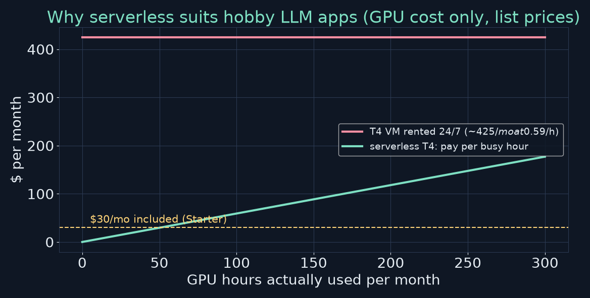
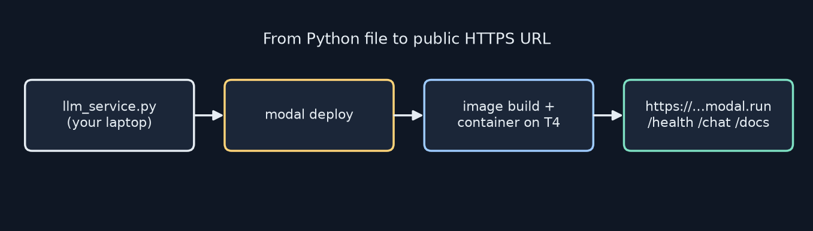
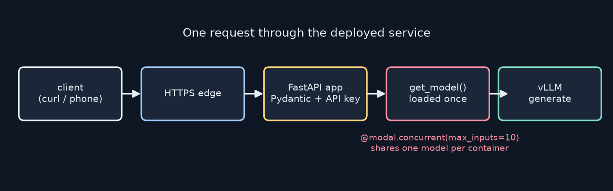
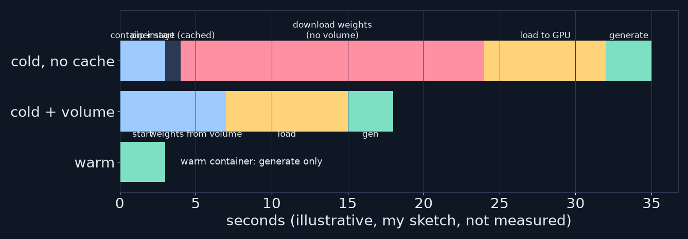

<!-- _class: lead -->
<!-- _paginate: false -->
# Build Your First LLM
## Chapter 17 — Deployment Options
A study companion to *Build Your First LLM* by Hasan Degismez
**Waqar Shaikh Builds**

<!-- say: Welcome to chapter seventeen of my study series on Build Your First LLM by Hasan Degismez. This is the chapter where the project leaves your laptop. We deploy an LLM API to Modal, a serverless GPU platform, using a few decorators and one command. I'll walk through every step, check the prices against Modal's pricing page as of today, and point out two problems in the book's code that would trip you up on a T4 GPU. -->

---

# Where we are

- **Ch 16:** a FastAPI service with validation, logging and rate limits
- **Ch 17 (today):** put it on a GPU in the cloud behind a public URL
- **Ch 18:** where to go next
- Notebook: **FirstLLM/code → notebooks/ch17.ipynb** (prints the files to save; the deploy itself runs from your terminal)

<!-- say: In chapter sixteen we built a production style FastAPI service. Today we put it on a cloud GPU with a public URL. The chapter seventeen notebook doesn't deploy anything itself. It prints the files you save and then run with the modal command line tool. -->

---

# Chapter 17 roadmap

1. What serverless means and why it fits LLMs
2. Hello Modal → add a GPU → add dependencies
3. Web endpoints with FastAPI
4. The full LLM service (vLLM + Qwen2.5-1.5B)
5. Secrets and volumes
6. Choosing a GPU · logs, updates, costs, cold starts
7. Security basics
8. **Fixes the book's code needs** · review

<!-- say: The plan. What serverless means. Three small Modal programs that build up to a GPU. Web endpoints. The full LLM service. Secrets and volumes. Choosing a GPU, logs, costs and cold starts. Security. Then the fixes the book's code needs, and review. -->

---

# Key terms for this chapter

| Term | One-line meaning |
|---|---|
| **Serverless** | You ship code. The platform runs and scales the machines |
| **Container** | A sealed package of OS + Python + libraries |
| **Cold start** | Time to boot a container and load the model |
| **Volume** | Storage that survives container restarts |
| **Secret** | Securely stored environment variables (API keys) |
| **Scaledown window** | Idle time before a container shuts down |

<!-- say: Key terms. Serverless means you ship code and the platform handles machines. A container packages the operating system, Python and your libraries. A cold start is the time to boot one and load the model. A volume is storage that survives restarts. A secret holds keys safely. And the scale down window is how long an idle container stays alive. -->

---

<!-- _class: divider -->
# Part 1
## Why serverless?

<!-- say: Part one. Why serverless at all? -->

---

# Owning a car vs taking a taxi

| Traditional server | Serverless (Modal) |
|---|---|
| Rented 24/7 | Runs only when called |
| Pay while idle | Pay per second of compute |
| You patch and secure it | Platform handles it |
| Fixed capacity | Scales up, and down to zero |

<!-- say: The book's analogy is a car versus a taxi. A traditional server is rented around the clock, you pay while it sits idle and you maintain it. Serverless runs only when a request arrives, bills per second and scales down to zero. -->

---

# The cost picture (list prices, Oct 2026)



- T4 = $0.000164/s ≈ **$0.59/h** · A10 ≈ $1.10/h · H100 ≈ $3.95/h (modal.com/pricing)
- Starter plan includes **$30/month** of compute → ~50 T4-hours *if GPU were the only cost*

<!-- say: I checked Modal's pricing page today. A T4 is about fifty nine cents an hour, an A10 about a dollar ten and an H100 about three ninety five, which matches the book. The starter plan includes thirty dollars of compute a month. That's about fifty T4 hours if the GPU were the only cost. In practice CPU and memory are billed too, so expect a bit less. For a demo used a few hours a month, serverless is far cheaper than a server rented all month. -->

---

# Getting set up

```bash
pip install modal
modal setup        # opens a browser to log in and stores a token
modal --version
```

- The token lives in `~/.modal.toml`. Treat it like a password
- Everything else in this chapter is plain Python

<sub>Code: FirstLLM/code (MIT License)</sub>

<!-- say: Setup is three commands. Install the package, run modal setup, which opens a browser and stores a token on your machine, and check the version. Treat that token like a password. -->

---

<!-- _class: divider -->
# Part 2
## Hello Modal → GPU → dependencies

<!-- say: Part two. Building up in small steps. -->

---

# Hello Modal

```python
import modal
app = modal.App("hello-world")

@app.function()
def hello(name: str) -> str:
    return f"Hello, {name}!"

@app.local_entrypoint()
def main():
    print(hello.remote("World"))
```

`modal run hello.py` → `Hello, World!`

<sub>Code: FirstLLM/code (MIT License)</sub>

<!-- say: The smallest Modal app. Create an app, decorate a function, and call it with dot remote from a local entry point. Modal run starts a container in the cloud, runs the function there and prints the result on your laptop. -->

---

# What actually happened

- `modal.App` = a named group of functions
- `@app.function()` = "run this in Modal's cloud"
- `.remote()` = call it there; `.local()` would run it here
- Modal built a container, ran it, returned the value and shut it down

<!-- say: Four ideas. The app is a named group of functions. The function decorator marks code to run remotely. Dot remote calls it in the cloud, and dot local would run it on your machine. Behind the scenes Modal built a container, ran your code, sent back the value and shut it down. -->

---

# One parameter for a GPU

```python
@app.function(gpu="T4")
def check_gpu():
    import torch
    if torch.cuda.is_available():
        return f"GPU available: {torch.cuda.get_device_name(0)}"
    return "No GPU found"
```

- No CUDA install, no drivers: the platform supplies them
- Imports go **inside** the function: they only need to exist in the container

<sub>Code: FirstLLM/code (MIT License)</sub>

<!-- say: Adding a GPU is one argument. The function imports torch inside its body, because torch only needs to exist inside the container, not on your laptop. On a T4 it reports a Tesla T4. -->

---

# Defining the container image

```python
image = modal.Image.debian_slim(python_version="3.11").pip_install(
    "torch", "transformers", "accelerate")

@app.function(image=image, gpu="T4")
def generate_text():
    from transformers import pipeline
    gen = pipeline("text-generation", model="gpt2", device=0)
    return gen("The meaning of life is", max_length=50)[0]["generated_text"]
```

- First run builds and caches the image. Later runs reuse it
- Tip: pin versions (`torch==…`) so a rebuild next month gives the same image

<sub>Code: FirstLLM/code (MIT License)</sub>

<!-- say: The image says what to install, in Python instead of a Dockerfile. The first run builds and caches it, and later runs reuse it. My tip: pin versions, so a rebuild next month doesn't quietly pull a different torch. -->

---

<!-- _class: divider -->
# Part 3
## Web endpoints

<!-- say: Part three. Giving it a URL. -->

---

# FastAPI on Modal

```python
web_app = FastAPI()

@web_app.get("/health")
def health():
    return {"status": "healthy"}

@app.function()
@modal.asgi_app()
def serve():
    return web_app
```

`modal deploy simple_api.py` → `https://<workspace>--my-api-serve.modal.run`

<sub>Code: FirstLLM/code (MIT License)</sub>

<!-- say: Any FastAPI app can be served by returning it from a function decorated with asgi app. Modal deploy, not modal run, keeps it running and prints a public HTTPS URL built from your workspace, app and function names. -->

---

# `run` vs `deploy`

| `modal run file.py` | `modal deploy file.py` |
|---|---|
| Ephemeral: lives while your terminal does | Persistent: survives closing the laptop |
| Good for testing | Good for sharing |
| Runs `local_entrypoint` | Publishes functions and endpoints |

- Also: `modal serve` = hot-reloading dev URL while you edit

<!-- say: Run is ephemeral and stops when your terminal does. Deploy is persistent and is what you share. There's also modal serve, which gives you a temporary URL that reloads as you edit, handy while developing. -->

---

# The deploy flow



- Open `/docs` for Swagger UI. It's the same FastAPI you ran locally in Ch 16

<!-- say: Here's the whole flow, redrawn. A Python file on your laptop, modal deploy, an image build and a container on a GPU, and a public URL with your health, chat and docs routes. The docs page is the same Swagger interface you used locally in chapter sixteen. -->

---

<!-- _class: divider -->
# Part 4
## The full LLM service

<!-- say: Part four. A real model behind the URL. -->

---

# The image and the model loader

```python
image = modal.Image.debian_slim(python_version="3.11").pip_install(
    "fastapi", "vllm==0.6.4", "torch")
_model = None
def get_model():
    global _model
    if _model is None:
        from vllm import LLM
        _model = LLM(model="Qwen/Qwen2.5-1.5B-Instruct",
                     trust_remote_code=True)
    return _model
```

- **Lazy loading:** the first request pays the load cost. Later ones reuse it

<sub>Code: FirstLLM/code (MIT License)</sub>

<!-- say: The service installs FastAPI and vLLM, a fast inference engine. A global holds the model, and get model loads Qwen two point five, one point five billion, the first time it's called, then reuses it. That's lazy loading. -->

---

# The endpoints

```python
@web_app.post("/chat", response_model=ChatResponse)
def chat(request: ChatRequest):
    model = get_model()
    from vllm import SamplingParams
    out = model.generate([request.message],
                         SamplingParams(max_tokens=request.max_tokens))
    return ChatResponse(response=out[0].outputs[0].text)
```

- Same Pydantic request/response models as Ch 16
- Errors become HTTP 500 with a message

<sub>Code: FirstLLM/code (MIT License), condensed</sub>

<!-- say: The chat endpoint takes a validated request, generates with vLLM and returns a validated response, the same Pydantic pattern as chapter sixteen. Exceptions become an HTTP five hundred. -->

---

# The function decorators

```python
@app.function(image=image, gpu="T4", timeout=300,
              scaledown_window=300)      # stay warm 5 min
@modal.concurrent(max_inputs=10)          # 10 requests per container
@modal.asgi_app()
def serve():
    return web_app
```



<sub>Code: FirstLLM/code (MIT License)</sub>

<!-- say: The decorators set the image, the GPU, a five minute timeout and a five minute scale down window. Concurrent with ten inputs lets one container, and one loaded model, serve ten requests at once. vLLM batches them together on the GPU. -->

---

# Fix 1: T4 can't do bfloat16

- Qwen2.5 ships in **bfloat16**; the T4 (compute capability 7.5) doesn't support it
- vLLM 0.6.x then refuses to start: *"Bfloat16 is only supported on GPUs with compute capability of at least 8.0"* (vLLM issue #9990, Qwen2.5 on T4)

```python
_model = LLM(model="Qwen/Qwen2.5-1.5B-Instruct", dtype="half",
             max_model_len=4096)
```

- Or pick an `L4`/`A10` (bf16-capable) GPU

<!-- say: Here's the first fix the book's code needs. Qwen two point five is stored in bfloat sixteen, and a T4 doesn't support that format. vLLM version zero point six refuses to start with an error saying bfloat sixteen needs compute capability eight. There's a public vLLM issue showing exactly this with Qwen two point five on a T4. The fix is dtype half. I'd also cap the context length so the cache fits in sixteen gigabytes. Or choose an L4 or A10, which support bfloat sixteen. -->

---

# Fix 2: prompts need the chat template

- `model.generate(["What is Python?"])` feeds raw text to an **Instruct** model
- Without its chat template, replies ramble or continue your text
- vLLM has a chat helper:

```python
out = model.chat([{"role": "user", "content": request.message}], params)
```

<!-- say: The second issue is quality rather than a crash. The service passes the raw message to an instruct model with no chat template, so it tends to ramble or just continue your sentence. vLLM's chat method applies the model's template for you. I'd use that. -->

---

# Testing the deployment

```bash
curl https://<your-url>.modal.run/health
curl -X POST https://<your-url>.modal.run/chat \
     -H "Content-Type: application/json" \
     -d '{"message": "What is Python?"}'
```

- The first call after idle is a **cold start** (tens of seconds)
- Or click through `/docs`

<sub>Code: FirstLLM/code (MIT License)</sub>

<!-- say: Test with curl: the health route, then a chat post with a JSON body. Expect the first call after the app has been idle to take a while. That's a cold start. Or use the docs page. -->

---

<!-- _class: divider -->
# Part 5
## Secrets and volumes

<!-- say: Part five. Keys and caches. -->

---

# Secrets: never hard-code keys

```bash
modal secret create my-secrets API_KEY=...
```

```python
@app.function(secrets=[modal.Secret.from_name("my-secrets")])
def with_secrets():
    import os
    api_key = os.environ["API_KEY"]
```

- Same idea as Ch 16's `.env`, but stored server-side
- Attach the secret to **`serve`** so the endpoint can read it

<sub>Code: FirstLLM/code (MIT License)</sub>

<!-- say: Create a secret once from the command line or the dashboard. Attach it to a function, and it appears as an environment variable. One detail: to protect the chat endpoint, attach the secret to the serve function itself, otherwise the API key check never sees a key. -->

---

# Volumes: cache the weights

```python
model_cache = modal.Volume.from_name("model-cache", create_if_missing=True)

@app.function(gpu="T4",
              volumes={"/root/.cache/huggingface": model_cache})
def with_cache(): ...
```

- Mount it on the Hugging Face cache path → download once, reuse after every cold start
- 1 TiB/month of volume storage is included (pricing page)

<sub>Code: FirstLLM/code (MIT License)</sub>

<!-- say: A volume mounted at the Hugging Face cache folder means the weights download once and every later cold start reads them from the volume. Mount it on the serve function too, not only a demo function. -->

---

<!-- _class: divider -->
# Part 6
## GPUs, costs, cold starts

<!-- say: Part six. Running it sensibly. -->

---

# Choosing a GPU

| GPU | Memory | bf16? | ~$/h | Good for |
|---|---|---|---|---|
| T4 | 16 GB | ✗ | 0.59 | ≤3B models in fp16 |
| L4 | 24 GB | ✓ | 0.80 | the same models, bf16, faster |
| A10 | 24 GB | ✓ | 1.10 | 7B in fp16 |
| A100 40/80 | 40/80 GB | ✓ | 2.10 / 2.50 | 13B+ |
| H100 | 80 GB | ✓ | 3.95 | big and fast |

- Rule of thumb: fp16 weights ≈ **2 bytes × params**, plus KV cache

<!-- say: Here's my table from the current pricing page. The T4 is cheapest but lacks bfloat sixteen. An L4 costs a little more, supports it and is faster, which makes it a good default for small models. A rough memory rule: two bytes per parameter in half precision, plus room for the KV cache. A one and a half billion model needs about three gigabytes for weights. -->

---

# Cold starts



- Cache weights in a volume · keep warm with `scaledown_window` · accept some for hobby apps

<!-- say: A cold start is boot time, plus downloading weights, plus loading them onto the GPU. This is my sketch, not a measurement. A volume removes the download, and a longer scale down window keeps a container warm between requests, at a cost. For a hobby project, an occasional slow first request is fine. -->

---

# Logs, updates, cost control

- `modal app logs my-llm-service` or the dashboard. Ch 16's JSONL logs show up there
- Redeploy = `modal deploy` again (rolling update)
- Scale to zero after the window · start on a small GPU
- **Set a workspace budget:** Starter usage beyond $30 is pay-as-you-go

<!-- say: Logs stream from the command line or the dashboard, and your chapter sixteen JSON logs appear there unchanged. Updating is just deploying again. For cost, let it scale to zero and start small. One correction: the book says you'll get an email before any charges. Modal's pricing page says usage beyond the thirty dollars is pay as you go, so set a workspace budget if you want a hard cap. -->

---

<!-- _class: divider -->
# Part 7
## Security basics

<!-- say: Part seven. Your API is public. -->

---

# The API-key check, and a subtle bug

```python
@web_app.post("/chat")
def chat(request: ChatRequest, x_api_key: str = Header()):
    if API_KEY and x_api_key != API_KEY:
        raise HTTPException(401, "Invalid API key")
```

- `Header()` with no default makes the header **required**: without it you get **422**, even when no key is configured (I tested this)
- Fix: `x_api_key: str | None = Header(default=None)`

<sub>Code: FirstLLM/code (MIT License)</sub>

<!-- say: The book's API key check has a small trap. Header with no default makes the header required, so any request without it gets a four twenty two validation error, even when no key is set. I tested it with FastAPI's test client. Give it a default of None, and then the code behaves as the book describes. -->

---

# The rest of the checklist

- HTTPS is automatic on `*.modal.run`
- Reuse Ch 16's rate limiter and Pydantic/regex validation
- Cap `max_tokens` in the request model (`le=512`) so one call can't run up your GPU bill
- Note: the in-memory rate limiter is **per container**. Multiple containers each count separately

<!-- say: The rest. HTTPS is automatic. Reuse your rate limiter and validation. Put an upper limit on max tokens, so a single request can't run your GPU for minutes. And remember that an in memory rate limiter counts per container, so if Modal scales to three containers, each has its own count. -->

---

# Not Modal? Other routes

- **Docker + a VPS** (book's Appendix E): full control, but you pay 24/7 and patch it yourself
- **Hugging Face Spaces / Inference Endpoints:** quick demos and managed endpoints
- **Local + tunnel** (Ollama + a tunnel): free, but only while your machine is on
- Same FastAPI app everywhere. Only the wrapper changes

<!-- say: Modal isn't the only route. The book's appendix covers Docker on a rented server, which gives full control but costs money around the clock. Hugging Face Spaces and inference endpoints are good for demos. And a local model plus a tunnel is free but only works while your machine is on. The nice thing is that your FastAPI app is the same everywhere. Only the wrapper changes. -->

---

<!-- _class: divider -->
# Part 8
## Review

<!-- say: Part eight. Review. -->

---

# Review questions: short answers

1. **Serverless?** You pay per second and it scales to zero, which suits spiky LLM traffic
2. **GPU?** `@app.function(gpu="T4")`
3. **Cold start?** Boot + load. Cut it with volumes, warm windows, smaller models
4. **Volumes?** Keep weights between containers → no re-download
5. **No traffic?** After `scaledown_window` it scales to zero → $0 GPU

<!-- say: Short answers. Serverless bills per second and scales to zero, perfect for spiky traffic. A GPU is one argument. A cold start is boot plus model load, reduced by volumes and warm windows. Volumes keep weights between containers. And with no traffic, the app scales to zero and costs nothing. -->

---

# Checkpoint exercise, my version

1. Deploy Hello World → then `gpu="L4"` and confirm CUDA
2. Deploy the LLM service **with `dtype="half"` or on L4**, a volume, and `model.chat`
3. Hit `/health` and `/chat` from your phone
4. Add the secret to `serve` and the `Header(default=None)` fix
5. Set a budget in the dashboard before sharing the URL

<!-- say: My version of the checkpoint. Deploy hello world, then a GPU function. Deploy the service with half precision or on an L4, a volume and the chat method. Test from your phone. Add the API key secret with the header fix. And set a budget before you share the link. -->

---

# Practice this

- Deploy `simple_api.py`, then time cold vs warm `/health`
- Swap Qwen for your own Ch 12 MiniGPT behind the same FastAPI routes
- Compare T4 fp16 vs L4 bf16 tokens/second for $1 of credit

<!-- say: Practice: deploy the simple API and time a cold versus a warm request. Swap in your own chapter twelve model behind the same routes. And compare tokens per second per dollar on a T4 and an L4. -->

---

# Credits

Based on ***Build Your First LLM*** by **Hasan Degismez** — buy the book: **leanpub.com/FirstLLM/**
Code: **github.com/FirstLLM/code** (MIT License) · notebook ch17.ipynb
Prices: modal.com/pricing (checked 28 Oct 2026) · Slides, narration and diagrams: my own · **Waqar Shaikh Builds**

<!-- say: This video is based on Build Your First LLM by Hasan Degismez. The explanations and diagrams are my own, but the book goes deeper, so please support the author and buy it at leanpub dot com slash First LLM. The code is on GitHub at First LLM slash code, under the MIT licence. Thanks for watching, and see you in the final chapter. -->
