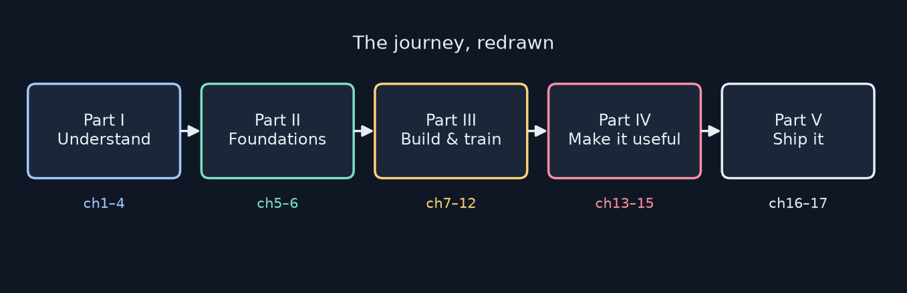
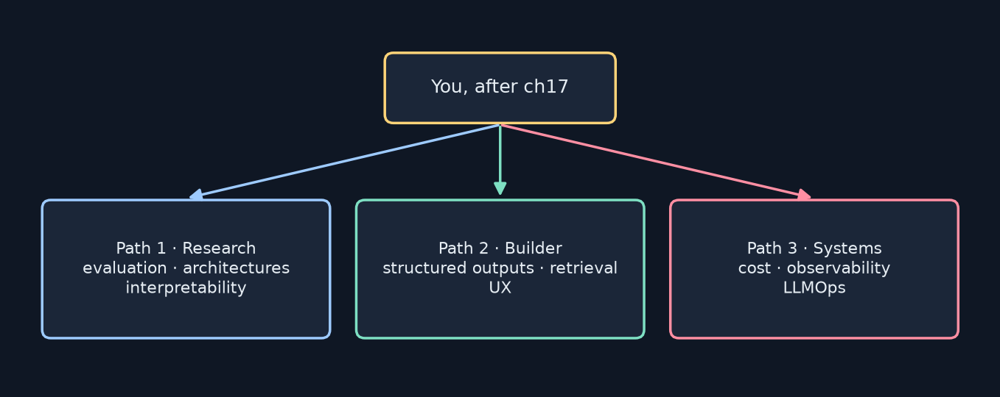
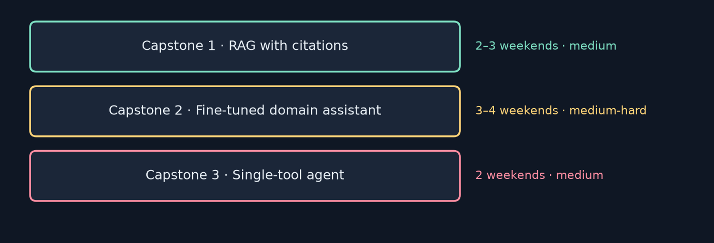

<!-- _class: lead -->
<!-- _paginate: false -->
# Build Your First LLM
## Chapter 18 — What's Next
A study companion to *Build Your First LLM* by Hasan Degismez
**Waqar Shaikh Builds**

<!-- say: Welcome to the final chapter of my study series on Build Your First LLM by Hasan Degismez. There's no new model code here. Instead we look back at what we built, talk about building responsibly, and map out three paths and three concrete capstone projects for the next six to twelve months. I'll also share what this series taught me from running every notebook on a plain CPU, including the bugs we found along the way. -->

---

# Where we are

- **Ch 1–17:** from "what is AI?" to a deployed LLM API
- **Ch 18 (today):** consolidate, take responsibility, pick a next project
- Notebook: **FirstLLM/code → notebooks/ch18.ipynb**: a skills checklist and starter templates

<!-- say: We've gone from what is AI all the way to a deployed API. Today we consolidate and choose what to build next. The chapter eighteen notebook is a skills checklist, a learning plan and two starter templates. -->

---

# Chapter 18 roadmap

1. What you built: the journey in five parts
2. Skills checklist
3. The bigger picture: responsible building
4. Three paths forward
5. Three capstone projects
6. Community and resources · reading papers
7. My lessons from running every notebook
8. Review and a final checklist

<!-- say: The plan. The journey in five parts. A skills checklist. Responsible building. Three paths. Three capstones. Communities and how to read a paper. My own lessons from this series. And a final checklist. -->

---

# Key terms for this chapter

| Term | One-line meaning |
|---|---|
| **MLOps / LLMOps** | Running ML or LLM apps in production: versioning, eval, monitoring |
| **Quantization** | Fewer bits per weight → less memory and compute |
| **Structured outputs** | Constraining replies to JSON or function calls |
| **Sparse attention** | Attend to a subset of tokens, not all pairs |
| **Mixture of experts** | Route each token to a few specialist sub-networks |
| **Interpretability** | Explaining why a model produced an output |

<!-- say: Some terms for the road. MLOps and LLMOps mean running models in production. Quantization stores weights with fewer bits. Structured outputs force JSON or function calls. Sparse attention skips most token pairs. Mixture of experts routes each token to a few specialists. And interpretability asks why the model did what it did. -->

---

<!-- _class: divider -->
# Part 1
## What you built

<!-- say: Part one. Look how far we've come. -->

---

# The journey

- Theory → foundations → a model from scratch → useful apps → shipped

<!-- say: Here's the journey, redrawn in five parts. Understanding in chapters one to four. Python and tensors in five and six. Data, tokenizer, embeddings, attention, the transformer and training in seven to twelve. Fine tuning, prompting and applications in thirteen to fifteen. Production and deployment in sixteen and seventeen. -->

---

# Part by part

- **I:** embeddings, attention, the Transformer: *why* it works
- **II:** Python, NumPy, PyTorch tensors and autograd
- **III:** clean data → BPE tokens → embeddings → MiniGPT → trained on Shakespeare
- **IV:** LoRA fine-tuning, prompt engineering, RAG and tools
- **V:** FastAPI with validation and logging → GPU deployment on Modal

<!-- say: Part one gave us the why. Part two the tools. Part three the model itself, built piece by piece and trained. Part four made it useful with LoRA, prompting, retrieval and tools. And part five shipped it behind a validated, logged API on a cloud GPU. -->

---

# Skills checklist

| Theory | Building | Production |
|---|---|---|
| Embeddings as vectors | Prepare and clean data | FastAPI + validation + logs |
| Why attention matters | Train a network from scratch | Deploy on a GPU |
| Why models hallucinate | Fine-tune with LoRA | Secrets, costs, scaling |
| | RAG for outside knowledge | |

- The notebook starts at **0/14**: flip each to `True` honestly

<!-- say: The checklist, in three columns: theory, building and production. The notebook starts you at zero out of fourteen and asks you to flip each one honestly. If you followed the exercises, most should be true. If one isn't, that tells you which chapter to revisit. -->

---

# These are the real skills

- Frontier labs use the same fundamentals: tokenization, attention, training loops, APIs
- Their models are bigger and their infrastructure is harder, but the ideas are the same
- You understand them because you **built** them, and debugged them

<!-- say: These aren't toy skills. Frontier labs use the same fundamentals at a much bigger scale. And you understand them because you built them. Sometimes you fixed them too, as we'll see in a moment. -->

---

<!-- _class: divider -->
# Part 2
## The bigger picture

<!-- say: Part two. Building responsibly. -->

---

# Responsibility is good engineering

- The best teams ask "what could go wrong?" **before** deploying
- It isn't a brake on your work: it's the same habit as testing
- Three areas to question: **data**, **outputs**, **transparency**

<!-- say: The author frames responsibility as good engineering, and I agree. Asking what could go wrong before you deploy is the same habit as writing tests. There are three areas to question: your data, your outputs and your transparency. -->

---

# Questions to ask every time

| Data | Outputs | Transparency |
|---|---|---|
| Where did it come from? | Could it produce harm? | Do users know it's AI? |
| Licensed for this use? | What if a hallucination is believed? | Are decisions logged? |
| What biases might it carry? | Validating inputs, moderating outputs? | Can you trace a failure? |

<!-- say: Here they are as a grid. For data: where did it come from, is it licensed, what biases does it carry. For outputs: could it cause harm, what if someone believes a hallucination, are you validating and moderating. For transparency: do users know it's AI, are you logging, can you trace a failure. -->

---

# Where we practised this

- **Ch 7:** sourcing, licences, cleaning, PII
- **Ch 15:** guardrails and tests for an application
- **Ch 16:** input validation, JSONL logging, rate limits
- **Ch 17:** secrets, API keys, budgets
- Ethics is a practice you keep up, not a box you tick once

<!-- say: We practised these along the way. Data sourcing in chapter seven. Guardrails in fifteen. Validation, logging and rate limits in sixteen. Secrets and keys in seventeen. The book says ethics is a practice you maintain, not a checklist you complete. One small correction: it credits chapter seventeen with audit trails, but logging was really chapter sixteen. -->

---

# Your next system *will* fail sometimes

- RAG retrieves the wrong passage and answers confidently
- Fine-tunes inherit dataset bias · agents call the wrong tool
- So: **set expectations · add guardrails · log everything · test for bias · give users an escape hatch**

<!-- say: Whatever you build next will fail sometimes. Retrieval will grab the wrong passage. Fine tunes will inherit bias. Agents will call the wrong tool. So set expectations, add guardrails, log everything, test on diverse inputs and let users report problems or override the AI. The goal is failing gracefully, not perfection. -->

---

<!-- _class: divider -->
# Part 3
## Three paths forward

<!-- say: Part three. Where to go from here. -->

---

# Pick a direction for 6–12 months

<!-- say: Three directions for the next six to twelve months. Research, builder and systems. It's not a permanent career choice, and many people move between them. -->

---

# Path 1 · Deeper technical (research)

- **For you if** you want to know *why* models work
- **Next:** better evaluation (human, adversarial, real benchmarks) · sparse attention, MoE, state-space models · interpretability
- **Builds on:** Ch 10 (attention), Ch 12 (training), Ch 15 (evaluation)
- **Start with:** "Attention Is All You Need", interpretability research blogs, Stanford CS324

<!-- say: Path one is research. Learn evaluation beyond loss and perplexity, architecture variants like sparse attention, mixture of experts and state space models, and interpretability. The book says this builds on chapter six, but six is the NumPy and PyTorch chapter. Training is chapter twelve and evaluation is in chapter fifteen. Start with the original transformer paper, which you can now actually read. -->

---

# Path 2 · Product and applications (builder)

- **For you if** you want to make things people use
- **Next:** structured outputs · hybrid search, re-ranking, query expansion · streaming and graceful failure
- **Builds on:** Ch 14 (prompting), Ch 15 (RAG + tools)
- **Start with:** the Hugging Face NLP course, LangChain / LlamaIndex docs, a vendor prompt guide

<!-- say: Path two is the builder. Reliable JSON and function calls, better retrieval with hybrid search and re ranking, and the user experience of streaming and graceful failure. The book points to chapter fourteen for RAG and fifteen for tools. In fact, both RAG and tool use are in chapter fifteen, and fourteen is prompting. -->

---

# Path 3 · Production and infrastructure (systems)

- **For you if** you want things reliable at scale
- **Next:** quantization, caching, batching · dashboards, alerts, tracing · prompt versioning, A/B tests, eval pipelines
- **Builds on:** Ch 16 (APIs), Ch 17 (deployment)
- **Start with:** vLLM / SGLang docs, Modal guides, the MLOps Community

<!-- say: Path three is systems. Make inference cheap with quantization, caching and batching. Make it observable with dashboards and tracing. And run it like software with prompt versioning, A B tests and evaluation pipelines. This builds on chapters sixteen and seventeen. -->

---

# Combine them

- Depth to pick the right model and know its limits
- Product sense to build something wanted
- Production skill to keep it running
- **Go deep on one, stay competent in the others**

<!-- say: Real projects need all three: technical depth, product sense and production skill. Pick one to go deep on and stay competent in the other two. -->

---

<!-- _class: divider -->
# Part 4
## Your first solo project

<!-- say: Part four. Stop reading, start building. -->

---

# Three capstones

<!-- say: The book offers three capstones, each sized for a few weekends. RAG with citations. A fine tuned domain assistant. And a single tool agent. -->

---

# Capstone 1 · RAG with citations

1. Collect 50–100 documents on a topic you care about
2. Chunk and embed (**Ch 15**'s RAG section)
3. Retrieve **with source links** in every answer
4. Wrap in Ch 16's API → deploy with Ch 17
5. Grade 20 questions by hand: accurate *and* correctly cited?

- **Stretch:** hybrid search, adding BM25 to embeddings

<!-- say: Capstone one: a RAG system over your own documents. Collect a corpus, chunk and embed it using chapter fifteen's RAG section, which the book labels chapter fourteen, return sources with every answer, wrap it in the API and deploy it. Then grade twenty questions by hand. The stretch goal is hybrid search with BM25. -->

---

# Capstone 2 · Fine-tuned domain assistant

1. Pick a domain you know
2. Curate **500–1,000** instruction/response pairs (Ch 7 quality rules)
3. QLoRA-tune a ~7B model (Ch 13 ideas, PEFT + bitsandbytes)
4. Build 20 test questions the generic model gets wrong
5. Compare, then deploy

- **Stretch:** DPO (preference optimisation)

<!-- say: Capstone two: a domain assistant. Curate five hundred to a thousand clean examples, QLoRA tune a seven billion model using chapter thirteen's ideas with the PEFT library, test on twenty questions the base model fails, compare and deploy. The stretch is DPO, which learns from preferred versus rejected answers. -->

---

# Capstone 3 · Single-tool agent

1. One tool (a calculator is easiest)
2. Clear input/output schema
3. Structured-output tool selection
4. 20 tests: 10 need the tool, 10 don't
5. Target **19/20** correct decisions · validate tool I/O

- The starter template uses `eval`. **Swap in a real expression parser**

<!-- say: Capstone three: an agent with exactly one tool. Define its schema, decide with structured outputs, and test twenty cases, half needing the tool. Aim for nineteen out of twenty. One warning from the notebook's own starter: its calculator uses eval with empty built ins. That still isn't safe, so use a proper math parser. -->

---

# How to choose

- Consolidate what you learned → **Capstone 1**
- Learn something new (dataset curation) → **Capstone 2**
- Have the most fun → **Capstone 3**
- The only wrong choice is not starting

<!-- say: How to pick. To consolidate, do the RAG system. To learn something new, do fine tuning. For fun, build the agent. The only wrong choice is analysis paralysis. -->

---

# A four-weekend plan (any capstone)

| Weekend | Goal | Done when |
|---|---|---|
| 1 | Data + a 20-question test set | You can score a baseline |
| 2 | Core pipeline (retrieve / tune / tool call) | Baseline beaten on ≥5 questions |
| 3 | API + logging + guardrails (Ch 16) | `/health` and tests pass |
| 4 | Deploy (Ch 17) + write-up | A URL and a README with numbers |

<!-- say: Here's a plan I'd use for any of the three. Weekend one: data and a twenty question test set, so you have a baseline score. Weekend two: the core pipeline, beating the baseline. Weekend three: the API, logging and guardrails. Weekend four: deploy and write it up with real numbers. -->

---

# Measure it like Ch 15

- Fix your test set **before** you tune anything
- Report: accuracy, citation correctness, latency, $ per 1,000 requests
- Keep a failure log: every wrong answer with its cause
- Compare against a baseline (no RAG / no fine-tune / no tool)

<!-- say: Measure it the way chapter fifteen taught. Freeze the test set before tuning. Report accuracy, citation correctness, latency and cost per thousand requests. Keep a log of every failure and its cause. And always compare against a baseline without the feature. -->

---

# Make it portfolio-ready

- A README: problem → approach → numbers → limits
- A 2-minute demo video or GIF
- The live URL **with a budget cap** and an API key for heavy endpoints
- An honest "what didn't work" section: reviewers love it

<!-- say: Make it portfolio ready. A README that goes from problem to approach to numbers to limitations. A short demo video. A live URL with a budget cap. And an honest section on what didn't work, which is often the most impressive part. -->

---

<!-- _class: divider -->
# Part 5
## Community and resources

<!-- say: Part five. You don't have to learn alone. -->

---

# Where to keep learning

| Gentle start | When confident | Join in |
|---|---|---|
| Hugging Face NLP/LLM course | Stanford CS324 | Hugging Face Discord |
| r/LocalLLaMA | Original papers (Transformer, LoRA) | MLOps Community |
| A vendor prompt-engineering guide | DeepLearning.AI short courses | Open-source PRs: docs, bugs, examples |

<!-- say: Resources by comfort level. Start with the Hugging Face course and the local LLaMA community. When you're confident, Stanford's CS324 and the original papers. Then join the Hugging Face Discord or MLOps community, and contribute small things to open source: docs, bug reports, examples. -->

---

# How to read an ML paper

1. Abstract and conclusion first: what's the claim?
2. The figures: they usually carry the idea
3. Skip the maths on the first pass
4. The experiments: what did they actually test?
5. Related work last

<!-- say: The book's method for reading papers. Abstract and conclusion first. Then the figures. Skip the maths the first time. Focus on what the experiments actually tested. And read related work last. -->

---

<!-- _class: divider -->
# Part 6
## My lessons from this series

<!-- say: Part six. What running every notebook taught me. -->

---

# Run the code, and read your logs

- **Ch 11:** loaded GPT-2 produced "foxeseseses" → missing attention biases + GELU variant. Fixed to 6e-5 of HF
- **Ch 12:** `ignore_index=0` ignores `!`, not padding (pad = 50256). Real CPU numbers were nowhere near the printed ones
- **Ch 13:** LoRA counts and A/B naming didn't match the code
- **Ch 17:** T4 + bf16 Qwen won't start in vLLM 0.6.x without `dtype="half"`
- Every row is in **ERRATA.md** in my repo

<!-- say: My biggest lesson: run the code and read your own logs. In chapter eleven, loaded GPT-2 wrote foxes es es es, because of missing attention biases and the wrong GELU. In chapter twelve, the loss ignored the exclamation mark instead of padding. In thirteen, the LoRA counts and naming didn't match the code. In seventeen, a T4 can't run bfloat sixteen. Every one of these is in the errata file in my repository. None of it takes away from the book. Finding these is how I actually learned the material. -->

---

# Where your MiniGPT sits

| Model | Params | Trained on | What it can do |
|---|---|---|---|
| MiniGPT (Ch 12, CPU) | 16 M | 338k Shakespeare tokens | Shakespeare-shaped noise |
| GPT-2 small (Ch 11 load) | 124 M | ~40 GB web text | Fluent but unreliable |
| Llama 3.2 3B (Ch 14–16, Ollama) | 3.2 B | trillions of tokens + tuning | Useful assistant on a laptop |

- Same architecture family; the difference is mostly **scale + data + tuning**

<!-- say: Here's where our own model sits. Our sixteen million parameter MiniGPT, trained on a third of a million Shakespeare tokens, writes Shakespeare shaped noise. GPT-2 small, which we loaded in chapter eleven, is fluent but unreliable. Llama three point two, three billion parameters, which we ran locally through Ollama for chapters fourteen to sixteen, is a genuinely useful assistant. It's the same family of architecture. The difference is scale, data and tuning. -->

---

# The series by the numbers

- **18** chapters · **14** notebooks run on a CPU
- Chapters 1–17: **5 h 49 min** of walkthroughs · **67 errata** logged in ERRATA.md, each one tested
- Every slide, diagram and narration: my own words; all code © FirstLLM/code (MIT)

<!-- say: The series by the numbers. Eighteen chapters, and fourteen notebooks run on an ordinary CPU. The first seventeen videos add up to about five hours and fifty minutes. Along the way I logged sixty seven errata, every one checked by running code. That's not a criticism of the book: checking a book against running code is the best way to learn from it, and I'd encourage you to do the same. -->

---

# What I'd do next

- Re-train MiniGPT with the Ch 12 fixes on a bigger corpus (TinyStories) for ~1 GPU-hour
- LoRA-tune Llama 3.2 1B on my own FAQ, then evaluate it as in Ch 15
- Deploy it on an L4 with `dtype` set explicitly and a $5 budget

<!-- say: What I'd do next myself. Retrain MiniGPT with the chapter twelve fixes on a bigger corpus such as TinyStories, for about an hour of GPU. LoRA tune Llama three point two on my own FAQ and evaluate it properly. And deploy it on an L4 with a small budget cap. -->

---

# Review questions: my answers

1. **Three paths:** research · builder · systems
2. **Why ongoing?** Data, users and models change, and so do failure modes
3. **My capstone:** RAG with citations, because it uses the most chapters
4. **Next resources:** the LoRA paper, then vLLM's docs
5. **Most surprising:** how much behaviour hides in one argument (`ignore_index`, `bias=False`)

<!-- say: My answers to the review questions. The three paths are research, builder and systems. Responsibility is ongoing because data, users and models all change. My capstone is the RAG system. My next reads are the LoRA paper and vLLM's documentation. And what surprised me most is how much behaviour hides in a single argument. -->

---

# Final checklist

- ☐ Score yourself on the 14 skills
- ☐ Choose **one** capstone and start this week
- ☐ Bookmark **one** resource for tomorrow
- ☐ Share your deployed URL with someone

> "Now go build something." The author's closing line, and the right one

<!-- say: Before you close the book: score the fourteen skills, choose one capstone and start this week, bookmark one resource, and share your deployed URL. The author ends with a personal note. He's a backend developer who wrote the book to teach himself how LLMs work, and his closing line is "now go build something". -->

---

# Credits and thank you

Based on ***Build Your First LLM*** by **Hasan Degismez** — buy the book: **leanpub.com/FirstLLM/**
Code: **github.com/FirstLLM/code** (MIT License) · notebook ch18.ipynb
Whole series (slides, notes, errata): github.com/waqarys/Courses · branch build-your-first-llm · **Waqar Shaikh Builds**

<!-- say: This series is based on Build Your First LLM by Hasan Degismez. The explanations and diagrams are my own, but the book is the real thing, so please support the author and buy it at leanpub dot com slash First LLM. The code is on GitHub at First LLM slash code, under the MIT licence. All my slides, notes and the errata for the series are in my Courses repository. Thank you for watching the whole series. Now go build something. -->
